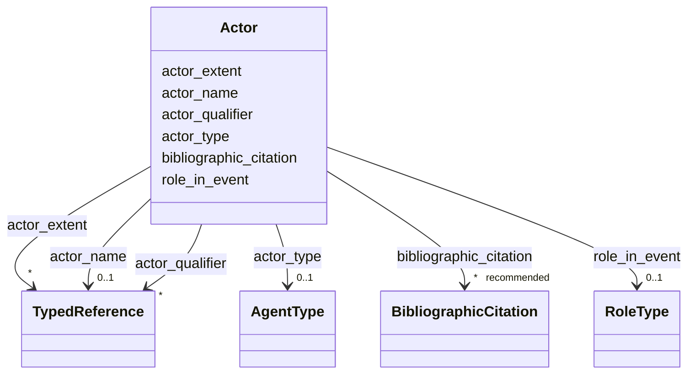

---
search:
  boost: 10.0
---

# Class: Actor


_Agent and role in an event._


<div data-search-exclude markdown="1">


URI: [wasth:Actor](https://tradicional.arq.br/schema/Actor)





<!-- no inheritance hierarchy -->

## Slots

| Name | Cardinality and Range | Description | Inheritance |
| ---  | --- | --- | --- |
| [bibliographic_citation](bibliographic_citation.md) | * _recommended_ <br/> [BibliographicCitation](BibliographicCitation.md) | Cadastro de uma referência bibliográfica | direct |
| [actor_type](actor_type.md) | 0..1 <br/> [AgentType](AgentType.md) | Define se o agente é uma pessoa, uma organização ou corporação, uma oficina, ... | direct |
| [actor_name](actor_name.md) | 0..1 <br/> [TypedReference](TypedReference.md) | Nome do agente extraído de um vocabulário controlado | direct |
| [role_in_event](role_in_event.md) | 0..1 <br/> [RoleType](RoleType.md) | Ação desempenhada pelo agente no evento | direct |
| [actor_qualifier](actor_qualifier.md) | * <br/> [TypedReference](TypedReference.md) | For the Attribution Qualifier Actor element choose a concept URI from the [at... | direct |
| [actor_extent](actor_extent.md) | * <br/> [TypedReference](TypedReference.md) | Parte da obra sobre a qual o agente interveio | direct |


## Usages

| used by | used in | type | used |
| ---  | --- | --- | --- |
| [Event](Event.md) | [actor_role](actor_role.md) | range | [Actor](Actor.md) |


## Identifier and Mapping Information


### Schema Source


* from schema: https://tradicional.arq.br/schema


## Mappings

| Mapping Type | Mapped Value |
| ---  | ---  |
| self | wasth:Actor |
| native | wasth:Actor |


## LinkML Source

<!-- TODO: investigate https://stackoverflow.com/questions/37606292/how-to-create-tabbed-code-blocks-in-mkdocs-or-sphinx -->

### Direct

<details>
```yaml
name: Actor
description: Agent and role in an event.
from_schema: https://tradicional.arq.br/schema
slots:
- bibliographic_citation
attributes:
  actor_type:
    name: actor_type
    description: 'Define se o agente é uma pessoa, uma organização ou corporação,
      uma oficina, uma família, etc.

      '
    from_schema: https://tradicional.arq.br/schema/temporal
    rank: 1000
    ifabsent: AgentType(personal)
    alias: type
    domain_of:
    - Actor
    range: AgentType
  actor_name:
    name: actor_name
    description: Nome do agente extraído de um vocabulário controlado.
    from_schema: https://tradicional.arq.br/schema/temporal
    rank: 1000
    alias: name
    domain_of:
    - Actor
    range: TypedReference
    inlined: true
  role_in_event:
    name: role_in_event
    description: Ação desempenhada pelo agente no evento.
    from_schema: https://tradicional.arq.br/schema/temporal
    rank: 1000
    domain_of:
    - Actor
    range: RoleType
  actor_qualifier:
    name: actor_qualifier
    description: 'For the Attribution Qualifier Actor element choose a concept URI
      from the [attribution qualifiers hierarchy](http://vocab.getty.edu/hier/aat/300404264)
      of the Art & Architecture Thesaurus, or another linked open vocabulary.

      '
    from_schema: https://tradicional.arq.br/schema/temporal
    rank: 1000
    alias: qualifier
    domain_of:
    - Actor
    range: TypedReference
    multivalued: true
    inlined_as_list: true
  actor_extent:
    name: actor_extent
    description: Parte da obra sobre a qual o agente interveio.
    from_schema: https://tradicional.arq.br/schema/temporal
    rank: 1000
    alias: extent
    domain_of:
    - Actor
    range: TypedReference
    multivalued: true
    inlined_as_list: true

```
</details>

### Induced

<details>
```yaml
name: Actor
description: Agent and role in an event.
from_schema: https://tradicional.arq.br/schema
attributes:
  actor_type:
    name: actor_type
    description: 'Define se o agente é uma pessoa, uma organização ou corporação,
      uma oficina, uma família, etc.

      '
    from_schema: https://tradicional.arq.br/schema/temporal
    rank: 1000
    ifabsent: AgentType(personal)
    alias: type
    owner: Actor
    domain_of:
    - Actor
    range: AgentType
  actor_name:
    name: actor_name
    description: Nome do agente extraído de um vocabulário controlado.
    from_schema: https://tradicional.arq.br/schema/temporal
    rank: 1000
    alias: name
    owner: Actor
    domain_of:
    - Actor
    range: TypedReference
    inlined: true
  role_in_event:
    name: role_in_event
    description: Ação desempenhada pelo agente no evento.
    from_schema: https://tradicional.arq.br/schema/temporal
    rank: 1000
    owner: Actor
    domain_of:
    - Actor
    range: RoleType
  actor_qualifier:
    name: actor_qualifier
    description: 'For the Attribution Qualifier Actor element choose a concept URI
      from the [attribution qualifiers hierarchy](http://vocab.getty.edu/hier/aat/300404264)
      of the Art & Architecture Thesaurus, or another linked open vocabulary.

      '
    from_schema: https://tradicional.arq.br/schema/temporal
    rank: 1000
    alias: qualifier
    owner: Actor
    domain_of:
    - Actor
    range: TypedReference
    multivalued: true
    inlined: true
    inlined_as_list: true
  actor_extent:
    name: actor_extent
    description: Parte da obra sobre a qual o agente interveio.
    from_schema: https://tradicional.arq.br/schema/temporal
    rank: 1000
    alias: extent
    owner: Actor
    domain_of:
    - Actor
    range: TypedReference
    multivalued: true
    inlined: true
    inlined_as_list: true
  bibliographic_citation:
    name: bibliographic_citation
    description: 'Cadastro de uma referência bibliográfica.

      Usar o campo `description` para formatar a referência, caso a formatação automática
      do Zotero não for satisfatória.

      '
    from_schema: https://tradicional.arq.br/schema
    rank: 1000
    slot_uri: dcterms:bibliographicCitation
    owner: Actor
    domain_of:
    - ConceptReference
    - RelatedObject
    - MediaObject
    - TypedReference
    - Measurement
    - Actor
    - Thing
    - Appellation
    - GeographicPoint
    - GeographicExtent
    - Inscription
    range: BibliographicCitation
    recommended: true
    multivalued: true
    inlined: true
    inlined_as_list: true

```
</details></div>
