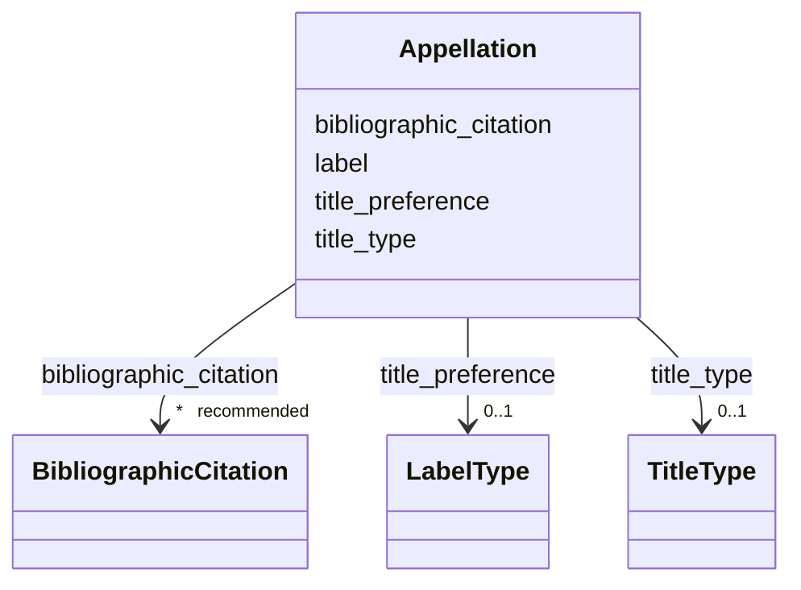

---
search:
  boost: 10.0
---

# Class: Appellation 

<div data-search-exclude markdown="1">


URI: [wasth:Appellation](https://tradicional.arq.br/schema/Appellation)





<!-- no inheritance hierarchy -->

## Slots

| Name | Cardinality and Range | Description | Inheritance |
| ---  | --- | --- | --- |
| [title_type](title_type.md) | 0..1 <br/> [TitleType](TitleType.md) | Indica se o título é um nome próprio, descritivo, etc | direct |
| [bibliographic_citation](bibliographic_citation.md) | * _recommended_ <br/> [BibliographicCitation](BibliographicCitation.md) | 📚  Cadastro de uma referência bibliográfica | direct |
| [title_preference](title_preference.md) | 0..1 <br/> [LabelType](LabelType.md) | Indica se o nome em questão deve ser oculto ou não, se é uma versão alternati... | direct |
| [label](label.md) | 0..1 <br/> [String](String.md) | Nome ou título (texto sem formatação) | direct |


## Usages

| used by | used in | type | used |
| ---  | --- | --- | --- |
| [Concept](Concept.md) | [alt_name](alt_name.md) | range | [Appellation](Appellation.md) |
| [Resource](Resource.md) | [alt_name](alt_name.md) | range | [Appellation](Appellation.md) |
| [Event](Event.md) | [alt_name](alt_name.md) | range | [Appellation](Appellation.md) |
| [Thing](Thing.md) | [alt_name](alt_name.md) | range | [Appellation](Appellation.md) |
| [Repository](Repository.md) | [alt_name](alt_name.md) | range | [Appellation](Appellation.md) |
| [Work](Work.md) | [alt_name](alt_name.md) | range | [Appellation](Appellation.md) |
| [Site](Site.md) | [alt_name](alt_name.md) | range | [Appellation](Appellation.md) |


## Identifier and Mapping Information


### Schema Source


* from schema: https://tradicional.arq.br/schema


## Mappings

| Mapping Type | Mapped Value |
| ---  | ---  |
| self | wasth:Appellation |
| native | wasth:Appellation |


## LinkML Source

<!-- TODO: investigate https://stackoverflow.com/questions/37606292/how-to-create-tabbed-code-blocks-in-mkdocs-or-sphinx -->

### Direct

<details>
```yaml
name: Appellation
from_schema: https://tradicional.arq.br/schema
slots:
- title_type
- bibliographic_citation
slot_usage:
  title_type:
    name: title_type
    ifabsent: TitleType(descriptive)
    range: TitleType
attributes:
  title_preference:
    name: title_preference
    description: Indica se o nome em questão deve ser oculto ou não, se é uma versão
      alternativa ou uma variante de grafia, etc.
    from_schema: https://tradicional.arq.br/schema/thing
    rank: 1000
    ifabsent: LabelType(alternative)
    alias: label_type
    domain_of:
    - Appellation
    range: LabelType
  label:
    name: label
    description: Nome ou título (texto sem formatação).
    from_schema: https://tradicional.arq.br/schema/thing
    rank: 1000
    domain_of:
    - Appellation
    range: string

```
</details>

### Induced

<details>
```yaml
name: Appellation
from_schema: https://tradicional.arq.br/schema
slot_usage:
  title_type:
    name: title_type
    ifabsent: TitleType(descriptive)
    range: TitleType
attributes:
  title_preference:
    name: title_preference
    description: Indica se o nome em questão deve ser oculto ou não, se é uma versão
      alternativa ou uma variante de grafia, etc.
    from_schema: https://tradicional.arq.br/schema/thing
    rank: 1000
    ifabsent: LabelType(alternative)
    alias: label_type
    owner: Appellation
    domain_of:
    - Appellation
    range: LabelType
  label:
    name: label
    description: Nome ou título (texto sem formatação).
    from_schema: https://tradicional.arq.br/schema/thing
    rank: 1000
    owner: Appellation
    domain_of:
    - Appellation
    range: string
  title_type:
    name: title_type
    description: Indica se o título é um nome próprio, descritivo, etc.
    from_schema: https://tradicional.arq.br/schema
    rank: 1000
    ifabsent: TitleType(descriptive)
    owner: Appellation
    domain_of:
    - Concept
    - Resource
    - Appellation
    - Repository
    - Site
    range: TitleType
  bibliographic_citation:
    name: bibliographic_citation
    description: '📚  Cadastro de uma referência bibliográfica.

      O campo `refid` deve conter a chave de citação (citation key) que consta do
      registro bibliográfico na biblioteca do nosso projeto de pesquisa no Zotero,
      começando com arroba @. Em geral, a chave de citação é o DOI ou ISBN da publicação,
      mas pode ser diferente.

      Se necessário, incluir no campo `note` uma especificação adicional, como o número
      da página da referência bibliográfica de onde a informação foi extraída.

      Usar o campo `description` para formatar a referência, caso a formatação automática
      do Zotero não for satisfatória.

      '
    from_schema: https://tradicional.arq.br/schema
    rank: 1000
    slot_uri: dcterms:bibliographicCitation
    owner: Appellation
    domain_of:
    - ConceptReference
    - RelatedObject
    - MediaObject
    - TypedReference
    - Measurement
    - Actor
    - Thing
    - Appellation
    - GeographicPoint
    - GeographicExtent
    - Inscription
    range: BibliographicCitation
    recommended: true
    multivalued: true
    inlined: true
    inlined_as_list: true

```
</details></div>