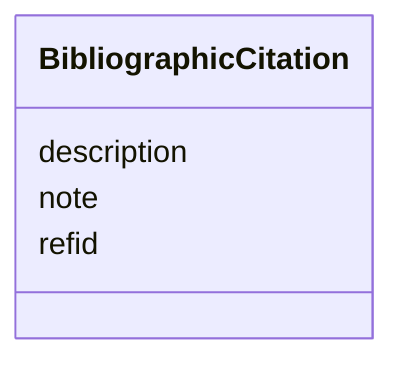

---
search:
  boost: 10.0
---

# Class: BibliographicCitation


_Cadastro de uma referência bibliográfica._

_Usar o campo `description` para formatar a referência, caso a formatação_

_automática não for satisfatória._

__


<div data-search-exclude markdown="1">


URI: [schema:CreativeWork](http://schema.org/CreativeWork)





<!-- no inheritance hierarchy -->

## Class Properties

| Property | Value |
| --- | --- |
| Class URI | [schema:CreativeWork](http://schema.org/CreativeWork) |


## Slots

| Name | Cardinality and Range | Description | Inheritance |
| ---  | --- | --- | --- |
| [description](description.md) | 0..1 <br/> [String](String.md) | A human-readable description for a thing | direct |
| [refid](refid.md) | 1 <br/> [CslCitekey](CslCitekey.md) | Se a fonte for cadastrada, o campo `refid` deve conter a chave de | direct |
| [note](note.md) | 0..1 <br/> [String](String.md) | Se necessário, incluir no campo `note` uma especificação adicional, | direct |


## Usages

| used by | used in | type | used |
| ---  | --- | --- | --- |
| [Concept](Concept.md) | [bibliographic_citation](bibliographic_citation.md) | range | [BibliographicCitation](BibliographicCitation.md) |
| [Concept](Concept.md) | [title_source](title_source.md) | range | [BibliographicCitation](BibliographicCitation.md) |
| [ConceptReference](ConceptReference.md) | [bibliographic_citation](bibliographic_citation.md) | range | [BibliographicCitation](BibliographicCitation.md) |
| [Place](Place.md) | [bibliographic_citation](bibliographic_citation.md) | range | [BibliographicCitation](BibliographicCitation.md) |
| [Place](Place.md) | [title_source](title_source.md) | range | [BibliographicCitation](BibliographicCitation.md) |
| [Site](Site.md) | [bibliographic_citation](bibliographic_citation.md) | range | [BibliographicCitation](BibliographicCitation.md) |
| [Site](Site.md) | [title_source](title_source.md) | range | [BibliographicCitation](BibliographicCitation.md) |
| [GeographicPoint](GeographicPoint.md) | [bibliographic_citation](bibliographic_citation.md) | range | [BibliographicCitation](BibliographicCitation.md) |
| [GeographicExtent](GeographicExtent.md) | [bibliographic_citation](bibliographic_citation.md) | range | [BibliographicCitation](BibliographicCitation.md) |
| [TypedReference](TypedReference.md) | [bibliographic_citation](bibliographic_citation.md) | range | [BibliographicCitation](BibliographicCitation.md) |
| [Measurements](Measurements.md) | [bibliographic_citation](bibliographic_citation.md) | range | [BibliographicCitation](BibliographicCitation.md) |
| [MaterialTech](MaterialTech.md) | [bibliographic_citation](bibliographic_citation.md) | range | [BibliographicCitation](BibliographicCitation.md) |
| [RelatedObject](RelatedObject.md) | [bibliographic_citation](bibliographic_citation.md) | range | [BibliographicCitation](BibliographicCitation.md) |
| [RelatedWork](RelatedWork.md) | [bibliographic_citation](bibliographic_citation.md) | range | [BibliographicCitation](BibliographicCitation.md) |
| [Resource](Resource.md) | [bibliographic_citation](bibliographic_citation.md) | range | [BibliographicCitation](BibliographicCitation.md) |
| [Resource](Resource.md) | [title_source](title_source.md) | range | [BibliographicCitation](BibliographicCitation.md) |
| [Media](Media.md) | [bibliographic_citation](bibliographic_citation.md) | range | [BibliographicCitation](BibliographicCitation.md) |
| [Event](Event.md) | [bibliographic_citation](bibliographic_citation.md) | range | [BibliographicCitation](BibliographicCitation.md) |
| [Event](Event.md) | [title_source](title_source.md) | range | [BibliographicCitation](BibliographicCitation.md) |
| [Actor](Actor.md) | [bibliographic_citation](bibliographic_citation.md) | range | [BibliographicCitation](BibliographicCitation.md) |
| [StylePeriod](StylePeriod.md) | [bibliographic_citation](bibliographic_citation.md) | range | [BibliographicCitation](BibliographicCitation.md) |
| [Thing](Thing.md) | [bibliographic_citation](bibliographic_citation.md) | range | [BibliographicCitation](BibliographicCitation.md) |
| [Thing](Thing.md) | [title_source](title_source.md) | range | [BibliographicCitation](BibliographicCitation.md) |
| [Appellation](Appellation.md) | [bibliographic_citation](bibliographic_citation.md) | range | [BibliographicCitation](BibliographicCitation.md) |
| [Repository](Repository.md) | [bibliographic_citation](bibliographic_citation.md) | range | [BibliographicCitation](BibliographicCitation.md) |
| [Repository](Repository.md) | [title_source](title_source.md) | range | [BibliographicCitation](BibliographicCitation.md) |
| [Work](Work.md) | [bibliographic_citation](bibliographic_citation.md) | range | [BibliographicCitation](BibliographicCitation.md) |
| [Work](Work.md) | [title_source](title_source.md) | range | [BibliographicCitation](BibliographicCitation.md) |
| [Inscription](Inscription.md) | [bibliographic_citation](bibliographic_citation.md) | range | [BibliographicCitation](BibliographicCitation.md) |


## Identifier and Mapping Information


### Schema Source


* from schema: https://tradicional.arq.br/schema


## Mappings

| Mapping Type | Mapped Value |
| ---  | ---  |
| self | schema:CreativeWork |
| native | wasth:BibliographicCitation |


## LinkML Source

<!-- TODO: investigate https://stackoverflow.com/questions/37606292/how-to-create-tabbed-code-blocks-in-mkdocs-or-sphinx -->

### Direct

<details>
```yaml
name: BibliographicCitation
description: 'Cadastro de uma referência bibliográfica.

  Usar o campo `description` para formatar a referência, caso a formatação

  automática não for satisfatória.

  '
from_schema: https://tradicional.arq.br/schema
slots:
- description
attributes:
  refid:
    name: refid
    description: 'Se a fonte for cadastrada, o campo `refid` deve conter a chave de

      citação (`citation key`) que consta do registro bibliográfico na

      biblioteca do nosso projeto de pesquisa no [Zotero].

      Em geral, a chave de citação é o DOI ou ISBN da publicação, mas pode

      ser diferente.

      '
    from_schema: https://tradicional.arq.br/schema/resource
    domain_of:
    - TypedReference
    - BibliographicCitation
    range: CslCitekey
    required: true
  note:
    name: note
    description: 'Se necessário, incluir no campo `note` uma especificação adicional,

      como o número da página da referência bibliográfica de onde a

      informação foi extraída.

      '
    from_schema: https://tradicional.arq.br/schema/resource
    rank: 1000
    domain_of:
    - BibliographicCitation
    range: string
class_uri: schema:CreativeWork

```
</details>

### Induced

<details>
```yaml
name: BibliographicCitation
description: 'Cadastro de uma referência bibliográfica.

  Usar o campo `description` para formatar a referência, caso a formatação

  automática não for satisfatória.

  '
from_schema: https://tradicional.arq.br/schema
attributes:
  refid:
    name: refid
    description: 'Se a fonte for cadastrada, o campo `refid` deve conter a chave de

      citação (`citation key`) que consta do registro bibliográfico na

      biblioteca do nosso projeto de pesquisa no [Zotero].

      Em geral, a chave de citação é o DOI ou ISBN da publicação, mas pode

      ser diferente.

      '
    from_schema: https://tradicional.arq.br/schema/resource
    owner: BibliographicCitation
    domain_of:
    - TypedReference
    - BibliographicCitation
    range: CslCitekey
    required: true
  note:
    name: note
    description: 'Se necessário, incluir no campo `note` uma especificação adicional,

      como o número da página da referência bibliográfica de onde a

      informação foi extraída.

      '
    from_schema: https://tradicional.arq.br/schema/resource
    rank: 1000
    owner: BibliographicCitation
    domain_of:
    - BibliographicCitation
    range: string
  description:
    name: description
    description: A human-readable description for a thing
    from_schema: https://tradicional.arq.br/schema
    rank: 1000
    slot_uri: dcterms:description
    alias: display
    owner: BibliographicCitation
    domain_of:
    - ConceptReference
    - Measurements
    - BibliographicCitation
    - RelatedObject
    - Media
    - EventDate
    - EventPlace
    - RelatedEvent
    - Thing
    - Appellation
    - Inscription
    - Topic
    range: string
class_uri: schema:CreativeWork

```
</details></div>
