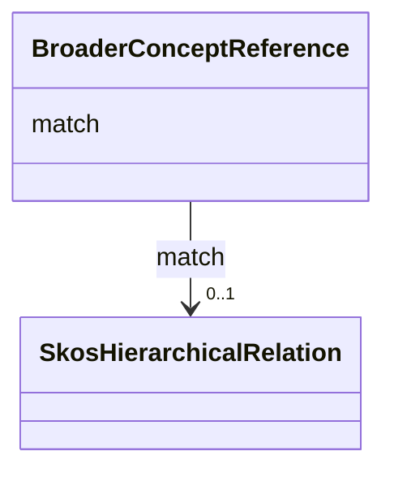

---
search:
  boost: 10.0
---

# Class: BroaderConceptReference


_Relações hierárquicas._


<div data-search-exclude markdown="1">


URI: [wasth:BroaderConceptReference](https://tradicional.arq.br/schema/BroaderConceptReference)





<!-- no inheritance hierarchy -->

## Slots

| Name | Cardinality and Range | Description | Inheritance |
| ---  | --- | --- | --- |
| [match](match.md) | 0..1 <br/> [SkosHierarchicalRelation](SkosHierarchicalRelation.md) | Tipo da relação | direct |


## Usages

| used by | used in | type | used |
| ---  | --- | --- | --- |
| [Concept](Concept.md) | [broader](broader.md) | range | [BroaderConceptReference](BroaderConceptReference.md) |


## Identifier and Mapping Information


### Schema Source


* from schema: https://tradicional.arq.br/schema


## Mappings

| Mapping Type | Mapped Value |
| ---  | ---  |
| self | wasth:BroaderConceptReference |
| native | wasth:BroaderConceptReference |


## LinkML Source

<!-- TODO: investigate https://stackoverflow.com/questions/37606292/how-to-create-tabbed-code-blocks-in-mkdocs-or-sphinx -->

### Direct

<details>
```yaml
name: BroaderConceptReference
description: Relações hierárquicas.
from_schema: https://tradicional.arq.br/schema
attributes:
  match:
    name: match
    description: Tipo da relação.
    from_schema: https://tradicional.arq.br/schema/concept
    rank: 1000
    domain_of:
    - BroaderConceptReference
    - RelatedConceptReference
    range: SkosHierarchicalRelation

```
</details>

### Induced

<details>
```yaml
name: BroaderConceptReference
description: Relações hierárquicas.
from_schema: https://tradicional.arq.br/schema
attributes:
  match:
    name: match
    description: Tipo da relação.
    from_schema: https://tradicional.arq.br/schema/concept
    rank: 1000
    owner: BroaderConceptReference
    domain_of:
    - BroaderConceptReference
    - RelatedConceptReference
    range: SkosHierarchicalRelation

```
</details></div>
