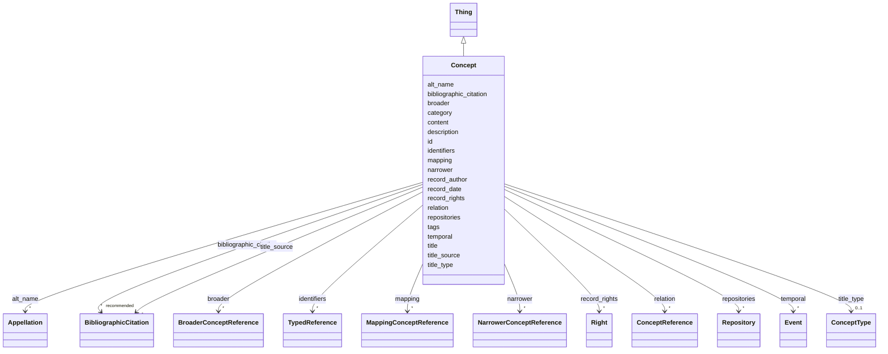

---
search:
  boost: 10.0
---

# Class: Concept 


_Um conceito é uma unidade de conhecimento ou entendimento delimitada e definida com clareza, distinta de outros conceitos. Cada conceito pretende descrever um aspecto ou recorte da realidade empírica ou teórica, de modo que a sua definição seja amplamente conhecida e partilhada dentro do campo disciplinar ao qual ele pertence._

_Para além da clareza na definição do próprio conceito, estabelecer a sua relação com outros conceitos mais gerais ou mais específicos é importante ao se constituir um vocabulário controlado._

_Por isso, a definição de cada conceito DEVE se referir a bibliografia consagrada e, sempre que possível, a outros vocabulários controlados nacionais e estrangeiros._

_-------------------------------------------------------------------------_

_A SKOS concept can be viewed as an idea or notion; a unit of thought. However, what constitutes a unit of thought is subjective, and this definition is meant to be suggestive, rather than restrictive._

_The notion of a SKOS concept is useful when describing the conceptual or intellectual structure of a knowledge organization system, and when referring to specific ideas or meanings established within a KOS._

_Note that, because SKOS is designed to be a vehicle for representing semi-formal KOS, such as thesauri and classification schemes, a certain amount of flexibility has been built in to the formal definition of this class._

__


<div data-search-exclude markdown="1">


URI: [skos:Concept](http://www.w3.org/2004/02/skos/core#Concept)





## Inheritance
* [Thing](Thing.md)
    * **Concept**


## Class Properties

| Property | Value |
| --- | --- |
| Class URI | [skos:Concept](http://www.w3.org/2004/02/skos/core#Concept) |


## Slots

| Name | Cardinality and Range | Description | Inheritance |
| ---  | --- | --- | --- |
| [title_type](title_type.md) | 0..1 <br/> [ConceptType](ConceptType.md) | Indica se o título é um nome próprio, descritivo, etc | direct |
| [broader](broader.md) | * <br/> [BroaderConceptReference](BroaderConceptReference.md) | Um conceito de significação mais genérica | direct |
| [narrower](narrower.md) | * <br/> [NarrowerConceptReference](NarrowerConceptReference.md) | Um conceito de significação mais específica | direct |
| [mapping](mapping.md) | * <br/> [MappingConceptReference](MappingConceptReference.md) | Um conceito com o qual existe um relacionamento semântico associativo | direct |
| [relation](relation.md) | * <br/> [ConceptReference](ConceptReference.md) | Um conceito com o qual existe um relacionamento semântico associativo | direct |
| [description](description.md) | 1 <br/> [String](String.md) | A human-readable description for a thing | [Thing](Thing.md) |
| [bibliographic_citation](bibliographic_citation.md) | * _recommended_ <br/> [BibliographicCitation](BibliographicCitation.md) | 📚  Cadastro de uma referência bibliográfica | [Thing](Thing.md) |
| [content](content.md) | 0..1 _recommended_ <br/> [String](String.md) | Conteúdo textual descritivo ou explicativo | [Thing](Thing.md) |
| [id](id.md) | 1 <br/> [Uriorcurie](Uriorcurie.md) | Identificador globalmente único para este objeto ou recurso | [Thing](Thing.md) |
| [record_author](record_author.md) | 0..1 <br/> [OrcidId](OrcidId.md) | ORCID iD da pessoa que escreveu a versão original da ficha | [Thing](Thing.md) |
| [record_date](record_date.md) | 0..1 <br/> [Date](Date.md) | Data de inclusão da ficha | [Thing](Thing.md) |
| [title](title.md) | 1 <br/> [String](String.md) | Nome pelo qual este item é mais comumente conhecido | [Thing](Thing.md) |
| [title_source](title_source.md) | * <br/> [BibliographicCitation](BibliographicCitation.md) | A fonte do título title_source é opcional ; um título pode ser atestado em ma... | [Thing](Thing.md) |
| [alt_name](alt_name.md) | * <br/> [Appellation](Appellation.md) | O bloco `alt_name` permite cadastrar outros nomes pelos quais o objeto ou con... | [Thing](Thing.md) |
| [category](category.md) | 1 <br/> [Uriorcurie](Uriorcurie.md) | Uma classificação ampla para o objeto descrito na ficha, usando o vocabulário... | [Thing](Thing.md) |
| [identifiers](identifiers.md) | * <br/> [TypedReference](TypedReference.md) | Números de inventário e demais códigos que identificam este objeto em outras ... | [Thing](Thing.md) |
| [tags](tags.md) | * <br/> [String](String.md) | Lista de palavras-chave que caracterizam o objeto, de modo não estruturado | [Thing](Thing.md) |
| [temporal](temporal.md) | * <br/> [Event](Event.md) | Descrição dos eventos associados ao ciclo de vida da edificação ou à existênc... | [Thing](Thing.md) |
| [repositories](repositories.md) | * <br/> [Repository](Repository.md) | Nos Documentários da Arquitetura Tradicional, usamos repositórios para indica... | [Thing](Thing.md) |
| [record_rights](record_rights.md) | * <br/> [Right](Right.md) | Informações estruturadas sobre os direitos que incidem sobre o conteúdo textu... | [Thing](Thing.md) |


## Usages

| used by | used in | type | used |
| ---  | --- | --- | --- |
| [Container](Container.md) | [concepts](concepts.md) | range | [Concept](Concept.md) |
| [ConceptReference](ConceptReference.md) | [concept](concept.md) | range | [Concept](Concept.md) |
| [BroaderConceptReference](BroaderConceptReference.md) | [concept](concept.md) | range | [Concept](Concept.md) |
| [NarrowerConceptReference](NarrowerConceptReference.md) | [concept](concept.md) | range | [Concept](Concept.md) |
| [MappingConceptReference](MappingConceptReference.md) | [concept](concept.md) | range | [Concept](Concept.md) |
| [MaterialTech](MaterialTech.md) | [concept](concept.md) | range | [Concept](Concept.md) |
| [StylePeriod](StylePeriod.md) | [concept](concept.md) | range | [Concept](Concept.md) |
| [Topic](Topic.md) | [concept](concept.md) | range | [Concept](Concept.md) |


## Identifier and Mapping Information


### Schema Source


* from schema: https://tradicional.arq.br/schema


## Mappings

| Mapping Type | Mapped Value |
| ---  | ---  |
| self | skos:Concept |
| native | wasth:Concept |
| exact | schema:DefinedTerm |


## LinkML Source

<!-- TODO: investigate https://stackoverflow.com/questions/37606292/how-to-create-tabbed-code-blocks-in-mkdocs-or-sphinx -->

### Direct

<details>
```yaml
name: Concept
description: 'Um conceito é uma unidade de conhecimento ou entendimento delimitada
  e definida com clareza, distinta de outros conceitos. Cada conceito pretende descrever
  um aspecto ou recorte da realidade empírica ou teórica, de modo que a sua definição
  seja amplamente conhecida e partilhada dentro do campo disciplinar ao qual ele pertence.

  Para além da clareza na definição do próprio conceito, estabelecer a sua relação
  com outros conceitos mais gerais ou mais específicos é importante ao se constituir
  um vocabulário controlado.

  Por isso, a definição de cada conceito DEVE se referir a bibliografia consagrada
  e, sempre que possível, a outros vocabulários controlados nacionais e estrangeiros.

  -------------------------------------------------------------------------

  A SKOS concept can be viewed as an idea or notion; a unit of thought. However, what
  constitutes a unit of thought is subjective, and this definition is meant to be
  suggestive, rather than restrictive.

  The notion of a SKOS concept is useful when describing the conceptual or intellectual
  structure of a knowledge organization system, and when referring to specific ideas
  or meanings established within a KOS.

  Note that, because SKOS is designed to be a vehicle for representing semi-formal
  KOS, such as thesauri and classification schemes, a certain amount of flexibility
  has been built in to the formal definition of this class.

  '
from_schema: https://tradicional.arq.br/schema
exact_mappings:
- schema:DefinedTerm
is_a: Thing
slots:
- title_type
slot_usage:
  title_type:
    name: title_type
    ifabsent: ConceptType(concept)
    range: ConceptType
attributes:
  broader:
    name: broader
    description: 'Um conceito de significação mais genérica. Conceitos genéricos são
      tipicamente representados como pais em uma hierarquia de conceitos (árvore).

      Preenchimento manual.'
    from_schema: https://tradicional.arq.br/schema/concept
    rank: 1000
    slot_uri: skos:broader
    domain_of:
    - Concept
    inverse: narrower
    range: BroaderConceptReference
    multivalued: true
    inlined_as_list: true
  narrower:
    name: narrower
    description: 'Um conceito de significação mais específica. Conceitos específicos
      são tipicamente representados como descendentes em uma hierarquia de conceitos
      (árvore).

      Derivado automaticamente das relações `broader` em outras fichas. NÃO preencher
      manualmente.'
    from_schema: https://tradicional.arq.br/schema/concept
    rank: 1000
    slot_uri: skos:narrower
    domain_of:
    - Concept
    inverse: broader
    range: NarrowerConceptReference
    multivalued: true
    inlined_as_list: true
  mapping:
    name: mapping
    description: Um conceito com o qual existe um relacionamento semântico associativo.
      Usar em referência a vocabulários externos, como o Getty Art and Architecture
      Thesaurus.
    from_schema: https://tradicional.arq.br/schema/concept
    rank: 1000
    domain_of:
    - Concept
    range: MappingConceptReference
    multivalued: true
    inlined_as_list: true
  relation:
    name: relation
    description: Um conceito com o qual existe um relacionamento semântico associativo.
      Usar em referência ao nosso próprio vocabulário controlado.
    from_schema: https://tradicional.arq.br/schema/concept
    rank: 1000
    slot_uri: skos:related
    domain_of:
    - Concept
    range: ConceptReference
    multivalued: true
    inlined_as_list: true
class_uri: skos:Concept

```
</details>

### Induced

<details>
```yaml
name: Concept
description: 'Um conceito é uma unidade de conhecimento ou entendimento delimitada
  e definida com clareza, distinta de outros conceitos. Cada conceito pretende descrever
  um aspecto ou recorte da realidade empírica ou teórica, de modo que a sua definição
  seja amplamente conhecida e partilhada dentro do campo disciplinar ao qual ele pertence.

  Para além da clareza na definição do próprio conceito, estabelecer a sua relação
  com outros conceitos mais gerais ou mais específicos é importante ao se constituir
  um vocabulário controlado.

  Por isso, a definição de cada conceito DEVE se referir a bibliografia consagrada
  e, sempre que possível, a outros vocabulários controlados nacionais e estrangeiros.

  -------------------------------------------------------------------------

  A SKOS concept can be viewed as an idea or notion; a unit of thought. However, what
  constitutes a unit of thought is subjective, and this definition is meant to be
  suggestive, rather than restrictive.

  The notion of a SKOS concept is useful when describing the conceptual or intellectual
  structure of a knowledge organization system, and when referring to specific ideas
  or meanings established within a KOS.

  Note that, because SKOS is designed to be a vehicle for representing semi-formal
  KOS, such as thesauri and classification schemes, a certain amount of flexibility
  has been built in to the formal definition of this class.

  '
from_schema: https://tradicional.arq.br/schema
exact_mappings:
- schema:DefinedTerm
is_a: Thing
slot_usage:
  title_type:
    name: title_type
    ifabsent: ConceptType(concept)
    range: ConceptType
attributes:
  broader:
    name: broader
    description: 'Um conceito de significação mais genérica. Conceitos genéricos são
      tipicamente representados como pais em uma hierarquia de conceitos (árvore).

      Preenchimento manual.'
    from_schema: https://tradicional.arq.br/schema/concept
    rank: 1000
    slot_uri: skos:broader
    owner: Concept
    domain_of:
    - Concept
    inverse: narrower
    range: BroaderConceptReference
    multivalued: true
    inlined: true
    inlined_as_list: true
  narrower:
    name: narrower
    description: 'Um conceito de significação mais específica. Conceitos específicos
      são tipicamente representados como descendentes em uma hierarquia de conceitos
      (árvore).

      Derivado automaticamente das relações `broader` em outras fichas. NÃO preencher
      manualmente.'
    from_schema: https://tradicional.arq.br/schema/concept
    rank: 1000
    slot_uri: skos:narrower
    owner: Concept
    domain_of:
    - Concept
    inverse: broader
    range: NarrowerConceptReference
    multivalued: true
    inlined: true
    inlined_as_list: true
  mapping:
    name: mapping
    description: Um conceito com o qual existe um relacionamento semântico associativo.
      Usar em referência a vocabulários externos, como o Getty Art and Architecture
      Thesaurus.
    from_schema: https://tradicional.arq.br/schema/concept
    rank: 1000
    owner: Concept
    domain_of:
    - Concept
    range: MappingConceptReference
    multivalued: true
    inlined: true
    inlined_as_list: true
  relation:
    name: relation
    description: Um conceito com o qual existe um relacionamento semântico associativo.
      Usar em referência ao nosso próprio vocabulário controlado.
    from_schema: https://tradicional.arq.br/schema/concept
    rank: 1000
    slot_uri: skos:related
    owner: Concept
    domain_of:
    - Concept
    range: ConceptReference
    multivalued: true
    inlined: true
    inlined_as_list: true
  title_type:
    name: title_type
    description: Indica se o título é um nome próprio, descritivo, etc.
    from_schema: https://tradicional.arq.br/schema
    rank: 1000
    ifabsent: ConceptType(concept)
    owner: Concept
    domain_of:
    - Concept
    - Resource
    - Appellation
    - Repository
    - Site
    range: ConceptType
  description:
    name: description
    description: A human-readable description for a thing
    from_schema: https://tradicional.arq.br/schema
    exact_mappings:
    - schema:description
    rank: 1000
    slot_uri: dcterms:description
    alias: display
    owner: Concept
    domain_of:
    - ConceptReference
    - BibliographicCitation
    - RelatedObject
    - MediaObject
    - TypedReference
    - Measurement
    - RelatedEvent
    - Thing
    - Inscription
    - Topic
    range: string
    required: true
  bibliographic_citation:
    name: bibliographic_citation
    description: '📚  Cadastro de uma referência bibliográfica.

      O campo `refid` deve conter a chave de citação (citation key) que consta do
      registro bibliográfico na biblioteca do nosso projeto de pesquisa no Zotero,
      começando com arroba @. Em geral, a chave de citação é o DOI ou ISBN da publicação,
      mas pode ser diferente.

      Se necessário, incluir no campo `note` uma especificação adicional, como o número
      da página da referência bibliográfica de onde a informação foi extraída.

      Usar o campo `description` para formatar a referência, caso a formatação automática
      do Zotero não for satisfatória.

      '
    from_schema: https://tradicional.arq.br/schema
    rank: 1000
    slot_uri: dcterms:bibliographicCitation
    owner: Concept
    domain_of:
    - ConceptReference
    - RelatedObject
    - MediaObject
    - TypedReference
    - Measurement
    - Actor
    - Thing
    - Appellation
    - GeographicPoint
    - GeographicExtent
    - Inscription
    range: BibliographicCitation
    recommended: true
    multivalued: true
    inlined: true
    inlined_as_list: true
  content:
    name: content
    description: Conteúdo textual descritivo ou explicativo.
    from_schema: https://tradicional.arq.br/schema
    rank: 1000
    slot_uri: skos:scopeNote
    owner: Concept
    domain_of:
    - Thing
    - Inscription
    range: string
    recommended: true
  id:
    name: id
    description: 'Identificador globalmente único para este objeto ou recurso.

      '
    from_schema: https://tradicional.arq.br/schema/thing
    rank: 1000
    slot_uri: dcterms:identifier
    identifier: true
    owner: Concept
    domain_of:
    - Thing
    range: uriorcurie
    required: true
  record_author:
    name: record_author
    description: 'ORCID iD da pessoa que escreveu a versão original da ficha. Alterar
      apenas no caso de a ficha ter sido substancialmente reescrita.

      '
    from_schema: https://tradicional.arq.br/schema/thing
    rank: 1000
    slot_uri: dcterms:contributor
    alias: author
    owner: Concept
    domain_of:
    - Thing
    range: OrcidId
  record_date:
    name: record_date
    description: Data de inclusão da ficha.
    from_schema: https://tradicional.arq.br/schema/thing
    rank: 1000
    slot_uri: dcterms:created
    alias: date
    owner: Concept
    domain_of:
    - Thing
    range: date
  title:
    name: title
    description: 'Nome pelo qual este item é mais comumente conhecido. Outros nomes
      podem ser cadastrados em `alt_name`.

      '
    from_schema: https://tradicional.arq.br/schema/thing
    exact_mappings:
    - schema:name
    rank: 1000
    slot_uri: dcterms:title
    owner: Concept
    domain_of:
    - Thing
    range: string
    required: true
  title_source:
    name: title_source
    description: A fonte do título title_source é opcional ; um título pode ser atestado
      em mais de uma fonte, por isso este campo é uma lista de itens (cada item começa
      com um hífen).
    from_schema: https://tradicional.arq.br/schema/thing
    rank: 1000
    owner: Concept
    domain_of:
    - Thing
    range: BibliographicCitation
    multivalued: true
    inlined: true
    inlined_as_list: true
  alt_name:
    name: alt_name
    description: 'O bloco `alt_name` permite cadastrar outros nomes pelos quais o
      objeto ou conceito será eventualmente conhecido. É uma lista opcional de itens,
      e se existir, os campos de cada item da lista devem ser preenchidos como os
      do título principal.

      O campo `label` ou `description` de cada item contém o texto do título (nome).

      Este bloco pode ser omitido por completo se não houver títulos alternativos.

      '
    from_schema: https://tradicional.arq.br/schema/thing
    rank: 1000
    owner: Concept
    domain_of:
    - Thing
    range: Appellation
    multivalued: true
    inlined: true
    inlined_as_list: true
  category:
    name: category
    description: 'Uma classificação ampla para o objeto descrito na ficha, usando
      o vocabulário controlado do LIDO.

      Nos documentários de edificações, preencher este campo OBRIGATORIAMENTE com
      `term:lido00096` ("Objeto manufaturado").

      No vocabulário controlado, preencher este campo OBRIGATORIAMENTE com `term:lido01193`
      ("Objeto conceitual").

      ---------------------------------------------------------------------

      The LIDO Category Vocabulary is a structured controlled list of terms recommended
      to use as values in the LIDO Category element.

      Examples are human-made object or natural object.'
    from_schema: https://tradicional.arq.br/schema/thing
    rank: 1000
    slot_uri: term:lidoCategory
    designates_type: true
    owner: Concept
    domain_of:
    - Thing
    range: uriorcurie
    required: true
  identifiers:
    name: identifiers
    description: "Números de inventário e demais códigos que identificam este objeto\
      \ em outras bases de dados.\nCaso esta edificação esteja cadastrada em outras\
      \ bases de dados (por exemplo, [SICG], [SIPA], [HPIP], [iPatrimonio], etc.),\
      \ pode preencher a lista `identifiers` como segue.\n:clipboard: O conteúdo de\
      \ cada bloco é uma lista recuada em dois espaços com respeito à categoria superior.\
      \ Seus itens são :\n* `type` é o tipo de referência : pode ser `uri` (padrão),\
      \ `iri` ou\n  `local` — se estiver em dúvida, omita esta linha ;\n\n* `refid`\
      \ é obrigatório : representa o identificador do conceito no\n  vocabulário controlado\
      \ ou no repositório de origem — normalmente\n  será uma URI (um link para a\
      \ página web do cadastro) ;\n\n* `description` deve ser usado para representar\
      \ textualmente\n  o número de inventário, código identificador ou outra informação\n\
      \  que individualize o objeto na base externa (por exemplo, livro do\n  tombo\
      \ e número do processo de tombamento, no Brasil) ;\n\n* `bibliographic_citation`\
      \ é opcional e permite citar uma lista de\n  referências bibliográficas que\
      \ validem a inclusão deste termo.\n\n* `source` também é opcional e permite\
      \ cadastrar os dados da pessoa\n  jurídica responsável pelo registro.\n\n---------------------------------------------------------------------\n\
      Published or external identifiers for the object.\n"
    from_schema: https://tradicional.arq.br/schema/thing
    rank: 1000
    owner: Concept
    domain_of:
    - Thing
    range: TypedReference
    multivalued: true
    inlined: true
    inlined_as_list: true
  tags:
    name: tags
    description: 'Lista de palavras-chave que caracterizam o objeto, de modo não estruturado.
      Recomenda-se usar uma palavra-chave de cada um dos recortes abaixo:

      - Geográfico ; - Cronológico ; - Histórico-cultural ; - Técnico-construtivo ;
      - Temático ou tipológico ; - Funcional.

      ---------------------------------------------------------------------

      Provisional uncontrolled keywords. Prefer `classifications` or `subject` for
      curated vocabulary terms.'
    from_schema: https://tradicional.arq.br/schema/thing
    rank: 1000
    owner: Concept
    domain_of:
    - Thing
    range: string
    multivalued: true
  temporal:
    name: temporal
    description: 'Descrição dos eventos associados ao ciclo de vida da edificação
      ou à existência e/ou uso do objeto ou conceito. Ler a respetiva documentação
      para estruturar este campo.

      '
    from_schema: https://tradicional.arq.br/schema/thing
    owner: Concept
    domain_of:
    - Right
    - Thing
    range: Event
    multivalued: true
    inlined: true
    inlined_as_list: true
  repositories:
    name: repositories
    description: 'Nos Documentários da Arquitetura Tradicional, usamos repositórios
      para indicar a inclusão da edificação em perímetros de sítios tombados/classificados
      do patrimônio, áreas de interesse histórico-cultural, etc.

      O repositório é cadastrado como uma pessoa jurídica dotada de extensão geográfica.

      ---------------------------------------------------------------------

      A set of elements for the identification, name and location of the repository
      that is responsible for the object/work in focus.

      Repeated if there are several designations known, or if former repositories
      or geographic places should be listed.

      '
    from_schema: https://tradicional.arq.br/schema/thing
    rank: 1000
    owner: Concept
    domain_of:
    - Thing
    range: Repository
    multivalued: true
    inlined: true
    inlined_as_list: true
  record_rights:
    name: record_rights
    description: 'Informações estruturadas sobre os direitos que incidem sobre o conteúdo
      textual desta ficha.

      ⚠️  Este grupo se refere aos direitos sobre o CONTEÚDO da ficha, não sobre os
      direitos incidentes sobre o objeto descrito.

      ---------------------------------------------------------------------

      A set of structured information about rights regarding the content provided
      in this LIDO record.

      '
    from_schema: https://tradicional.arq.br/schema/thing
    rank: 1000
    owner: Concept
    domain_of:
    - Thing
    range: Right
    multivalued: true
    inlined: true
    inlined_as_list: true
class_uri: skos:Concept

```
</details></div>