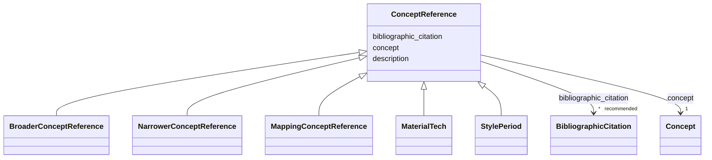

---
search:
  boost: 10.0
---

# Class: ConceptReference 


_Atribuição de vocabulário controlado com citação de apoio._


<div data-search-exclude markdown="1">


URI: [wasth:ConceptReference](https://tradicional.arq.br/schema/ConceptReference)





## Inheritance
* **ConceptReference**
    * [BroaderConceptReference](BroaderConceptReference.md)
    * [NarrowerConceptReference](NarrowerConceptReference.md)
    * [MappingConceptReference](MappingConceptReference.md)
    * [MaterialTech](MaterialTech.md)
    * [StylePeriod](StylePeriod.md)


## Slots

| Name | Cardinality and Range | Description | Inheritance |
| ---  | --- | --- | --- |
| [concept](concept.md) | 1 <br/> [Concept](Concept.md) |  | direct |
| [description](description.md) | 0..1 <br/> [String](String.md) | A human-readable description for a thing | direct |
| [bibliographic_citation](bibliographic_citation.md) | * _recommended_ <br/> [BibliographicCitation](BibliographicCitation.md) | 📚  Cadastro de uma referência bibliográfica | direct |


## Usages

| used by | used in | type | used |
| ---  | --- | --- | --- |
| [Concept](Concept.md) | [relation](relation.md) | range | [ConceptReference](ConceptReference.md) |
| [Event](Event.md) | [method](method.md) | range | [ConceptReference](ConceptReference.md) |
| [Work](Work.md) | [work_type_condition](work_type_condition.md) | range | [ConceptReference](ConceptReference.md) |
| [Work](Work.md) | [work_type_form](work_type_form.md) | range | [ConceptReference](ConceptReference.md) |
| [Work](Work.md) | [work_type_function](work_type_function.md) | range | [ConceptReference](ConceptReference.md) |
| [Work](Work.md) | [work_type_context](work_type_context.md) | range | [ConceptReference](ConceptReference.md) |
| [Work](Work.md) | [work_type_subject_type](work_type_subject_type.md) | range | [ConceptReference](ConceptReference.md) |
| [Work](Work.md) | [work_type_use](work_type_use.md) | range | [ConceptReference](ConceptReference.md) |
| [Work](Work.md) | [classification_genre](classification_genre.md) | range | [ConceptReference](ConceptReference.md) |
| [Work](Work.md) | [classification_subject](classification_subject.md) | range | [ConceptReference](ConceptReference.md) |
| [Work](Work.md) | [classification_local](classification_local.md) | range | [ConceptReference](ConceptReference.md) |
| [Work](Work.md) | [classification_special](classification_special.md) | range | [ConceptReference](ConceptReference.md) |


## Identifier and Mapping Information


### Schema Source


* from schema: https://tradicional.arq.br/schema


## Mappings

| Mapping Type | Mapped Value |
| ---  | ---  |
| self | wasth:ConceptReference |
| native | wasth:ConceptReference |


## LinkML Source

<!-- TODO: investigate https://stackoverflow.com/questions/37606292/how-to-create-tabbed-code-blocks-in-mkdocs-or-sphinx -->

### Direct

<details>
```yaml
name: ConceptReference
description: Atribuição de vocabulário controlado com citação de apoio.
from_schema: https://tradicional.arq.br/schema
slots:
- concept
- description
- bibliographic_citation

```
</details>

### Induced

<details>
```yaml
name: ConceptReference
description: Atribuição de vocabulário controlado com citação de apoio.
from_schema: https://tradicional.arq.br/schema
attributes:
  concept:
    name: concept
    from_schema: https://tradicional.arq.br/schema
    rank: 1000
    alias: name
    owner: ConceptReference
    domain_of:
    - ConceptReference
    - Topic
    range: Concept
    required: true
  description:
    name: description
    description: A human-readable description for a thing
    from_schema: https://tradicional.arq.br/schema
    exact_mappings:
    - schema:description
    rank: 1000
    slot_uri: dcterms:description
    alias: display
    owner: ConceptReference
    domain_of:
    - ConceptReference
    - BibliographicCitation
    - RelatedObject
    - MediaObject
    - TypedReference
    - Measurement
    - RelatedEvent
    - Thing
    - Inscription
    - Topic
    range: string
  bibliographic_citation:
    name: bibliographic_citation
    description: '📚  Cadastro de uma referência bibliográfica.

      O campo `refid` deve conter a chave de citação (citation key) que consta do
      registro bibliográfico na biblioteca do nosso projeto de pesquisa no Zotero,
      começando com arroba @. Em geral, a chave de citação é o DOI ou ISBN da publicação,
      mas pode ser diferente.

      Se necessário, incluir no campo `note` uma especificação adicional, como o número
      da página da referência bibliográfica de onde a informação foi extraída.

      Usar o campo `description` para formatar a referência, caso a formatação automática
      do Zotero não for satisfatória.

      '
    from_schema: https://tradicional.arq.br/schema
    rank: 1000
    slot_uri: dcterms:bibliographicCitation
    owner: ConceptReference
    domain_of:
    - ConceptReference
    - RelatedObject
    - MediaObject
    - TypedReference
    - Measurement
    - Actor
    - Thing
    - Appellation
    - GeographicPoint
    - GeographicExtent
    - Inscription
    range: BibliographicCitation
    recommended: true
    multivalued: true
    inlined: true
    inlined_as_list: true

```
</details></div>