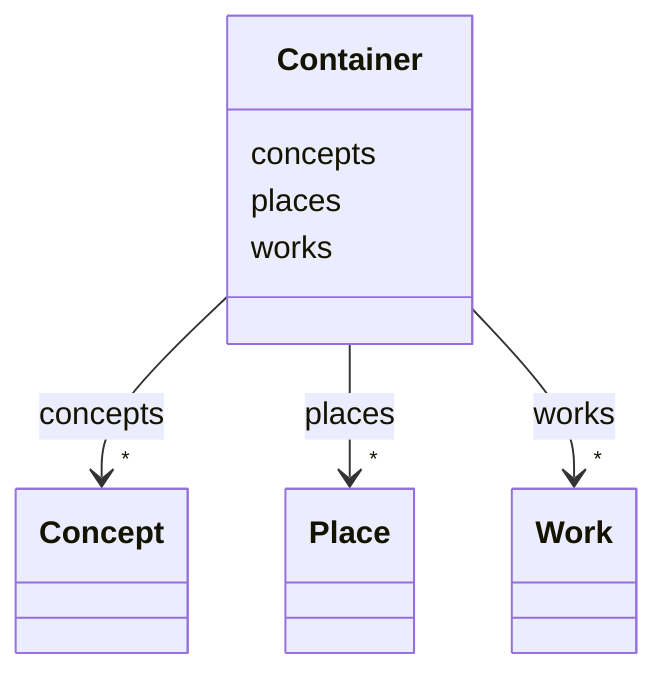

---
search:
  boost: 10.0
---

# Class: Container


_Todos os elementos do documentário._


<div data-search-exclude markdown="1">


URI: [wasth:Container](https://tradicional.arq.br/schema/Container)





<!-- no inheritance hierarchy -->

## Class Properties

| Property | Value |
| --- | --- |
| Tree Root | Yes |


## Slots

| Name | Cardinality and Range | Description | Inheritance |
| ---  | --- | --- | --- |
| [works](works.md) | * <br/> [Work](Work.md) |  | direct |
| [places](places.md) | * <br/> [Place](Place.md) |  | direct |
| [concepts](concepts.md) | * <br/> [Concept](Concept.md) |  | direct |


## Identifier and Mapping Information


### Schema Source


* from schema: https://tradicional.arq.br/schema


## Mappings

| Mapping Type | Mapped Value |
| ---  | ---  |
| self | wasth:Container |
| native | wasth:Container |


## LinkML Source

<!-- TODO: investigate https://stackoverflow.com/questions/37606292/how-to-create-tabbed-code-blocks-in-mkdocs-or-sphinx -->

### Direct

<details>
```yaml
name: Container
description: Todos os elementos do documentário.
from_schema: https://tradicional.arq.br/schema
attributes:
  works:
    name: works
    from_schema: https://tradicional.arq.br/schema
    rank: 1000
    domain_of:
    - Container
    range: Work
    multivalued: true
    inlined_as_list: true
  places:
    name: places
    from_schema: https://tradicional.arq.br/schema
    rank: 1000
    domain_of:
    - Container
    - EventPlace
    range: Place
    multivalued: true
    inlined_as_list: true
  concepts:
    name: concepts
    from_schema: https://tradicional.arq.br/schema
    rank: 1000
    domain_of:
    - Container
    range: Concept
    multivalued: true
    inlined_as_list: true
tree_root: true

```
</details>

### Induced

<details>
```yaml
name: Container
description: Todos os elementos do documentário.
from_schema: https://tradicional.arq.br/schema
attributes:
  works:
    name: works
    from_schema: https://tradicional.arq.br/schema
    rank: 1000
    owner: Container
    domain_of:
    - Container
    range: Work
    multivalued: true
    inlined: true
    inlined_as_list: true
  places:
    name: places
    from_schema: https://tradicional.arq.br/schema
    rank: 1000
    owner: Container
    domain_of:
    - Container
    - EventPlace
    range: Place
    multivalued: true
    inlined: true
    inlined_as_list: true
  concepts:
    name: concepts
    from_schema: https://tradicional.arq.br/schema
    rank: 1000
    owner: Container
    domain_of:
    - Container
    range: Concept
    multivalued: true
    inlined: true
    inlined_as_list: true
tree_root: true

```
</details></div>
