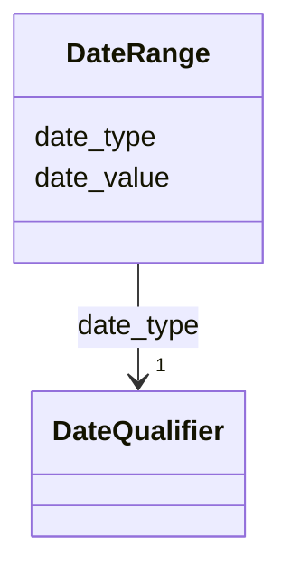

---
search:
  boost: 10.0
---

# Class: DateRange

<div data-search-exclude markdown="1">


URI: [wasth:DateRange](https://tradicional.arq.br/schema/DateRange)





<!-- no inheritance hierarchy -->

## Slots

| Name | Cardinality and Range | Description | Inheritance |
| ---  | --- | --- | --- |
| [date_type](date_type.md) | 1 <br/> [DateQualifier](DateQualifier.md) | An attribute for the kind of latest date, whether it is, for instance, exact ... | direct |
| [date_value](date_value.md) | 0..1 <br/> [Date](Date.md) | Usar o formato ISO-8601 (por exemplo, 2026-03-17) | direct |


## Usages

| used by | used in | type | used |
| ---  | --- | --- | --- |
| [EventDate](EventDate.md) | [earliest_date](earliest_date.md) | range | [DateRange](DateRange.md) |
| [EventDate](EventDate.md) | [latest_date](latest_date.md) | range | [DateRange](DateRange.md) |


## Identifier and Mapping Information


### Schema Source


* from schema: https://tradicional.arq.br/schema


## Mappings

| Mapping Type | Mapped Value |
| ---  | ---  |
| self | wasth:DateRange |
| native | wasth:DateRange |


## LinkML Source

<!-- TODO: investigate https://stackoverflow.com/questions/37606292/how-to-create-tabbed-code-blocks-in-mkdocs-or-sphinx -->

### Direct

<details>
```yaml
name: DateRange
from_schema: https://tradicional.arq.br/schema
attributes:
  date_type:
    name: date_type
    description: 'An attribute for the kind of latest date, whether it is, for instance,
      exact or estimated.

      '
    from_schema: https://tradicional.arq.br/schema/temporal
    rank: 1000
    alias: type
    domain_of:
    - DateRange
    range: DateQualifier
    required: true
  date_value:
    name: date_value
    description: 'Usar o formato ISO-8601 (por exemplo, 2026-03-17). Para datas imprecisas,
      usar o primeiro dia, mês ou ano do período delimitado, e descrever verbalmente
      o período no campo `description`.

      '
    from_schema: https://tradicional.arq.br/schema/temporal
    rank: 1000
    domain_of:
    - DateRange
    range: date

```
</details>

### Induced

<details>
```yaml
name: DateRange
from_schema: https://tradicional.arq.br/schema
attributes:
  date_type:
    name: date_type
    description: 'An attribute for the kind of latest date, whether it is, for instance,
      exact or estimated.

      '
    from_schema: https://tradicional.arq.br/schema/temporal
    rank: 1000
    alias: type
    owner: DateRange
    domain_of:
    - DateRange
    range: DateQualifier
    required: true
  date_value:
    name: date_value
    description: 'Usar o formato ISO-8601 (por exemplo, 2026-03-17). Para datas imprecisas,
      usar o primeiro dia, mês ou ano do período delimitado, e descrever verbalmente
      o período no campo `description`.

      '
    from_schema: https://tradicional.arq.br/schema/temporal
    rank: 1000
    owner: DateRange
    domain_of:
    - DateRange
    range: date

```
</details></div>
