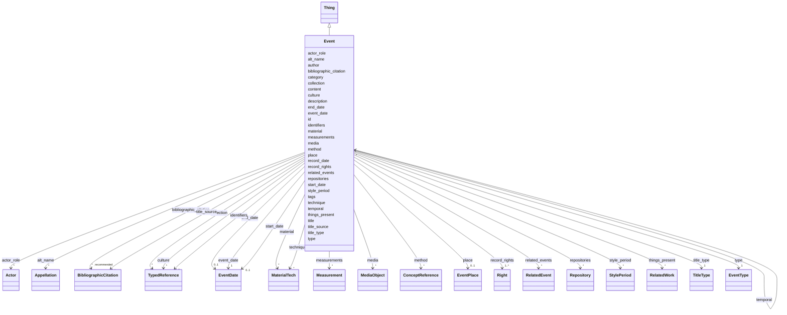

---
search:
  boost: 10.0
---

# Class: Event


_This class comprises distinct, delimited and coherent processes and interactions of a material nature, in cultural, social or physical systems, involving and affecting instances of E77 Persistent Item in a way characteristic of the kind of process. Typical examples are meetings, births, deaths, actions of decision taking, making or inventing things, but also more complex and extended ones such as conferences, elections, building of a castle, or battles._

_While the continuous growth of a tree lacks the limits characteristic of an event, its germination from a seed does qualify as an event. Similarly, the blowing of the wind lacks the distinctness and limits of an event, but a hurricane, flood or earthquake would qualify as an event. Mental processes are considered as events, in cases where they are connected with the material externalization of their results; for example, the creation of a poem, a performance or a change of intention that becomes obvious from subsequent actions or declarations._

_The effects of an instance of E5 Event may not lead to relevant permanent changes of properties or relations of the items involved in it, for example an unrecorded performance. Of course, in order to be documented, some kind of evidence for an event must exist, be it witnesses, traces or products of the event._

_While instances of E4 Period always require some form of coherence between its constituent phenomena, in addition, the essential constituents of instances of E5 Event should contribute to an overall effect; for example, the statements made during a meeting and the listening of the audience._

_Viewed at a coarse level of detail, an instance of E5 Event may appear as if it had an ‘instantaneous’ overall effect, but any process or interaction of material nature in reality have an extent in time and space. At a fine level, instances of E5 Event may be analysed into component phenomena and phases within a space and timeframe, and as such can be seen as a period, regardless of the size of the phenomena. The reverse is not necessarily the case: not all instances of E4 Period give rise to a noteworthy overall effect and are thus not instances of E5 Event._

__


<div data-search-exclude markdown="1">


URI: [crm:E5_Event](http://www.cidoc-crm.org/cidoc-crm/E5_Event)





## Inheritance
* [Thing](Thing.md)
    * **Event**


## Class Properties

| Property | Value |
| --- | --- |
| Class URI | [crm:E5_Event](http://www.cidoc-crm.org/cidoc-crm/E5_Event) |


## Slots

| Name | Cardinality and Range | Description | Inheritance |
| ---  | --- | --- | --- |
| [measurements](measurements.md) | * <br/> [Measurement](Measurement.md) |  | direct |
| [material](material.md) | * <br/> [MaterialTech](MaterialTech.md) | This class is a specialization of E55 Type and comprises the concepts of mate... | direct |
| [technique](technique.md) | * <br/> [MaterialTech](MaterialTech.md) | The production or manufacturing processes, techniques, and methods incorporat... | direct |
| [media](media.md) | * <br/> [MediaObject](MediaObject.md) |  | direct |
| [type](type.md) | 1 <br/> [EventType](EventType.md) |  | direct |
| [actor_role](actor_role.md) | * <br/> [Actor](Actor.md) | Identificação de um agente e do seu papel no evento | direct |
| [event_date](event_date.md) | 1 <br/> [EventDate](EventDate.md) | Conjunto de datas em que decorreu o evento | direct |
| [start_date](start_date.md) | 0..1 <br/> [EventDate](EventDate.md) | Data inicial do evento ou mais antiga data presumida para o seu decurso | direct |
| [end_date](end_date.md) | 0..1 <br/> [EventDate](EventDate.md) | Data final do evento ou mais tardia data presumida para o seu decurso | direct |
| [style_period](style_period.md) | * <br/> [StylePeriod](StylePeriod.md) | An index element for the period in which the event happened, comprising infor... | direct |
| [culture](culture.md) | * <br/> [TypedReference](TypedReference.md) | An index element for the cultural context from which the object/work in focus... | direct |
| [place](place.md) | 0..1 <br/> [EventPlace](EventPlace.md) | A set of structured information indicating the place or location where an obj... | direct |
| [method](method.md) | * <br/> [ConceptReference](ConceptReference.md) | An index element for the method by which the event is or was carried out | direct |
| [things_present](things_present.md) | * <br/> [RelatedWork](RelatedWork.md) | A set of structured information for a related object or work that is or was p... | direct |
| [related_events](related_events.md) | * <br/> [RelatedEvent](RelatedEvent.md) | A set of structured information about an event related to the event in focus,... | direct |
| [description](description.md) | 1 <br/> [String](String.md) | A human-readable description for a thing | [Thing](Thing.md) |
| [record_rights](record_rights.md) | 1..* <br/> [Right](Right.md) | A set of structured information about rights regarding the content provided i... | [Thing](Thing.md) |
| [title_type](title_type.md) | 1 <br/> [TitleType](TitleType.md) | Indica se o título é um nome próprio, descritivo, etc | [Thing](Thing.md) |
| [bibliographic_citation](bibliographic_citation.md) | * _recommended_ <br/> [BibliographicCitation](BibliographicCitation.md) |  | [Thing](Thing.md) |
| [content](content.md) | 0..1 _recommended_ <br/> [String](String.md) | Deixe uma linha em branco após o fechamento dos metadados e inclua aqui uma d... | [Thing](Thing.md) |
| [id](id.md) | 1 <br/> [Uriorcurie](Uriorcurie.md) | Unique identifier for this object | [Thing](Thing.md) |
| [author](author.md) | 0..1 <br/> [OrcidId](OrcidId.md) | ORCID iD of the record author or maintainer | [Thing](Thing.md) |
| [record_date](record_date.md) | 0..1 <br/> [Date](Date.md) | Date the record was created or last substantively revised | [Thing](Thing.md) |
| [title](title.md) | 1 <br/> [String](String.md) | The preferred human-readable label for a Thing | [Thing](Thing.md) |
| [title_source](title_source.md) | * <br/> [BibliographicCitation](BibliographicCitation.md) | 📚 A fonte do título title_source é opcional ; um título pode ser atestado em ... | [Thing](Thing.md) |
| [alt_name](alt_name.md) | * <br/> [Appellation](Appellation.md) | O bloco `alt_name` permite cadastrar outros nomes pelos quais a edificação se... | [Thing](Thing.md) |
| [category](category.md) | 1 <br/> [Uriorcurie](Uriorcurie.md) | The LIDO Category Vocabulary is a structured controlled list of terms recomme... | [Thing](Thing.md) |
| [identifiers](identifiers.md) | * <br/> [TypedReference](TypedReference.md) | Published or external identifiers for the object | [Thing](Thing.md) |
| [tags](tags.md) | * <br/> [String](String.md) | Provisional uncontrolled keywords | [Thing](Thing.md) |
| [temporal](temporal.md) | * <br/> [Event](Event.md) | Temporalidade do objeto | [Thing](Thing.md) |
| [collection](collection.md) | * <br/> [TypedReference](TypedReference.md) | Collections or aggregations to which the object belongs | [Thing](Thing.md) |
| [repositories](repositories.md) | * <br/> [Repository](Repository.md) | A set of elements for the identification, name and location of the repository... | [Thing](Thing.md) |


## Usages

| used by | used in | type | used |
| ---  | --- | --- | --- |
| [Concept](Concept.md) | [temporal](temporal.md) | range | [Event](Event.md) |
| [Place](Place.md) | [temporal](temporal.md) | range | [Event](Event.md) |
| [Site](Site.md) | [temporal](temporal.md) | range | [Event](Event.md) |
| [Resource](Resource.md) | [temporal](temporal.md) | range | [Event](Event.md) |
| [Event](Event.md) | [temporal](temporal.md) | range | [Event](Event.md) |
| [RelatedEvent](RelatedEvent.md) | [name](name.md) | range | [Event](Event.md) |
| [Thing](Thing.md) | [temporal](temporal.md) | range | [Event](Event.md) |
| [Repository](Repository.md) | [temporal](temporal.md) | range | [Event](Event.md) |
| [Work](Work.md) | [temporal](temporal.md) | range | [Event](Event.md) |


## Identifier and Mapping Information


### Schema Source


* from schema: https://tradicional.arq.br/schema


## Mappings

| Mapping Type | Mapped Value |
| ---  | ---  |
| self | crm:E5_Event |
| native | wasth:Event |
| exact | schema:Event |


## LinkML Source

<!-- TODO: investigate https://stackoverflow.com/questions/37606292/how-to-create-tabbed-code-blocks-in-mkdocs-or-sphinx -->

### Direct

<details>
```yaml
name: Event
description: 'This class comprises distinct, delimited and coherent processes and
  interactions of a material nature, in cultural, social or physical systems, involving
  and affecting instances of E77 Persistent Item in a way characteristic of the kind
  of process. Typical examples are meetings, births, deaths, actions of decision taking,
  making or inventing things, but also more complex and extended ones such as conferences,
  elections, building of a castle, or battles.

  While the continuous growth of a tree lacks the limits characteristic of an event,
  its germination from a seed does qualify as an event. Similarly, the blowing of
  the wind lacks the distinctness and limits of an event, but a hurricane, flood or
  earthquake would qualify as an event. Mental processes are considered as events,
  in cases where they are connected with the material externalization of their results;
  for example, the creation of a poem, a performance or a change of intention that
  becomes obvious from subsequent actions or declarations.

  The effects of an instance of E5 Event may not lead to relevant permanent changes
  of properties or relations of the items involved in it, for example an unrecorded
  performance. Of course, in order to be documented, some kind of evidence for an
  event must exist, be it witnesses, traces or products of the event.

  While instances of E4 Period always require some form of coherence between its constituent
  phenomena, in addition, the essential constituents of instances of E5 Event should
  contribute to an overall effect; for example, the statements made during a meeting
  and the listening of the audience.

  Viewed at a coarse level of detail, an instance of E5 Event may appear as if it
  had an ‘instantaneous’ overall effect, but any process or interaction of material
  nature in reality have an extent in time and space. At a fine level, instances of
  E5 Event may be analysed into component phenomena and phases within a space and
  timeframe, and as such can be seen as a period, regardless of the size of the phenomena.
  The reverse is not necessarily the case: not all instances of E4 Period give rise
  to a noteworthy overall effect and are thus not instances of E5 Event.

  '
from_schema: https://tradicional.arq.br/schema
exact_mappings:
- schema:Event
is_a: Thing
slots:
- measurements
- material
- technique
- media
attributes:
  type:
    name: type
    from_schema: https://tradicional.arq.br/schema/temporal
    domain_of:
    - Measurement
    - Right
    - LegalBody
    - Event
    - StylePeriod
    - EventPlace
    - Inscription
    - Topic
    - HistoricPlace
    range: EventType
    required: true
  actor_role:
    name: actor_role
    description: Identificação de um agente e do seu papel no evento.
    from_schema: https://tradicional.arq.br/schema/temporal
    rank: 1000
    domain_of:
    - Event
    range: Actor
    multivalued: true
    inlined_as_list: true
  event_date:
    name: event_date
    description: Conjunto de datas em que decorreu o evento.
    from_schema: https://tradicional.arq.br/schema/temporal
    rank: 1000
    domain_of:
    - Event
    range: EventDate
    required: true
    inlined: true
  start_date:
    name: start_date
    description: 'Data inicial do evento ou mais antiga data presumida para o seu
      decurso.

      '
    from_schema: https://tradicional.arq.br/schema/temporal
    rank: 1000
    alias: start_date
    domain_of:
    - Event
    range: EventDate
    inlined: true
  end_date:
    name: end_date
    description: 'Data final do evento ou mais tardia data presumida para o seu decurso.

      '
    from_schema: https://tradicional.arq.br/schema/temporal
    rank: 1000
    alias: end_date
    domain_of:
    - Event
    range: EventDate
    inlined: true
  style_period:
    name: style_period
    description: 'An index element for the period in which the event happened, comprising
      information about geologic time scale, archaelogical, historical, or artistic
      period, style, or art movement, whose characteristics are represented by the
      object or work.

      Note that "Period/Style" corresponds to "Style" in CDWA as shorthand for [Style/Period/Group/Movement/Dynasty](https://www.getty.edu/research/publications/electronic_publications/cdwa/17styles.html).

      Examples may be Neolithic for a period, Impressionist for a style, or Cubism
      for a movement.

      '
    from_schema: https://tradicional.arq.br/schema/temporal
    rank: 1000
    domain_of:
    - Event
    range: StylePeriod
    multivalued: true
    inlined_as_list: true
  culture:
    name: culture
    description: An index element for the cultural context from which the object/work
      in focus originated. Used if the creator or producer is unknown, or if the cultural
      context is of particular interest. Examples may include the name of a culture,
      a nation, or an ethnic group.
    from_schema: https://tradicional.arq.br/schema/temporal
    rank: 1000
    domain_of:
    - Event
    range: TypedReference
    multivalued: true
    inlined_as_list: true
  place:
    name: place
    description: A set of structured information indicating the place or location
      where an object/work was associated with a particular event.
    from_schema: https://tradicional.arq.br/schema/temporal
    rank: 1000
    domain_of:
    - Event
    range: EventPlace
    inlined: true
  method:
    name: method
    description: An index element for the method by which the event is or was carried
      out. Examples may include an acquisition method or a field collection method.
    from_schema: https://tradicional.arq.br/schema/temporal
    rank: 1000
    domain_of:
    - Event
    range: ConceptReference
    multivalued: true
    inlined_as_list: true
  things_present:
    name: things_present
    description: A set of structured information for a related object or work that
      is or was present at the event in focus. Repeated if there are multiple related
      objects or works.
    from_schema: https://tradicional.arq.br/schema/temporal
    rank: 1000
    domain_of:
    - Event
    range: RelatedWork
    multivalued: true
  related_events:
    name: related_events
    description: A set of structured information about an event related to the event
      in focus, indicating the type of relationship where applicable.
    from_schema: https://tradicional.arq.br/schema/temporal
    rank: 1000
    domain_of:
    - Event
    range: RelatedEvent
    multivalued: true
class_uri: crm:E5_Event

```
</details>

### Induced

<details>
```yaml
name: Event
description: 'This class comprises distinct, delimited and coherent processes and
  interactions of a material nature, in cultural, social or physical systems, involving
  and affecting instances of E77 Persistent Item in a way characteristic of the kind
  of process. Typical examples are meetings, births, deaths, actions of decision taking,
  making or inventing things, but also more complex and extended ones such as conferences,
  elections, building of a castle, or battles.

  While the continuous growth of a tree lacks the limits characteristic of an event,
  its germination from a seed does qualify as an event. Similarly, the blowing of
  the wind lacks the distinctness and limits of an event, but a hurricane, flood or
  earthquake would qualify as an event. Mental processes are considered as events,
  in cases where they are connected with the material externalization of their results;
  for example, the creation of a poem, a performance or a change of intention that
  becomes obvious from subsequent actions or declarations.

  The effects of an instance of E5 Event may not lead to relevant permanent changes
  of properties or relations of the items involved in it, for example an unrecorded
  performance. Of course, in order to be documented, some kind of evidence for an
  event must exist, be it witnesses, traces or products of the event.

  While instances of E4 Period always require some form of coherence between its constituent
  phenomena, in addition, the essential constituents of instances of E5 Event should
  contribute to an overall effect; for example, the statements made during a meeting
  and the listening of the audience.

  Viewed at a coarse level of detail, an instance of E5 Event may appear as if it
  had an ‘instantaneous’ overall effect, but any process or interaction of material
  nature in reality have an extent in time and space. At a fine level, instances of
  E5 Event may be analysed into component phenomena and phases within a space and
  timeframe, and as such can be seen as a period, regardless of the size of the phenomena.
  The reverse is not necessarily the case: not all instances of E4 Period give rise
  to a noteworthy overall effect and are thus not instances of E5 Event.

  '
from_schema: https://tradicional.arq.br/schema
exact_mappings:
- schema:Event
is_a: Thing
attributes:
  type:
    name: type
    from_schema: https://tradicional.arq.br/schema/temporal
    owner: Event
    domain_of:
    - Measurement
    - Right
    - LegalBody
    - Event
    - StylePeriod
    - EventPlace
    - Inscription
    - Topic
    - HistoricPlace
    range: EventType
    required: true
  actor_role:
    name: actor_role
    description: Identificação de um agente e do seu papel no evento.
    from_schema: https://tradicional.arq.br/schema/temporal
    rank: 1000
    owner: Event
    domain_of:
    - Event
    range: Actor
    multivalued: true
    inlined: true
    inlined_as_list: true
  event_date:
    name: event_date
    description: Conjunto de datas em que decorreu o evento.
    from_schema: https://tradicional.arq.br/schema/temporal
    rank: 1000
    owner: Event
    domain_of:
    - Event
    range: EventDate
    required: true
    inlined: true
  start_date:
    name: start_date
    description: 'Data inicial do evento ou mais antiga data presumida para o seu
      decurso.

      '
    from_schema: https://tradicional.arq.br/schema/temporal
    rank: 1000
    alias: start_date
    owner: Event
    domain_of:
    - Event
    range: EventDate
    inlined: true
  end_date:
    name: end_date
    description: 'Data final do evento ou mais tardia data presumida para o seu decurso.

      '
    from_schema: https://tradicional.arq.br/schema/temporal
    rank: 1000
    alias: end_date
    owner: Event
    domain_of:
    - Event
    range: EventDate
    inlined: true
  style_period:
    name: style_period
    description: 'An index element for the period in which the event happened, comprising
      information about geologic time scale, archaelogical, historical, or artistic
      period, style, or art movement, whose characteristics are represented by the
      object or work.

      Note that "Period/Style" corresponds to "Style" in CDWA as shorthand for [Style/Period/Group/Movement/Dynasty](https://www.getty.edu/research/publications/electronic_publications/cdwa/17styles.html).

      Examples may be Neolithic for a period, Impressionist for a style, or Cubism
      for a movement.

      '
    from_schema: https://tradicional.arq.br/schema/temporal
    rank: 1000
    owner: Event
    domain_of:
    - Event
    range: StylePeriod
    multivalued: true
    inlined: true
    inlined_as_list: true
  culture:
    name: culture
    description: An index element for the cultural context from which the object/work
      in focus originated. Used if the creator or producer is unknown, or if the cultural
      context is of particular interest. Examples may include the name of a culture,
      a nation, or an ethnic group.
    from_schema: https://tradicional.arq.br/schema/temporal
    rank: 1000
    owner: Event
    domain_of:
    - Event
    range: TypedReference
    multivalued: true
    inlined: true
    inlined_as_list: true
  place:
    name: place
    description: A set of structured information indicating the place or location
      where an object/work was associated with a particular event.
    from_schema: https://tradicional.arq.br/schema/temporal
    rank: 1000
    owner: Event
    domain_of:
    - Event
    range: EventPlace
    inlined: true
  method:
    name: method
    description: An index element for the method by which the event is or was carried
      out. Examples may include an acquisition method or a field collection method.
    from_schema: https://tradicional.arq.br/schema/temporal
    rank: 1000
    owner: Event
    domain_of:
    - Event
    range: ConceptReference
    multivalued: true
    inlined: true
    inlined_as_list: true
  things_present:
    name: things_present
    description: A set of structured information for a related object or work that
      is or was present at the event in focus. Repeated if there are multiple related
      objects or works.
    from_schema: https://tradicional.arq.br/schema/temporal
    rank: 1000
    owner: Event
    domain_of:
    - Event
    range: RelatedWork
    multivalued: true
  related_events:
    name: related_events
    description: A set of structured information about an event related to the event
      in focus, indicating the type of relationship where applicable.
    from_schema: https://tradicional.arq.br/schema/temporal
    rank: 1000
    owner: Event
    domain_of:
    - Event
    range: RelatedEvent
    multivalued: true
  measurements:
    name: measurements
    from_schema: https://tradicional.arq.br/schema
    rank: 1000
    owner: Event
    domain_of:
    - MediaObject
    - Event
    - Work
    range: Measurement
    multivalued: true
    inlined: true
    inlined_as_list: true
  material:
    name: material
    description: 'This class is a specialization of E55 Type and comprises the concepts
      of materials.

      Instances of E57 Material may denote properties of matter before its use, during
      its use, and as incorporated in an object, such as ultramarine powder, tempera
      paste, reinforced concrete. Discrete pieces of raw-materials kept in museums,
      such as bricks, sheets of fabric, pieces of metal, should be modelled individually
      in the same way as other objects. Discrete used or processed pieces, such as
      the stones from Nefer Titi''s temple, should be modelled as parts (cf. P46 is
      composed of (forms part of): E18 Physical Thing).

      This type is used categorically in the model without reference to instances
      of it, i.e. the Model does not foresee the description of instances of instances
      of E57 Material, e.g. “instances of gold”.

      It is recommended that internationally or nationally agreed codes and terminology
      should be used.

      '
    from_schema: https://tradicional.arq.br/schema
    exact_mappings:
    - vra:Material
    rank: 1000
    slot_uri: crm:E57_Material
    owner: Event
    domain_of:
    - Event
    - Work
    range: MaterialTech
    multivalued: true
    inlined: true
    inlined_as_list: true
  technique:
    name: technique
    description: 'The production or manufacturing processes, techniques, and methods
      incorporated in the fabrication or alteration of the work or image.

      '
    from_schema: https://tradicional.arq.br/schema
    close_mappings:
    - crm:E55_Type
    rank: 1000
    slot_uri: vra:Technique
    owner: Event
    domain_of:
    - Event
    - Work
    range: MaterialTech
    multivalued: true
    inlined: true
    inlined_as_list: true
  media:
    name: media
    from_schema: https://tradicional.arq.br/schema
    rank: 1000
    owner: Event
    domain_of:
    - RelatedObject
    - Event
    - Work
    range: MediaObject
    multivalued: true
    inlined: true
    inlined_as_list: true
  description:
    name: description
    description: A human-readable description for a thing
    from_schema: https://tradicional.arq.br/schema
    rank: 1000
    slot_uri: dcterms:description
    alias: display
    owner: Event
    domain_of:
    - ConceptReference
    - Measurement
    - BibliographicCitation
    - RelatedObject
    - MediaObject
    - EventDate
    - EventPlace
    - RelatedEvent
    - Thing
    - Appellation
    - Inscription
    - Topic
    range: string
    required: true
  record_rights:
    name: record_rights
    description: 'A set of structured information about rights regarding the content
      provided in this LIDO record.

      ---------------------------------------------------------------------

      :warning: Este grupo se refere aos direitos sobre o CONTEÚDO da ficha, não sobre
      os direitos incidentes sobre o objeto descrito.

      '
    from_schema: https://tradicional.arq.br/schema/thing
    rank: 1000
    owner: Event
    domain_of:
    - Thing
    range: Right
    required: true
    multivalued: true
    inlined: true
    inlined_as_list: true
  title_type:
    name: title_type
    description: Indica se o título é um nome próprio, descritivo, etc.
    from_schema: https://tradicional.arq.br/schema
    rank: 1000
    alias: type
    owner: Event
    domain_of:
    - Thing
    - Appellation
    range: TitleType
    required: true
  bibliographic_citation:
    name: bibliographic_citation
    from_schema: https://tradicional.arq.br/schema
    rank: 1000
    slot_uri: dcterms:bibliographicCitation
    owner: Event
    domain_of:
    - ConceptReference
    - GeographicPoint
    - GeographicExtent
    - TypedReference
    - Measurement
    - RelatedObject
    - MediaObject
    - Actor
    - Thing
    - Appellation
    - Inscription
    range: BibliographicCitation
    recommended: true
    multivalued: true
    inlined: true
    inlined_as_list: true
  content:
    name: content
    description: 'Deixe uma linha em branco após o fechamento dos metadados e inclua
      aqui uma descrição morfológica e histórica da edificação com texto livre, usando
      formatação Markdown.

      Poderá incluir um segundo bloco de metadados para indicar as referências bibliográficas
      da descrição textual, no campo `nocite`. O formato é uma lista de chaves de
      citação do Zotero (cada uma começando com `@`) separadas por vírgulas:

      ```yaml Conteúdo textual em formato *Markdown* com citações [@citekey].

      --- nocite: "@*" --- ```

      '
    from_schema: https://tradicional.arq.br/schema
    rank: 1000
    slot_uri: skos:scopeNote
    owner: Event
    domain_of:
    - Thing
    - Inscription
    range: string
    recommended: true
  id:
    name: id
    description: Unique identifier for this object.
    from_schema: https://tradicional.arq.br/schema/thing
    rank: 1000
    slot_uri: dcterms:identifier
    identifier: true
    owner: Event
    domain_of:
    - Thing
    range: uriorcurie
    required: true
  author:
    name: author
    description: ORCID iD of the record author or maintainer.
    from_schema: https://tradicional.arq.br/schema/thing
    rank: 1000
    slot_uri: dcterms:creator
    owner: Event
    domain_of:
    - Thing
    range: OrcidId
  record_date:
    name: record_date
    description: Date the record was created or last substantively revised.
    from_schema: https://tradicional.arq.br/schema/thing
    rank: 1000
    slot_uri: dcterms:created
    owner: Event
    domain_of:
    - Thing
    range: date
  title:
    name: title
    description: The preferred human-readable label for a Thing.
    from_schema: https://tradicional.arq.br/schema/thing
    rank: 1000
    slot_uri: dcterms:title
    owner: Event
    domain_of:
    - Thing
    range: string
    required: true
  title_source:
    name: title_source
    description: '📚 A fonte do título title_source é opcional ; um título pode ser
      atestado em mais de uma fonte, por isso este campo é uma lista de itens (cada
      item começa com um hífen).

      Se a fonte for cadastrada, o campo `refid` deve conter a chave de citação (citation
      key) que consta do registro bibliográfico na biblioteca do nosso projeto de
      pesquisa no Zotero. Em geral, a chave de citação é o DOI ou ISBN da publicação,
      mas pode ser diferente.

      Se necessário, incluir no campo note uma especificação adicional, como o número
      da página da referência bibliográfica de onde a informação foi extraída.

      Todos os campos source no restante da ficha devem ser preenchidos do mesmo modo.
      (Equivalente DublinCore: bibliographiCitation).'
    from_schema: https://tradicional.arq.br/schema/thing
    rank: 1000
    owner: Event
    domain_of:
    - Thing
    range: BibliographicCitation
    multivalued: true
    inlined: true
    inlined_as_list: true
  alt_name:
    name: alt_name
    description: 'O bloco `alt_name` permite cadastrar outros nomes pelos quais a
      edificação será eventualmente conhecida. É uma lista opcional de itens, e se
      existir, os campos de cada item da lista devem ser preenchidos como os do título
      principal.

      O campo `description` de cada item contém o texto do título (nome).

      Este bloco pode ser omitido por completo se não houver títulos alternativos.

      '
    from_schema: https://tradicional.arq.br/schema/thing
    rank: 1000
    owner: Event
    domain_of:
    - Thing
    range: Appellation
    multivalued: true
    inlined: true
    inlined_as_list: true
  category:
    name: category
    description: 'The LIDO Category Vocabulary is a structured controlled list of
      terms recommended to use as values in the LIDO Category element.

      Examples are human-made object or natural object.'
    from_schema: https://tradicional.arq.br/schema/thing
    rank: 1000
    slot_uri: term:lidoCategory
    designates_type: true
    owner: Event
    domain_of:
    - Thing
    range: uriorcurie
    required: true
  identifiers:
    name: identifiers
    description: Published or external identifiers for the object.
    from_schema: https://tradicional.arq.br/schema/thing
    rank: 1000
    owner: Event
    domain_of:
    - Thing
    range: TypedReference
    multivalued: true
    inlined: true
    inlined_as_list: true
  tags:
    name: tags
    description: Provisional uncontrolled keywords. Prefer `classifications` or `subject`
      for curated vocabulary terms.
    from_schema: https://tradicional.arq.br/schema/thing
    rank: 1000
    owner: Event
    domain_of:
    - Thing
    range: string
    multivalued: true
  temporal:
    name: temporal
    description: Temporalidade do objeto.
    from_schema: https://tradicional.arq.br/schema/thing
    owner: Event
    domain_of:
    - Right
    - Thing
    range: Event
    multivalued: true
    inlined: true
    inlined_as_list: true
  collection:
    name: collection
    description: Collections or aggregations to which the object belongs.
    from_schema: https://tradicional.arq.br/schema/thing
    rank: 1000
    owner: Event
    domain_of:
    - Thing
    - Work
    range: TypedReference
    multivalued: true
    inlined: true
    inlined_as_list: true
  repositories:
    name: repositories
    description: 'A set of elements for the identification, name and location of the
      repository that is responsible for the object/work in focus.

      Repeated if there are several designations known, or if former repositories
      or geographic places should be listed.

      ---------------------------------------------------------------------

      Nos Documentários da Arquitetura Tradicional, usamos repositórios para indicar
      a inclusão da edificação em perímetros de sítios do patrimônio cultural, etc.

      Os repositórios devem ser cadastrados de modo semelhante às informações de georreferenciamento,
      usando o tipo `other`.

      '
    from_schema: https://tradicional.arq.br/schema/thing
    rank: 1000
    owner: Event
    domain_of:
    - Thing
    - Work
    range: Repository
    multivalued: true
    inlined: true
    inlined_as_list: true
class_uri: crm:E5_Event

```
</details></div>
