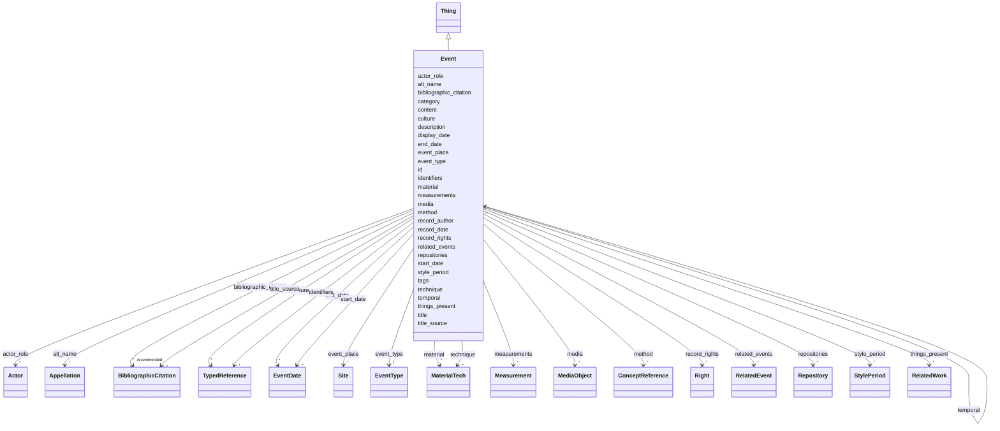

---
search:
  boost: 10.0
---

# Class: Event 


_Um evento é um processo específico e coerente, delimitável, de interações entre fatores materiais, humanos e físico-ambientais, que afetam objetos de modo característico ao tipo de processo em jogo. Pode tratar-se de uma ação ou um conjunto articulado de ações intencionais, de consequências imprevistas de ações intencionais, ou de processos naturais sem intervenção humana._

_-------------------------------------------------------------------------_

_This class comprises distinct, delimited and coherent processes and interactions of a material nature, in cultural, social or physical systems, involving and affecting instances of E77 Persistent Item in a way characteristic of the kind of process. Typical examples are meetings, births, deaths, actions of decision taking, making or inventing things, but also more complex and extended ones such as conferences, elections, building of a castle, or battles._

_While the continuous growth of a tree lacks the limits characteristic of an event, its germination from a seed does qualify as an event. Similarly, the blowing of the wind lacks the distinctness and limits of an event, but a hurricane, flood or earthquake would qualify as an event. Mental processes are considered as events, in cases where they are connected with the material externalization of their results; for example, the creation of a poem, a performance or a change of intention that becomes obvious from subsequent actions or declarations._

_The effects of an instance of E5 Event may not lead to relevant permanent changes of properties or relations of the items involved in it, for example an unrecorded performance. Of course, in order to be documented, some kind of evidence for an event must exist, be it witnesses, traces or products of the event._

_While instances of E4 Period always require some form of coherence between its constituent phenomena, in addition, the essential constituents of instances of E5 Event should contribute to an overall effect; for example, the statements made during a meeting and the listening of the audience._

_Viewed at a coarse level of detail, an instance of E5 Event may appear as if it had an ‘instantaneous’ overall effect, but any process or interaction of material nature in reality have an extent in time and space. At a fine level, instances of E5 Event may be analysed into component phenomena and phases within a space and timeframe, and as such can be seen as a period, regardless of the size of the phenomena. The reverse is not necessarily the case: not all instances of E4 Period give rise to a noteworthy overall effect and are thus not instances of E5 Event._

__


<div data-search-exclude markdown="1">


URI: [crm:E5_Event](http://www.cidoc-crm.org/cidoc-crm/E5_Event)





## Inheritance
* [Thing](Thing.md)
    * **Event**


## Class Properties

| Property | Value |
| --- | --- |
| Class URI | [crm:E5_Event](http://www.cidoc-crm.org/cidoc-crm/E5_Event) |


## Slots

| Name | Cardinality and Range | Description | Inheritance |
| ---  | --- | --- | --- |
| [style_period](style_period.md) | * <br/> [StylePeriod](StylePeriod.md) | Denomina o(s) período(s) em que o evento decorreu, em qualquer escala relevan... | direct |
| [culture](culture.md) | * <br/> [TypedReference](TypedReference.md) | Designa o contexto cultural ou étnico no qual o objeto foi afetado pelo event... | direct |
| [measurements](measurements.md) | * <br/> [Measurement](Measurement.md) | A wrapper for information about the dimensions, or other measurements, of the... | direct |
| [material](material.md) | * <br/> [MaterialTech](MaterialTech.md) | Descreve a natureza do material empregado na edificação, no elemento ou no ev... | direct |
| [technique](technique.md) | * <br/> [MaterialTech](MaterialTech.md) | Processos, técnicas, métodos e saberes postos em prática no conjunto da edifi... | direct |
| [media](media.md) | * <br/> [MediaObject](MediaObject.md) | Representações iconográficas deste objeto | direct |
| [event_type](event_type.md) | 1 <br/> [EventType](EventType.md) | Categoriza o evento segundo os vários tipos de ações, de processos, ou de res... | direct |
| [actor_role](actor_role.md) | * <br/> [Actor](Actor.md) | Identificação de um agente e do seu papel no evento | direct |
| [display_date](display_date.md) | 0..1 <br/> [String](String.md) | Permite a expressão descritiva das datas de início e fim do evento, para cont... | direct |
| [start_date](start_date.md) | * <br/> [EventDate](EventDate.md) | Data inicial do evento ou mais antiga data presumida para o seu decurso | direct |
| [end_date](end_date.md) | * <br/> [EventDate](EventDate.md) | Data final do evento ou mais tardia data presumida para o seu decurso | direct |
| [event_place](event_place.md) | * <br/> [Site](Site.md) | Lugares associados ao evento, sem incluir o próprio local no qual se situa a ... | direct |
| [method](method.md) | * <br/> [ConceptReference](ConceptReference.md) | An index element for the method by which the event is or was carried out | direct |
| [things_present](things_present.md) | * <br/> [RelatedWork](RelatedWork.md) | A set of structured information for a related object or work that is or was p... | direct |
| [related_events](related_events.md) | * <br/> [RelatedEvent](RelatedEvent.md) | A set of structured information about an event related to the event in focus,... | direct |
| [description](description.md) | 1 <br/> [String](String.md) | A human-readable description for a thing | [Thing](Thing.md) |
| [bibliographic_citation](bibliographic_citation.md) | * _recommended_ <br/> [BibliographicCitation](BibliographicCitation.md) | 📚  Cadastro de uma referência bibliográfica | [Thing](Thing.md) |
| [content](content.md) | 0..1 _recommended_ <br/> [String](String.md) | Conteúdo textual descritivo ou explicativo | [Thing](Thing.md) |
| [id](id.md) | 1 <br/> [Uriorcurie](Uriorcurie.md) | Identificador globalmente único para este objeto ou recurso | [Thing](Thing.md) |
| [record_author](record_author.md) | 0..1 <br/> [OrcidId](OrcidId.md) | ORCID iD da pessoa que escreveu a versão original da ficha | [Thing](Thing.md) |
| [record_date](record_date.md) | 0..1 <br/> [Date](Date.md) | Data de inclusão da ficha | [Thing](Thing.md) |
| [title](title.md) | 1 <br/> [String](String.md) | Nome pelo qual este item é mais comumente conhecido | [Thing](Thing.md) |
| [title_source](title_source.md) | * <br/> [BibliographicCitation](BibliographicCitation.md) | A fonte do título title_source é opcional ; um título pode ser atestado em ma... | [Thing](Thing.md) |
| [alt_name](alt_name.md) | * <br/> [Appellation](Appellation.md) | O bloco `alt_name` permite cadastrar outros nomes pelos quais o objeto ou con... | [Thing](Thing.md) |
| [category](category.md) | 1 <br/> [Uriorcurie](Uriorcurie.md) | Uma classificação ampla para o objeto descrito na ficha, usando o vocabulário... | [Thing](Thing.md) |
| [identifiers](identifiers.md) | * <br/> [TypedReference](TypedReference.md) | Números de inventário e demais códigos que identificam este objeto em outras ... | [Thing](Thing.md) |
| [tags](tags.md) | * <br/> [String](String.md) | Lista de palavras-chave que caracterizam o objeto, de modo não estruturado | [Thing](Thing.md) |
| [temporal](temporal.md) | * <br/> [Event](Event.md) | Descrição dos eventos associados ao ciclo de vida da edificação ou à existênc... | [Thing](Thing.md) |
| [repositories](repositories.md) | * <br/> [Repository](Repository.md) | Nos Documentários da Arquitetura Tradicional, usamos repositórios para indica... | [Thing](Thing.md) |
| [record_rights](record_rights.md) | * <br/> [Right](Right.md) | Informações estruturadas sobre os direitos que incidem sobre o conteúdo textu... | [Thing](Thing.md) |


## Usages

| used by | used in | type | used |
| ---  | --- | --- | --- |
| [Concept](Concept.md) | [temporal](temporal.md) | range | [Event](Event.md) |
| [Resource](Resource.md) | [temporal](temporal.md) | range | [Event](Event.md) |
| [Measurement](Measurement.md) | [measurement_event](measurement_event.md) | range | [Event](Event.md) |
| [Event](Event.md) | [temporal](temporal.md) | range | [Event](Event.md) |
| [RelatedEvent](RelatedEvent.md) | [event_name](event_name.md) | range | [Event](Event.md) |
| [Thing](Thing.md) | [temporal](temporal.md) | range | [Event](Event.md) |
| [Repository](Repository.md) | [temporal](temporal.md) | range | [Event](Event.md) |
| [Work](Work.md) | [temporal](temporal.md) | range | [Event](Event.md) |
| [Site](Site.md) | [temporal](temporal.md) | range | [Event](Event.md) |


## Identifier and Mapping Information


### Schema Source


* from schema: https://tradicional.arq.br/schema


## Mappings

| Mapping Type | Mapped Value |
| ---  | ---  |
| self | crm:E5_Event |
| native | wasth:Event |
| exact | schema:Event |


## LinkML Source

<!-- TODO: investigate https://stackoverflow.com/questions/37606292/how-to-create-tabbed-code-blocks-in-mkdocs-or-sphinx -->

### Direct

<details>
```yaml
name: Event
description: 'Um evento é um processo específico e coerente, delimitável, de interações
  entre fatores materiais, humanos e físico-ambientais, que afetam objetos de modo
  característico ao tipo de processo em jogo. Pode tratar-se de uma ação ou um conjunto
  articulado de ações intencionais, de consequências imprevistas de ações intencionais,
  ou de processos naturais sem intervenção humana.

  -------------------------------------------------------------------------

  This class comprises distinct, delimited and coherent processes and interactions
  of a material nature, in cultural, social or physical systems, involving and affecting
  instances of E77 Persistent Item in a way characteristic of the kind of process.
  Typical examples are meetings, births, deaths, actions of decision taking, making
  or inventing things, but also more complex and extended ones such as conferences,
  elections, building of a castle, or battles.

  While the continuous growth of a tree lacks the limits characteristic of an event,
  its germination from a seed does qualify as an event. Similarly, the blowing of
  the wind lacks the distinctness and limits of an event, but a hurricane, flood or
  earthquake would qualify as an event. Mental processes are considered as events,
  in cases where they are connected with the material externalization of their results;
  for example, the creation of a poem, a performance or a change of intention that
  becomes obvious from subsequent actions or declarations.

  The effects of an instance of E5 Event may not lead to relevant permanent changes
  of properties or relations of the items involved in it, for example an unrecorded
  performance. Of course, in order to be documented, some kind of evidence for an
  event must exist, be it witnesses, traces or products of the event.

  While instances of E4 Period always require some form of coherence between its constituent
  phenomena, in addition, the essential constituents of instances of E5 Event should
  contribute to an overall effect; for example, the statements made during a meeting
  and the listening of the audience.

  Viewed at a coarse level of detail, an instance of E5 Event may appear as if it
  had an ‘instantaneous’ overall effect, but any process or interaction of material
  nature in reality have an extent in time and space. At a fine level, instances of
  E5 Event may be analysed into component phenomena and phases within a space and
  timeframe, and as such can be seen as a period, regardless of the size of the phenomena.
  The reverse is not necessarily the case: not all instances of E4 Period give rise
  to a noteworthy overall effect and are thus not instances of E5 Event.

  '
from_schema: https://tradicional.arq.br/schema
exact_mappings:
- schema:Event
is_a: Thing
slots:
- style_period
- culture
- measurements
- material
- technique
- media
attributes:
  event_type:
    name: event_type
    description: 'Categoriza o evento segundo os vários tipos de ações, de processos,
      ou de resultados (início ou fim da existência, transformação).

      '
    from_schema: https://tradicional.arq.br/schema/temporal
    rank: 1000
    alias: type
    domain_of:
    - Event
    range: EventType
    required: true
  actor_role:
    name: actor_role
    description: Identificação de um agente e do seu papel no evento.
    from_schema: https://tradicional.arq.br/schema/temporal
    rank: 1000
    domain_of:
    - Event
    range: Actor
    multivalued: true
    inlined_as_list: true
  display_date:
    name: display_date
    description: 'Permite a expressão descritiva das datas de início e fim do evento,
      para contemplar variados graus de incerteza, ou de modo a representar a data
      em calendários diferentes do gregoriano. Omitir apenas se os valores numéricos
      das datas forem exatos.

      '
    from_schema: https://tradicional.arq.br/schema/temporal
    rank: 1000
    domain_of:
    - Event
    range: string
  start_date:
    name: start_date
    description: 'Data inicial do evento ou mais antiga data presumida para o seu
      decurso. Omitir se desconhecida.

      Por ora, é responsabilidade de quem preenche a ficha assegurar que `start_date`
      e `end_date` ocorram em ordem cronológica. Não dispomos de validação automática
      para tanto.

      '
    from_schema: https://tradicional.arq.br/schema/temporal
    rank: 1000
    domain_of:
    - Event
    range: EventDate
    multivalued: true
    inlined_as_list: true
    minimum_cardinality: 0
    maximum_cardinality: 2
  end_date:
    name: end_date
    description: 'Data final do evento ou mais tardia data presumida para o seu decurso.
      Omitir se desconhecida.

      Por ora, é responsabilidade de quem preenche a ficha assegurar que `start_date`
      e `end_date` ocorram em ordem cronológica. Não dispomos de validação automática
      para tanto.

      '
    from_schema: https://tradicional.arq.br/schema/temporal
    rank: 1000
    domain_of:
    - Event
    range: EventDate
    multivalued: true
    inlined_as_list: true
    minimum_cardinality: 0
    maximum_cardinality: 2
  event_place:
    name: event_place
    description: 'Lugares associados ao evento, sem incluir o próprio local no qual
      se situa a edificação.

      '
    from_schema: https://tradicional.arq.br/schema/temporal
    rank: 1000
    alias: place
    domain_of:
    - Event
    range: Site
    multivalued: true
    inlined_as_list: true
  method:
    name: method
    description: An index element for the method by which the event is or was carried
      out. Examples may include an acquisition method or a field collection method.
    from_schema: https://tradicional.arq.br/schema/temporal
    rank: 1000
    domain_of:
    - Event
    range: ConceptReference
    multivalued: true
    inlined_as_list: true
  things_present:
    name: things_present
    description: A set of structured information for a related object or work that
      is or was present at the event in focus. Repeated if there are multiple related
      objects or works.
    from_schema: https://tradicional.arq.br/schema/temporal
    rank: 1000
    domain_of:
    - Event
    range: RelatedWork
    multivalued: true
    inlined_as_list: true
  related_events:
    name: related_events
    description: A set of structured information about an event related to the event
      in focus, indicating the type of relationship where applicable.
    from_schema: https://tradicional.arq.br/schema/temporal
    rank: 1000
    domain_of:
    - Event
    range: RelatedEvent
    multivalued: true
    inlined_as_list: true
class_uri: crm:E5_Event

```
</details>

### Induced

<details>
```yaml
name: Event
description: 'Um evento é um processo específico e coerente, delimitável, de interações
  entre fatores materiais, humanos e físico-ambientais, que afetam objetos de modo
  característico ao tipo de processo em jogo. Pode tratar-se de uma ação ou um conjunto
  articulado de ações intencionais, de consequências imprevistas de ações intencionais,
  ou de processos naturais sem intervenção humana.

  -------------------------------------------------------------------------

  This class comprises distinct, delimited and coherent processes and interactions
  of a material nature, in cultural, social or physical systems, involving and affecting
  instances of E77 Persistent Item in a way characteristic of the kind of process.
  Typical examples are meetings, births, deaths, actions of decision taking, making
  or inventing things, but also more complex and extended ones such as conferences,
  elections, building of a castle, or battles.

  While the continuous growth of a tree lacks the limits characteristic of an event,
  its germination from a seed does qualify as an event. Similarly, the blowing of
  the wind lacks the distinctness and limits of an event, but a hurricane, flood or
  earthquake would qualify as an event. Mental processes are considered as events,
  in cases where they are connected with the material externalization of their results;
  for example, the creation of a poem, a performance or a change of intention that
  becomes obvious from subsequent actions or declarations.

  The effects of an instance of E5 Event may not lead to relevant permanent changes
  of properties or relations of the items involved in it, for example an unrecorded
  performance. Of course, in order to be documented, some kind of evidence for an
  event must exist, be it witnesses, traces or products of the event.

  While instances of E4 Period always require some form of coherence between its constituent
  phenomena, in addition, the essential constituents of instances of E5 Event should
  contribute to an overall effect; for example, the statements made during a meeting
  and the listening of the audience.

  Viewed at a coarse level of detail, an instance of E5 Event may appear as if it
  had an ‘instantaneous’ overall effect, but any process or interaction of material
  nature in reality have an extent in time and space. At a fine level, instances of
  E5 Event may be analysed into component phenomena and phases within a space and
  timeframe, and as such can be seen as a period, regardless of the size of the phenomena.
  The reverse is not necessarily the case: not all instances of E4 Period give rise
  to a noteworthy overall effect and are thus not instances of E5 Event.

  '
from_schema: https://tradicional.arq.br/schema
exact_mappings:
- schema:Event
is_a: Thing
attributes:
  event_type:
    name: event_type
    description: 'Categoriza o evento segundo os vários tipos de ações, de processos,
      ou de resultados (início ou fim da existência, transformação).

      '
    from_schema: https://tradicional.arq.br/schema/temporal
    rank: 1000
    alias: type
    owner: Event
    domain_of:
    - Event
    range: EventType
    required: true
  actor_role:
    name: actor_role
    description: Identificação de um agente e do seu papel no evento.
    from_schema: https://tradicional.arq.br/schema/temporal
    rank: 1000
    owner: Event
    domain_of:
    - Event
    range: Actor
    multivalued: true
    inlined: true
    inlined_as_list: true
  display_date:
    name: display_date
    description: 'Permite a expressão descritiva das datas de início e fim do evento,
      para contemplar variados graus de incerteza, ou de modo a representar a data
      em calendários diferentes do gregoriano. Omitir apenas se os valores numéricos
      das datas forem exatos.

      '
    from_schema: https://tradicional.arq.br/schema/temporal
    rank: 1000
    owner: Event
    domain_of:
    - Event
    range: string
  start_date:
    name: start_date
    description: 'Data inicial do evento ou mais antiga data presumida para o seu
      decurso. Omitir se desconhecida.

      Por ora, é responsabilidade de quem preenche a ficha assegurar que `start_date`
      e `end_date` ocorram em ordem cronológica. Não dispomos de validação automática
      para tanto.

      '
    from_schema: https://tradicional.arq.br/schema/temporal
    rank: 1000
    owner: Event
    domain_of:
    - Event
    range: EventDate
    multivalued: true
    inlined: true
    inlined_as_list: true
    minimum_cardinality: 0
    maximum_cardinality: 2
  end_date:
    name: end_date
    description: 'Data final do evento ou mais tardia data presumida para o seu decurso.
      Omitir se desconhecida.

      Por ora, é responsabilidade de quem preenche a ficha assegurar que `start_date`
      e `end_date` ocorram em ordem cronológica. Não dispomos de validação automática
      para tanto.

      '
    from_schema: https://tradicional.arq.br/schema/temporal
    rank: 1000
    owner: Event
    domain_of:
    - Event
    range: EventDate
    multivalued: true
    inlined: true
    inlined_as_list: true
    minimum_cardinality: 0
    maximum_cardinality: 2
  event_place:
    name: event_place
    description: 'Lugares associados ao evento, sem incluir o próprio local no qual
      se situa a edificação.

      '
    from_schema: https://tradicional.arq.br/schema/temporal
    rank: 1000
    alias: place
    owner: Event
    domain_of:
    - Event
    range: Site
    multivalued: true
    inlined: true
    inlined_as_list: true
  method:
    name: method
    description: An index element for the method by which the event is or was carried
      out. Examples may include an acquisition method or a field collection method.
    from_schema: https://tradicional.arq.br/schema/temporal
    rank: 1000
    owner: Event
    domain_of:
    - Event
    range: ConceptReference
    multivalued: true
    inlined: true
    inlined_as_list: true
  things_present:
    name: things_present
    description: A set of structured information for a related object or work that
      is or was present at the event in focus. Repeated if there are multiple related
      objects or works.
    from_schema: https://tradicional.arq.br/schema/temporal
    rank: 1000
    owner: Event
    domain_of:
    - Event
    range: RelatedWork
    multivalued: true
    inlined: true
    inlined_as_list: true
  related_events:
    name: related_events
    description: A set of structured information about an event related to the event
      in focus, indicating the type of relationship where applicable.
    from_schema: https://tradicional.arq.br/schema/temporal
    rank: 1000
    owner: Event
    domain_of:
    - Event
    range: RelatedEvent
    multivalued: true
    inlined: true
    inlined_as_list: true
  style_period:
    name: style_period
    description: 'Denomina o(s) período(s) em que o evento decorreu, em qualquer escala
      relevante para o conhecimento : geológica, arqueológica, histórica ou artística.
      A identificação do período ou estilo deve ser relevante para as características
      que o objeto adquiriu devido a esse evento, não somente uma coincidência cronológica.

      ---------------------------------------------------------------------

      An index element for the period in which the event happened, comprising information
      about geologic time scale, archaelogical, historical, or artistic period, style,
      or art movement, whose characteristics are represented by the object or work.

      Note that "Period/Style" corresponds to "Style" in CDWA as shorthand for [Style/Period/Group/Movement/Dynasty](https://www.getty.edu/research/publications/electronic_publications/cdwa/17styles.html).

      Examples may be Neolithic for a period, Impressionist for a style, or Cubism
      for a movement.

      '
    from_schema: https://tradicional.arq.br/schema
    rank: 1000
    owner: Event
    domain_of:
    - Event
    - Work
    range: StylePeriod
    multivalued: true
    inlined: true
    inlined_as_list: true
  culture:
    name: culture
    description: 'Designa o contexto cultural ou étnico no qual o objeto foi afetado
      pelo evento em questão, desde que as características de tal contexto estejam
      refletidas no objeto. O preenchimento do contexto cultural é especialmente relevante
      quando os agentes envolvidos na produção ou alteração do objeto são desconhecidos.

      ---------------------------------------------------------------------

      An index element for the cultural context from which the object/work in focus
      originated. Used if the creator or producer is unknown, or if the cultural context
      is of particular interest. Examples may include the name of a culture, a nation,
      or an ethnic group.'
    from_schema: https://tradicional.arq.br/schema
    rank: 1000
    owner: Event
    domain_of:
    - Event
    - Work
    range: TypedReference
    multivalued: true
    inlined: true
    inlined_as_list: true
  measurements:
    name: measurements
    description: 'A wrapper for information about the dimensions, or other measurements,
      of the object/work in focus. May also include extents of the parts of a complex
      object or work.

      '
    from_schema: https://tradicional.arq.br/schema
    rank: 1000
    owner: Event
    domain_of:
    - MediaObject
    - Event
    - Work
    range: Measurement
    multivalued: true
    inlined: true
    inlined_as_list: true
  material:
    name: material
    description: 'Descreve a natureza do material empregado na edificação, no elemento
      ou no evento descritos. Conforme necessário e segundo o discernimento de quem
      preenche a ficha, pode se referir a matérias-primas ou a produtos prontos para
      uso.

      Espólios ou partes de outras edificações reutilizadas podem ser descritos segundo
      os materiais de que são constituídos, mas a procedência não deve ser cadastrada
      neste item. Para tanto, devem ser utilizados os eventos no grupo `temporal`.

      -------------------------------------------------------------------------

      This class is a specialization of E55 Type and comprises the concepts of materials.

      Instances of E57 Material may denote properties of matter before its use, during
      its use, and as incorporated in an object, such as ultramarine powder, tempera
      paste, reinforced concrete. Discrete pieces of raw-materials kept in museums,
      such as bricks, sheets of fabric, pieces of metal, should be modelled individually
      in the same way as other objects. Discrete used or processed pieces, such as
      the stones from Nefer Titi''s temple, should be modelled as parts (cf. P46 is
      composed of (forms part of): E18 Physical Thing).

      This type is used categorically in the model without reference to instances
      of it, i.e. the Model does not foresee the description of instances of instances
      of E57 Material, e.g. “instances of gold”.

      It is recommended that internationally or nationally agreed codes and terminology
      should be used.

      '
    from_schema: https://tradicional.arq.br/schema
    exact_mappings:
    - vra:Material
    rank: 1000
    slot_uri: crm:E57_Material
    owner: Event
    domain_of:
    - Event
    - Work
    range: MaterialTech
    multivalued: true
    inlined: true
    inlined_as_list: true
  technique:
    name: technique
    description: 'Processos, técnicas, métodos e saberes postos em prática no conjunto
      da edificação e nas suas partes mais significativas, considerando a sua produção
      e alterações substanciais, bem como a sua eventual destruição.

      -------------------------------------------------------------------------

      The production or manufacturing processes, techniques, and methods incorporated
      in the fabrication or alteration of the work or image.

      '
    from_schema: https://tradicional.arq.br/schema
    close_mappings:
    - crm:E55_Type
    rank: 1000
    slot_uri: vra:Technique
    owner: Event
    domain_of:
    - Event
    - Work
    range: MaterialTech
    multivalued: true
    inlined: true
    inlined_as_list: true
  media:
    name: media
    description: 'Representações iconográficas deste objeto.

      No caso de `preview_image` ou `provided_image`, o link deve referenciar diretamente
      o arquivo (ficheiro) da imagem. Em se tratando de `provided_3d` ou `service`,
      o link deve remeter a uma página web que forneça a respetiva API ou as informações
      acerca do modelo.

      (A FAZER) Ver [Instruções para carregar imagens e desenhos].

      '
    from_schema: https://tradicional.arq.br/schema
    rank: 1000
    owner: Event
    domain_of:
    - RelatedObject
    - Event
    - Work
    range: MediaObject
    multivalued: true
    inlined: true
    inlined_as_list: true
  description:
    name: description
    description: A human-readable description for a thing
    from_schema: https://tradicional.arq.br/schema
    exact_mappings:
    - schema:description
    rank: 1000
    slot_uri: dcterms:description
    alias: display
    owner: Event
    domain_of:
    - ConceptReference
    - BibliographicCitation
    - RelatedObject
    - MediaObject
    - TypedReference
    - Measurement
    - RelatedEvent
    - Thing
    - Inscription
    - Topic
    range: string
    required: true
  bibliographic_citation:
    name: bibliographic_citation
    description: '📚  Cadastro de uma referência bibliográfica.

      O campo `refid` deve conter a chave de citação (citation key) que consta do
      registro bibliográfico na biblioteca do nosso projeto de pesquisa no Zotero,
      começando com arroba @. Em geral, a chave de citação é o DOI ou ISBN da publicação,
      mas pode ser diferente.

      Se necessário, incluir no campo `note` uma especificação adicional, como o número
      da página da referência bibliográfica de onde a informação foi extraída.

      Usar o campo `description` para formatar a referência, caso a formatação automática
      do Zotero não for satisfatória.

      '
    from_schema: https://tradicional.arq.br/schema
    rank: 1000
    slot_uri: dcterms:bibliographicCitation
    owner: Event
    domain_of:
    - ConceptReference
    - RelatedObject
    - MediaObject
    - TypedReference
    - Measurement
    - Actor
    - Thing
    - Appellation
    - GeographicPoint
    - GeographicExtent
    - Inscription
    range: BibliographicCitation
    recommended: true
    multivalued: true
    inlined: true
    inlined_as_list: true
  content:
    name: content
    description: Conteúdo textual descritivo ou explicativo.
    from_schema: https://tradicional.arq.br/schema
    rank: 1000
    slot_uri: skos:scopeNote
    owner: Event
    domain_of:
    - Thing
    - Inscription
    range: string
    recommended: true
  id:
    name: id
    description: 'Identificador globalmente único para este objeto ou recurso.

      '
    from_schema: https://tradicional.arq.br/schema/thing
    rank: 1000
    slot_uri: dcterms:identifier
    identifier: true
    owner: Event
    domain_of:
    - Thing
    range: uriorcurie
    required: true
  record_author:
    name: record_author
    description: 'ORCID iD da pessoa que escreveu a versão original da ficha. Alterar
      apenas no caso de a ficha ter sido substancialmente reescrita.

      '
    from_schema: https://tradicional.arq.br/schema/thing
    rank: 1000
    slot_uri: dcterms:contributor
    alias: author
    owner: Event
    domain_of:
    - Thing
    range: OrcidId
  record_date:
    name: record_date
    description: Data de inclusão da ficha.
    from_schema: https://tradicional.arq.br/schema/thing
    rank: 1000
    slot_uri: dcterms:created
    alias: date
    owner: Event
    domain_of:
    - Thing
    range: date
  title:
    name: title
    description: 'Nome pelo qual este item é mais comumente conhecido. Outros nomes
      podem ser cadastrados em `alt_name`.

      '
    from_schema: https://tradicional.arq.br/schema/thing
    exact_mappings:
    - schema:name
    rank: 1000
    slot_uri: dcterms:title
    owner: Event
    domain_of:
    - Thing
    range: string
    required: true
  title_source:
    name: title_source
    description: A fonte do título title_source é opcional ; um título pode ser atestado
      em mais de uma fonte, por isso este campo é uma lista de itens (cada item começa
      com um hífen).
    from_schema: https://tradicional.arq.br/schema/thing
    rank: 1000
    owner: Event
    domain_of:
    - Thing
    range: BibliographicCitation
    multivalued: true
    inlined: true
    inlined_as_list: true
  alt_name:
    name: alt_name
    description: 'O bloco `alt_name` permite cadastrar outros nomes pelos quais o
      objeto ou conceito será eventualmente conhecido. É uma lista opcional de itens,
      e se existir, os campos de cada item da lista devem ser preenchidos como os
      do título principal.

      O campo `label` ou `description` de cada item contém o texto do título (nome).

      Este bloco pode ser omitido por completo se não houver títulos alternativos.

      '
    from_schema: https://tradicional.arq.br/schema/thing
    rank: 1000
    owner: Event
    domain_of:
    - Thing
    range: Appellation
    multivalued: true
    inlined: true
    inlined_as_list: true
  category:
    name: category
    description: 'Uma classificação ampla para o objeto descrito na ficha, usando
      o vocabulário controlado do LIDO.

      Nos documentários de edificações, preencher este campo OBRIGATORIAMENTE com
      `term:lido00096` ("Objeto manufaturado").

      No vocabulário controlado, preencher este campo OBRIGATORIAMENTE com `term:lido01193`
      ("Objeto conceitual").

      ---------------------------------------------------------------------

      The LIDO Category Vocabulary is a structured controlled list of terms recommended
      to use as values in the LIDO Category element.

      Examples are human-made object or natural object.'
    from_schema: https://tradicional.arq.br/schema/thing
    rank: 1000
    slot_uri: term:lidoCategory
    designates_type: true
    owner: Event
    domain_of:
    - Thing
    range: uriorcurie
    required: true
  identifiers:
    name: identifiers
    description: "Números de inventário e demais códigos que identificam este objeto\
      \ em outras bases de dados.\nCaso esta edificação esteja cadastrada em outras\
      \ bases de dados (por exemplo, [SICG], [SIPA], [HPIP], [iPatrimonio], etc.),\
      \ pode preencher a lista `identifiers` como segue.\n:clipboard: O conteúdo de\
      \ cada bloco é uma lista recuada em dois espaços com respeito à categoria superior.\
      \ Seus itens são :\n* `type` é o tipo de referência : pode ser `uri` (padrão),\
      \ `iri` ou\n  `local` — se estiver em dúvida, omita esta linha ;\n\n* `refid`\
      \ é obrigatório : representa o identificador do conceito no\n  vocabulário controlado\
      \ ou no repositório de origem — normalmente\n  será uma URI (um link para a\
      \ página web do cadastro) ;\n\n* `description` deve ser usado para representar\
      \ textualmente\n  o número de inventário, código identificador ou outra informação\n\
      \  que individualize o objeto na base externa (por exemplo, livro do\n  tombo\
      \ e número do processo de tombamento, no Brasil) ;\n\n* `bibliographic_citation`\
      \ é opcional e permite citar uma lista de\n  referências bibliográficas que\
      \ validem a inclusão deste termo.\n\n* `source` também é opcional e permite\
      \ cadastrar os dados da pessoa\n  jurídica responsável pelo registro.\n\n---------------------------------------------------------------------\n\
      Published or external identifiers for the object.\n"
    from_schema: https://tradicional.arq.br/schema/thing
    rank: 1000
    owner: Event
    domain_of:
    - Thing
    range: TypedReference
    multivalued: true
    inlined: true
    inlined_as_list: true
  tags:
    name: tags
    description: 'Lista de palavras-chave que caracterizam o objeto, de modo não estruturado.
      Recomenda-se usar uma palavra-chave de cada um dos recortes abaixo:

      - Geográfico ; - Cronológico ; - Histórico-cultural ; - Técnico-construtivo ;
      - Temático ou tipológico ; - Funcional.

      ---------------------------------------------------------------------

      Provisional uncontrolled keywords. Prefer `classifications` or `subject` for
      curated vocabulary terms.'
    from_schema: https://tradicional.arq.br/schema/thing
    rank: 1000
    owner: Event
    domain_of:
    - Thing
    range: string
    multivalued: true
  temporal:
    name: temporal
    description: 'Descrição dos eventos associados ao ciclo de vida da edificação
      ou à existência e/ou uso do objeto ou conceito. Ler a respetiva documentação
      para estruturar este campo.

      '
    from_schema: https://tradicional.arq.br/schema/thing
    owner: Event
    domain_of:
    - Right
    - Thing
    range: Event
    multivalued: true
    inlined: true
    inlined_as_list: true
  repositories:
    name: repositories
    description: 'Nos Documentários da Arquitetura Tradicional, usamos repositórios
      para indicar a inclusão da edificação em perímetros de sítios tombados/classificados
      do patrimônio, áreas de interesse histórico-cultural, etc.

      O repositório é cadastrado como uma pessoa jurídica dotada de extensão geográfica.

      ---------------------------------------------------------------------

      A set of elements for the identification, name and location of the repository
      that is responsible for the object/work in focus.

      Repeated if there are several designations known, or if former repositories
      or geographic places should be listed.

      '
    from_schema: https://tradicional.arq.br/schema/thing
    rank: 1000
    owner: Event
    domain_of:
    - Thing
    range: Repository
    multivalued: true
    inlined: true
    inlined_as_list: true
  record_rights:
    name: record_rights
    description: 'Informações estruturadas sobre os direitos que incidem sobre o conteúdo
      textual desta ficha.

      ⚠️  Este grupo se refere aos direitos sobre o CONTEÚDO da ficha, não sobre os
      direitos incidentes sobre o objeto descrito.

      ---------------------------------------------------------------------

      A set of structured information about rights regarding the content provided
      in this LIDO record.

      '
    from_schema: https://tradicional.arq.br/schema/thing
    rank: 1000
    owner: Event
    domain_of:
    - Thing
    range: Right
    multivalued: true
    inlined: true
    inlined_as_list: true
class_uri: crm:E5_Event

```
</details></div>