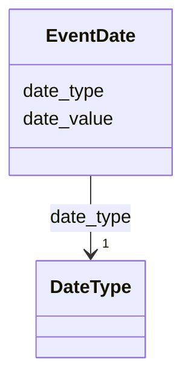

---
search:
  boost: 10.0
---

# Class: EventDate 


_Expressão complexa de uma data que pode se referir ao começo ou ao término de um evento pontual ou de uma decorrência prolongada. Permite expressar as datas de corte inicial e final, cada uma com seus respetivos graus de confiabilidade e de precisão._

__


<div data-search-exclude markdown="1">


URI: [wasth:EventDate](https://tradicional.arq.br/schema/EventDate)





<!-- no inheritance hierarchy -->

## Slots

| Name | Cardinality and Range | Description | Inheritance |
| ---  | --- | --- | --- |
| [date_type](date_type.md) | 1 <br/> [DateType](DateType.md) | Qualifica a confiabilidade da data como sendo conhecida ou estimada | direct |
| [date_value](date_value.md) | 0..1 <br/> [Date](Date.md) | Usar o formato ISO-8601 (AAAA-MM-DD) | direct |


## Usages

| used by | used in | type | used |
| ---  | --- | --- | --- |
| [Right](Right.md) | [temporal](temporal.md) | range | [EventDate](EventDate.md) |
| [Event](Event.md) | [start_date](start_date.md) | range | [EventDate](EventDate.md) |
| [Event](Event.md) | [end_date](end_date.md) | range | [EventDate](EventDate.md) |


## Comments

* ⚠️  Não temos padrão estabelecido para datas anteriores ao calendário gregoriano (1583), antes de Cristo, ou convertidas de outros calendários. Datas no calendário juliano podem ser expressadas nominalmente. Datas da era ibérica podem usar o valor nominal do dia e do mês, tendo o ano convertido para o gregoriano. Datas de calendários não cristãos podem ser convertidas para a data gregoriana correspondente, mesmo as anteriores a 1583.
Ver <https://en.wikipedia.org/wiki/ISO_8601#Dates> para a discussão dessa dificuldade, cuja solução depende do estabelecimento de um padrão específico para cada caso.

## Notes

* A wrapper for the expression of a date by providing a set of years as earliest and latest date delimiting the respective span of time, usually given in the proleptic Gregorian calendar.
If it is an exact date, possibly with time, repeat the same date (and time) in Earliest Date and Latest Date elements.


## Identifier and Mapping Information


### Schema Source


* from schema: https://tradicional.arq.br/schema


## Mappings

| Mapping Type | Mapped Value |
| ---  | ---  |
| self | wasth:EventDate |
| native | wasth:EventDate |


## LinkML Source

<!-- TODO: investigate https://stackoverflow.com/questions/37606292/how-to-create-tabbed-code-blocks-in-mkdocs-or-sphinx -->

### Direct

<details>
```yaml
name: EventDate
description: 'Expressão complexa de uma data que pode se referir ao começo ou ao término
  de um evento pontual ou de uma decorrência prolongada. Permite expressar as datas
  de corte inicial e final, cada uma com seus respetivos graus de confiabilidade e
  de precisão.

  '
notes:
- 'A wrapper for the expression of a date by providing a set of years as earliest
  and latest date delimiting the respective span of time, usually given in the proleptic
  Gregorian calendar.

  If it is an exact date, possibly with time, repeat the same date (and time) in Earliest
  Date and Latest Date elements.'
comments:
- '⚠️  Não temos padrão estabelecido para datas anteriores ao calendário gregoriano
  (1583), antes de Cristo, ou convertidas de outros calendários. Datas no calendário
  juliano podem ser expressadas nominalmente. Datas da era ibérica podem usar o valor
  nominal do dia e do mês, tendo o ano convertido para o gregoriano. Datas de calendários
  não cristãos podem ser convertidas para a data gregoriana correspondente, mesmo
  as anteriores a 1583.

  Ver <https://en.wikipedia.org/wiki/ISO_8601#Dates> para a discussão dessa dificuldade,
  cuja solução depende do estabelecimento de um padrão específico para cada caso.'
from_schema: https://tradicional.arq.br/schema
attributes:
  date_type:
    name: date_type
    description: 'Qualifica a confiabilidade da data como sendo conhecida ou estimada.
      A confiabilidade independe do grau de precisão da data.

      '
    from_schema: https://tradicional.arq.br/schema/temporal
    rank: 1000
    alias: type
    domain_of:
    - EventDate
    range: DateType
    required: true
  date_value:
    name: date_value
    description: 'Usar o formato ISO-8601 (AAAA-MM-DD). Para datas imprecisas, usar
      o PRIMEIRO ou o ÚLTIMO dia, mês ou ano do período delimitado, conforme se tratar
      de uma data de corte inicial ou final para o evento, e descrever verbalmente
      o período no campo `display_date`.

      '
    from_schema: https://tradicional.arq.br/schema/temporal
    rank: 1000
    domain_of:
    - EventDate
    range: date

```
</details>

### Induced

<details>
```yaml
name: EventDate
description: 'Expressão complexa de uma data que pode se referir ao começo ou ao término
  de um evento pontual ou de uma decorrência prolongada. Permite expressar as datas
  de corte inicial e final, cada uma com seus respetivos graus de confiabilidade e
  de precisão.

  '
notes:
- 'A wrapper for the expression of a date by providing a set of years as earliest
  and latest date delimiting the respective span of time, usually given in the proleptic
  Gregorian calendar.

  If it is an exact date, possibly with time, repeat the same date (and time) in Earliest
  Date and Latest Date elements.'
comments:
- '⚠️  Não temos padrão estabelecido para datas anteriores ao calendário gregoriano
  (1583), antes de Cristo, ou convertidas de outros calendários. Datas no calendário
  juliano podem ser expressadas nominalmente. Datas da era ibérica podem usar o valor
  nominal do dia e do mês, tendo o ano convertido para o gregoriano. Datas de calendários
  não cristãos podem ser convertidas para a data gregoriana correspondente, mesmo
  as anteriores a 1583.

  Ver <https://en.wikipedia.org/wiki/ISO_8601#Dates> para a discussão dessa dificuldade,
  cuja solução depende do estabelecimento de um padrão específico para cada caso.'
from_schema: https://tradicional.arq.br/schema
attributes:
  date_type:
    name: date_type
    description: 'Qualifica a confiabilidade da data como sendo conhecida ou estimada.
      A confiabilidade independe do grau de precisão da data.

      '
    from_schema: https://tradicional.arq.br/schema/temporal
    rank: 1000
    alias: type
    owner: EventDate
    domain_of:
    - EventDate
    range: DateType
    required: true
  date_value:
    name: date_value
    description: 'Usar o formato ISO-8601 (AAAA-MM-DD). Para datas imprecisas, usar
      o PRIMEIRO ou o ÚLTIMO dia, mês ou ano do período delimitado, conforme se tratar
      de uma data de corte inicial ou final para o evento, e descrever verbalmente
      o período no campo `display_date`.

      '
    from_schema: https://tradicional.arq.br/schema/temporal
    rank: 1000
    owner: EventDate
    domain_of:
    - EventDate
    range: date

```
</details></div>