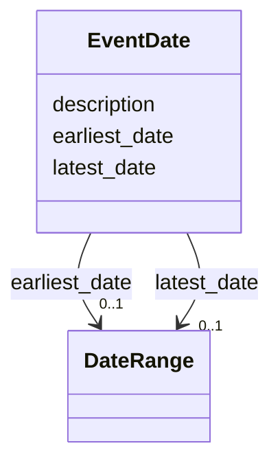

---
search:
  boost: 10.0
---

# Class: EventDate


_A wrapper for the expression of a date by providing a set of years as earliest and latest date delimiting the respective span of time, usually given in the proleptic Gregorian calendar._

_If it is an exact date, possibly with time, repeat the same date (and time) in Earliest Date and Latest Date elements._

__


<div data-search-exclude markdown="1">


URI: [wasth:EventDate](https://tradicional.arq.br/schema/EventDate)





<!-- no inheritance hierarchy -->

## Slots

| Name | Cardinality and Range | Description | Inheritance |
| ---  | --- | --- | --- |
| [description](description.md) | 0..1 <br/> [String](String.md) | A human-readable description for a thing | direct |
| [earliest_date](earliest_date.md) | 0..1 <br/> [DateRange](DateRange.md) | An index element for the expression of an exact or estimated date, for instan... | direct |
| [latest_date](latest_date.md) | 0..1 <br/> [DateRange](DateRange.md) | An index element for the expression of the exact or approximate date, for ins... | direct |


## Usages

| used by | used in | type | used |
| ---  | --- | --- | --- |
| [Right](Right.md) | [temporal](temporal.md) | range | [EventDate](EventDate.md) |
| [Event](Event.md) | [event_date](event_date.md) | range | [EventDate](EventDate.md) |
| [Event](Event.md) | [start_date](start_date.md) | range | [EventDate](EventDate.md) |
| [Event](Event.md) | [end_date](end_date.md) | range | [EventDate](EventDate.md) |


## Identifier and Mapping Information


### Schema Source


* from schema: https://tradicional.arq.br/schema


## Mappings

| Mapping Type | Mapped Value |
| ---  | ---  |
| self | wasth:EventDate |
| native | wasth:EventDate |


## LinkML Source

<!-- TODO: investigate https://stackoverflow.com/questions/37606292/how-to-create-tabbed-code-blocks-in-mkdocs-or-sphinx -->

### Direct

<details>
```yaml
name: EventDate
description: 'A wrapper for the expression of a date by providing a set of years as
  earliest and latest date delimiting the respective span of time, usually given in
  the proleptic Gregorian calendar.

  If it is an exact date, possibly with time, repeat the same date (and time) in Earliest
  Date and Latest Date elements.

  '
from_schema: https://tradicional.arq.br/schema
slots:
- description
attributes:
  earliest_date:
    name: earliest_date
    description: 'An index element for the expression of an exact or estimated date,
      for instance a year or calendar date, that delimits the beginning of a date
      span.

      '
    from_schema: https://tradicional.arq.br/schema/temporal
    rank: 1000
    domain_of:
    - EventDate
    range: DateRange
  latest_date:
    name: latest_date
    description: 'An index element for the expression of the exact or approximate
      date, for instance a year or calendar date, that delimits the end of a date
      span.

      '
    from_schema: https://tradicional.arq.br/schema/temporal
    rank: 1000
    domain_of:
    - EventDate
    range: DateRange

```
</details>

### Induced

<details>
```yaml
name: EventDate
description: 'A wrapper for the expression of a date by providing a set of years as
  earliest and latest date delimiting the respective span of time, usually given in
  the proleptic Gregorian calendar.

  If it is an exact date, possibly with time, repeat the same date (and time) in Earliest
  Date and Latest Date elements.

  '
from_schema: https://tradicional.arq.br/schema
attributes:
  earliest_date:
    name: earliest_date
    description: 'An index element for the expression of an exact or estimated date,
      for instance a year or calendar date, that delimits the beginning of a date
      span.

      '
    from_schema: https://tradicional.arq.br/schema/temporal
    rank: 1000
    owner: EventDate
    domain_of:
    - EventDate
    range: DateRange
  latest_date:
    name: latest_date
    description: 'An index element for the expression of the exact or approximate
      date, for instance a year or calendar date, that delimits the end of a date
      span.

      '
    from_schema: https://tradicional.arq.br/schema/temporal
    rank: 1000
    owner: EventDate
    domain_of:
    - EventDate
    range: DateRange
  description:
    name: description
    description: A human-readable description for a thing
    from_schema: https://tradicional.arq.br/schema
    rank: 1000
    slot_uri: dcterms:description
    alias: display
    owner: EventDate
    domain_of:
    - ConceptReference
    - Measurement
    - BibliographicCitation
    - RelatedObject
    - MediaObject
    - EventDate
    - EventPlace
    - RelatedEvent
    - Thing
    - Appellation
    - Inscription
    - Topic
    range: string

```
</details></div>
