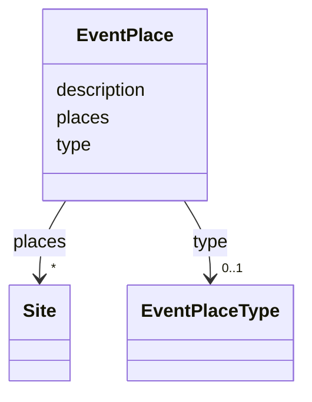

---
search:
  boost: 10.0
---

# Class: EventPlace

<div data-search-exclude markdown="1">


URI: [wasth:EventPlace](https://tradicional.arq.br/schema/EventPlace)





<!-- no inheritance hierarchy -->

## Slots

| Name | Cardinality and Range | Description | Inheritance |
| ---  | --- | --- | --- |
| [description](description.md) | 0..1 <br/> [String](String.md) | A human-readable description for a thing | direct |
| [type](type.md) | 0..1 <br/> [EventPlaceType](EventPlaceType.md) |  | direct |
| [places](places.md) | * <br/> [Site](Site.md) |  | direct |


## Usages

| used by | used in | type | used |
| ---  | --- | --- | --- |
| [Event](Event.md) | [place](place.md) | range | [EventPlace](EventPlace.md) |


## Identifier and Mapping Information


### Schema Source


* from schema: https://tradicional.arq.br/schema


## Mappings

| Mapping Type | Mapped Value |
| ---  | ---  |
| self | wasth:EventPlace |
| native | wasth:EventPlace |


## LinkML Source

<!-- TODO: investigate https://stackoverflow.com/questions/37606292/how-to-create-tabbed-code-blocks-in-mkdocs-or-sphinx -->

### Direct

<details>
```yaml
name: EventPlace
from_schema: https://tradicional.arq.br/schema
slots:
- description
attributes:
  type:
    name: type
    from_schema: https://tradicional.arq.br/schema/temporal
    domain_of:
    - Measurements
    - Event
    - StylePeriod
    - EventPlace
    - Inscription
    - Topic
    - HistoricPlace
    range: EventPlaceType
  places:
    name: places
    from_schema: https://tradicional.arq.br/schema/temporal
    alias: places
    domain_of:
    - Container
    - EventPlace
    range: Site
    multivalued: true
    inlined_as_list: true

```
</details>

### Induced

<details>
```yaml
name: EventPlace
from_schema: https://tradicional.arq.br/schema
attributes:
  type:
    name: type
    from_schema: https://tradicional.arq.br/schema/temporal
    owner: EventPlace
    domain_of:
    - Measurements
    - Event
    - StylePeriod
    - EventPlace
    - Inscription
    - Topic
    - HistoricPlace
    range: EventPlaceType
  places:
    name: places
    from_schema: https://tradicional.arq.br/schema/temporal
    alias: places
    owner: EventPlace
    domain_of:
    - Container
    - EventPlace
    range: Site
    multivalued: true
    inlined: true
    inlined_as_list: true
  description:
    name: description
    description: A human-readable description for a thing
    from_schema: https://tradicional.arq.br/schema
    rank: 1000
    slot_uri: dcterms:description
    alias: display
    owner: EventPlace
    domain_of:
    - ConceptReference
    - Measurements
    - BibliographicCitation
    - RelatedObject
    - Media
    - EventDate
    - EventPlace
    - RelatedEvent
    - Thing
    - Appellation
    - Inscription
    - Topic
    range: string

```
</details></div>
