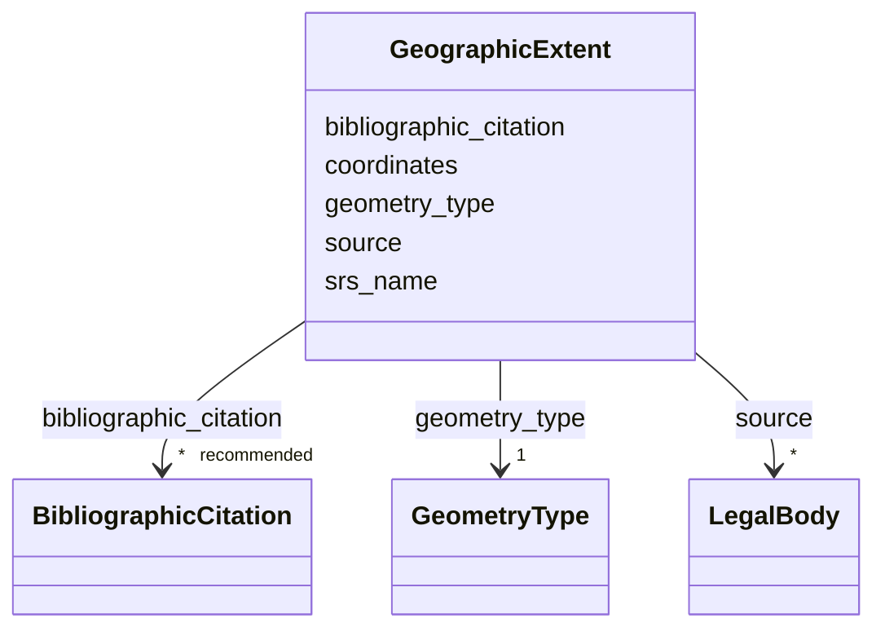

---
search:
  boost: 10.0
---

# Class: GeographicExtent


_Coordenadas do polígono que define o sítio._

__


<div data-search-exclude markdown="1">


URI: [wasth:GeographicExtent](https://tradicional.arq.br/schema/GeographicExtent)





<!-- no inheritance hierarchy -->

## Slots

| Name | Cardinality and Range | Description | Inheritance |
| ---  | --- | --- | --- |
| [srs_name](srs_name.md) | 0..1 _recommended_ <br/> [Uriorcurie](Uriorcurie.md) | Names the coordinate reference system (CRS) that defines the semantics of the... | direct |
| [source](source.md) | * <br/> [LegalBody](LegalBody.md) |  | direct |
| [bibliographic_citation](bibliographic_citation.md) | * _recommended_ <br/> [BibliographicCitation](BibliographicCitation.md) |  | direct |
| [geometry_type](geometry_type.md) | 1 <br/> [GeometryType](GeometryType.md) | Tipo da geometria descrita pelas coordenadas | direct |
| [coordinates](coordinates.md) | 1 <br/> [GeoJSONCoordinateArray](GeoJSONCoordinateArray.md) | No QGIS, usar a ferramenta `Get WKT` para obter as coordenadas do | direct |


## Usages

| used by | used in | type | used |
| ---  | --- | --- | --- |
| [Site](Site.md) | [extent](extent.md) | range | [GeographicExtent](GeographicExtent.md) |


## Identifier and Mapping Information


### Schema Source


* from schema: https://tradicional.arq.br/schema


## Mappings

| Mapping Type | Mapped Value |
| ---  | ---  |
| self | wasth:GeographicExtent |
| native | wasth:GeographicExtent |


## LinkML Source

<!-- TODO: investigate https://stackoverflow.com/questions/37606292/how-to-create-tabbed-code-blocks-in-mkdocs-or-sphinx -->

### Direct

<details>
```yaml
name: GeographicExtent
description: 'Coordenadas do polígono que define o sítio.

  '
from_schema: https://tradicional.arq.br/schema
slots:
- srs_name
- source
- bibliographic_citation
attributes:
  geometry_type:
    name: geometry_type
    description: Tipo da geometria descrita pelas coordenadas.
    from_schema: https://tradicional.arq.br/schema/place
    rank: 1000
    alias: type
    domain_of:
    - GeographicExtent
    range: GeometryType
    required: true
  coordinates:
    name: coordinates
    description: 'No QGIS, usar a ferramenta `Get WKT` para obter as coordenadas do

      polígono (`extent`) com a opção `Get JSON` — copiar apenas os

      colchetes `[[[ ]]]` e os valores numéricos dentro deles.

      '
    from_schema: https://tradicional.arq.br/schema/place
    rank: 1000
    domain_of:
    - GeographicExtent
    range: GeoJSONCoordinateArray
    required: true

```
</details>

### Induced

<details>
```yaml
name: GeographicExtent
description: 'Coordenadas do polígono que define o sítio.

  '
from_schema: https://tradicional.arq.br/schema
attributes:
  geometry_type:
    name: geometry_type
    description: Tipo da geometria descrita pelas coordenadas.
    from_schema: https://tradicional.arq.br/schema/place
    rank: 1000
    alias: type
    owner: GeographicExtent
    domain_of:
    - GeographicExtent
    range: GeometryType
    required: true
  coordinates:
    name: coordinates
    description: 'No QGIS, usar a ferramenta `Get WKT` para obter as coordenadas do

      polígono (`extent`) com a opção `Get JSON` — copiar apenas os

      colchetes `[[[ ]]]` e os valores numéricos dentro deles.

      '
    from_schema: https://tradicional.arq.br/schema/place
    rank: 1000
    owner: GeographicExtent
    domain_of:
    - GeographicExtent
    range: GeoJSONCoordinateArray
    required: true
  srs_name:
    name: srs_name
    description: Names the coordinate reference system (CRS) that defines the semantics
      of the lat/long pair according to the ISO6709 standard.
    from_schema: https://tradicional.arq.br/schema
    rank: 1000
    ifabsent: string(EPSG:4326)
    alias: srsName
    owner: GeographicExtent
    domain_of:
    - GeographicPoint
    - GeographicExtent
    range: uriorcurie
    recommended: true
    inlined: true
  source:
    name: source
    from_schema: https://tradicional.arq.br/schema
    rank: 1000
    owner: GeographicExtent
    domain_of:
    - GeographicPoint
    - GeographicExtent
    - TypedReference
    - RelatedObject
    - Media
    range: LegalBody
    multivalued: true
    inlined: true
    inlined_as_list: true
  bibliographic_citation:
    name: bibliographic_citation
    from_schema: https://tradicional.arq.br/schema
    rank: 1000
    slot_uri: dcterms:bibliographicCitation
    owner: GeographicExtent
    domain_of:
    - ConceptReference
    - GeographicPoint
    - GeographicExtent
    - TypedReference
    - Measurements
    - RelatedObject
    - Media
    - Actor
    - Thing
    - Appellation
    - Inscription
    range: BibliographicCitation
    recommended: true
    multivalued: true
    inlined: true
    inlined_as_list: true

```
</details></div>
