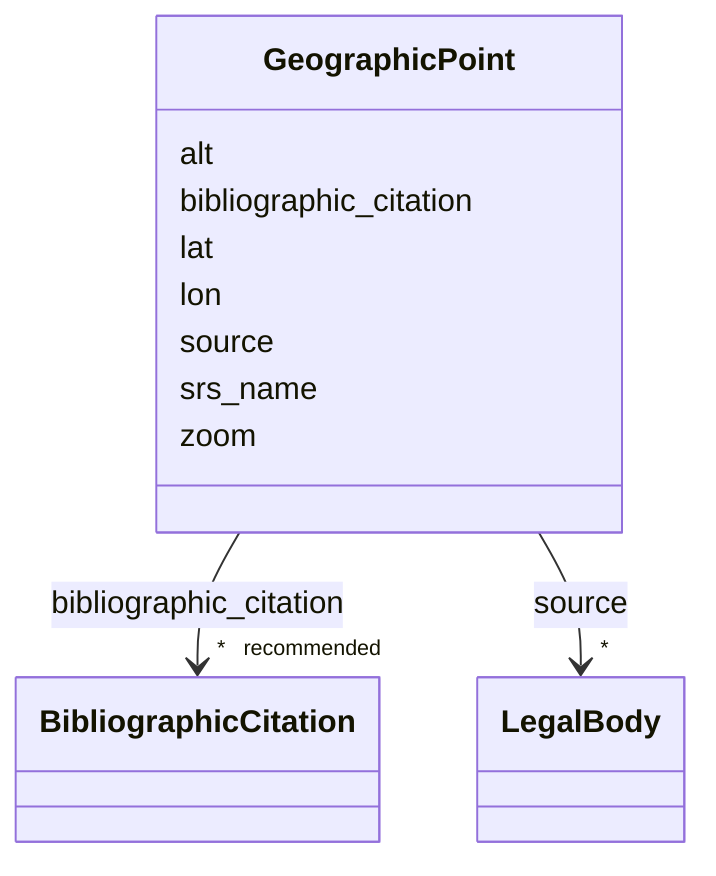

---
search:
  boost: 10.0
---

# Class: GeographicPoint


_Coordenadas do ponto que situa o sítio na visualização do mapa._

_A fonte preferencial de autoridade para o georreferenciamento é um órgão público, por exemplo o IPHAN no Brasil (usando as coordenadas informadas no [SICG]) ou a DGMN em Portugal (usando as coordenadas informadas no [SIPA])._

_Caso não haja georreferenciamento oficial, usar uma planta cadastral municipal georreferenciada ou, na falta desta, o [Global Building Atlas]. Nesses casos, para se obter as coordenadas de georreferenciamento, é preciso usar um Sistema de Informações Geográficas da sua preferência._

_Como exemplo, no [QGIS], isso pode ser feito seguindo as instruções abaixo :_

_1. Sempre projetar o mapa usando EPSG:4326 (WGS84) ;_

_2. Selecionar o polígono da edificação na camada da planta cadastral ou_

_   do Global Building Atlas ;_

__

_3. Rodar o comando do menu `Vector > Geometry Tools > Centroids` para_

_  obter as coordenadas do ponto (`location`) — ele vai criar uma camada_

_  temporária com o ponto no centróide do polígono selecionado ;_

__

_4. Usar novamente a ferramenta `Get WKT` para visualizar as coordenadas,_

_  copiar os valores e colar na ficha com o grau de precisão (casas_

_  decimais) desejado._

__


<div data-search-exclude markdown="1">


URI: [wasth:GeographicPoint](https://tradicional.arq.br/schema/GeographicPoint)





<!-- no inheritance hierarchy -->

## Slots

| Name | Cardinality and Range | Description | Inheritance |
| ---  | --- | --- | --- |
| [srs_name](srs_name.md) | 0..1 _recommended_ <br/> [Uriorcurie](Uriorcurie.md) | Names the coordinate reference system (CRS) that defines the semantics of the... | direct |
| [source](source.md) | * <br/> [LegalBody](LegalBody.md) |  | direct |
| [bibliographic_citation](bibliographic_citation.md) | * _recommended_ <br/> [BibliographicCitation](BibliographicCitation.md) |  | direct |
| [lat](lat.md) | 1 <br/> [Latitude](Latitude.md) | Latitude em graus decimais (separador decimal: ponto) | direct |
| [lon](lon.md) | 1 <br/> [Longitude](Longitude.md) | Longitude em graus decimais (separador decimal: ponto) | direct |
| [alt](alt.md) | 0..1 <br/> [Float](Float.md) | Altitude em metros (separador decimal: ponto) | direct |
| [zoom](zoom.md) | 0..1 <br/> [Integer](Integer.md) | Usado para visualizar o mapa mais de longe se a precisão das coordenadas for ... | direct |


## Usages

| used by | used in | type | used |
| ---  | --- | --- | --- |
| [Site](Site.md) | [location](location.md) | range | [GeographicPoint](GeographicPoint.md) |


## Identifier and Mapping Information


### Schema Source


* from schema: https://tradicional.arq.br/schema


## Mappings

| Mapping Type | Mapped Value |
| ---  | ---  |
| self | wasth:GeographicPoint |
| native | wasth:GeographicPoint |


## LinkML Source

<!-- TODO: investigate https://stackoverflow.com/questions/37606292/how-to-create-tabbed-code-blocks-in-mkdocs-or-sphinx -->

### Direct

<details>
```yaml
name: GeographicPoint
description: "Coordenadas do ponto que situa o sítio na visualização do mapa.\nA fonte\
  \ preferencial de autoridade para o georreferenciamento é um órgão público, por\
  \ exemplo o IPHAN no Brasil (usando as coordenadas informadas no [SICG]) ou a DGMN\
  \ em Portugal (usando as coordenadas informadas no [SIPA]).\nCaso não haja georreferenciamento\
  \ oficial, usar uma planta cadastral municipal georreferenciada ou, na falta desta,\
  \ o [Global Building Atlas]. Nesses casos, para se obter as coordenadas de georreferenciamento,\
  \ é preciso usar um Sistema de Informações Geográficas da sua preferência.\nComo\
  \ exemplo, no [QGIS], isso pode ser feito seguindo as instruções abaixo :\n1. Sempre\
  \ projetar o mapa usando EPSG:4326 (WGS84) ;\n2. Selecionar o polígono da edificação\
  \ na camada da planta cadastral ou\n   do Global Building Atlas ;\n\n3. Rodar o\
  \ comando do menu `Vector > Geometry Tools > Centroids` para\n  obter as coordenadas\
  \ do ponto (`location`) — ele vai criar uma camada\n  temporária com o ponto no\
  \ centróide do polígono selecionado ;\n\n4. Usar novamente a ferramenta `Get WKT`\
  \ para visualizar as coordenadas,\n  copiar os valores e colar na ficha com o grau\
  \ de precisão (casas\n  decimais) desejado.\n"
from_schema: https://tradicional.arq.br/schema
slots:
- srs_name
- source
- bibliographic_citation
attributes:
  lat:
    name: lat
    description: 'Latitude em graus decimais (separador decimal: ponto).'
    from_schema: https://tradicional.arq.br/schema/place
    rank: 1000
    domain_of:
    - GeographicPoint
    range: Latitude
    required: true
  lon:
    name: lon
    description: 'Longitude em graus decimais (separador decimal: ponto).'
    from_schema: https://tradicional.arq.br/schema/place
    rank: 1000
    domain_of:
    - GeographicPoint
    range: Longitude
    required: true
  alt:
    name: alt
    description: 'Altitude em metros (separador decimal: ponto)'
    from_schema: https://tradicional.arq.br/schema/place
    rank: 1000
    domain_of:
    - GeographicPoint
    range: float
    minimum_value: -1000
    maximum_value: 10000
  zoom:
    name: zoom
    description: 'Usado para visualizar o mapa mais de longe se a precisão das coordenadas
      for baixa.

      '
    from_schema: https://tradicional.arq.br/schema/place
    rank: 1000
    ifabsent: integer(13)
    domain_of:
    - GeographicPoint
    range: integer
    minimum_value: 0
    maximum_value: 18

```
</details>

### Induced

<details>
```yaml
name: GeographicPoint
description: "Coordenadas do ponto que situa o sítio na visualização do mapa.\nA fonte\
  \ preferencial de autoridade para o georreferenciamento é um órgão público, por\
  \ exemplo o IPHAN no Brasil (usando as coordenadas informadas no [SICG]) ou a DGMN\
  \ em Portugal (usando as coordenadas informadas no [SIPA]).\nCaso não haja georreferenciamento\
  \ oficial, usar uma planta cadastral municipal georreferenciada ou, na falta desta,\
  \ o [Global Building Atlas]. Nesses casos, para se obter as coordenadas de georreferenciamento,\
  \ é preciso usar um Sistema de Informações Geográficas da sua preferência.\nComo\
  \ exemplo, no [QGIS], isso pode ser feito seguindo as instruções abaixo :\n1. Sempre\
  \ projetar o mapa usando EPSG:4326 (WGS84) ;\n2. Selecionar o polígono da edificação\
  \ na camada da planta cadastral ou\n   do Global Building Atlas ;\n\n3. Rodar o\
  \ comando do menu `Vector > Geometry Tools > Centroids` para\n  obter as coordenadas\
  \ do ponto (`location`) — ele vai criar uma camada\n  temporária com o ponto no\
  \ centróide do polígono selecionado ;\n\n4. Usar novamente a ferramenta `Get WKT`\
  \ para visualizar as coordenadas,\n  copiar os valores e colar na ficha com o grau\
  \ de precisão (casas\n  decimais) desejado.\n"
from_schema: https://tradicional.arq.br/schema
attributes:
  lat:
    name: lat
    description: 'Latitude em graus decimais (separador decimal: ponto).'
    from_schema: https://tradicional.arq.br/schema/place
    rank: 1000
    owner: GeographicPoint
    domain_of:
    - GeographicPoint
    range: Latitude
    required: true
  lon:
    name: lon
    description: 'Longitude em graus decimais (separador decimal: ponto).'
    from_schema: https://tradicional.arq.br/schema/place
    rank: 1000
    owner: GeographicPoint
    domain_of:
    - GeographicPoint
    range: Longitude
    required: true
  alt:
    name: alt
    description: 'Altitude em metros (separador decimal: ponto)'
    from_schema: https://tradicional.arq.br/schema/place
    rank: 1000
    owner: GeographicPoint
    domain_of:
    - GeographicPoint
    range: float
    minimum_value: -1000
    maximum_value: 10000
  zoom:
    name: zoom
    description: 'Usado para visualizar o mapa mais de longe se a precisão das coordenadas
      for baixa.

      '
    from_schema: https://tradicional.arq.br/schema/place
    rank: 1000
    ifabsent: integer(13)
    owner: GeographicPoint
    domain_of:
    - GeographicPoint
    range: integer
    minimum_value: 0
    maximum_value: 18
  srs_name:
    name: srs_name
    description: Names the coordinate reference system (CRS) that defines the semantics
      of the lat/long pair according to the ISO6709 standard.
    from_schema: https://tradicional.arq.br/schema
    rank: 1000
    alias: srsName
    owner: GeographicPoint
    domain_of:
    - GeographicPoint
    - GeographicExtent
    range: uriorcurie
    recommended: true
    inlined: true
  source:
    name: source
    from_schema: https://tradicional.arq.br/schema
    rank: 1000
    owner: GeographicPoint
    domain_of:
    - GeographicPoint
    - GeographicExtent
    - RelatedObject
    - MediaObject
    - TypedReference
    range: LegalBody
    multivalued: true
    inlined: true
    inlined_as_list: true
  bibliographic_citation:
    name: bibliographic_citation
    from_schema: https://tradicional.arq.br/schema
    rank: 1000
    slot_uri: dcterms:bibliographicCitation
    owner: GeographicPoint
    domain_of:
    - ConceptReference
    - GeographicPoint
    - GeographicExtent
    - RelatedObject
    - MediaObject
    - TypedReference
    - Measurement
    - Actor
    - Thing
    - Appellation
    - Inscription
    range: BibliographicCitation
    recommended: true
    multivalued: true
    inlined: true
    inlined_as_list: true

```
</details></div>
