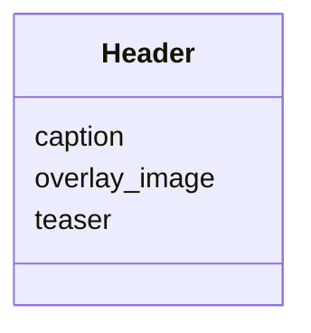

---
search:
  boost: 10.0
---

# Class: Header


_Presentation metadata for the WASTH interface._


<div data-search-exclude markdown="1">


URI: [wasth:Header](https://tradicional.arq.br/schema/Header)





<!-- no inheritance hierarchy -->

## Slots

| Name | Cardinality and Range | Description | Inheritance |
| ---  | --- | --- | --- |
| [teaser](teaser.md) | 0..1 <br/> [Uriorcurie](Uriorcurie.md) |  | direct |
| [overlay_image](overlay_image.md) | 0..1 <br/> [Uriorcurie](Uriorcurie.md) |  | direct |
| [caption](caption.md) | 0..1 <br/> [String](String.md) | Legenda descritiva ou explicativa | direct |


## Identifier and Mapping Information


### Schema Source


* from schema: https://tradicional.arq.br/schema


## Mappings

| Mapping Type | Mapped Value |
| ---  | ---  |
| self | wasth:Header |
| native | wasth:Header |


## LinkML Source

<!-- TODO: investigate https://stackoverflow.com/questions/37606292/how-to-create-tabbed-code-blocks-in-mkdocs-or-sphinx -->

### Direct

<details>
```yaml
name: Header
description: Presentation metadata for the WASTH interface.
from_schema: https://tradicional.arq.br/schema
slots:
- teaser
- overlay_image
- caption

```
</details>

### Induced

<details>
```yaml
name: Header
description: Presentation metadata for the WASTH interface.
from_schema: https://tradicional.arq.br/schema
attributes:
  teaser:
    name: teaser
    from_schema: https://tradicional.arq.br/schema
    rank: 1000
    owner: Header
    domain_of:
    - Header
    range: uriorcurie
  overlay_image:
    name: overlay_image
    from_schema: https://tradicional.arq.br/schema
    rank: 1000
    owner: Header
    domain_of:
    - Header
    range: uriorcurie
  caption:
    name: caption
    description: Legenda descritiva ou explicativa.
    from_schema: https://tradicional.arq.br/schema
    rank: 1000
    alias: caption
    owner: Header
    domain_of:
    - Header
    range: string

```
</details></div>
