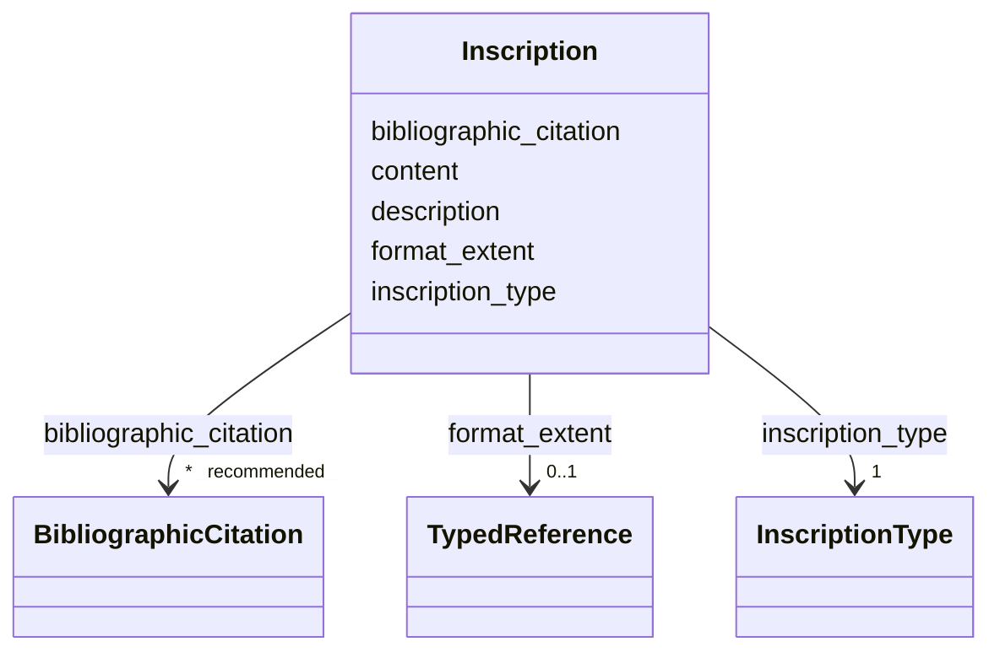

---
search:
  boost: 10.0
---

# Class: Inscription 


_A descrição da inscrição informa local, dimensões e características. Os tipos de descrição podem ser extraídos da hierarquia Getty: <http://vocab.getty.edu/page/aat/300220469>._

_Os itens das listas de `material` e `technique` DEVEM usar o nosso [vocabulário controlado](https://vocabulario.tradicional.arq.br)._

_Essa distinção é especialmente relevante no caso de revestimentos, como estuques, azulejos ou pinturas decorativas, por oposição à base sobre a qual eles são aplicados._


<div data-search-exclude markdown="1">


URI: [wasth:Inscription](https://tradicional.arq.br/schema/Inscription)





<!-- no inheritance hierarchy -->

## Slots

| Name | Cardinality and Range | Description | Inheritance |
| ---  | --- | --- | --- |
| [format_extent](format_extent.md) | 0..1 <br/> [TypedReference](TypedReference.md) | Indica a parte do objeto que está sendo medida — por exemplo, se a altura é a... | direct |
| [description](description.md) | 0..1 <br/> [String](String.md) | A human-readable description for a thing | direct |
| [content](content.md) | 0..1 _recommended_ <br/> [String](String.md) | Conteúdo textual descritivo ou explicativo | direct |
| [bibliographic_citation](bibliographic_citation.md) | * _recommended_ <br/> [BibliographicCitation](BibliographicCitation.md) | 📚  Cadastro de uma referência bibliográfica | direct |
| [inscription_type](inscription_type.md) | 1 <br/> [InscriptionType](InscriptionType.md) | Determina a natureza da inscrição | direct |


## Usages

| used by | used in | type | used |
| ---  | --- | --- | --- |
| [Work](Work.md) | [inscriptions](inscriptions.md) | range | [Inscription](Inscription.md) |


## Identifier and Mapping Information


### Schema Source


* from schema: https://tradicional.arq.br/schema


## Mappings

| Mapping Type | Mapped Value |
| ---  | ---  |
| self | wasth:Inscription |
| native | wasth:Inscription |


## LinkML Source

<!-- TODO: investigate https://stackoverflow.com/questions/37606292/how-to-create-tabbed-code-blocks-in-mkdocs-or-sphinx -->

### Direct

<details>
```yaml
name: Inscription
description: 'A descrição da inscrição informa local, dimensões e características.
  Os tipos de descrição podem ser extraídos da hierarquia Getty: <http://vocab.getty.edu/page/aat/300220469>.

  Os itens das listas de `material` e `technique` DEVEM usar o nosso [vocabulário
  controlado](https://vocabulario.tradicional.arq.br).

  Essa distinção é especialmente relevante no caso de revestimentos, como estuques,
  azulejos ou pinturas decorativas, por oposição à base sobre a qual eles são aplicados.'
from_schema: https://tradicional.arq.br/schema
slots:
- format_extent
- description
- content
- bibliographic_citation
attributes:
  inscription_type:
    name: inscription_type
    description: 'Determina a natureza da inscrição.

      '
    from_schema: https://tradicional.arq.br/schema/work
    rank: 1000
    ifabsent: string(text)
    alias: type
    domain_of:
    - Inscription
    range: InscriptionType
    required: true

```
</details>

### Induced

<details>
```yaml
name: Inscription
description: 'A descrição da inscrição informa local, dimensões e características.
  Os tipos de descrição podem ser extraídos da hierarquia Getty: <http://vocab.getty.edu/page/aat/300220469>.

  Os itens das listas de `material` e `technique` DEVEM usar o nosso [vocabulário
  controlado](https://vocabulario.tradicional.arq.br).

  Essa distinção é especialmente relevante no caso de revestimentos, como estuques,
  azulejos ou pinturas decorativas, por oposição à base sobre a qual eles são aplicados.'
from_schema: https://tradicional.arq.br/schema
attributes:
  inscription_type:
    name: inscription_type
    description: 'Determina a natureza da inscrição.

      '
    from_schema: https://tradicional.arq.br/schema/work
    rank: 1000
    ifabsent: string(text)
    alias: type
    owner: Inscription
    domain_of:
    - Inscription
    range: InscriptionType
    required: true
  format_extent:
    name: format_extent
    description: 'Indica a parte do objeto que está sendo medida — por exemplo, se
      a altura é até a linha de coroamento ou até a cumeeira, etc. — usar a `uri`
      de um vocabulário controlado.

      '
    from_schema: https://tradicional.arq.br/schema
    rank: 1000
    alias: extent
    owner: Inscription
    domain_of:
    - Measurement
    - Inscription
    - Topic
    range: TypedReference
    inlined: true
  description:
    name: description
    description: A human-readable description for a thing
    from_schema: https://tradicional.arq.br/schema
    exact_mappings:
    - schema:description
    rank: 1000
    slot_uri: dcterms:description
    alias: display
    owner: Inscription
    domain_of:
    - ConceptReference
    - BibliographicCitation
    - RelatedObject
    - MediaObject
    - TypedReference
    - Measurement
    - RelatedEvent
    - Thing
    - Inscription
    - Topic
    range: string
  content:
    name: content
    description: Conteúdo textual descritivo ou explicativo.
    from_schema: https://tradicional.arq.br/schema
    rank: 1000
    slot_uri: skos:scopeNote
    owner: Inscription
    domain_of:
    - Thing
    - Inscription
    range: string
    recommended: true
  bibliographic_citation:
    name: bibliographic_citation
    description: '📚  Cadastro de uma referência bibliográfica.

      O campo `refid` deve conter a chave de citação (citation key) que consta do
      registro bibliográfico na biblioteca do nosso projeto de pesquisa no Zotero,
      começando com arroba @. Em geral, a chave de citação é o DOI ou ISBN da publicação,
      mas pode ser diferente.

      Se necessário, incluir no campo `note` uma especificação adicional, como o número
      da página da referência bibliográfica de onde a informação foi extraída.

      Usar o campo `description` para formatar a referência, caso a formatação automática
      do Zotero não for satisfatória.

      '
    from_schema: https://tradicional.arq.br/schema
    rank: 1000
    slot_uri: dcterms:bibliographicCitation
    owner: Inscription
    domain_of:
    - ConceptReference
    - RelatedObject
    - MediaObject
    - TypedReference
    - Measurement
    - Actor
    - Thing
    - Appellation
    - GeographicPoint
    - GeographicExtent
    - Inscription
    range: BibliographicCitation
    recommended: true
    multivalued: true
    inlined: true
    inlined_as_list: true

```
</details></div>