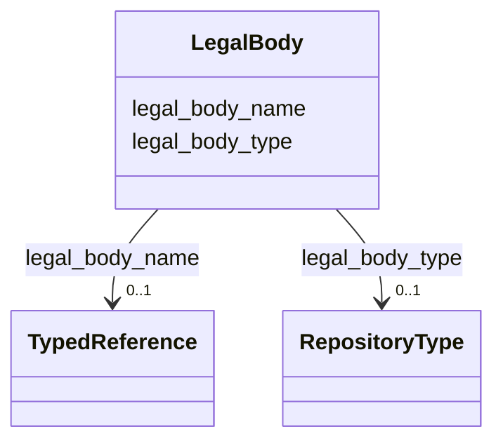

---
search:
  boost: 10.0
---

# Class: LegalBody 


_Referência a uma pessoa jurídica (pode ser um indivíduo detentor de direitos jurídicos específicos que se queira referenciar) ou entidade coletiva histórica._

__


<div data-search-exclude markdown="1">


URI: [wasth:LegalBody](https://tradicional.arq.br/schema/LegalBody)





<!-- no inheritance hierarchy -->

## Slots

| Name | Cardinality and Range | Description | Inheritance |
| ---  | --- | --- | --- |
| [legal_body_type](legal_body_type.md) | 0..1 <br/> [RepositoryType](RepositoryType.md) | Define a natureza do ente legal : pessoa jurídica, perímetro geográfico de tu... | direct |
| [legal_body_name](legal_body_name.md) | 0..1 <br/> [TypedReference](TypedReference.md) | Referencia a identidade do ente legal num vocabulário controlado ou repositór... | direct |


## Usages

| used by | used in | type | used |
| ---  | --- | --- | --- |
| [RelatedObject](RelatedObject.md) | [source](source.md) | range | [LegalBody](LegalBody.md) |
| [RelatedWork](RelatedWork.md) | [source](source.md) | range | [LegalBody](LegalBody.md) |
| [MediaObject](MediaObject.md) | [source](source.md) | range | [LegalBody](LegalBody.md) |
| [TypedReference](TypedReference.md) | [source](source.md) | range | [LegalBody](LegalBody.md) |
| [Right](Right.md) | [holder](holder.md) | range | [LegalBody](LegalBody.md) |
| [Repository](Repository.md) | [legal_body](legal_body.md) | range | [LegalBody](LegalBody.md) |
| [GeographicPoint](GeographicPoint.md) | [source](source.md) | range | [LegalBody](LegalBody.md) |
| [GeographicExtent](GeographicExtent.md) | [source](source.md) | range | [LegalBody](LegalBody.md) |


## Identifier and Mapping Information


### Schema Source


* from schema: https://tradicional.arq.br/schema


## Mappings

| Mapping Type | Mapped Value |
| ---  | ---  |
| self | wasth:LegalBody |
| native | wasth:LegalBody |


## LinkML Source

<!-- TODO: investigate https://stackoverflow.com/questions/37606292/how-to-create-tabbed-code-blocks-in-mkdocs-or-sphinx -->

### Direct

<details>
```yaml
name: LegalBody
description: 'Referência a uma pessoa jurídica (pode ser um indivíduo detentor de
  direitos jurídicos específicos que se queira referenciar) ou entidade coletiva histórica.

  '
from_schema: https://tradicional.arq.br/schema
attributes:
  legal_body_type:
    name: legal_body_type
    description: 'Define a natureza do ente legal : pessoa jurídica, perímetro geográfico
      de tutela, etc.

      '
    from_schema: https://tradicional.arq.br/schema/shared
    rank: 1000
    ifabsent: RepositoryType(corporate)
    alias: type
    domain_of:
    - LegalBody
    range: RepositoryType
  legal_body_name:
    name: legal_body_name
    description: 'Referencia a identidade do ente legal num vocabulário controlado
      ou repositório de identidades, tal como o ISNI.

      '
    from_schema: https://tradicional.arq.br/schema/shared
    rank: 1000
    alias: name
    domain_of:
    - LegalBody
    range: TypedReference
    inlined: true

```
</details>

### Induced

<details>
```yaml
name: LegalBody
description: 'Referência a uma pessoa jurídica (pode ser um indivíduo detentor de
  direitos jurídicos específicos que se queira referenciar) ou entidade coletiva histórica.

  '
from_schema: https://tradicional.arq.br/schema
attributes:
  legal_body_type:
    name: legal_body_type
    description: 'Define a natureza do ente legal : pessoa jurídica, perímetro geográfico
      de tutela, etc.

      '
    from_schema: https://tradicional.arq.br/schema/shared
    rank: 1000
    ifabsent: RepositoryType(corporate)
    alias: type
    owner: LegalBody
    domain_of:
    - LegalBody
    range: RepositoryType
  legal_body_name:
    name: legal_body_name
    description: 'Referencia a identidade do ente legal num vocabulário controlado
      ou repositório de identidades, tal como o ISNI.

      '
    from_schema: https://tradicional.arq.br/schema/shared
    rank: 1000
    alias: name
    owner: LegalBody
    domain_of:
    - LegalBody
    range: TypedReference
    inlined: true

```
</details></div>