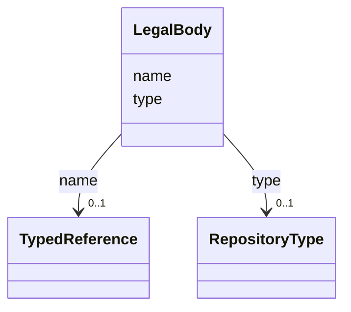

---
search:
  boost: 10.0
---

# Class: LegalBody


_Personal, corporate, family, or other responsible body._


<div data-search-exclude markdown="1">


URI: [wasth:LegalBody](https://tradicional.arq.br/schema/LegalBody)





<!-- no inheritance hierarchy -->

## Slots

| Name | Cardinality and Range | Description | Inheritance |
| ---  | --- | --- | --- |
| [type](type.md) | 0..1 <br/> [RepositoryType](RepositoryType.md) |  | direct |
| [name](name.md) | 0..1 <br/> [TypedReference](TypedReference.md) |  | direct |


## Usages

| used by | used in | type | used |
| ---  | --- | --- | --- |
| [GeographicPoint](GeographicPoint.md) | [source](source.md) | range | [LegalBody](LegalBody.md) |
| [GeographicExtent](GeographicExtent.md) | [source](source.md) | range | [LegalBody](LegalBody.md) |
| [RelatedObject](RelatedObject.md) | [source](source.md) | range | [LegalBody](LegalBody.md) |
| [RelatedWork](RelatedWork.md) | [source](source.md) | range | [LegalBody](LegalBody.md) |
| [MediaObject](MediaObject.md) | [source](source.md) | range | [LegalBody](LegalBody.md) |
| [TypedReference](TypedReference.md) | [source](source.md) | range | [LegalBody](LegalBody.md) |
| [Right](Right.md) | [holder](holder.md) | range | [LegalBody](LegalBody.md) |
| [Repository](Repository.md) | [legal_body](legal_body.md) | range | [LegalBody](LegalBody.md) |


## Identifier and Mapping Information


### Schema Source


* from schema: https://tradicional.arq.br/schema


## Mappings

| Mapping Type | Mapped Value |
| ---  | ---  |
| self | wasth:LegalBody |
| native | wasth:LegalBody |


## LinkML Source

<!-- TODO: investigate https://stackoverflow.com/questions/37606292/how-to-create-tabbed-code-blocks-in-mkdocs-or-sphinx -->

### Direct

<details>
```yaml
name: LegalBody
description: Personal, corporate, family, or other responsible body.
from_schema: https://tradicional.arq.br/schema
attributes:
  type:
    name: type
    from_schema: https://tradicional.arq.br/schema/shared
    ifabsent: string(corporate)
    alias: type
    domain_of:
    - Measurement
    - Right
    - LegalBody
    - Event
    - StylePeriod
    - EventPlace
    - Inscription
    - Topic
    - HistoricPlace
    range: RepositoryType
  name:
    name: name
    from_schema: https://tradicional.arq.br/schema/shared
    alias: name
    domain_of:
    - ConceptReference
    - LegalBody
    - RelatedEvent
    - HistoricPlace
    range: TypedReference
    inlined: true

```
</details>

### Induced

<details>
```yaml
name: LegalBody
description: Personal, corporate, family, or other responsible body.
from_schema: https://tradicional.arq.br/schema
attributes:
  type:
    name: type
    from_schema: https://tradicional.arq.br/schema/shared
    ifabsent: string(corporate)
    alias: type
    owner: LegalBody
    domain_of:
    - Measurement
    - Right
    - LegalBody
    - Event
    - StylePeriod
    - EventPlace
    - Inscription
    - Topic
    - HistoricPlace
    range: RepositoryType
  name:
    name: name
    from_schema: https://tradicional.arq.br/schema/shared
    alias: name
    owner: LegalBody
    domain_of:
    - ConceptReference
    - LegalBody
    - RelatedEvent
    - HistoricPlace
    range: TypedReference
    inlined: true

```
</details></div>
