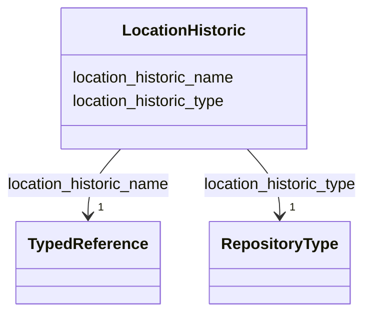

---
search:
  boost: 10.0
---

# Class: LocationHistoric 


_Designações alternativas ou jurisdições antigas para o mesmo local, NÃO a localização original de uma construção fisicamente deslocada (para tanto, cadastrar outra localização do tipo `former_site`). Preencher apenas caso a nomenclatura seja relevante, por exemplo para nomear as antigas províncias de Portugal ou o Oeste da Bahia, que originalmente pertencia a Pernambuco, ou ainda se for relevante informar uma região física._


<div data-search-exclude markdown="1">


URI: [wasth:LocationHistoric](https://tradicional.arq.br/schema/LocationHistoric)





<!-- no inheritance hierarchy -->

## Slots

| Name | Cardinality and Range | Description | Inheritance |
| ---  | --- | --- | --- |
| [location_historic_type](location_historic_type.md) | 1 <br/> [RepositoryType](RepositoryType.md) | Define se o local histórico designa uma jurisdição, um topônimo antigo, ou ou... | direct |
| [location_historic_name](location_historic_name.md) | 1 <br/> [TypedReference](TypedReference.md) | Identificação do local com referência a um vocabulário controlado ou repositó... | direct |


## Usages

| used by | used in | type | used |
| ---  | --- | --- | --- |
| [Work](Work.md) | [location_historic](location_historic.md) | range | [LocationHistoric](LocationHistoric.md) |


## Identifier and Mapping Information


### Schema Source


* from schema: https://tradicional.arq.br/schema


## Mappings

| Mapping Type | Mapped Value |
| ---  | ---  |
| self | wasth:LocationHistoric |
| native | wasth:LocationHistoric |


## LinkML Source

<!-- TODO: investigate https://stackoverflow.com/questions/37606292/how-to-create-tabbed-code-blocks-in-mkdocs-or-sphinx -->

### Direct

<details>
```yaml
name: LocationHistoric
description: Designações alternativas ou jurisdições antigas para o mesmo local, NÃO
  a localização original de uma construção fisicamente deslocada (para tanto, cadastrar
  outra localização do tipo `former_site`). Preencher apenas caso a nomenclatura seja
  relevante, por exemplo para nomear as antigas províncias de Portugal ou o Oeste
  da Bahia, que originalmente pertencia a Pernambuco, ou ainda se for relevante informar
  uma região física.
from_schema: https://tradicional.arq.br/schema
attributes:
  location_historic_type:
    name: location_historic_type
    description: 'Define se o local histórico designa uma jurisdição, um topônimo
      antigo, ou outro.

      '
    from_schema: https://tradicional.arq.br/schema/work
    rank: 1000
    alias: type
    domain_of:
    - LocationHistoric
    range: RepositoryType
    required: true
  location_historic_name:
    name: location_historic_name
    description: 'Identificação do local com referência a um vocabulário controlado
      ou repositório de topônimos tal como o geonames.

      '
    from_schema: https://tradicional.arq.br/schema/work
    rank: 1000
    alias: name
    domain_of:
    - LocationHistoric
    range: TypedReference
    required: true
    inlined: true

```
</details>

### Induced

<details>
```yaml
name: LocationHistoric
description: Designações alternativas ou jurisdições antigas para o mesmo local, NÃO
  a localização original de uma construção fisicamente deslocada (para tanto, cadastrar
  outra localização do tipo `former_site`). Preencher apenas caso a nomenclatura seja
  relevante, por exemplo para nomear as antigas províncias de Portugal ou o Oeste
  da Bahia, que originalmente pertencia a Pernambuco, ou ainda se for relevante informar
  uma região física.
from_schema: https://tradicional.arq.br/schema
attributes:
  location_historic_type:
    name: location_historic_type
    description: 'Define se o local histórico designa uma jurisdição, um topônimo
      antigo, ou outro.

      '
    from_schema: https://tradicional.arq.br/schema/work
    rank: 1000
    alias: type
    owner: LocationHistoric
    domain_of:
    - LocationHistoric
    range: RepositoryType
    required: true
  location_historic_name:
    name: location_historic_name
    description: 'Identificação do local com referência a um vocabulário controlado
      ou repositório de topônimos tal como o geonames.

      '
    from_schema: https://tradicional.arq.br/schema/work
    rank: 1000
    alias: name
    owner: LocationHistoric
    domain_of:
    - LocationHistoric
    range: TypedReference
    required: true
    inlined: true

```
</details></div>