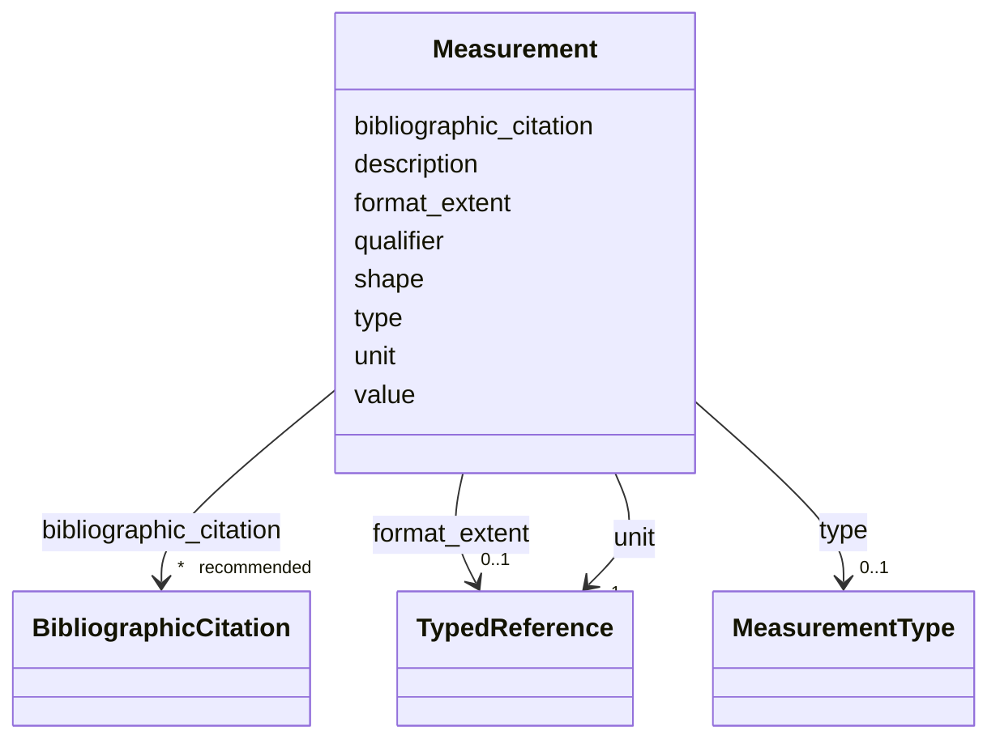

---
search:
  boost: 10.0
---

# Class: Measurement


_This class comprises actions measuring physical properties and other values that can be determined by a systematic, objective procedure of direct observation of particular states of physical reality._

_An instance of E16 Measurement may use simple counting or tools, such as yardsticks or radiation detection devices. The interest is in the method and care applied, so that the reliability of the result may be judged at a later stage, or research continued on the associated documents. The date of the event is important for dimensions, which may change value over time, such as the length of an object subject to shrinkage. Methods and devices employed should be associated with instances of E16 Measurement by properties such as: *P33 used specific technique*: E29 Design or Procedure, *P125 used object of type*: E55 Type, *P16 used specific object (was used for)*: E70 Thing, whereas basic techniques such as "carbon-14 dating" should be encoded using *P2 has type (is type of)*: E55 Type. Details of methods and devices reused or reusable in other instances of E16 Measurement should be documented for these entities rather than the measurements themselves, whereas details of particular execution may be documented by free text or by instantiating adequate sub-activities, if the detail may be of interest for an overarching query._

_Regardless whether a measurement is made by an instrument or by human senses, it represents the initial transition from physical reality to information without any other documented information object in between within the reasoning chain that would represent the result of the interaction of the observer or device with reality. Therefore, determining properties of an instance of E90 Symbolic Object is regarded as an instance of E13 Attribute Assignment, which may be inferred from observing and measuring representative carriers. In the case that the carrier can be named, the property *P16 used specific object (was used for)* should be used to indicate the instance(s) of E18 Physical Thing that was used as the empirical basis for the attribute assignment. For instance, inferring properties of depicted items using image material, such as satellite images, is not regarded as an instance of E16 Measurement, but as a subsequent instance of E13 Attribute Assignment. Rather, only the production of the images, understood as arrays of radiation intensities, is regarded as an instance of E16 Measurement. The same reasoning holds for other sensor data._

_O campo `description` permite uma representação textual das medidas da edificação, caso não seja possível cadastrar medidas individuais com precisão, ou seja preciso maior flexibilidade para explicar as dimensões._

__


<div data-search-exclude markdown="1">


URI: [E16_Measurement](E16_Measurement)





<!-- no inheritance hierarchy -->

## Class Properties

| Property | Value |
| --- | --- |
| Class URI | [E16_Measurement](E16_Measurement) |


## Slots

| Name | Cardinality and Range | Description | Inheritance |
| ---  | --- | --- | --- |
| [description](description.md) | 0..1 <br/> [String](String.md) | A human-readable description for a thing | direct |
| [format_extent](format_extent.md) | 0..1 <br/> [TypedReference](TypedReference.md) | Indica a parte do objeto que está sendo medida — por exemplo, se a altura é a... | direct |
| [bibliographic_citation](bibliographic_citation.md) | * _recommended_ <br/> [BibliographicCitation](BibliographicCitation.md) |  | direct |
| [unit](unit.md) | 1 <br/> [TypedReference](TypedReference.md) | Unidade de medida usada no dimensionamento da representação, por exemplo metr... | direct |
| [type](type.md) | 0..1 <br/> [MeasurementType](MeasurementType.md) | designa a natureza da medida : largura, altura, área, etc | direct |
| [value](value.md) | 1 <br/> [Float](Float.md) | Valor numérico, usar ponto como separador decimal | direct |
| [qualifier](qualifier.md) | 0..1 <br/> [String](String.md) | Indica que as medidas são aproximadas : usar um [qualificador do AAT](https:/... | direct |
| [shape](shape.md) | 0..1 <br/> [String](String.md) | caso relevante, indicar a forma do elemento medido usando a [lista de formas ... | direct |


## Usages

| used by | used in | type | used |
| ---  | --- | --- | --- |
| [MediaObject](MediaObject.md) | [measurements](measurements.md) | range | [Measurement](Measurement.md) |
| [Event](Event.md) | [measurements](measurements.md) | range | [Measurement](Measurement.md) |
| [Work](Work.md) | [measurements](measurements.md) | range | [Measurement](Measurement.md) |


## Identifier and Mapping Information


### Schema Source


* from schema: https://tradicional.arq.br/schema


## Mappings

| Mapping Type | Mapped Value |
| ---  | ---  |
| self | E16_Measurement |
| native | wasth:Measurement |
| close | dcterms:format |


## LinkML Source

<!-- TODO: investigate https://stackoverflow.com/questions/37606292/how-to-create-tabbed-code-blocks-in-mkdocs-or-sphinx -->

### Direct

<details>
```yaml
name: Measurement
description: 'This class comprises actions measuring physical properties and other
  values that can be determined by a systematic, objective procedure of direct observation
  of particular states of physical reality.

  An instance of E16 Measurement may use simple counting or tools, such as yardsticks
  or radiation detection devices. The interest is in the method and care applied,
  so that the reliability of the result may be judged at a later stage, or research
  continued on the associated documents. The date of the event is important for dimensions,
  which may change value over time, such as the length of an object subject to shrinkage.
  Methods and devices employed should be associated with instances of E16 Measurement
  by properties such as: *P33 used specific technique*: E29 Design or Procedure, *P125
  used object of type*: E55 Type, *P16 used specific object (was used for)*: E70 Thing,
  whereas basic techniques such as "carbon-14 dating" should be encoded using *P2
  has type (is type of)*: E55 Type. Details of methods and devices reused or reusable
  in other instances of E16 Measurement should be documented for these entities rather
  than the measurements themselves, whereas details of particular execution may be
  documented by free text or by instantiating adequate sub-activities, if the detail
  may be of interest for an overarching query.

  Regardless whether a measurement is made by an instrument or by human senses, it
  represents the initial transition from physical reality to information without any
  other documented information object in between within the reasoning chain that would
  represent the result of the interaction of the observer or device with reality.
  Therefore, determining properties of an instance of E90 Symbolic Object is regarded
  as an instance of E13 Attribute Assignment, which may be inferred from observing
  and measuring representative carriers. In the case that the carrier can be named,
  the property *P16 used specific object (was used for)* should be used to indicate
  the instance(s) of E18 Physical Thing that was used as the empirical basis for the
  attribute assignment. For instance, inferring properties of depicted items using
  image material, such as satellite images, is not regarded as an instance of E16
  Measurement, but as a subsequent instance of E13 Attribute Assignment. Rather, only
  the production of the images, understood as arrays of radiation intensities, is
  regarded as an instance of E16 Measurement. The same reasoning holds for other sensor
  data.

  O campo `description` permite uma representação textual das medidas da edificação,
  caso não seja possível cadastrar medidas individuais com precisão, ou seja preciso
  maior flexibilidade para explicar as dimensões.

  '
from_schema: https://tradicional.arq.br/schema
close_mappings:
- dcterms:format
slots:
- description
- format_extent
- bibliographic_citation
- unit
attributes:
  type:
    name: type
    description: 'designa a natureza da medida : largura, altura, área, etc. — usar
      um dos [tipos de dimensões ](https://www.getty.edu/vow/AATHierarchy?find=&logic=AND&note=&page=1&subjectid=300226820)
      do Art and Architecture Thesaurus do Instituto Getty (AAT).

      '
    from_schema: https://tradicional.arq.br/schema/shared
    rank: 1000
    ifabsent: MeasurementType(proper)
    domain_of:
    - Measurement
    - Right
    - LegalBody
    - Event
    - StylePeriod
    - EventPlace
    - Inscription
    - Topic
    - HistoricPlace
    range: MeasurementType
  value:
    name: value
    description: Valor numérico, usar ponto como separador decimal.
    from_schema: https://tradicional.arq.br/schema/shared
    rank: 1000
    alias: value
    domain_of:
    - Measurement
    range: float
    required: true
    minimum_value: 0
  qualifier:
    name: qualifier
    description: 'Indica que as medidas são aproximadas : usar um [qualificador do
      AAT](https://www.getty.edu/vow/AATHierarchy?find=&logic=&note=&page=1&subjectid=300435720) ;

      '
    from_schema: https://tradicional.arq.br/schema/shared
    rank: 1000
    alias: qualifier
    domain_of:
    - Measurement
    range: string
  shape:
    name: shape
    description: 'caso relevante, indicar a forma do elemento medido usando a [lista
      de formas do AAT](https://www.getty.edu/vow/AATHierarchy?find=&logic=AND&note=&page=1&subjectid=300056273).

      '
    from_schema: https://tradicional.arq.br/schema/shared
    rank: 1000
    alias: shape
    domain_of:
    - Measurement
    range: string
class_uri: E16_Measurement

```
</details>

### Induced

<details>
```yaml
name: Measurement
description: 'This class comprises actions measuring physical properties and other
  values that can be determined by a systematic, objective procedure of direct observation
  of particular states of physical reality.

  An instance of E16 Measurement may use simple counting or tools, such as yardsticks
  or radiation detection devices. The interest is in the method and care applied,
  so that the reliability of the result may be judged at a later stage, or research
  continued on the associated documents. The date of the event is important for dimensions,
  which may change value over time, such as the length of an object subject to shrinkage.
  Methods and devices employed should be associated with instances of E16 Measurement
  by properties such as: *P33 used specific technique*: E29 Design or Procedure, *P125
  used object of type*: E55 Type, *P16 used specific object (was used for)*: E70 Thing,
  whereas basic techniques such as "carbon-14 dating" should be encoded using *P2
  has type (is type of)*: E55 Type. Details of methods and devices reused or reusable
  in other instances of E16 Measurement should be documented for these entities rather
  than the measurements themselves, whereas details of particular execution may be
  documented by free text or by instantiating adequate sub-activities, if the detail
  may be of interest for an overarching query.

  Regardless whether a measurement is made by an instrument or by human senses, it
  represents the initial transition from physical reality to information without any
  other documented information object in between within the reasoning chain that would
  represent the result of the interaction of the observer or device with reality.
  Therefore, determining properties of an instance of E90 Symbolic Object is regarded
  as an instance of E13 Attribute Assignment, which may be inferred from observing
  and measuring representative carriers. In the case that the carrier can be named,
  the property *P16 used specific object (was used for)* should be used to indicate
  the instance(s) of E18 Physical Thing that was used as the empirical basis for the
  attribute assignment. For instance, inferring properties of depicted items using
  image material, such as satellite images, is not regarded as an instance of E16
  Measurement, but as a subsequent instance of E13 Attribute Assignment. Rather, only
  the production of the images, understood as arrays of radiation intensities, is
  regarded as an instance of E16 Measurement. The same reasoning holds for other sensor
  data.

  O campo `description` permite uma representação textual das medidas da edificação,
  caso não seja possível cadastrar medidas individuais com precisão, ou seja preciso
  maior flexibilidade para explicar as dimensões.

  '
from_schema: https://tradicional.arq.br/schema
close_mappings:
- dcterms:format
attributes:
  type:
    name: type
    description: 'designa a natureza da medida : largura, altura, área, etc. — usar
      um dos [tipos de dimensões ](https://www.getty.edu/vow/AATHierarchy?find=&logic=AND&note=&page=1&subjectid=300226820)
      do Art and Architecture Thesaurus do Instituto Getty (AAT).

      '
    from_schema: https://tradicional.arq.br/schema/shared
    rank: 1000
    ifabsent: MeasurementType(proper)
    owner: Measurement
    domain_of:
    - Measurement
    - Right
    - LegalBody
    - Event
    - StylePeriod
    - EventPlace
    - Inscription
    - Topic
    - HistoricPlace
    range: MeasurementType
  value:
    name: value
    description: Valor numérico, usar ponto como separador decimal.
    from_schema: https://tradicional.arq.br/schema/shared
    rank: 1000
    alias: value
    owner: Measurement
    domain_of:
    - Measurement
    range: float
    required: true
    minimum_value: 0
  qualifier:
    name: qualifier
    description: 'Indica que as medidas são aproximadas : usar um [qualificador do
      AAT](https://www.getty.edu/vow/AATHierarchy?find=&logic=&note=&page=1&subjectid=300435720) ;

      '
    from_schema: https://tradicional.arq.br/schema/shared
    rank: 1000
    alias: qualifier
    owner: Measurement
    domain_of:
    - Measurement
    range: string
  shape:
    name: shape
    description: 'caso relevante, indicar a forma do elemento medido usando a [lista
      de formas do AAT](https://www.getty.edu/vow/AATHierarchy?find=&logic=AND&note=&page=1&subjectid=300056273).

      '
    from_schema: https://tradicional.arq.br/schema/shared
    rank: 1000
    alias: shape
    owner: Measurement
    domain_of:
    - Measurement
    range: string
  description:
    name: description
    description: A human-readable description for a thing
    from_schema: https://tradicional.arq.br/schema
    exact_mappings:
    - schema:description
    rank: 1000
    slot_uri: dcterms:description
    alias: display
    owner: Measurement
    domain_of:
    - ConceptReference
    - BibliographicCitation
    - RelatedObject
    - MediaObject
    - Measurement
    - EventDate
    - EventPlace
    - RelatedEvent
    - Thing
    - Appellation
    - Inscription
    - Topic
    range: string
  format_extent:
    name: format_extent
    description: 'Indica a parte do objeto que está sendo medida — por exemplo, se
      a altura é até a linha de coroamento ou até a cumeeira, etc. — usar a `uri`
      de um vocabulário controlado.

      '
    from_schema: https://tradicional.arq.br/schema
    rank: 1000
    alias: extent
    owner: Measurement
    domain_of:
    - Measurement
    - Inscription
    - Topic
    range: TypedReference
    inlined: true
  bibliographic_citation:
    name: bibliographic_citation
    from_schema: https://tradicional.arq.br/schema
    rank: 1000
    slot_uri: dcterms:bibliographicCitation
    owner: Measurement
    domain_of:
    - ConceptReference
    - GeographicPoint
    - GeographicExtent
    - RelatedObject
    - MediaObject
    - TypedReference
    - Measurement
    - Actor
    - Thing
    - Appellation
    - Inscription
    range: BibliographicCitation
    recommended: true
    multivalued: true
    inlined: true
    inlined_as_list: true
  unit:
    name: unit
    description: 'Unidade de medida usada no dimensionamento da representação, por
      exemplo metros ou milímetros. Usar a [hierarquia de unidades de medida](https://www.getty.edu/vow/AATHierarchy?find=&logic=AND&note=&page=1&subjectid=300379096)
      do AAT, ou do nosso próprio [vocabulário controlado].

      '
    from_schema: https://tradicional.arq.br/schema
    rank: 1000
    alias: unit
    owner: Measurement
    domain_of:
    - Resource
    - Measurement
    range: TypedReference
    required: true
    inlined: true
class_uri: E16_Measurement

```
</details></div>
