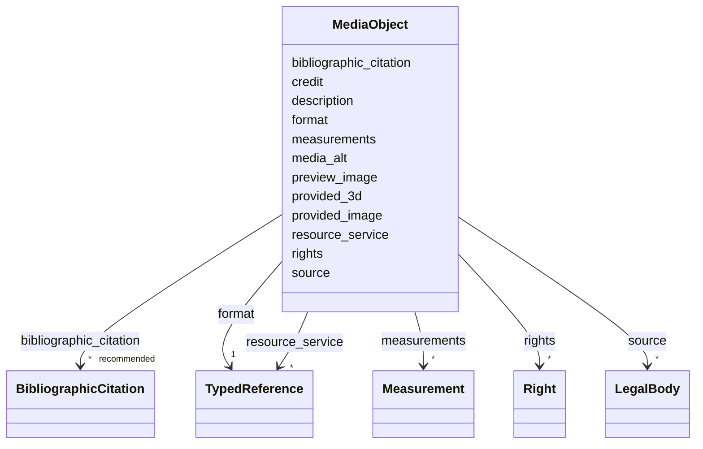

---
search:
  boost: 10.0
---

# Class: MediaObject


_Descrição e referência a um único arquivo de mídia._

_Obrigatoriamente deve conter uma URI._

_No caso de `preview_image` ou `provided_image`, o link deve referenciar diretamente o arquivo (ficheiro) da imagem. Em se tratando de `provided_3d` ou `service`, o link deve remeter a uma página web que forneça a respetiva API ou as informações acerca do modelo._

_(A FAZER) Ver [Instruções para carregar imagens e desenhos]._

__


<div data-search-exclude markdown="1">


URI: [schema:MediaObject](http://schema.org/MediaObject)





<!-- no inheritance hierarchy -->

## Class Properties

| Property | Value |
| --- | --- |
| Class URI | [schema:MediaObject](http://schema.org/MediaObject) |


## Slots

| Name | Cardinality and Range | Description | Inheritance |
| ---  | --- | --- | --- |
| [format](format.md) | 1 <br/> [TypedReference](TypedReference.md) | Campo disciplinado pela especificação [DublinCore] no campo [format](https://... | direct |
| [preview_image](preview_image.md) | 0..1 <br/> [Uriorcurie](Uriorcurie.md) | Uma única miniatura da imagem original | direct |
| [provided_image](provided_image.md) | * <br/> [Uriorcurie](Uriorcurie.md) | Lista de versões ampliadas ou originais da imagem, vetorial ou bitmap | direct |
| [provided_3d](provided_3d.md) | * <br/> [Uriorcurie](Uriorcurie.md) | Modelo tridimensional ou IFC da edificação | direct |
| [resource_service](resource_service.md) | * <br/> [TypedReference](TypedReference.md) | Apenas no caso de a imagem ser fornecida como um serviço dinâmico online, tal... | direct |
| [measurements](measurements.md) | * <br/> [Measurement](Measurement.md) | A wrapper for information about the dimensions, or other measurements, of the... | direct |
| [media_alt](media_alt.md) | 0..1 <br/> [String](String.md) | Texto alternativo para leitores de tela ou outras formas de acessibilidade | direct |
| [description](description.md) | 0..1 <br/> [String](String.md) | A human-readable description for a thing | direct |
| [source](source.md) | * <br/> [LegalBody](LegalBody.md) |  | direct |
| [bibliographic_citation](bibliographic_citation.md) | * _recommended_ <br/> [BibliographicCitation](BibliographicCitation.md) | Cadastro de uma referência bibliográfica | direct |
| [credit](credit.md) | 0..1 <br/> [String](String.md) | Informação sobre autoria ou responsabilidade | direct |
| [rights](rights.md) | * <br/> [Right](Right.md) |  | direct |


## Usages

| used by | used in | type | used |
| ---  | --- | --- | --- |
| [RelatedObject](RelatedObject.md) | [media](media.md) | range | [MediaObject](MediaObject.md) |
| [RelatedWork](RelatedWork.md) | [media](media.md) | range | [MediaObject](MediaObject.md) |
| [Event](Event.md) | [media](media.md) | range | [MediaObject](MediaObject.md) |
| [Work](Work.md) | [media](media.md) | range | [MediaObject](MediaObject.md) |


## Identifier and Mapping Information


### Schema Source


* from schema: https://tradicional.arq.br/schema


## Mappings

| Mapping Type | Mapped Value |
| ---  | ---  |
| self | schema:MediaObject |
| native | wasth:MediaObject |
| exact | dctypes:Image |


## LinkML Source

<!-- TODO: investigate https://stackoverflow.com/questions/37606292/how-to-create-tabbed-code-blocks-in-mkdocs-or-sphinx -->

### Direct

<details>
```yaml
name: MediaObject
description: 'Descrição e referência a um único arquivo de mídia.

  Obrigatoriamente deve conter uma URI.

  No caso de `preview_image` ou `provided_image`, o link deve referenciar diretamente
  o arquivo (ficheiro) da imagem. Em se tratando de `provided_3d` ou `service`, o
  link deve remeter a uma página web que forneça a respetiva API ou as informações
  acerca do modelo.

  (A FAZER) Ver [Instruções para carregar imagens e desenhos].

  '
from_schema: https://tradicional.arq.br/schema
exact_mappings:
- dctypes:Image
slots:
- format
- preview_image
- provided_image
- provided_3d
- resource_service
- measurements
- media_alt
- description
- source
- bibliographic_citation
- credit
- rights
class_uri: schema:MediaObject

```
</details>

### Induced

<details>
```yaml
name: MediaObject
description: 'Descrição e referência a um único arquivo de mídia.

  Obrigatoriamente deve conter uma URI.

  No caso de `preview_image` ou `provided_image`, o link deve referenciar diretamente
  o arquivo (ficheiro) da imagem. Em se tratando de `provided_3d` ou `service`, o
  link deve remeter a uma página web que forneça a respetiva API ou as informações
  acerca do modelo.

  (A FAZER) Ver [Instruções para carregar imagens e desenhos].

  '
from_schema: https://tradicional.arq.br/schema
exact_mappings:
- dctypes:Image
attributes:
  format:
    name: format
    description: 'Campo disciplinado pela especificação [DublinCore] no campo [format](https://www.dublincore.org/specifications/dublin-core/dcmi-terms/elements11/format/).
      Esta especificação sugere a [lista de tipos de mídia IANA].

      '
    from_schema: https://tradicional.arq.br/schema
    rank: 1000
    slot_uri: dcterms:MediaType
    owner: MediaObject
    domain_of:
    - MediaObject
    range: TypedReference
    required: true
    inlined: true
  preview_image:
    name: preview_image
    description: 'Uma única miniatura da imagem original.

      Obs.: não usamos a opção `placeholder`, ela será preenchida automaticamente
      em caso de ausência da miniatura, nem outros tipos de miniaturas que não imagens.
      A especificação LIDO admite listar mais de uma miniatura, mas tampouco prevemos
      essa hipótese.

      '
    from_schema: https://tradicional.arq.br/schema
    rank: 1000
    owner: MediaObject
    domain_of:
    - Resource
    - MediaObject
    range: uriorcurie
    inlined: true
  provided_image:
    name: provided_image
    description: Lista de versões ampliadas ou originais da imagem, vetorial ou bitmap.
    from_schema: https://tradicional.arq.br/schema
    rank: 1000
    owner: MediaObject
    domain_of:
    - Resource
    - MediaObject
    range: uriorcurie
    multivalued: true
    inlined: true
    inlined_as_list: true
  provided_3d:
    name: provided_3d
    description: Modelo tridimensional ou IFC da edificação.
    from_schema: https://tradicional.arq.br/schema
    rank: 1000
    owner: MediaObject
    domain_of:
    - Resource
    - MediaObject
    range: uriorcurie
    multivalued: true
    inlined: true
    inlined_as_list: true
  resource_service:
    name: resource_service
    description: Apenas no caso de a imagem ser fornecida como um serviço dinâmico
      online, tal como a especificação [IIIF].
    from_schema: https://tradicional.arq.br/schema
    rank: 1000
    alias: service
    owner: MediaObject
    domain_of:
    - Resource
    - MediaObject
    range: TypedReference
    multivalued: true
    inlined: true
    inlined_as_list: true
  measurements:
    name: measurements
    description: 'A wrapper for information about the dimensions, or other measurements,
      of the object/work in focus. May also include extents of the parts of a complex
      object or work.

      '
    from_schema: https://tradicional.arq.br/schema
    rank: 1000
    owner: MediaObject
    domain_of:
    - MediaObject
    - Event
    - Work
    range: Measurement
    multivalued: true
    inlined: true
    inlined_as_list: true
  media_alt:
    name: media_alt
    description: Texto alternativo para leitores de tela ou outras formas de acessibilidade.
      Apenas texto sem formatação.
    from_schema: https://tradicional.arq.br/schema
    rank: 1000
    alias: alt
    owner: MediaObject
    domain_of:
    - MediaObject
    range: string
  description:
    name: description
    description: A human-readable description for a thing
    from_schema: https://tradicional.arq.br/schema
    exact_mappings:
    - schema:description
    rank: 1000
    slot_uri: dcterms:description
    alias: display
    owner: MediaObject
    domain_of:
    - ConceptReference
    - BibliographicCitation
    - RelatedObject
    - MediaObject
    - Measurement
    - EventDate
    - EventPlace
    - RelatedEvent
    - Thing
    - Appellation
    - Inscription
    - Topic
    range: string
  source:
    name: source
    from_schema: https://tradicional.arq.br/schema
    rank: 1000
    owner: MediaObject
    domain_of:
    - RelatedObject
    - MediaObject
    - TypedReference
    - GeographicPoint
    - GeographicExtent
    range: LegalBody
    multivalued: true
    inlined: true
    inlined_as_list: true
  bibliographic_citation:
    name: bibliographic_citation
    description: 'Cadastro de uma referência bibliográfica.

      Usar o campo `description` para formatar a referência, caso a formatação automática
      do Zotero não for satisfatória.

      '
    from_schema: https://tradicional.arq.br/schema
    rank: 1000
    slot_uri: dcterms:bibliographicCitation
    owner: MediaObject
    domain_of:
    - ConceptReference
    - RelatedObject
    - MediaObject
    - TypedReference
    - Measurement
    - Actor
    - Thing
    - Appellation
    - GeographicPoint
    - GeographicExtent
    - Inscription
    range: BibliographicCitation
    recommended: true
    multivalued: true
    inlined: true
    inlined_as_list: true
  credit:
    name: credit
    description: Informação sobre autoria ou responsabilidade.
    from_schema: https://tradicional.arq.br/schema
    rank: 1000
    owner: MediaObject
    domain_of:
    - Resource
    - MediaObject
    range: string
  rights:
    name: rights
    from_schema: https://tradicional.arq.br/schema
    rank: 1000
    owner: MediaObject
    domain_of:
    - MediaObject
    range: Right
    multivalued: true
    inlined: true
    inlined_as_list: true
class_uri: schema:MediaObject

```
</details></div>
