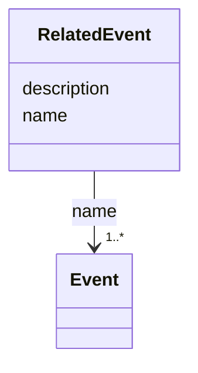

---
search:
  boost: 10.0
---

# Class: RelatedEvent

<div data-search-exclude markdown="1">


URI: [wasth:RelatedEvent](https://tradicional.arq.br/schema/RelatedEvent)





<!-- no inheritance hierarchy -->

## Slots

| Name | Cardinality and Range | Description | Inheritance |
| ---  | --- | --- | --- |
| [description](description.md) | 0..1 <br/> [String](String.md) | A human-readable description for a thing | direct |
| [name](name.md) | 1..* <br/> [Event](Event.md) |  | direct |


## Usages

| used by | used in | type | used |
| ---  | --- | --- | --- |
| [Event](Event.md) | [related_events](related_events.md) | range | [RelatedEvent](RelatedEvent.md) |


## Identifier and Mapping Information


### Schema Source


* from schema: https://tradicional.arq.br/schema


## Mappings

| Mapping Type | Mapped Value |
| ---  | ---  |
| self | wasth:RelatedEvent |
| native | wasth:RelatedEvent |


## LinkML Source

<!-- TODO: investigate https://stackoverflow.com/questions/37606292/how-to-create-tabbed-code-blocks-in-mkdocs-or-sphinx -->

### Direct

<details>
```yaml
name: RelatedEvent
from_schema: https://tradicional.arq.br/schema
slots:
- description
attributes:
  name:
    name: name
    from_schema: https://tradicional.arq.br/schema/temporal
    domain_of:
    - ConceptReference
    - RelatedEvent
    - HistoricPlace
    symmetric: true
    range: Event
    required: true
    multivalued: true
    inlined: false

```
</details>

### Induced

<details>
```yaml
name: RelatedEvent
from_schema: https://tradicional.arq.br/schema
attributes:
  name:
    name: name
    from_schema: https://tradicional.arq.br/schema/temporal
    owner: RelatedEvent
    domain_of:
    - ConceptReference
    - RelatedEvent
    - HistoricPlace
    symmetric: true
    range: Event
    required: true
    multivalued: true
    inlined: false
  description:
    name: description
    description: A human-readable description for a thing
    from_schema: https://tradicional.arq.br/schema
    rank: 1000
    slot_uri: dcterms:description
    alias: display
    owner: RelatedEvent
    domain_of:
    - ConceptReference
    - Measurements
    - BibliographicCitation
    - RelatedObject
    - Media
    - EventDate
    - EventPlace
    - RelatedEvent
    - Thing
    - Appellation
    - Inscription
    - Topic
    range: string

```
</details></div>
