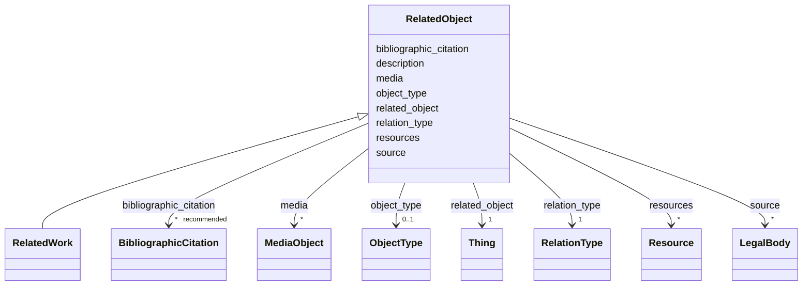

---
search:
  boost: 10.0
---

# Class: RelatedObject 


_A wrapper for identifying information about an object or work, including collections, related to the object/work in focus. May include a weblink._

__


<div data-search-exclude markdown="1">


URI: [wasth:RelatedObject](https://tradicional.arq.br/schema/RelatedObject)





## Inheritance
* **RelatedObject**
    * [RelatedWork](RelatedWork.md)


## Slots

| Name | Cardinality and Range | Description | Inheritance |
| ---  | --- | --- | --- |
| [description](description.md) | 0..1 <br/> [String](String.md) | A human-readable description for a thing | direct |
| [relation_type](relation_type.md) | 1 <br/> [RelationType](RelationType.md) | Usamos os tipos de relação previstos pelo [VRA Core] | direct |
| [related_object](related_object.md) | 1 <br/> [Thing](Thing.md) |  | direct |
| [object_type](object_type.md) | 0..1 <br/> [ObjectType](ObjectType.md) | Usar um vocabulário controlado para identificar o tipo de representação, por ... | direct |
| [resources](resources.md) | * <br/> [Resource](Resource.md) | Os desenhos ou modelos da edificação são apresentados online por meio de imag... | direct |
| [media](media.md) | * <br/> [MediaObject](MediaObject.md) | Representações iconográficas deste objeto | direct |
| [source](source.md) | * <br/> [LegalBody](LegalBody.md) |  | direct |
| [bibliographic_citation](bibliographic_citation.md) | * _recommended_ <br/> [BibliographicCitation](BibliographicCitation.md) | 📚  Cadastro de uma referência bibliográfica | direct |


## Identifier and Mapping Information


### Schema Source


* from schema: https://tradicional.arq.br/schema


## Mappings

| Mapping Type | Mapped Value |
| ---  | ---  |
| self | wasth:RelatedObject |
| native | wasth:RelatedObject |


## LinkML Source

<!-- TODO: investigate https://stackoverflow.com/questions/37606292/how-to-create-tabbed-code-blocks-in-mkdocs-or-sphinx -->

### Direct

<details>
```yaml
name: RelatedObject
description: 'A wrapper for identifying information about an object or work, including
  collections, related to the object/work in focus. May include a weblink.

  '
from_schema: https://tradicional.arq.br/schema
slots:
- description
- relation_type
- related_object
- object_type
- resources
- media
- source
- bibliographic_citation

```
</details>

### Induced

<details>
```yaml
name: RelatedObject
description: 'A wrapper for identifying information about an object or work, including
  collections, related to the object/work in focus. May include a weblink.

  '
from_schema: https://tradicional.arq.br/schema
attributes:
  description:
    name: description
    description: A human-readable description for a thing
    from_schema: https://tradicional.arq.br/schema
    exact_mappings:
    - schema:description
    rank: 1000
    slot_uri: dcterms:description
    alias: display
    owner: RelatedObject
    domain_of:
    - ConceptReference
    - BibliographicCitation
    - RelatedObject
    - MediaObject
    - TypedReference
    - Measurement
    - RelatedEvent
    - Thing
    - Inscription
    - Topic
    range: string
  relation_type:
    name: relation_type
    description: "Usamos os tipos de relação previstos pelo [VRA Core]. Provavelmente\
      \ necessitamos apenas de :\n- `planFor` : desenho técnico bidimensional de levantamento\n\
      \  (padrão, pode ser omitido) ;\n\n- `modelFor` : modelo tridimensional, com\
      \ ou sem informações construtivas\n  associadas (BIM) ;\n\n- `imageOf` : outras\
      \ representações em duas dimensões da edificação ;\n- `preparatoryFor` : representação\
      \ técnica de projeto para intervenções a\n  serem realizadas (ou já realizadas)\
      \ na edificação.\n"
    from_schema: https://tradicional.arq.br/schema
    rank: 1000
    alias: rel_type
    owner: RelatedObject
    domain_of:
    - RelatedObject
    - Resource
    range: RelationType
    required: true
  related_object:
    name: related_object
    from_schema: https://tradicional.arq.br/schema
    rank: 1000
    owner: RelatedObject
    domain_of:
    - RelatedObject
    range: Thing
    required: true
  object_type:
    name: object_type
    description: 'Usar um vocabulário controlado para identificar o tipo de representação,
      por exemplo as hierarquias do Getty AAT [obras visuais](http://vocab.getty.edu/hier/aat/300191086).
      ou [formatos de informação](http://vocab.getty.edu/hier/aat/300220751)

      '
    from_schema: https://tradicional.arq.br/schema
    rank: 1000
    owner: RelatedObject
    domain_of:
    - RelatedObject
    range: ObjectType
  resources:
    name: resources
    description: 'Os desenhos ou modelos da edificação são apresentados online por
      meio de imagens vetoriais ou bitmap.

      Cada desenho ou modelo pode ser apresentado sob várias representações, como
      pré-visualização, imagem original, ou serviço [IIIF]. Essas imagens devem ser
      identificadas como segue :

      As categorias de representação previstas no [LIDO] podem ser consultadas em
      <http://terminology.lido-schema.org/resourceRepresentation_type> e são inseridas
      na ficha como um mapa.

      '
    from_schema: https://tradicional.arq.br/schema
    rank: 1000
    owner: RelatedObject
    domain_of:
    - RelatedObject
    - Work
    range: Resource
    multivalued: true
    inlined: true
    inlined_as_list: false
  media:
    name: media
    description: 'Representações iconográficas deste objeto.

      No caso de `preview_image` ou `provided_image`, o link deve referenciar diretamente
      o arquivo (ficheiro) da imagem. Em se tratando de `provided_3d` ou `service`,
      o link deve remeter a uma página web que forneça a respetiva API ou as informações
      acerca do modelo.

      (A FAZER) Ver [Instruções para carregar imagens e desenhos].

      '
    from_schema: https://tradicional.arq.br/schema
    rank: 1000
    owner: RelatedObject
    domain_of:
    - RelatedObject
    - Event
    - Work
    range: MediaObject
    multivalued: true
    inlined: true
    inlined_as_list: true
  source:
    name: source
    from_schema: https://tradicional.arq.br/schema
    rank: 1000
    owner: RelatedObject
    domain_of:
    - RelatedObject
    - MediaObject
    - TypedReference
    - GeographicPoint
    - GeographicExtent
    range: LegalBody
    multivalued: true
    inlined: true
    inlined_as_list: true
  bibliographic_citation:
    name: bibliographic_citation
    description: '📚  Cadastro de uma referência bibliográfica.

      O campo `refid` deve conter a chave de citação (citation key) que consta do
      registro bibliográfico na biblioteca do nosso projeto de pesquisa no Zotero,
      começando com arroba @. Em geral, a chave de citação é o DOI ou ISBN da publicação,
      mas pode ser diferente.

      Se necessário, incluir no campo `note` uma especificação adicional, como o número
      da página da referência bibliográfica de onde a informação foi extraída.

      Usar o campo `description` para formatar a referência, caso a formatação automática
      do Zotero não for satisfatória.

      '
    from_schema: https://tradicional.arq.br/schema
    rank: 1000
    slot_uri: dcterms:bibliographicCitation
    owner: RelatedObject
    domain_of:
    - ConceptReference
    - RelatedObject
    - MediaObject
    - TypedReference
    - Measurement
    - Actor
    - Thing
    - Appellation
    - GeographicPoint
    - GeographicExtent
    - Inscription
    range: BibliographicCitation
    recommended: true
    multivalued: true
    inlined: true
    inlined_as_list: true

```
</details></div>