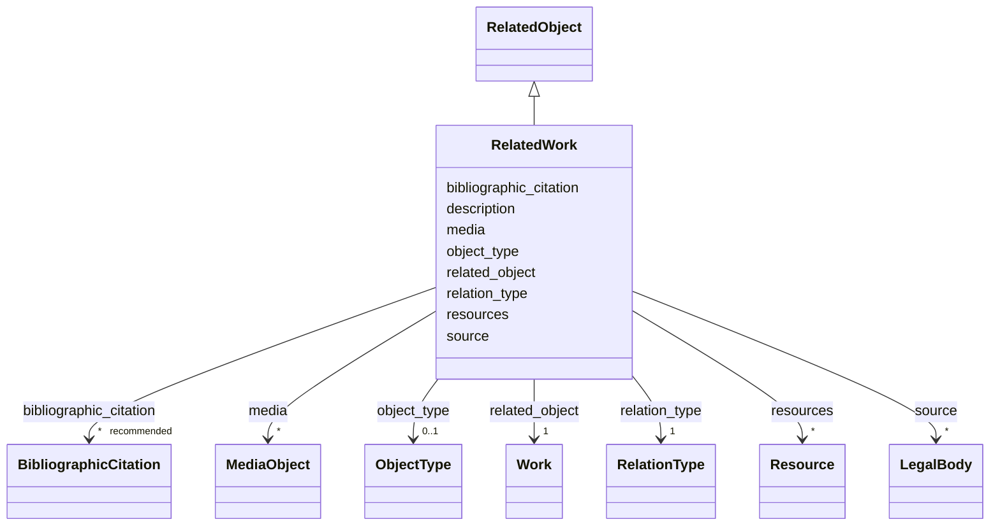

---
search:
  boost: 10.0
---

# Class: RelatedWork


_A wrapper for identifying information about an object or work, including collections, related to the object/work in focus. May include a weblink._

_As formas mais comuns de relação no nosso projeto são :_

__

_  - depicted in: A edificação é representada numa pintura ou desenho_

_    artístico;_

__

_  - documented by: Informações sobre a edificação estão publicadas numa_

_    referência bibliográfica, processo administrativo ou outro documento_

_    textual impresso, manuscrito ou eletrônico;_

__

_  - has plan / has floor plan / has section / has elevation / has_

_    rendering: Essas relações mostram a existência de desenhos técnicos_

_    da edificação, sejam eles históricos ou recentes, compilados de_

_    fontes externas a este projeto de pesquisa._

__

_  - has construction drawing / has design / has sketch: Essas relações se_

_    referem a desenhos históricos (fontes primárias) que atestam o_

_    processo de projeto da edificação._

__

_ATENÇÃO : OS DESENHOS PRODUZIDOS POR ESTE PROJETO DE PESQUISA DEVEM SER CADASTRADOS NO GRUPO resource, MAIS ABAIXO._

_O grupo relation é destinado unicamente a cadastrar relações desta edificação com objetos autônomos, tais como outras edificações, conjuntos urbanos, obras de artes visuais, referências bibliográficas ou acervos arquivísticos._


<div data-search-exclude markdown="1">


URI: [wasth:RelatedWork](https://tradicional.arq.br/schema/RelatedWork)





## Inheritance
* [RelatedObject](RelatedObject.md)
    * **RelatedWork**


## Slots

| Name | Cardinality and Range | Description | Inheritance |
| ---  | --- | --- | --- |
| [description](description.md) | 0..1 <br/> [String](String.md) | A human-readable description for a thing | [RelatedObject](RelatedObject.md) |
| [relation_type](relation_type.md) | 1 <br/> [RelationType](RelationType.md) | Usamos os tipos de relação previstos pelo [VRA Core] | [RelatedObject](RelatedObject.md) |
| [related_object](related_object.md) | 1 <br/> [Work](Work.md) |  | [RelatedObject](RelatedObject.md) |
| [object_type](object_type.md) | 0..1 <br/> [ObjectType](ObjectType.md) | Usar um vocabulário controlado para identificar o tipo de representação, por ... | [RelatedObject](RelatedObject.md) |
| [resources](resources.md) | * <br/> [Resource](Resource.md) | Os desenhos ou modelos da edificação são apresentados online por meio de imag... | [RelatedObject](RelatedObject.md) |
| [media](media.md) | * <br/> [MediaObject](MediaObject.md) | Representações iconográficas deste objeto | [RelatedObject](RelatedObject.md) |
| [source](source.md) | * <br/> [LegalBody](LegalBody.md) |  | [RelatedObject](RelatedObject.md) |
| [bibliographic_citation](bibliographic_citation.md) | * _recommended_ <br/> [BibliographicCitation](BibliographicCitation.md) | Cadastro de uma referência bibliográfica | [RelatedObject](RelatedObject.md) |


## Usages

| used by | used in | type | used |
| ---  | --- | --- | --- |
| [Event](Event.md) | [things_present](things_present.md) | range | [RelatedWork](RelatedWork.md) |
| [Work](Work.md) | [related_works](related_works.md) | range | [RelatedWork](RelatedWork.md) |


## Identifier and Mapping Information


### Schema Source


* from schema: https://tradicional.arq.br/schema


## Mappings

| Mapping Type | Mapped Value |
| ---  | ---  |
| self | wasth:RelatedWork |
| native | wasth:RelatedWork |


## LinkML Source

<!-- TODO: investigate https://stackoverflow.com/questions/37606292/how-to-create-tabbed-code-blocks-in-mkdocs-or-sphinx -->

### Direct

<details>
```yaml
name: RelatedWork
description: "A wrapper for identifying information about an object or work, including\
  \ collections, related to the object/work in focus. May include a weblink.\nAs formas\
  \ mais comuns de relação no nosso projeto são :\n\n  - depicted in: A edificação\
  \ é representada numa pintura ou desenho\n    artístico;\n\n  - documented by: Informações\
  \ sobre a edificação estão publicadas numa\n    referência bibliográfica, processo\
  \ administrativo ou outro documento\n    textual impresso, manuscrito ou eletrônico;\n\
  \n  - has plan / has floor plan / has section / has elevation / has\n    rendering:\
  \ Essas relações mostram a existência de desenhos técnicos\n    da edificação, sejam\
  \ eles históricos ou recentes, compilados de\n    fontes externas a este projeto\
  \ de pesquisa.\n\n  - has construction drawing / has design / has sketch: Essas\
  \ relações se\n    referem a desenhos históricos (fontes primárias) que atestam\
  \ o\n    processo de projeto da edificação.\n\nATENÇÃO : OS DESENHOS PRODUZIDOS\
  \ POR ESTE PROJETO DE PESQUISA DEVEM SER CADASTRADOS NO GRUPO resource, MAIS ABAIXO.\n\
  O grupo relation é destinado unicamente a cadastrar relações desta edificação com\
  \ objetos autônomos, tais como outras edificações, conjuntos urbanos, obras de artes\
  \ visuais, referências bibliográficas ou acervos arquivísticos."
from_schema: https://tradicional.arq.br/schema
is_a: RelatedObject
slot_usage:
  related_object:
    name: related_object
    range: Work

```
</details>

### Induced

<details>
```yaml
name: RelatedWork
description: "A wrapper for identifying information about an object or work, including\
  \ collections, related to the object/work in focus. May include a weblink.\nAs formas\
  \ mais comuns de relação no nosso projeto são :\n\n  - depicted in: A edificação\
  \ é representada numa pintura ou desenho\n    artístico;\n\n  - documented by: Informações\
  \ sobre a edificação estão publicadas numa\n    referência bibliográfica, processo\
  \ administrativo ou outro documento\n    textual impresso, manuscrito ou eletrônico;\n\
  \n  - has plan / has floor plan / has section / has elevation / has\n    rendering:\
  \ Essas relações mostram a existência de desenhos técnicos\n    da edificação, sejam\
  \ eles históricos ou recentes, compilados de\n    fontes externas a este projeto\
  \ de pesquisa.\n\n  - has construction drawing / has design / has sketch: Essas\
  \ relações se\n    referem a desenhos históricos (fontes primárias) que atestam\
  \ o\n    processo de projeto da edificação.\n\nATENÇÃO : OS DESENHOS PRODUZIDOS\
  \ POR ESTE PROJETO DE PESQUISA DEVEM SER CADASTRADOS NO GRUPO resource, MAIS ABAIXO.\n\
  O grupo relation é destinado unicamente a cadastrar relações desta edificação com\
  \ objetos autônomos, tais como outras edificações, conjuntos urbanos, obras de artes\
  \ visuais, referências bibliográficas ou acervos arquivísticos."
from_schema: https://tradicional.arq.br/schema
is_a: RelatedObject
slot_usage:
  related_object:
    name: related_object
    range: Work
attributes:
  description:
    name: description
    description: A human-readable description for a thing
    from_schema: https://tradicional.arq.br/schema
    exact_mappings:
    - schema:description
    rank: 1000
    slot_uri: dcterms:description
    alias: display
    owner: RelatedWork
    domain_of:
    - ConceptReference
    - BibliographicCitation
    - RelatedObject
    - MediaObject
    - Measurement
    - EventDate
    - EventPlace
    - RelatedEvent
    - Thing
    - Appellation
    - Inscription
    - Topic
    range: string
  relation_type:
    name: relation_type
    description: "Usamos os tipos de relação previstos pelo [VRA Core]. Provavelmente\
      \ necessitamos apenas de :\n- `planFor` : desenho técnico bidimensional de levantamento\n\
      \  (padrão, pode ser omitido) ;\n\n- `modelFor` : modelo tridimensional, com\
      \ ou sem informações construtivas\n  associadas (BIM) ;\n\n- `imageOf` : outras\
      \ representações em duas dimensões da edificação ;\n- `preparatoryFor` : representação\
      \ técnica de projeto para intervenções a\n  serem realizadas (ou já realizadas)\
      \ na edificação.\n"
    from_schema: https://tradicional.arq.br/schema
    rank: 1000
    alias: rel_type
    owner: RelatedWork
    domain_of:
    - RelatedObject
    - Resource
    range: RelationType
    required: true
  related_object:
    name: related_object
    from_schema: https://tradicional.arq.br/schema
    rank: 1000
    owner: RelatedWork
    domain_of:
    - RelatedObject
    range: Work
    required: true
  object_type:
    name: object_type
    description: 'Usar um vocabulário controlado para identificar o tipo de representação,
      por exemplo as hierarquias do Getty AAT [obras visuais](http://vocab.getty.edu/hier/aat/300191086).
      ou [formatos de informação](http://vocab.getty.edu/hier/aat/300220751)

      '
    from_schema: https://tradicional.arq.br/schema
    rank: 1000
    owner: RelatedWork
    domain_of:
    - RelatedObject
    range: ObjectType
  resources:
    name: resources
    description: 'Os desenhos ou modelos da edificação são apresentados online por
      meio de imagens vetoriais ou bitmap.

      Cada desenho ou modelo pode ser apresentado sob várias representações, como
      pré-visualização, imagem original, ou serviço [IIIF]. Essas imagens devem ser
      identificadas como segue :

      As categorias de representação previstas no [LIDO] podem ser consultadas em
      <http://terminology.lido-schema.org/resourceRepresentation_type> e são inseridas
      na ficha como um mapa.

      '
    from_schema: https://tradicional.arq.br/schema
    rank: 1000
    owner: RelatedWork
    domain_of:
    - RelatedObject
    - Work
    range: Resource
    multivalued: true
    inlined: true
    inlined_as_list: false
  media:
    name: media
    description: 'Representações iconográficas deste objeto.

      No caso de `preview_image` ou `provided_image`, o link deve referenciar diretamente
      o arquivo (ficheiro) da imagem. Em se tratando de `provided_3d` ou `service`,
      o link deve remeter a uma página web que forneça a respetiva API ou as informações
      acerca do modelo.

      (A FAZER) Ver [Instruções para carregar imagens e desenhos].

      '
    from_schema: https://tradicional.arq.br/schema
    rank: 1000
    owner: RelatedWork
    domain_of:
    - RelatedObject
    - Event
    - Work
    range: MediaObject
    multivalued: true
    inlined: true
    inlined_as_list: true
  source:
    name: source
    from_schema: https://tradicional.arq.br/schema
    rank: 1000
    owner: RelatedWork
    domain_of:
    - RelatedObject
    - MediaObject
    - TypedReference
    - GeographicPoint
    - GeographicExtent
    range: LegalBody
    multivalued: true
    inlined: true
    inlined_as_list: true
  bibliographic_citation:
    name: bibliographic_citation
    description: 'Cadastro de uma referência bibliográfica.

      Usar o campo `description` para formatar a referência, caso a formatação automática
      do Zotero não for satisfatória.

      '
    from_schema: https://tradicional.arq.br/schema
    rank: 1000
    slot_uri: dcterms:bibliographicCitation
    owner: RelatedWork
    domain_of:
    - ConceptReference
    - RelatedObject
    - MediaObject
    - TypedReference
    - Measurement
    - Actor
    - Thing
    - Appellation
    - GeographicPoint
    - GeographicExtent
    - Inscription
    range: BibliographicCitation
    recommended: true
    multivalued: true
    inlined: true
    inlined_as_list: true

```
</details></div>
