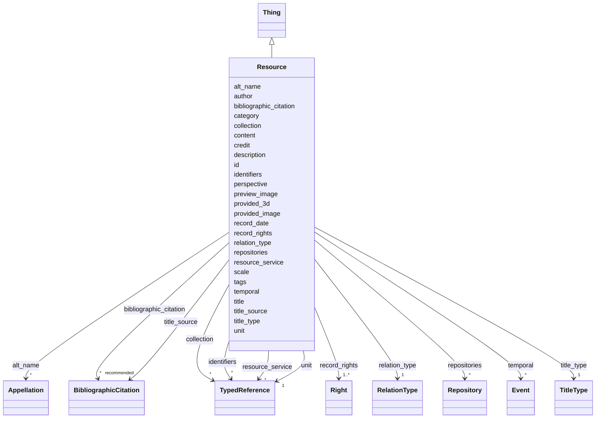

---
search:
  boost: 10.0
---

# Class: Resource


_This class comprises identifiable immaterial items that make propositions about reality._

_These propositions may be expressed in text, graphics, images, audiograms, videograms, or by other similar means. Documentation databases are regarded as instances of E31 Document. This class should not be confused with the concept “document” in Information Technology, which is compatible with E73 Information Object._

__


<div data-search-exclude markdown="1">


URI: [crm:E31_Document](http://www.cidoc-crm.org/cidoc-crm/E31_Document)





## Inheritance
* [Thing](Thing.md)
    * **Resource**


## Class Properties

| Property | Value |
| --- | --- |
| Class URI | [crm:E31_Document](http://www.cidoc-crm.org/cidoc-crm/E31_Document) |


## Slots

| Name | Cardinality and Range | Description | Inheritance |
| ---  | --- | --- | --- |
| [relation_type](relation_type.md) | 1 <br/> [RelationType](RelationType.md) | Usamos os tipos de relação previstos pelo [VRA Core] | direct |
| [preview_image](preview_image.md) | 0..1 <br/> [Uriorcurie](Uriorcurie.md) | Uma única miniatura da imagem original | direct |
| [provided_image](provided_image.md) | * <br/> [Uriorcurie](Uriorcurie.md) | Lista de versões ampliadas ou originais da imagem, vetorial ou bitmap | direct |
| [provided_3d](provided_3d.md) | * <br/> [Uriorcurie](Uriorcurie.md) | Modelo tridimensional ou IFC da edificação | direct |
| [resource_service](resource_service.md) | * <br/> [TypedReference](TypedReference.md) | Apenas no caso de a imagem ser fornecida como um serviço dinâmico online, tal... | direct |
| [unit](unit.md) | 1 <br/> [TypedReference](TypedReference.md) | Unidade de medida usada no dimensionamento da representação, por exemplo metr... | direct |
| [credit](credit.md) | 0..1 <br/> [String](String.md) | Informação sobre autoria ou responsabilidade | direct |
| [scale](scale.md) | 0..1 <br/> [Float](Float.md) | Número inverso da escala da imagem, se ela tiver uma resolução ou tamanho de ... | direct |
| [perspective](perspective.md) | 0..1 <br/> [Integer](Integer.md) | Tipo de vista do desenho | direct |
| [description](description.md) | 1 <br/> [String](String.md) | A human-readable description for a thing | [Thing](Thing.md) |
| [title_type](title_type.md) | 1 <br/> [TitleType](TitleType.md) | Indica se o título é um nome próprio, descritivo, etc | [Thing](Thing.md) |
| [bibliographic_citation](bibliographic_citation.md) | * _recommended_ <br/> [BibliographicCitation](BibliographicCitation.md) |  | [Thing](Thing.md) |
| [content](content.md) | 0..1 _recommended_ <br/> [String](String.md) | Deixe uma linha em branco após o fechamento dos metadados e inclua aqui uma d... | [Thing](Thing.md) |
| [id](id.md) | 1 <br/> [Uriorcurie](Uriorcurie.md) | Unique identifier for this object | [Thing](Thing.md) |
| [author](author.md) | 0..1 <br/> [OrcidId](OrcidId.md) | ORCID iD of the record author or maintainer | [Thing](Thing.md) |
| [record_date](record_date.md) | 0..1 <br/> [Date](Date.md) | Date the record was created or last substantively revised | [Thing](Thing.md) |
| [title](title.md) | 1 <br/> [String](String.md) | The preferred human-readable label for a Thing | [Thing](Thing.md) |
| [title_source](title_source.md) | * <br/> [BibliographicCitation](BibliographicCitation.md) | 📚 A fonte do título title_source é opcional ; um título pode ser atestado em ... | [Thing](Thing.md) |
| [alt_name](alt_name.md) | * <br/> [Appellation](Appellation.md) | O bloco `alt_name` permite cadastrar outros nomes pelos quais a edificação se... | [Thing](Thing.md) |
| [category](category.md) | 1 <br/> [Uriorcurie](Uriorcurie.md) | The LIDO Category Vocabulary is a structured controlled list of terms recomme... | [Thing](Thing.md) |
| [identifiers](identifiers.md) | * <br/> [TypedReference](TypedReference.md) | Published or external identifiers for the object | [Thing](Thing.md) |
| [tags](tags.md) | * <br/> [String](String.md) | Provisional uncontrolled keywords | [Thing](Thing.md) |
| [temporal](temporal.md) | * <br/> [Event](Event.md) | Temporalidade do objeto | [Thing](Thing.md) |
| [collection](collection.md) | * <br/> [TypedReference](TypedReference.md) | Collections or aggregations to which the object belongs | [Thing](Thing.md) |
| [repositories](repositories.md) | * <br/> [Repository](Repository.md) | A set of elements for the identification, name and location of the repository... | [Thing](Thing.md) |
| [record_rights](record_rights.md) | 1..* <br/> [Right](Right.md) | A set of structured information about rights regarding the content provided i... | [Thing](Thing.md) |


## Usages

| used by | used in | type | used |
| ---  | --- | --- | --- |
| [RelatedObject](RelatedObject.md) | [resources](resources.md) | range | [Resource](Resource.md) |
| [RelatedWork](RelatedWork.md) | [resources](resources.md) | range | [Resource](Resource.md) |
| [Work](Work.md) | [resources](resources.md) | range | [Resource](Resource.md) |


## Identifier and Mapping Information


### Schema Source


* from schema: https://tradicional.arq.br/schema


## Mappings

| Mapping Type | Mapped Value |
| ---  | ---  |
| self | crm:E31_Document |
| native | wasth:Resource |
| exact | schema:ArchiveComponent |


## LinkML Source

<!-- TODO: investigate https://stackoverflow.com/questions/37606292/how-to-create-tabbed-code-blocks-in-mkdocs-or-sphinx -->

### Direct

<details>
```yaml
name: Resource
description: 'This class comprises identifiable immaterial items that make propositions
  about reality.

  These propositions may be expressed in text, graphics, images, audiograms, videograms,
  or by other similar means. Documentation databases are regarded as instances of
  E31 Document. This class should not be confused with the concept “document” in Information
  Technology, which is compatible with E73 Information Object.

  '
from_schema: https://tradicional.arq.br/schema
exact_mappings:
- schema:ArchiveComponent
is_a: Thing
slots:
- relation_type
- preview_image
- provided_image
- provided_3d
- resource_service
- unit
- credit
attributes:
  scale:
    name: scale
    description: 'Número inverso da escala da imagem, se ela tiver uma resolução ou
      tamanho de página definidos. Por exemplo, para um desenho na escala 1 : 100,
      `scale: 100`.'
    from_schema: https://tradicional.arq.br/schema/resource
    rank: 1000
    alias: scale
    domain_of:
    - Resource
    range: float
    minimum_value: 0
  perspective:
    name: perspective
    description: "Tipo de vista do desenho. Usar a numeração da ISO 19650–2 :\n\n\
      \  - 0 = geral\n  - 1 = planta baixa (padrão, pode ser omitido)\n  - 2 = elevação\n\
      \  - 3 = corte\n  - 4 = mapa de elementos\n  - 5 = detalhe\n  - 6 = mapa de\
      \ revestimentos\n  - 7 = planta de forro\n  - 8 = vista ou modelo 3D\n  - 9\
      \ = definido pelo agente\n"
    from_schema: https://tradicional.arq.br/schema/resource
    rank: 1000
    ifabsent: integer(1)
    domain_of:
    - Resource
    range: integer
    minimum_value: 0
    maximum_value: 9
class_uri: crm:E31_Document

```
</details>

### Induced

<details>
```yaml
name: Resource
description: 'This class comprises identifiable immaterial items that make propositions
  about reality.

  These propositions may be expressed in text, graphics, images, audiograms, videograms,
  or by other similar means. Documentation databases are regarded as instances of
  E31 Document. This class should not be confused with the concept “document” in Information
  Technology, which is compatible with E73 Information Object.

  '
from_schema: https://tradicional.arq.br/schema
exact_mappings:
- schema:ArchiveComponent
is_a: Thing
attributes:
  scale:
    name: scale
    description: 'Número inverso da escala da imagem, se ela tiver uma resolução ou
      tamanho de página definidos. Por exemplo, para um desenho na escala 1 : 100,
      `scale: 100`.'
    from_schema: https://tradicional.arq.br/schema/resource
    rank: 1000
    alias: scale
    owner: Resource
    domain_of:
    - Resource
    range: float
    minimum_value: 0
  perspective:
    name: perspective
    description: "Tipo de vista do desenho. Usar a numeração da ISO 19650–2 :\n\n\
      \  - 0 = geral\n  - 1 = planta baixa (padrão, pode ser omitido)\n  - 2 = elevação\n\
      \  - 3 = corte\n  - 4 = mapa de elementos\n  - 5 = detalhe\n  - 6 = mapa de\
      \ revestimentos\n  - 7 = planta de forro\n  - 8 = vista ou modelo 3D\n  - 9\
      \ = definido pelo agente\n"
    from_schema: https://tradicional.arq.br/schema/resource
    rank: 1000
    ifabsent: integer(1)
    owner: Resource
    domain_of:
    - Resource
    range: integer
    minimum_value: 0
    maximum_value: 9
  relation_type:
    name: relation_type
    description: "Usamos os tipos de relação previstos pelo [VRA Core]. Provavelmente\
      \ necessitamos apenas de :\n- `planFor` : desenho técnico bidimensional de levantamento\n\
      \  (padrão, pode ser omitido) ;\n\n- `modelFor` : modelo tridimensional, com\
      \ ou sem informações construtivas\n  associadas (BIM) ;\n\n- `imageOf` : outras\
      \ representações em duas dimensões da edificação ;\n- `preparatoryFor` : representação\
      \ técnica de projeto para intervenções a\n  serem realizadas (ou já realizadas)\
      \ na edificação.\n"
    from_schema: https://tradicional.arq.br/schema
    rank: 1000
    alias: rel_type
    owner: Resource
    domain_of:
    - RelatedObject
    - Resource
    range: RelationType
    required: true
  preview_image:
    name: preview_image
    description: 'Uma única miniatura da imagem original.

      Obs.: não usamos a opção `placeholder`, ela será preenchida automaticamente
      em caso de ausência da miniatura, nem outros tipos de miniaturas que não imagens.
      A especificação LIDO admite listar mais de uma miniatura, mas tampouco prevemos
      essa hipótese.

      '
    from_schema: https://tradicional.arq.br/schema
    rank: 1000
    owner: Resource
    domain_of:
    - Resource
    - MediaObject
    range: uriorcurie
    inlined: true
  provided_image:
    name: provided_image
    description: Lista de versões ampliadas ou originais da imagem, vetorial ou bitmap.
    from_schema: https://tradicional.arq.br/schema
    rank: 1000
    owner: Resource
    domain_of:
    - Resource
    - MediaObject
    range: uriorcurie
    multivalued: true
    inlined: true
    inlined_as_list: true
  provided_3d:
    name: provided_3d
    description: Modelo tridimensional ou IFC da edificação.
    from_schema: https://tradicional.arq.br/schema
    rank: 1000
    owner: Resource
    domain_of:
    - Resource
    - MediaObject
    range: uriorcurie
    multivalued: true
    inlined: true
    inlined_as_list: true
  resource_service:
    name: resource_service
    description: Apenas no caso de a imagem ser fornecida como um serviço dinâmico
      online, tal como a especificação [IIIF].
    from_schema: https://tradicional.arq.br/schema
    rank: 1000
    alias: service
    owner: Resource
    domain_of:
    - Resource
    - MediaObject
    range: TypedReference
    multivalued: true
    inlined: true
    inlined_as_list: true
  unit:
    name: unit
    description: 'Unidade de medida usada no dimensionamento da representação, por
      exemplo metros ou milímetros. Usar a [hierarquia de unidades de medida](https://www.getty.edu/vow/AATHierarchy?find=&logic=AND&note=&page=1&subjectid=300379096)
      do AAT, ou do nosso próprio [vocabulário controlado].

      '
    from_schema: https://tradicional.arq.br/schema
    rank: 1000
    alias: unit
    owner: Resource
    domain_of:
    - Resource
    - Measurement
    range: TypedReference
    required: true
    inlined: true
  credit:
    name: credit
    description: Informação sobre autoria ou responsabilidade.
    from_schema: https://tradicional.arq.br/schema
    rank: 1000
    owner: Resource
    domain_of:
    - Resource
    - MediaObject
    range: string
  description:
    name: description
    description: A human-readable description for a thing
    from_schema: https://tradicional.arq.br/schema
    exact_mappings:
    - schema:description
    rank: 1000
    slot_uri: dcterms:description
    alias: display
    owner: Resource
    domain_of:
    - ConceptReference
    - BibliographicCitation
    - RelatedObject
    - MediaObject
    - Measurement
    - EventDate
    - EventPlace
    - RelatedEvent
    - Thing
    - Appellation
    - Inscription
    - Topic
    range: string
    required: true
  title_type:
    name: title_type
    description: Indica se o título é um nome próprio, descritivo, etc.
    from_schema: https://tradicional.arq.br/schema
    rank: 1000
    alias: type
    owner: Resource
    domain_of:
    - Thing
    - Appellation
    range: TitleType
    required: true
  bibliographic_citation:
    name: bibliographic_citation
    from_schema: https://tradicional.arq.br/schema
    rank: 1000
    slot_uri: dcterms:bibliographicCitation
    owner: Resource
    domain_of:
    - ConceptReference
    - GeographicPoint
    - GeographicExtent
    - RelatedObject
    - MediaObject
    - TypedReference
    - Measurement
    - Actor
    - Thing
    - Appellation
    - Inscription
    range: BibliographicCitation
    recommended: true
    multivalued: true
    inlined: true
    inlined_as_list: true
  content:
    name: content
    description: 'Deixe uma linha em branco após o fechamento dos metadados e inclua
      aqui uma descrição morfológica e histórica da edificação com texto livre, usando
      formatação Markdown.

      Poderá incluir um segundo bloco de metadados para indicar as referências bibliográficas
      da descrição textual, no campo `nocite`. O formato é uma lista de chaves de
      citação do Zotero (cada uma começando com `@`) separadas por vírgulas:

      ```yaml Conteúdo textual em formato *Markdown* com citações [@citekey].

      --- nocite: "@*" --- ```

      '
    from_schema: https://tradicional.arq.br/schema
    rank: 1000
    slot_uri: skos:scopeNote
    owner: Resource
    domain_of:
    - Thing
    - Inscription
    range: string
    recommended: true
  id:
    name: id
    description: Unique identifier for this object.
    from_schema: https://tradicional.arq.br/schema/thing
    rank: 1000
    slot_uri: dcterms:identifier
    identifier: true
    owner: Resource
    domain_of:
    - Thing
    range: uriorcurie
    required: true
  author:
    name: author
    description: ORCID iD of the record author or maintainer.
    from_schema: https://tradicional.arq.br/schema/thing
    rank: 1000
    slot_uri: dcterms:creator
    owner: Resource
    domain_of:
    - Thing
    range: OrcidId
  record_date:
    name: record_date
    description: Date the record was created or last substantively revised.
    from_schema: https://tradicional.arq.br/schema/thing
    rank: 1000
    slot_uri: dcterms:created
    owner: Resource
    domain_of:
    - Thing
    range: date
  title:
    name: title
    description: The preferred human-readable label for a Thing.
    from_schema: https://tradicional.arq.br/schema/thing
    exact_mappings:
    - schema:name
    rank: 1000
    slot_uri: dcterms:title
    owner: Resource
    domain_of:
    - Thing
    range: string
    required: true
  title_source:
    name: title_source
    description: '📚 A fonte do título title_source é opcional ; um título pode ser
      atestado em mais de uma fonte, por isso este campo é uma lista de itens (cada
      item começa com um hífen).

      Se a fonte for cadastrada, o campo `refid` deve conter a chave de citação (citation
      key) que consta do registro bibliográfico na biblioteca do nosso projeto de
      pesquisa no Zotero. Em geral, a chave de citação é o DOI ou ISBN da publicação,
      mas pode ser diferente.

      Se necessário, incluir no campo note uma especificação adicional, como o número
      da página da referência bibliográfica de onde a informação foi extraída.

      Todos os campos source no restante da ficha devem ser preenchidos do mesmo modo.
      (Equivalente DublinCore: bibliographiCitation).'
    from_schema: https://tradicional.arq.br/schema/thing
    rank: 1000
    owner: Resource
    domain_of:
    - Thing
    range: BibliographicCitation
    multivalued: true
    inlined: true
    inlined_as_list: true
  alt_name:
    name: alt_name
    description: 'O bloco `alt_name` permite cadastrar outros nomes pelos quais a
      edificação será eventualmente conhecida. É uma lista opcional de itens, e se
      existir, os campos de cada item da lista devem ser preenchidos como os do título
      principal.

      O campo `description` de cada item contém o texto do título (nome).

      Este bloco pode ser omitido por completo se não houver títulos alternativos.

      '
    from_schema: https://tradicional.arq.br/schema/thing
    rank: 1000
    owner: Resource
    domain_of:
    - Thing
    range: Appellation
    multivalued: true
    inlined: true
    inlined_as_list: true
  category:
    name: category
    description: 'The LIDO Category Vocabulary is a structured controlled list of
      terms recommended to use as values in the LIDO Category element.

      Examples are human-made object or natural object.'
    from_schema: https://tradicional.arq.br/schema/thing
    rank: 1000
    slot_uri: term:lidoCategory
    designates_type: true
    owner: Resource
    domain_of:
    - Thing
    range: uriorcurie
    required: true
  identifiers:
    name: identifiers
    description: Published or external identifiers for the object.
    from_schema: https://tradicional.arq.br/schema/thing
    rank: 1000
    owner: Resource
    domain_of:
    - Thing
    range: TypedReference
    multivalued: true
    inlined: true
    inlined_as_list: true
  tags:
    name: tags
    description: Provisional uncontrolled keywords. Prefer `classifications` or `subject`
      for curated vocabulary terms.
    from_schema: https://tradicional.arq.br/schema/thing
    rank: 1000
    owner: Resource
    domain_of:
    - Thing
    range: string
    multivalued: true
  temporal:
    name: temporal
    description: Temporalidade do objeto.
    from_schema: https://tradicional.arq.br/schema/thing
    owner: Resource
    domain_of:
    - Right
    - Thing
    range: Event
    multivalued: true
    inlined: true
    inlined_as_list: true
  collection:
    name: collection
    description: Collections or aggregations to which the object belongs.
    from_schema: https://tradicional.arq.br/schema/thing
    rank: 1000
    owner: Resource
    domain_of:
    - Thing
    - Work
    range: TypedReference
    multivalued: true
    inlined: true
    inlined_as_list: true
  repositories:
    name: repositories
    description: 'A set of elements for the identification, name and location of the
      repository that is responsible for the object/work in focus.

      Repeated if there are several designations known, or if former repositories
      or geographic places should be listed.

      ---------------------------------------------------------------------

      Nos Documentários da Arquitetura Tradicional, usamos repositórios para indicar
      a inclusão da edificação em perímetros de sítios do patrimônio cultural, etc.

      Os repositórios devem ser cadastrados de modo semelhante às informações de georreferenciamento,
      usando o tipo `other`.

      '
    from_schema: https://tradicional.arq.br/schema/thing
    rank: 1000
    owner: Resource
    domain_of:
    - Thing
    - Work
    range: Repository
    multivalued: true
    inlined: true
    inlined_as_list: true
  record_rights:
    name: record_rights
    description: 'A set of structured information about rights regarding the content
      provided in this LIDO record.

      ---------------------------------------------------------------------

      :warning: Este grupo se refere aos direitos sobre o CONTEÚDO da ficha, não sobre
      os direitos incidentes sobre o objeto descrito.

      '
    from_schema: https://tradicional.arq.br/schema/thing
    rank: 1000
    owner: Resource
    domain_of:
    - Thing
    range: Right
    required: true
    multivalued: true
    inlined: true
    inlined_as_list: true
class_uri: crm:E31_Document

```
</details></div>
