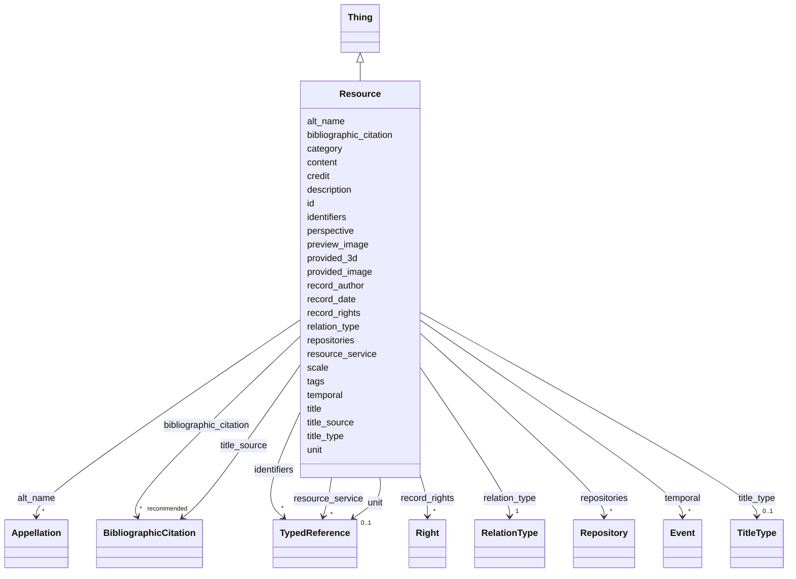

---
search:
  boost: 10.0
---

# Class: Resource 


_This class comprises identifiable immaterial items that make propositions about reality._

_These propositions may be expressed in text, graphics, images, audiograms, videograms, or by other similar means. Documentation databases are regarded as instances of E31 Document. This class should not be confused with the concept “document” in Information Technology, which is compatible with E73 Information Object._

__


<div data-search-exclude markdown="1">


URI: [crm:E31_Document](http://www.cidoc-crm.org/cidoc-crm/E31_Document)





## Inheritance
* [Thing](Thing.md)
    * **Resource**


## Class Properties

| Property | Value |
| --- | --- |
| Class URI | [crm:E31_Document](http://www.cidoc-crm.org/cidoc-crm/E31_Document) |


## Slots

| Name | Cardinality and Range | Description | Inheritance |
| ---  | --- | --- | --- |
| [title_type](title_type.md) | 0..1 <br/> [TitleType](TitleType.md) | Indica se o título é um nome próprio, descritivo, etc | direct |
| [relation_type](relation_type.md) | 1 <br/> [RelationType](RelationType.md) | Usamos os tipos de relação previstos pelo [VRA Core] | direct |
| [preview_image](preview_image.md) | 0..1 <br/> [Uriorcurie](Uriorcurie.md) | Uma única miniatura da imagem original | direct |
| [provided_image](provided_image.md) | * <br/> [Uriorcurie](Uriorcurie.md) | Lista de versões ampliadas ou originais da imagem, vetorial ou bitmap | direct |
| [provided_3d](provided_3d.md) | * <br/> [Uriorcurie](Uriorcurie.md) | Modelo tridimensional ou IFC da edificação | direct |
| [resource_service](resource_service.md) | * <br/> [TypedReference](TypedReference.md) | Apenas no caso de a imagem ser fornecida como um serviço dinâmico online, tal... | direct |
| [unit](unit.md) | 0..1 <br/> [TypedReference](TypedReference.md) | Unidade de medida usada no dimensionamento do objeto ou da representação, por... | direct |
| [credit](credit.md) | 0..1 <br/> [String](String.md) | Informação sobre autoria ou responsabilidade | direct |
| [scale](scale.md) | 0..1 <br/> [Float](Float.md) | Número inverso da escala da imagem, se ela tiver uma resolução ou tamanho de ... | direct |
| [perspective](perspective.md) | 0..1 <br/> [Integer](Integer.md) | Tipo de vista do desenho | direct |
| [description](description.md) | 1 <br/> [String](String.md) | A human-readable description for a thing | [Thing](Thing.md) |
| [bibliographic_citation](bibliographic_citation.md) | * _recommended_ <br/> [BibliographicCitation](BibliographicCitation.md) | 📚  Cadastro de uma referência bibliográfica | [Thing](Thing.md) |
| [content](content.md) | 0..1 _recommended_ <br/> [String](String.md) | Conteúdo textual descritivo ou explicativo | [Thing](Thing.md) |
| [id](id.md) | 1 <br/> [Uriorcurie](Uriorcurie.md) | Identificador globalmente único para este objeto ou recurso | [Thing](Thing.md) |
| [record_author](record_author.md) | 0..1 <br/> [OrcidId](OrcidId.md) | ORCID iD da pessoa que escreveu a versão original da ficha | [Thing](Thing.md) |
| [record_date](record_date.md) | 0..1 <br/> [Date](Date.md) | Data de inclusão da ficha | [Thing](Thing.md) |
| [title](title.md) | 1 <br/> [String](String.md) | Nome pelo qual este item é mais comumente conhecido | [Thing](Thing.md) |
| [title_source](title_source.md) | * <br/> [BibliographicCitation](BibliographicCitation.md) | A fonte do título title_source é opcional ; um título pode ser atestado em ma... | [Thing](Thing.md) |
| [alt_name](alt_name.md) | * <br/> [Appellation](Appellation.md) | O bloco `alt_name` permite cadastrar outros nomes pelos quais o objeto ou con... | [Thing](Thing.md) |
| [category](category.md) | 1 <br/> [Uriorcurie](Uriorcurie.md) | Uma classificação ampla para o objeto descrito na ficha, usando o vocabulário... | [Thing](Thing.md) |
| [identifiers](identifiers.md) | * <br/> [TypedReference](TypedReference.md) | Números de inventário e demais códigos que identificam este objeto em outras ... | [Thing](Thing.md) |
| [tags](tags.md) | * <br/> [String](String.md) | Lista de palavras-chave que caracterizam o objeto, de modo não estruturado | [Thing](Thing.md) |
| [temporal](temporal.md) | * <br/> [Event](Event.md) | Descrição dos eventos associados ao ciclo de vida da edificação ou à existênc... | [Thing](Thing.md) |
| [repositories](repositories.md) | * <br/> [Repository](Repository.md) | Nos Documentários da Arquitetura Tradicional, usamos repositórios para indica... | [Thing](Thing.md) |
| [record_rights](record_rights.md) | * <br/> [Right](Right.md) | Informações estruturadas sobre os direitos que incidem sobre o conteúdo textu... | [Thing](Thing.md) |


## Usages

| used by | used in | type | used |
| ---  | --- | --- | --- |
| [RelatedObject](RelatedObject.md) | [resources](resources.md) | range | [Resource](Resource.md) |
| [RelatedWork](RelatedWork.md) | [resources](resources.md) | range | [Resource](Resource.md) |
| [Work](Work.md) | [resources](resources.md) | range | [Resource](Resource.md) |


## Identifier and Mapping Information


### Schema Source


* from schema: https://tradicional.arq.br/schema


## Mappings

| Mapping Type | Mapped Value |
| ---  | ---  |
| self | crm:E31_Document |
| native | wasth:Resource |
| close | schema:ArchiveComponent |


## LinkML Source

<!-- TODO: investigate https://stackoverflow.com/questions/37606292/how-to-create-tabbed-code-blocks-in-mkdocs-or-sphinx -->

### Direct

<details>
```yaml
name: Resource
description: 'This class comprises identifiable immaterial items that make propositions
  about reality.

  These propositions may be expressed in text, graphics, images, audiograms, videograms,
  or by other similar means. Documentation databases are regarded as instances of
  E31 Document. This class should not be confused with the concept “document” in Information
  Technology, which is compatible with E73 Information Object.

  '
from_schema: https://tradicional.arq.br/schema
close_mappings:
- schema:ArchiveComponent
is_a: Thing
slots:
- title_type
- relation_type
- preview_image
- provided_image
- provided_3d
- resource_service
- unit
- credit
slot_usage:
  title_type:
    name: title_type
    ifabsent: TitleType(descriptive)
    range: TitleType
attributes:
  scale:
    name: scale
    description: 'Número inverso da escala da imagem, se ela tiver uma resolução ou
      tamanho de página definidos. Por exemplo, para um desenho na escala 1 : 100,
      `scale: 100`.'
    from_schema: https://tradicional.arq.br/schema/resource
    rank: 1000
    domain_of:
    - Resource
    range: float
    minimum_value: 0
  perspective:
    name: perspective
    description: "Tipo de vista do desenho. Usar a numeração da ISO 19650–2 :\n\n\
      \  - 0 = geral\n  - 1 = planta baixa (padrão, pode ser omitido)\n  - 2 = elevação\n\
      \  - 3 = corte\n  - 4 = mapa de elementos\n  - 5 = detalhe\n  - 6 = mapa de\
      \ revestimentos\n  - 7 = planta de forro\n  - 8 = vista ou modelo 3D\n  - 9\
      \ = definido pelo agente\n"
    from_schema: https://tradicional.arq.br/schema/resource
    rank: 1000
    ifabsent: integer(1)
    domain_of:
    - Resource
    range: integer
    minimum_value: 0
    maximum_value: 9
class_uri: crm:E31_Document

```
</details>

### Induced

<details>
```yaml
name: Resource
description: 'This class comprises identifiable immaterial items that make propositions
  about reality.

  These propositions may be expressed in text, graphics, images, audiograms, videograms,
  or by other similar means. Documentation databases are regarded as instances of
  E31 Document. This class should not be confused with the concept “document” in Information
  Technology, which is compatible with E73 Information Object.

  '
from_schema: https://tradicional.arq.br/schema
close_mappings:
- schema:ArchiveComponent
is_a: Thing
slot_usage:
  title_type:
    name: title_type
    ifabsent: TitleType(descriptive)
    range: TitleType
attributes:
  scale:
    name: scale
    description: 'Número inverso da escala da imagem, se ela tiver uma resolução ou
      tamanho de página definidos. Por exemplo, para um desenho na escala 1 : 100,
      `scale: 100`.'
    from_schema: https://tradicional.arq.br/schema/resource
    rank: 1000
    owner: Resource
    domain_of:
    - Resource
    range: float
    minimum_value: 0
  perspective:
    name: perspective
    description: "Tipo de vista do desenho. Usar a numeração da ISO 19650–2 :\n\n\
      \  - 0 = geral\n  - 1 = planta baixa (padrão, pode ser omitido)\n  - 2 = elevação\n\
      \  - 3 = corte\n  - 4 = mapa de elementos\n  - 5 = detalhe\n  - 6 = mapa de\
      \ revestimentos\n  - 7 = planta de forro\n  - 8 = vista ou modelo 3D\n  - 9\
      \ = definido pelo agente\n"
    from_schema: https://tradicional.arq.br/schema/resource
    rank: 1000
    ifabsent: integer(1)
    owner: Resource
    domain_of:
    - Resource
    range: integer
    minimum_value: 0
    maximum_value: 9
  title_type:
    name: title_type
    description: Indica se o título é um nome próprio, descritivo, etc.
    from_schema: https://tradicional.arq.br/schema
    rank: 1000
    ifabsent: TitleType(descriptive)
    owner: Resource
    domain_of:
    - Concept
    - Resource
    - Appellation
    - Repository
    - Site
    range: TitleType
  relation_type:
    name: relation_type
    description: "Usamos os tipos de relação previstos pelo [VRA Core]. Provavelmente\
      \ necessitamos apenas de :\n- `planFor` : desenho técnico bidimensional de levantamento\n\
      \  (padrão, pode ser omitido) ;\n\n- `modelFor` : modelo tridimensional, com\
      \ ou sem informações construtivas\n  associadas (BIM) ;\n\n- `imageOf` : outras\
      \ representações em duas dimensões da edificação ;\n- `preparatoryFor` : representação\
      \ técnica de projeto para intervenções a\n  serem realizadas (ou já realizadas)\
      \ na edificação.\n"
    from_schema: https://tradicional.arq.br/schema
    rank: 1000
    alias: rel_type
    owner: Resource
    domain_of:
    - RelatedObject
    - Resource
    range: RelationType
    required: true
  preview_image:
    name: preview_image
    description: 'Uma única miniatura da imagem original.

      Obs.: não usamos a opção `placeholder`, ela será preenchida automaticamente
      em caso de ausência da miniatura, nem outros tipos de miniaturas que não imagens.
      A especificação LIDO admite listar mais de uma miniatura, mas tampouco prevemos
      essa hipótese.

      '
    from_schema: https://tradicional.arq.br/schema
    rank: 1000
    owner: Resource
    domain_of:
    - Resource
    - MediaObject
    range: uriorcurie
  provided_image:
    name: provided_image
    description: Lista de versões ampliadas ou originais da imagem, vetorial ou bitmap.
    from_schema: https://tradicional.arq.br/schema
    rank: 1000
    owner: Resource
    domain_of:
    - Resource
    - MediaObject
    range: uriorcurie
    multivalued: true
  provided_3d:
    name: provided_3d
    description: Modelo tridimensional ou IFC da edificação.
    from_schema: https://tradicional.arq.br/schema
    rank: 1000
    owner: Resource
    domain_of:
    - Resource
    - MediaObject
    range: uriorcurie
    multivalued: true
  resource_service:
    name: resource_service
    description: Apenas no caso de a imagem ser fornecida como um serviço dinâmico
      online, tal como a especificação [IIIF].
    from_schema: https://tradicional.arq.br/schema
    rank: 1000
    alias: service
    owner: Resource
    domain_of:
    - Resource
    - MediaObject
    range: TypedReference
    multivalued: true
    inlined: true
    inlined_as_list: true
  unit:
    name: unit
    description: 'Unidade de medida usada no dimensionamento do objeto ou da representação,
      por exemplo metros, milímetros ou palmos. Usar a [hierarquia de unidades de
      medida](https://www.getty.edu/vow/AATHierarchy?find=&logic=AND&note=&page=1&subjectid=300379096)
      do AAT, ou do nosso próprio [vocabulário controlado].

      '
    from_schema: https://tradicional.arq.br/schema
    rank: 1000
    owner: Resource
    domain_of:
    - Resource
    - Measurement
    range: TypedReference
    inlined: true
  credit:
    name: credit
    description: Informação sobre autoria ou responsabilidade.
    from_schema: https://tradicional.arq.br/schema
    rank: 1000
    owner: Resource
    domain_of:
    - Resource
    - MediaObject
    range: string
  description:
    name: description
    description: A human-readable description for a thing
    from_schema: https://tradicional.arq.br/schema
    exact_mappings:
    - schema:description
    rank: 1000
    slot_uri: dcterms:description
    alias: display
    owner: Resource
    domain_of:
    - ConceptReference
    - BibliographicCitation
    - RelatedObject
    - MediaObject
    - TypedReference
    - Measurement
    - RelatedEvent
    - Thing
    - Inscription
    - Topic
    range: string
    required: true
  bibliographic_citation:
    name: bibliographic_citation
    description: '📚  Cadastro de uma referência bibliográfica.

      O campo `refid` deve conter a chave de citação (citation key) que consta do
      registro bibliográfico na biblioteca do nosso projeto de pesquisa no Zotero,
      começando com arroba @. Em geral, a chave de citação é o DOI ou ISBN da publicação,
      mas pode ser diferente.

      Se necessário, incluir no campo `note` uma especificação adicional, como o número
      da página da referência bibliográfica de onde a informação foi extraída.

      Usar o campo `description` para formatar a referência, caso a formatação automática
      do Zotero não for satisfatória.

      '
    from_schema: https://tradicional.arq.br/schema
    rank: 1000
    slot_uri: dcterms:bibliographicCitation
    owner: Resource
    domain_of:
    - ConceptReference
    - RelatedObject
    - MediaObject
    - TypedReference
    - Measurement
    - Actor
    - Thing
    - Appellation
    - GeographicPoint
    - GeographicExtent
    - Inscription
    range: BibliographicCitation
    recommended: true
    multivalued: true
    inlined: true
    inlined_as_list: true
  content:
    name: content
    description: Conteúdo textual descritivo ou explicativo.
    from_schema: https://tradicional.arq.br/schema
    rank: 1000
    slot_uri: skos:scopeNote
    owner: Resource
    domain_of:
    - Thing
    - Inscription
    range: string
    recommended: true
  id:
    name: id
    description: 'Identificador globalmente único para este objeto ou recurso.

      '
    from_schema: https://tradicional.arq.br/schema/thing
    rank: 1000
    slot_uri: dcterms:identifier
    identifier: true
    owner: Resource
    domain_of:
    - Thing
    range: uriorcurie
    required: true
  record_author:
    name: record_author
    description: 'ORCID iD da pessoa que escreveu a versão original da ficha. Alterar
      apenas no caso de a ficha ter sido substancialmente reescrita.

      '
    from_schema: https://tradicional.arq.br/schema/thing
    rank: 1000
    slot_uri: dcterms:contributor
    alias: author
    owner: Resource
    domain_of:
    - Thing
    range: OrcidId
  record_date:
    name: record_date
    description: Data de inclusão da ficha.
    from_schema: https://tradicional.arq.br/schema/thing
    rank: 1000
    slot_uri: dcterms:created
    alias: date
    owner: Resource
    domain_of:
    - Thing
    range: date
  title:
    name: title
    description: 'Nome pelo qual este item é mais comumente conhecido. Outros nomes
      podem ser cadastrados em `alt_name`.

      '
    from_schema: https://tradicional.arq.br/schema/thing
    exact_mappings:
    - schema:name
    rank: 1000
    slot_uri: dcterms:title
    owner: Resource
    domain_of:
    - Thing
    range: string
    required: true
  title_source:
    name: title_source
    description: A fonte do título title_source é opcional ; um título pode ser atestado
      em mais de uma fonte, por isso este campo é uma lista de itens (cada item começa
      com um hífen).
    from_schema: https://tradicional.arq.br/schema/thing
    rank: 1000
    owner: Resource
    domain_of:
    - Thing
    range: BibliographicCitation
    multivalued: true
    inlined: true
    inlined_as_list: true
  alt_name:
    name: alt_name
    description: 'O bloco `alt_name` permite cadastrar outros nomes pelos quais o
      objeto ou conceito será eventualmente conhecido. É uma lista opcional de itens,
      e se existir, os campos de cada item da lista devem ser preenchidos como os
      do título principal.

      O campo `label` ou `description` de cada item contém o texto do título (nome).

      Este bloco pode ser omitido por completo se não houver títulos alternativos.

      '
    from_schema: https://tradicional.arq.br/schema/thing
    rank: 1000
    owner: Resource
    domain_of:
    - Thing
    range: Appellation
    multivalued: true
    inlined: true
    inlined_as_list: true
  category:
    name: category
    description: 'Uma classificação ampla para o objeto descrito na ficha, usando
      o vocabulário controlado do LIDO.

      Nos documentários de edificações, preencher este campo OBRIGATORIAMENTE com
      `term:lido00096` ("Objeto manufaturado").

      No vocabulário controlado, preencher este campo OBRIGATORIAMENTE com `term:lido01193`
      ("Objeto conceitual").

      ---------------------------------------------------------------------

      The LIDO Category Vocabulary is a structured controlled list of terms recommended
      to use as values in the LIDO Category element.

      Examples are human-made object or natural object.'
    from_schema: https://tradicional.arq.br/schema/thing
    rank: 1000
    slot_uri: term:lidoCategory
    designates_type: true
    owner: Resource
    domain_of:
    - Thing
    range: uriorcurie
    required: true
  identifiers:
    name: identifiers
    description: "Números de inventário e demais códigos que identificam este objeto\
      \ em outras bases de dados.\nCaso esta edificação esteja cadastrada em outras\
      \ bases de dados (por exemplo, [SICG], [SIPA], [HPIP], [iPatrimonio], etc.),\
      \ pode preencher a lista `identifiers` como segue.\n:clipboard: O conteúdo de\
      \ cada bloco é uma lista recuada em dois espaços com respeito à categoria superior.\
      \ Seus itens são :\n* `type` é o tipo de referência : pode ser `uri` (padrão),\
      \ `iri` ou\n  `local` — se estiver em dúvida, omita esta linha ;\n\n* `refid`\
      \ é obrigatório : representa o identificador do conceito no\n  vocabulário controlado\
      \ ou no repositório de origem — normalmente\n  será uma URI (um link para a\
      \ página web do cadastro) ;\n\n* `description` deve ser usado para representar\
      \ textualmente\n  o número de inventário, código identificador ou outra informação\n\
      \  que individualize o objeto na base externa (por exemplo, livro do\n  tombo\
      \ e número do processo de tombamento, no Brasil) ;\n\n* `bibliographic_citation`\
      \ é opcional e permite citar uma lista de\n  referências bibliográficas que\
      \ validem a inclusão deste termo.\n\n* `source` também é opcional e permite\
      \ cadastrar os dados da pessoa\n  jurídica responsável pelo registro.\n\n---------------------------------------------------------------------\n\
      Published or external identifiers for the object.\n"
    from_schema: https://tradicional.arq.br/schema/thing
    rank: 1000
    owner: Resource
    domain_of:
    - Thing
    range: TypedReference
    multivalued: true
    inlined: true
    inlined_as_list: true
  tags:
    name: tags
    description: 'Lista de palavras-chave que caracterizam o objeto, de modo não estruturado.
      Recomenda-se usar uma palavra-chave de cada um dos recortes abaixo:

      - Geográfico ; - Cronológico ; - Histórico-cultural ; - Técnico-construtivo ;
      - Temático ou tipológico ; - Funcional.

      ---------------------------------------------------------------------

      Provisional uncontrolled keywords. Prefer `classifications` or `subject` for
      curated vocabulary terms.'
    from_schema: https://tradicional.arq.br/schema/thing
    rank: 1000
    owner: Resource
    domain_of:
    - Thing
    range: string
    multivalued: true
  temporal:
    name: temporal
    description: 'Descrição dos eventos associados ao ciclo de vida da edificação
      ou à existência e/ou uso do objeto ou conceito. Ler a respetiva documentação
      para estruturar este campo.

      '
    from_schema: https://tradicional.arq.br/schema/thing
    owner: Resource
    domain_of:
    - Right
    - Thing
    range: Event
    multivalued: true
    inlined: true
    inlined_as_list: true
  repositories:
    name: repositories
    description: 'Nos Documentários da Arquitetura Tradicional, usamos repositórios
      para indicar a inclusão da edificação em perímetros de sítios tombados/classificados
      do patrimônio, áreas de interesse histórico-cultural, etc.

      O repositório é cadastrado como uma pessoa jurídica dotada de extensão geográfica.

      ---------------------------------------------------------------------

      A set of elements for the identification, name and location of the repository
      that is responsible for the object/work in focus.

      Repeated if there are several designations known, or if former repositories
      or geographic places should be listed.

      '
    from_schema: https://tradicional.arq.br/schema/thing
    rank: 1000
    owner: Resource
    domain_of:
    - Thing
    range: Repository
    multivalued: true
    inlined: true
    inlined_as_list: true
  record_rights:
    name: record_rights
    description: 'Informações estruturadas sobre os direitos que incidem sobre o conteúdo
      textual desta ficha.

      ⚠️  Este grupo se refere aos direitos sobre o CONTEÚDO da ficha, não sobre os
      direitos incidentes sobre o objeto descrito.

      ---------------------------------------------------------------------

      A set of structured information about rights regarding the content provided
      in this LIDO record.

      '
    from_schema: https://tradicional.arq.br/schema/thing
    rank: 1000
    owner: Resource
    domain_of:
    - Thing
    range: Right
    multivalued: true
    inlined: true
    inlined_as_list: true
class_uri: crm:E31_Document

```
</details></div>