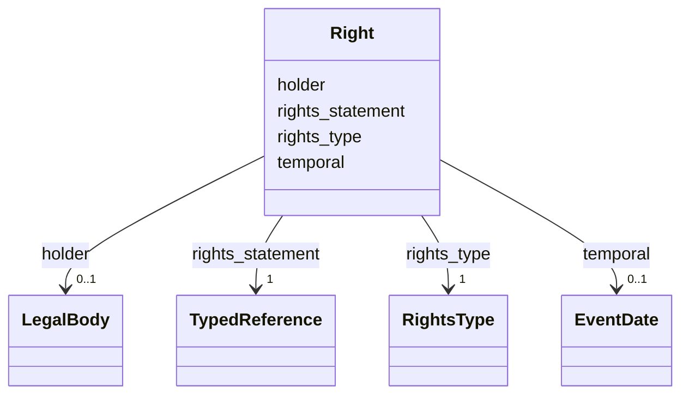

---
search:
  boost: 10.0
---

# Class: Right 


_* Preencher `earliest_date` com a data de início da vigência dos_

_  direitos ou a data do preenchimento da ficha._

__

_* `latest_date` pode ser omitido se não houver fim da vigência._

_* `holder` pode ser omitido se a obra estiver no domínio público._

__


<div data-search-exclude markdown="1">


URI: [crm:E30_Right](http://www.cidoc-crm.org/cidoc-crm/E30_Right)





<!-- no inheritance hierarchy -->

## Class Properties

| Property | Value |
| --- | --- |
| Class URI | [crm:E30_Right](http://www.cidoc-crm.org/cidoc-crm/E30_Right) |


## Slots

| Name | Cardinality and Range | Description | Inheritance |
| ---  | --- | --- | --- |
| [rights_type](rights_type.md) | 1 <br/> [RightsType](RightsType.md) | Determina se os direitos ora descritos são uma licença específica (padrão) ou... | direct |
| [rights_statement](rights_statement.md) | 1 <br/> [TypedReference](TypedReference.md) | Referencia, preferencialmente por meio de uma URI, as informações específicas... | direct |
| [temporal](temporal.md) | 0..1 <br/> [EventDate](EventDate.md) | Date on which a right is or was current | direct |
| [holder](holder.md) | 0..1 <br/> [LegalBody](LegalBody.md) | A set of elements identifying the person or the group of persons holding the ... | direct |


## Usages

| used by | used in | type | used |
| ---  | --- | --- | --- |
| [Concept](Concept.md) | [record_rights](record_rights.md) | range | [Right](Right.md) |
| [Resource](Resource.md) | [record_rights](record_rights.md) | range | [Right](Right.md) |
| [MediaObject](MediaObject.md) | [rights](rights.md) | range | [Right](Right.md) |
| [Event](Event.md) | [record_rights](record_rights.md) | range | [Right](Right.md) |
| [Thing](Thing.md) | [record_rights](record_rights.md) | range | [Right](Right.md) |
| [Repository](Repository.md) | [record_rights](record_rights.md) | range | [Right](Right.md) |
| [Work](Work.md) | [work_rights](work_rights.md) | range | [Right](Right.md) |
| [Work](Work.md) | [record_rights](record_rights.md) | range | [Right](Right.md) |
| [Site](Site.md) | [record_rights](record_rights.md) | range | [Right](Right.md) |


## Identifier and Mapping Information


### Schema Source


* from schema: https://tradicional.arq.br/schema


## Mappings

| Mapping Type | Mapped Value |
| ---  | ---  |
| self | crm:E30_Right |
| native | wasth:Right |


## LinkML Source

<!-- TODO: investigate https://stackoverflow.com/questions/37606292/how-to-create-tabbed-code-blocks-in-mkdocs-or-sphinx -->

### Direct

<details>
```yaml
name: Right
description: "* Preencher `earliest_date` com a data de início da vigência dos\n \
  \ direitos ou a data do preenchimento da ficha.\n\n* `latest_date` pode ser omitido\
  \ se não houver fim da vigência.\n* `holder` pode ser omitido se a obra estiver\
  \ no domínio público.\n"
from_schema: https://tradicional.arq.br/schema
attributes:
  rights_type:
    name: rights_type
    description: 'Determina se os direitos ora descritos são uma licença específica
      (padrão) ou expressão genérica de copyright.

      ---------------------------------------------------------------------

      Qualifies the kind of rights type, whether it refers to a generic kind of right,
      like copyright or performance rights, or is a specific rights or license statement,
      for instance, Rights Statements or Creative Commons Licenses.

      '
    from_schema: https://tradicional.arq.br/schema/shared
    rank: 1000
    domain_of:
    - Right
    range: RightsType
    required: true
  rights_statement:
    name: rights_statement
    description: 'Referencia, preferencialmente por meio de uma URI, as informações
      específicas dos direitos autorais incidentes sobre o item descrito.

      Por padrão, as casas tradicionais pertencem ao domínio público até prova em
      contrário. Essa informação e a declaração de direitos NKC (Sem direito autoral
      conhecido) NÃO PODE ser omitida da ficha. Para o domínio público, portanto,
      indicar a referência : <https://rightsstatements.org/vocab/NKC/1.0/>.

      ---------------------------------------------------------------------

      An index element for rights information being recorded. This can refer to a
      generic kind of right, such as copyright or a related right, but also be a specific
      rights or license statement like a standardized statement on copyright, usage,
      or access rights.

      '
    from_schema: https://tradicional.arq.br/schema/shared
    rank: 1000
    domain_of:
    - Right
    range: TypedReference
    required: true
    inlined: true
  temporal:
    name: temporal
    description: Date on which a right is or was current.
    from_schema: https://tradicional.arq.br/schema/shared
    rank: 1000
    alias: temporal
    domain_of:
    - Right
    - Thing
    range: EventDate
    inlined: true
  holder:
    name: holder
    description: 'A set of elements identifying the person or the group of persons
      holding the rights referenced in Rights Type. Often refers to copyright and
      related rights, such as the right to reproduce, distribute, exhibit or use the
      entity in focus, for example, the object/work, resource or metadata record.

      '
    from_schema: https://tradicional.arq.br/schema/shared
    rank: 1000
    alias: holder
    domain_of:
    - Right
    range: LegalBody
    inlined: true
class_uri: crm:E30_Right

```
</details>

### Induced

<details>
```yaml
name: Right
description: "* Preencher `earliest_date` com a data de início da vigência dos\n \
  \ direitos ou a data do preenchimento da ficha.\n\n* `latest_date` pode ser omitido\
  \ se não houver fim da vigência.\n* `holder` pode ser omitido se a obra estiver\
  \ no domínio público.\n"
from_schema: https://tradicional.arq.br/schema
attributes:
  rights_type:
    name: rights_type
    description: 'Determina se os direitos ora descritos são uma licença específica
      (padrão) ou expressão genérica de copyright.

      ---------------------------------------------------------------------

      Qualifies the kind of rights type, whether it refers to a generic kind of right,
      like copyright or performance rights, or is a specific rights or license statement,
      for instance, Rights Statements or Creative Commons Licenses.

      '
    from_schema: https://tradicional.arq.br/schema/shared
    rank: 1000
    owner: Right
    domain_of:
    - Right
    range: RightsType
    required: true
  rights_statement:
    name: rights_statement
    description: 'Referencia, preferencialmente por meio de uma URI, as informações
      específicas dos direitos autorais incidentes sobre o item descrito.

      Por padrão, as casas tradicionais pertencem ao domínio público até prova em
      contrário. Essa informação e a declaração de direitos NKC (Sem direito autoral
      conhecido) NÃO PODE ser omitida da ficha. Para o domínio público, portanto,
      indicar a referência : <https://rightsstatements.org/vocab/NKC/1.0/>.

      ---------------------------------------------------------------------

      An index element for rights information being recorded. This can refer to a
      generic kind of right, such as copyright or a related right, but also be a specific
      rights or license statement like a standardized statement on copyright, usage,
      or access rights.

      '
    from_schema: https://tradicional.arq.br/schema/shared
    rank: 1000
    owner: Right
    domain_of:
    - Right
    range: TypedReference
    required: true
    inlined: true
  temporal:
    name: temporal
    description: Date on which a right is or was current.
    from_schema: https://tradicional.arq.br/schema/shared
    rank: 1000
    alias: temporal
    owner: Right
    domain_of:
    - Right
    - Thing
    range: EventDate
    inlined: true
  holder:
    name: holder
    description: 'A set of elements identifying the person or the group of persons
      holding the rights referenced in Rights Type. Often refers to copyright and
      related rights, such as the right to reproduce, distribute, exhibit or use the
      entity in focus, for example, the object/work, resource or metadata record.

      '
    from_schema: https://tradicional.arq.br/schema/shared
    rank: 1000
    alias: holder
    owner: Right
    domain_of:
    - Right
    range: LegalBody
    inlined: true
class_uri: crm:E30_Right

```
</details></div>