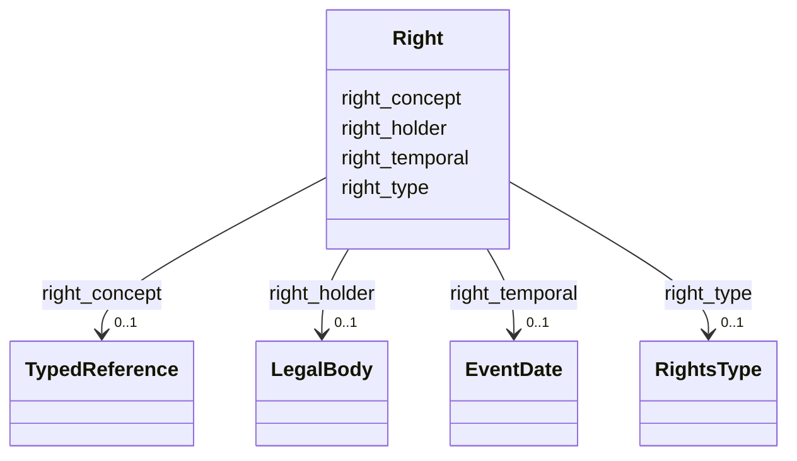

---
search:
  boost: 10.0
---

# Class: Right


_Rights statement associated with a record, resource, or note._


<div data-search-exclude markdown="1">


URI: [wasth:Right](https://tradicional.arq.br/schema/Right)





<!-- no inheritance hierarchy -->

## Slots

| Name | Cardinality and Range | Description | Inheritance |
| ---  | --- | --- | --- |
| [right_concept](right_concept.md) | 0..1 <br/> [TypedReference](TypedReference.md) |  | direct |
| [right_type](right_type.md) | 0..1 <br/> [RightsType](RightsType.md) |  | direct |
| [right_temporal](right_temporal.md) | 0..1 <br/> [EventDate](EventDate.md) |  | direct |
| [right_holder](right_holder.md) | 0..1 <br/> [LegalBody](LegalBody.md) |  | direct |


## Usages

| used by | used in | type | used |
| ---  | --- | --- | --- |
| [Concept](Concept.md) | [record_rights](record_rights.md) | range | [Right](Right.md) |
| [Place](Place.md) | [record_rights](record_rights.md) | range | [Right](Right.md) |
| [Site](Site.md) | [record_rights](record_rights.md) | range | [Right](Right.md) |
| [Resource](Resource.md) | [record_rights](record_rights.md) | range | [Right](Right.md) |
| [Media](Media.md) | [rights](rights.md) | range | [Right](Right.md) |
| [Event](Event.md) | [record_rights](record_rights.md) | range | [Right](Right.md) |
| [Thing](Thing.md) | [record_rights](record_rights.md) | range | [Right](Right.md) |
| [Repository](Repository.md) | [record_rights](record_rights.md) | range | [Right](Right.md) |
| [Work](Work.md) | [work_rights](work_rights.md) | range | [Right](Right.md) |
| [Work](Work.md) | [record_rights](record_rights.md) | range | [Right](Right.md) |


## Identifier and Mapping Information


### Schema Source


* from schema: https://tradicional.arq.br/schema


## Mappings

| Mapping Type | Mapped Value |
| ---  | ---  |
| self | wasth:Right |
| native | wasth:Right |


## LinkML Source

<!-- TODO: investigate https://stackoverflow.com/questions/37606292/how-to-create-tabbed-code-blocks-in-mkdocs-or-sphinx -->

### Direct

<details>
```yaml
name: Right
description: Rights statement associated with a record, resource, or note.
from_schema: https://tradicional.arq.br/schema
slots:
- right_concept
- right_type
- right_temporal
- right_holder

```
</details>

### Induced

<details>
```yaml
name: Right
description: Rights statement associated with a record, resource, or note.
from_schema: https://tradicional.arq.br/schema
attributes:
  right_concept:
    name: right_concept
    from_schema: https://tradicional.arq.br/schema
    rank: 1000
    alias: concept
    owner: Right
    domain_of:
    - Right
    range: TypedReference
    inlined: true
  right_type:
    name: right_type
    from_schema: https://tradicional.arq.br/schema
    rank: 1000
    ifabsent: string(generic)
    alias: type
    owner: Right
    domain_of:
    - Right
    range: RightsType
  right_temporal:
    name: right_temporal
    from_schema: https://tradicional.arq.br/schema
    rank: 1000
    alias: temporal
    owner: Right
    domain_of:
    - Right
    range: EventDate
    inlined: true
  right_holder:
    name: right_holder
    from_schema: https://tradicional.arq.br/schema
    rank: 1000
    alias: holder
    owner: Right
    domain_of:
    - Right
    range: LegalBody
    inlined: true

```
</details></div>
