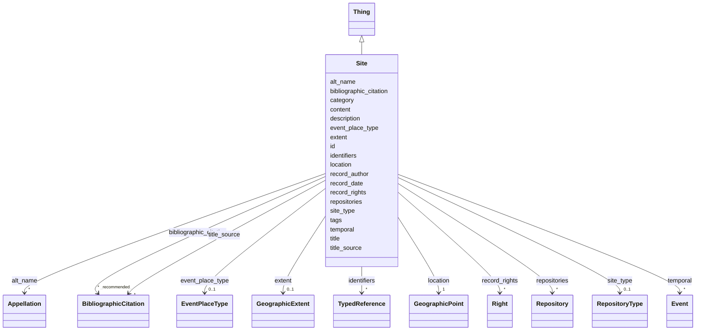

---
search:
  boost: 10.0
---

# Class: Site


_O georreferenciamento é o cerne do projeto dos Documentários da Arquitetura Tradicional. Ele permite investigar a distribuição geográfica das características construtivas e morfológicas das edificações cadastradas._

_Este bloco corresponde à terminologia do [DublinCore] `coverage > spatial`. Na especificação [LIDO], a localização física de um bem se confunde com a sua inserção institucional (repositório). Na formatação da nossa ficha, tentamos desfazer essa confusão separando o georreferenciamento e o repositório em blocos diferentes._

_As instruções de preenchimento específicas se encontram na documentação das classes que fornecem os dados para o sítio. Consulte também o [Tutorial de georreferenciamento](https://github.com/arqtrad/.github/wiki/Tutorial-de-georreferenciamento) para saber como localizar edificações não cadastradas nas bases de dados do patrimônio cultural (SICG ou SIPA)._

_-------------------------------------------------------------------------_

_This class comprises 4-dimensional point sets (volumes) in physical spacetime (in contrast to mathematical models of it) regardless of their true geometric forms. They may derive their identity from being the extent of a material phenomenon or from being the interpretation of an expression defining an extent in spacetime. Intersections of instances of E92 Spacetime Volume, E53 Place, and E52 Time-Span are also regarded as instances of E92 Spacetime Volume. An instance of E92 Spacetime Volume is either contiguous or composed of a finite number of contiguous subsets. Its boundaries may be fuzzy due to the properties of the phenomena it derives from or due to the limited precision up to which defining expression can be identified with a real extent in spacetime. The duration of existence of an instance of E92 Spacetime Volume is its projection on time._

__


<div data-search-exclude markdown="1">


* __NOTE__: this is an abstract class and should not be instantiated directly


URI: [crm:E92_Spacetime_Volume](http://www.cidoc-crm.org/cidoc-crm/E92_Spacetime_Volume)





## Inheritance
* [Thing](Thing.md)
    * **Site**


## Class Properties

| Property | Value |
| --- | --- |
| Class URI | [crm:E92_Spacetime_Volume](http://www.cidoc-crm.org/cidoc-crm/E92_Spacetime_Volume) |


## Slots

| Name | Cardinality and Range | Description | Inheritance |
| ---  | --- | --- | --- |
| [site_type](site_type.md) | 0..1 <br/> [RepositoryType](RepositoryType.md) |  | direct |
| [location](location.md) | 1 <br/> [GeographicPoint](GeographicPoint.md) | Coordenadas geográficas do ponto que permite situar a edificação no mapa para... | direct |
| [extent](extent.md) | 0..1 <br/> [GeographicExtent](GeographicExtent.md) | Área da implantação da edificação ou sítio cadastrado | direct |
| [event_place_type](event_place_type.md) | 0..1 <br/> [EventPlaceType](EventPlaceType.md) | Se relevante para a ação, indicar se se trata do local de descobrimento do ob... | direct |
| [description](description.md) | 1 <br/> [String](String.md) | A human-readable description for a thing | [Thing](Thing.md) |
| [bibliographic_citation](bibliographic_citation.md) | * _recommended_ <br/> [BibliographicCitation](BibliographicCitation.md) | 📚  Cadastro de uma referência bibliográfica | [Thing](Thing.md) |
| [content](content.md) | 0..1 _recommended_ <br/> [String](String.md) | Conteúdo textual descritivo ou explicativo | [Thing](Thing.md) |
| [id](id.md) | 1 <br/> [GeonamesId](GeonamesId.md) | Incluir aqui um identificador da base geonames na forma `geonames:1234` | [Thing](Thing.md) |
| [record_author](record_author.md) | 0..1 <br/> [OrcidId](OrcidId.md) | ORCID iD da pessoa que escreveu a versão original da ficha | [Thing](Thing.md) |
| [record_date](record_date.md) | 0..1 <br/> [Date](Date.md) | Data de inclusão da ficha | [Thing](Thing.md) |
| [title](title.md) | 1 <br/> [String](String.md) | Nome pelo qual este item é mais comumente conhecido | [Thing](Thing.md) |
| [title_source](title_source.md) | * <br/> [BibliographicCitation](BibliographicCitation.md) | A fonte do título title_source é opcional ; um título pode ser atestado em ma... | [Thing](Thing.md) |
| [alt_name](alt_name.md) | * <br/> [Appellation](Appellation.md) | O bloco `alt_name` permite cadastrar outros nomes pelos quais o objeto ou con... | [Thing](Thing.md) |
| [category](category.md) | 1 <br/> [Uriorcurie](Uriorcurie.md) | Uma classificação ampla para o objeto descrito na ficha, usando o vocabulário... | [Thing](Thing.md) |
| [identifiers](identifiers.md) | * <br/> [TypedReference](TypedReference.md) | Números de inventário e demais códigos que identificam este objeto em outras ... | [Thing](Thing.md) |
| [tags](tags.md) | * <br/> [String](String.md) | Lista de palavras-chave que caracterizam o objeto, de modo não estruturado | [Thing](Thing.md) |
| [temporal](temporal.md) | * <br/> [Event](Event.md) | Descrição dos eventos associados ao ciclo de vida da edificação ou à existênc... | [Thing](Thing.md) |
| [repositories](repositories.md) | * <br/> [Repository](Repository.md) | Nos Documentários da Arquitetura Tradicional, usamos repositórios para indica... | [Thing](Thing.md) |
| [record_rights](record_rights.md) | * <br/> [Right](Right.md) | Informações estruturadas sobre os direitos que incidem sobre o conteúdo textu... | [Thing](Thing.md) |


## Usages

| used by | used in | type | used |
| ---  | --- | --- | --- |
| [Event](Event.md) | [event_place](event_place.md) | range | [Site](Site.md) |
| [Repository](Repository.md) | [site](site.md) | range | [Site](Site.md) |
| [Work](Work.md) | [site](site.md) | range | [Site](Site.md) |
| [Work](Work.md) | [former_site](former_site.md) | range | [Site](Site.md) |
| [Work](Work.md) | [intended_site](intended_site.md) | range | [Site](Site.md) |
| [Work](Work.md) | [other_site](other_site.md) | range | [Site](Site.md) |


## Identifier and Mapping Information


### Schema Source


* from schema: https://tradicional.arq.br/schema


## Mappings

| Mapping Type | Mapped Value |
| ---  | ---  |
| self | crm:E92_Spacetime_Volume |
| native | wasth:Site |
| exact | schema:DefinedRegion |


## LinkML Source

<!-- TODO: investigate https://stackoverflow.com/questions/37606292/how-to-create-tabbed-code-blocks-in-mkdocs-or-sphinx -->

### Direct

<details>
```yaml
name: Site
description: 'O georreferenciamento é o cerne do projeto dos Documentários da Arquitetura
  Tradicional. Ele permite investigar a distribuição geográfica das características
  construtivas e morfológicas das edificações cadastradas.

  Este bloco corresponde à terminologia do [DublinCore] `coverage > spatial`. Na especificação
  [LIDO], a localização física de um bem se confunde com a sua inserção institucional
  (repositório). Na formatação da nossa ficha, tentamos desfazer essa confusão separando
  o georreferenciamento e o repositório em blocos diferentes.

  As instruções de preenchimento específicas se encontram na documentação das classes
  que fornecem os dados para o sítio. Consulte também o [Tutorial de georreferenciamento](https://github.com/arqtrad/.github/wiki/Tutorial-de-georreferenciamento)
  para saber como localizar edificações não cadastradas nas bases de dados do patrimônio
  cultural (SICG ou SIPA).

  -------------------------------------------------------------------------

  This class comprises 4-dimensional point sets (volumes) in physical spacetime (in
  contrast to mathematical models of it) regardless of their true geometric forms.
  They may derive their identity from being the extent of a material phenomenon or
  from being the interpretation of an expression defining an extent in spacetime.
  Intersections of instances of E92 Spacetime Volume, E53 Place, and E52 Time-Span
  are also regarded as instances of E92 Spacetime Volume. An instance of E92 Spacetime
  Volume is either contiguous or composed of a finite number of contiguous subsets.
  Its boundaries may be fuzzy due to the properties of the phenomena it derives from
  or due to the limited precision up to which defining expression can be identified
  with a real extent in spacetime. The duration of existence of an instance of E92
  Spacetime Volume is its projection on time.

  '
from_schema: https://tradicional.arq.br/schema
exact_mappings:
- schema:DefinedRegion
is_a: Thing
abstract: true
slot_usage:
  id:
    name: id
    description: 'Incluir aqui um identificador da base geonames na forma `geonames:1234`.

      '
    range: GeonamesId
attributes:
  site_type:
    name: site_type
    from_schema: https://tradicional.arq.br/schema/work
    rank: 1000
    ifabsent: RepositoryType(geographic)
    alias: type
    domain_of:
    - Site
    range: RepositoryType
  location:
    name: location
    description: 'Coordenadas geográficas do ponto que permite situar a edificação
      no mapa para fins ilustrativos. Usar o sistema de coordenadas geográficas EPSG:4326
      (WGS84) sempre que possível.

      ---------------------------------------------------------------------

      Representative point location for the place, normally in EPSG:4326 (WGS 84).'
    from_schema: https://tradicional.arq.br/schema/work
    rank: 1000
    slot_uri: geo:hasDefaultGeometry
    domain_of:
    - Site
    range: GeographicPoint
    required: true
    inlined: true
  extent:
    name: extent
    description: 'Área da implantação da edificação ou sítio cadastrado. Usar o sistema
      de coordenadas geográficas EPSG:4326 (WGS84) sempre que possível.

      ---------------------------------------------------------------------

      Polygonal, multipolygonal, or linear geographic extent associated with the place.'
    from_schema: https://tradicional.arq.br/schema/work
    rank: 1000
    slot_uri: geo:hasGeometry
    domain_of:
    - Site
    range: GeographicExtent
    inlined: true
  event_place_type:
    name: event_place_type
    description: 'Se relevante para a ação, indicar se se trata do local de descobrimento
      do objeto, do local de origem ou destino do seu translado. Omitir caso o evento
      não se enquadre nesses casos.

      '
    from_schema: https://tradicional.arq.br/schema/work
    rank: 1000
    domain_of:
    - Site
    range: EventPlaceType
class_uri: crm:E92_Spacetime_Volume

```
</details>

### Induced

<details>
```yaml
name: Site
description: 'O georreferenciamento é o cerne do projeto dos Documentários da Arquitetura
  Tradicional. Ele permite investigar a distribuição geográfica das características
  construtivas e morfológicas das edificações cadastradas.

  Este bloco corresponde à terminologia do [DublinCore] `coverage > spatial`. Na especificação
  [LIDO], a localização física de um bem se confunde com a sua inserção institucional
  (repositório). Na formatação da nossa ficha, tentamos desfazer essa confusão separando
  o georreferenciamento e o repositório em blocos diferentes.

  As instruções de preenchimento específicas se encontram na documentação das classes
  que fornecem os dados para o sítio. Consulte também o [Tutorial de georreferenciamento](https://github.com/arqtrad/.github/wiki/Tutorial-de-georreferenciamento)
  para saber como localizar edificações não cadastradas nas bases de dados do patrimônio
  cultural (SICG ou SIPA).

  -------------------------------------------------------------------------

  This class comprises 4-dimensional point sets (volumes) in physical spacetime (in
  contrast to mathematical models of it) regardless of their true geometric forms.
  They may derive their identity from being the extent of a material phenomenon or
  from being the interpretation of an expression defining an extent in spacetime.
  Intersections of instances of E92 Spacetime Volume, E53 Place, and E52 Time-Span
  are also regarded as instances of E92 Spacetime Volume. An instance of E92 Spacetime
  Volume is either contiguous or composed of a finite number of contiguous subsets.
  Its boundaries may be fuzzy due to the properties of the phenomena it derives from
  or due to the limited precision up to which defining expression can be identified
  with a real extent in spacetime. The duration of existence of an instance of E92
  Spacetime Volume is its projection on time.

  '
from_schema: https://tradicional.arq.br/schema
exact_mappings:
- schema:DefinedRegion
is_a: Thing
abstract: true
slot_usage:
  id:
    name: id
    description: 'Incluir aqui um identificador da base geonames na forma `geonames:1234`.

      '
    range: GeonamesId
attributes:
  site_type:
    name: site_type
    from_schema: https://tradicional.arq.br/schema/work
    rank: 1000
    ifabsent: RepositoryType(geographic)
    alias: type
    owner: Site
    domain_of:
    - Site
    range: RepositoryType
  location:
    name: location
    description: 'Coordenadas geográficas do ponto que permite situar a edificação
      no mapa para fins ilustrativos. Usar o sistema de coordenadas geográficas EPSG:4326
      (WGS84) sempre que possível.

      ---------------------------------------------------------------------

      Representative point location for the place, normally in EPSG:4326 (WGS 84).'
    from_schema: https://tradicional.arq.br/schema/work
    rank: 1000
    slot_uri: geo:hasDefaultGeometry
    owner: Site
    domain_of:
    - Site
    range: GeographicPoint
    required: true
    inlined: true
  extent:
    name: extent
    description: 'Área da implantação da edificação ou sítio cadastrado. Usar o sistema
      de coordenadas geográficas EPSG:4326 (WGS84) sempre que possível.

      ---------------------------------------------------------------------

      Polygonal, multipolygonal, or linear geographic extent associated with the place.'
    from_schema: https://tradicional.arq.br/schema/work
    rank: 1000
    slot_uri: geo:hasGeometry
    owner: Site
    domain_of:
    - Site
    range: GeographicExtent
    inlined: true
  event_place_type:
    name: event_place_type
    description: 'Se relevante para a ação, indicar se se trata do local de descobrimento
      do objeto, do local de origem ou destino do seu translado. Omitir caso o evento
      não se enquadre nesses casos.

      '
    from_schema: https://tradicional.arq.br/schema/work
    rank: 1000
    owner: Site
    domain_of:
    - Site
    range: EventPlaceType
  description:
    name: description
    description: A human-readable description for a thing
    from_schema: https://tradicional.arq.br/schema
    exact_mappings:
    - schema:description
    rank: 1000
    slot_uri: dcterms:description
    alias: display
    owner: Site
    domain_of:
    - ConceptReference
    - BibliographicCitation
    - RelatedObject
    - MediaObject
    - TypedReference
    - Measurement
    - RelatedEvent
    - Thing
    - Inscription
    - Topic
    range: string
    required: true
  bibliographic_citation:
    name: bibliographic_citation
    description: '📚  Cadastro de uma referência bibliográfica.

      O campo `refid` deve conter a chave de citação (citation key) que consta do
      registro bibliográfico na biblioteca do nosso projeto de pesquisa no Zotero,
      começando com arroba @. Em geral, a chave de citação é o DOI ou ISBN da publicação,
      mas pode ser diferente.

      Se necessário, incluir no campo `note` uma especificação adicional, como o número
      da página da referência bibliográfica de onde a informação foi extraída.

      Usar o campo `description` para formatar a referência, caso a formatação automática
      do Zotero não for satisfatória.

      '
    from_schema: https://tradicional.arq.br/schema
    rank: 1000
    slot_uri: dcterms:bibliographicCitation
    owner: Site
    domain_of:
    - ConceptReference
    - RelatedObject
    - MediaObject
    - TypedReference
    - Measurement
    - Actor
    - Thing
    - Appellation
    - GeographicPoint
    - GeographicExtent
    - Inscription
    range: BibliographicCitation
    recommended: true
    multivalued: true
    inlined: true
    inlined_as_list: true
  content:
    name: content
    description: Conteúdo textual descritivo ou explicativo.
    from_schema: https://tradicional.arq.br/schema
    rank: 1000
    slot_uri: skos:scopeNote
    owner: Site
    domain_of:
    - Thing
    - Inscription
    range: string
    recommended: true
  id:
    name: id
    description: 'Incluir aqui um identificador da base geonames na forma `geonames:1234`.

      '
    from_schema: https://tradicional.arq.br/schema
    rank: 1000
    slot_uri: dcterms:identifier
    identifier: true
    owner: Site
    domain_of:
    - Thing
    range: GeonamesId
    required: true
  record_author:
    name: record_author
    description: 'ORCID iD da pessoa que escreveu a versão original da ficha. Alterar
      apenas no caso de a ficha ter sido substancialmente reescrita.

      '
    from_schema: https://tradicional.arq.br/schema/thing
    rank: 1000
    slot_uri: dcterms:contributor
    alias: author
    owner: Site
    domain_of:
    - Thing
    range: OrcidId
  record_date:
    name: record_date
    description: Data de inclusão da ficha.
    from_schema: https://tradicional.arq.br/schema/thing
    rank: 1000
    slot_uri: dcterms:created
    alias: date
    owner: Site
    domain_of:
    - Thing
    range: date
  title:
    name: title
    description: 'Nome pelo qual este item é mais comumente conhecido. Outros nomes
      podem ser cadastrados em `alt_name`.

      '
    from_schema: https://tradicional.arq.br/schema/thing
    exact_mappings:
    - schema:name
    rank: 1000
    slot_uri: dcterms:title
    owner: Site
    domain_of:
    - Thing
    range: string
    required: true
  title_source:
    name: title_source
    description: A fonte do título title_source é opcional ; um título pode ser atestado
      em mais de uma fonte, por isso este campo é uma lista de itens (cada item começa
      com um hífen).
    from_schema: https://tradicional.arq.br/schema/thing
    rank: 1000
    owner: Site
    domain_of:
    - Thing
    range: BibliographicCitation
    multivalued: true
    inlined: true
    inlined_as_list: true
  alt_name:
    name: alt_name
    description: 'O bloco `alt_name` permite cadastrar outros nomes pelos quais o
      objeto ou conceito será eventualmente conhecido. É uma lista opcional de itens,
      e se existir, os campos de cada item da lista devem ser preenchidos como os
      do título principal.

      O campo `label` ou `description` de cada item contém o texto do título (nome).

      Este bloco pode ser omitido por completo se não houver títulos alternativos.

      '
    from_schema: https://tradicional.arq.br/schema/thing
    rank: 1000
    owner: Site
    domain_of:
    - Thing
    range: Appellation
    multivalued: true
    inlined: true
    inlined_as_list: true
  category:
    name: category
    description: 'Uma classificação ampla para o objeto descrito na ficha, usando
      o vocabulário controlado do LIDO.

      Nos documentários de edificações, preencher este campo OBRIGATORIAMENTE com
      `term:lido00096` ("Objeto manufaturado").

      No vocabulário controlado, preencher este campo OBRIGATORIAMENTE com `term:lido01193`
      ("Objeto conceitual").

      ---------------------------------------------------------------------

      The LIDO Category Vocabulary is a structured controlled list of terms recommended
      to use as values in the LIDO Category element.

      Examples are human-made object or natural object.'
    from_schema: https://tradicional.arq.br/schema/thing
    rank: 1000
    slot_uri: term:lidoCategory
    designates_type: true
    owner: Site
    domain_of:
    - Thing
    range: uriorcurie
    required: true
  identifiers:
    name: identifiers
    description: "Números de inventário e demais códigos que identificam este objeto\
      \ em outras bases de dados.\nCaso esta edificação esteja cadastrada em outras\
      \ bases de dados (por exemplo, [SICG], [SIPA], [HPIP], [iPatrimonio], etc.),\
      \ pode preencher a lista `identifiers` como segue.\n:clipboard: O conteúdo de\
      \ cada bloco é uma lista recuada em dois espaços com respeito à categoria superior.\
      \ Seus itens são :\n* `type` é o tipo de referência : pode ser `uri` (padrão),\
      \ `iri` ou\n  `local` — se estiver em dúvida, omita esta linha ;\n\n* `refid`\
      \ é obrigatório : representa o identificador do conceito no\n  vocabulário controlado\
      \ ou no repositório de origem — normalmente\n  será uma URI (um link para a\
      \ página web do cadastro) ;\n\n* `description` deve ser usado para representar\
      \ textualmente\n  o número de inventário, código identificador ou outra informação\n\
      \  que individualize o objeto na base externa (por exemplo, livro do\n  tombo\
      \ e número do processo de tombamento, no Brasil) ;\n\n* `bibliographic_citation`\
      \ é opcional e permite citar uma lista de\n  referências bibliográficas que\
      \ validem a inclusão deste termo.\n\n* `source` também é opcional e permite\
      \ cadastrar os dados da pessoa\n  jurídica responsável pelo registro.\n\n---------------------------------------------------------------------\n\
      Published or external identifiers for the object.\n"
    from_schema: https://tradicional.arq.br/schema/thing
    rank: 1000
    owner: Site
    domain_of:
    - Thing
    range: TypedReference
    multivalued: true
    inlined: true
    inlined_as_list: true
  tags:
    name: tags
    description: 'Lista de palavras-chave que caracterizam o objeto, de modo não estruturado.
      Recomenda-se usar uma palavra-chave de cada um dos recortes abaixo:

      - Geográfico ; - Cronológico ; - Histórico-cultural ; - Técnico-construtivo ;
      - Temático ou tipológico ; - Funcional.

      ---------------------------------------------------------------------

      Provisional uncontrolled keywords. Prefer `classifications` or `subject` for
      curated vocabulary terms.'
    from_schema: https://tradicional.arq.br/schema/thing
    rank: 1000
    owner: Site
    domain_of:
    - Thing
    range: string
    multivalued: true
  temporal:
    name: temporal
    description: 'Descrição dos eventos associados ao ciclo de vida da edificação
      ou à existência e/ou uso do objeto ou conceito. Ler a respetiva documentação
      para estruturar este campo.

      '
    from_schema: https://tradicional.arq.br/schema/thing
    owner: Site
    domain_of:
    - Right
    - Thing
    range: Event
    multivalued: true
    inlined: true
    inlined_as_list: true
  repositories:
    name: repositories
    description: 'Nos Documentários da Arquitetura Tradicional, usamos repositórios
      para indicar a inclusão da edificação em perímetros de sítios tombados/classificados
      do patrimônio, áreas de interesse histórico-cultural, etc.

      O repositório é cadastrado como uma pessoa jurídica dotada de extensão geográfica.

      ---------------------------------------------------------------------

      A set of elements for the identification, name and location of the repository
      that is responsible for the object/work in focus.

      Repeated if there are several designations known, or if former repositories
      or geographic places should be listed.

      '
    from_schema: https://tradicional.arq.br/schema/thing
    rank: 1000
    owner: Site
    domain_of:
    - Thing
    range: Repository
    multivalued: true
    inlined: true
    inlined_as_list: true
  record_rights:
    name: record_rights
    description: 'Informações estruturadas sobre os direitos que incidem sobre o conteúdo
      textual desta ficha.

      ⚠️  Este grupo se refere aos direitos sobre o CONTEÚDO da ficha, não sobre os
      direitos incidentes sobre o objeto descrito.

      ---------------------------------------------------------------------

      A set of structured information about rights regarding the content provided
      in this LIDO record.

      '
    from_schema: https://tradicional.arq.br/schema/thing
    rank: 1000
    owner: Site
    domain_of:
    - Thing
    range: Right
    multivalued: true
    inlined: true
    inlined_as_list: true
class_uri: crm:E92_Spacetime_Volume

```
</details></div>
