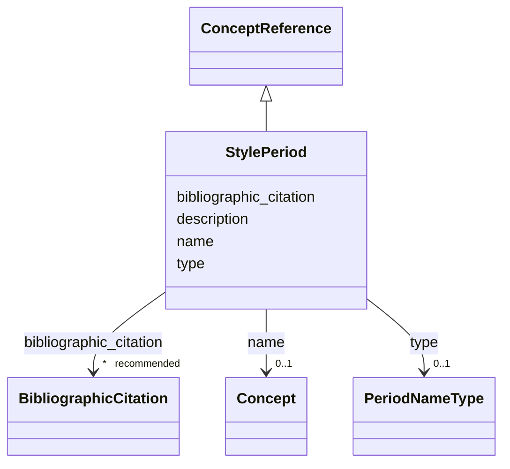

---
search:
  boost: 10.0
---

# Class: StylePeriod

<div data-search-exclude markdown="1">


URI: [wasth:StylePeriod](https://tradicional.arq.br/schema/StylePeriod)





## Inheritance
* [ConceptReference](ConceptReference.md)
    * **StylePeriod**


## Slots

| Name | Cardinality and Range | Description | Inheritance |
| ---  | --- | --- | --- |
| [type](type.md) | 0..1 <br/> [PeriodNameType](PeriodNameType.md) |  | direct |
| [description](description.md) | 0..1 <br/> [String](String.md) | A human-readable description for a thing | [ConceptReference](ConceptReference.md) |
| [name](name.md) | 0..1 <br/> [Concept](Concept.md) | Identificador do termo referido | [ConceptReference](ConceptReference.md) |
| [bibliographic_citation](bibliographic_citation.md) | * _recommended_ <br/> [BibliographicCitation](BibliographicCitation.md) |  | [ConceptReference](ConceptReference.md) |


## Usages

| used by | used in | type | used |
| ---  | --- | --- | --- |
| [Event](Event.md) | [style_period](style_period.md) | range | [StylePeriod](StylePeriod.md) |


## Identifier and Mapping Information


### Schema Source


* from schema: https://tradicional.arq.br/schema


## Mappings

| Mapping Type | Mapped Value |
| ---  | ---  |
| self | wasth:StylePeriod |
| native | wasth:StylePeriod |


## LinkML Source

<!-- TODO: investigate https://stackoverflow.com/questions/37606292/how-to-create-tabbed-code-blocks-in-mkdocs-or-sphinx -->

### Direct

<details>
```yaml
name: StylePeriod
from_schema: https://tradicional.arq.br/schema
is_a: ConceptReference
attributes:
  type:
    name: type
    from_schema: https://tradicional.arq.br/schema/temporal
    ifabsent: PeriodNameType(term:lido00731)
    domain_of:
    - Measurements
    - Event
    - StylePeriod
    - EventPlace
    - Inscription
    - Topic
    - HistoricPlace
    range: PeriodNameType

```
</details>

### Induced

<details>
```yaml
name: StylePeriod
from_schema: https://tradicional.arq.br/schema
is_a: ConceptReference
attributes:
  type:
    name: type
    from_schema: https://tradicional.arq.br/schema/temporal
    ifabsent: PeriodNameType(term:lido00731)
    owner: StylePeriod
    domain_of:
    - Measurements
    - Event
    - StylePeriod
    - EventPlace
    - Inscription
    - Topic
    - HistoricPlace
    range: PeriodNameType
  description:
    name: description
    description: A human-readable description for a thing
    from_schema: https://tradicional.arq.br/schema
    rank: 1000
    slot_uri: dcterms:description
    alias: display
    owner: StylePeriod
    domain_of:
    - ConceptReference
    - Measurements
    - BibliographicCitation
    - RelatedObject
    - Media
    - EventDate
    - EventPlace
    - RelatedEvent
    - Thing
    - Appellation
    - Inscription
    - Topic
    range: string
  name:
    name: name
    description: Identificador do termo referido.
    from_schema: https://tradicional.arq.br/schema/concept
    rank: 1000
    owner: StylePeriod
    domain_of:
    - ConceptReference
    - RelatedEvent
    - HistoricPlace
    range: Concept
  bibliographic_citation:
    name: bibliographic_citation
    from_schema: https://tradicional.arq.br/schema
    rank: 1000
    slot_uri: dcterms:bibliographicCitation
    owner: StylePeriod
    domain_of:
    - ConceptReference
    - GeographicPoint
    - GeographicExtent
    - TypedReference
    - Measurements
    - RelatedObject
    - Media
    - Actor
    - Thing
    - Appellation
    - Inscription
    range: BibliographicCitation
    recommended: true
    multivalued: true
    inlined: true
    inlined_as_list: true

```
</details></div>
