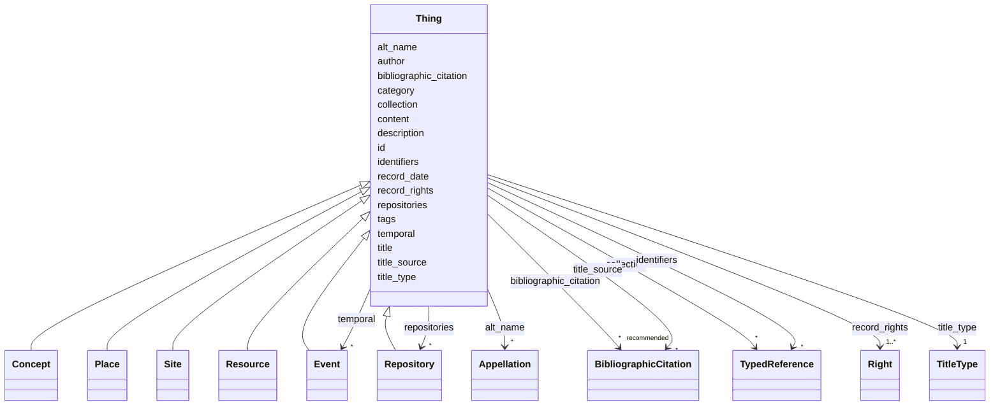

---
search:
  boost: 10.0
---

# Class: Thing


_This class comprises all things in the universe of discourse of the CIDOC Conceptual Reference Model._

_It is an abstract concept providing for three general properties:_

_- Identification by name or appellation, and in particular by a preferred_

_  identifier._

__

_- Classification by type, allowing further refinement of the specific_

_  subclass to which an instance belongs._

__

_- Attachment of free text and other unstructured data for the expression_

_  of anything not captured by formal properties._

__

_All other classes within the CIDOC CRM are directly or indirectly specialisations of E1 CRM Entity._

__


<div data-search-exclude markdown="1">


* __NOTE__: this is an abstract class and should not be instantiated directly


URI: [crm:E1_CRM_Entity](http://www.cidoc-crm.org/cidoc-crm/E1_CRM_Entity)





## Inheritance
* **Thing**
    * [Concept](Concept.md)
    * [Place](Place.md)
    * [Site](Site.md)
    * [Resource](Resource.md)
    * [Event](Event.md)
    * [Repository](Repository.md)


## Class Properties

| Property | Value |
| --- | --- |
| Class URI | [crm:E1_CRM_Entity](http://www.cidoc-crm.org/cidoc-crm/E1_CRM_Entity) |


## Slots

| Name | Cardinality and Range | Description | Inheritance |
| ---  | --- | --- | --- |
| [description](description.md) | 1 <br/> [String](String.md) | A human-readable description for a thing | direct |
| [title_type](title_type.md) | 1 <br/> [TitleType](TitleType.md) | Indica se o título é um nome próprio, descritivo, etc | direct |
| [bibliographic_citation](bibliographic_citation.md) | * _recommended_ <br/> [BibliographicCitation](BibliographicCitation.md) | Cadastro de uma referência bibliográfica | direct |
| [content](content.md) | 0..1 _recommended_ <br/> [String](String.md) | Deixe uma linha em branco após o fechamento dos metadados e inclua aqui uma d... | direct |
| [id](id.md) | 1 <br/> [Uriorcurie](Uriorcurie.md) | Unique identifier for this object | direct |
| [author](author.md) | 0..1 <br/> [OrcidId](OrcidId.md) | ORCID iD of the record author or maintainer | direct |
| [record_date](record_date.md) | 0..1 <br/> [Date](Date.md) | Date the record was created or last substantively revised | direct |
| [title](title.md) | 1 <br/> [String](String.md) | The preferred human-readable label for a Thing | direct |
| [title_source](title_source.md) | * <br/> [BibliographicCitation](BibliographicCitation.md) | 📚 A fonte do título title_source é opcional ; um título pode ser atestado em ... | direct |
| [alt_name](alt_name.md) | * <br/> [Appellation](Appellation.md) | O bloco `alt_name` permite cadastrar outros nomes pelos quais a edificação se... | direct |
| [category](category.md) | 1 <br/> [Uriorcurie](Uriorcurie.md) | The LIDO Category Vocabulary is a structured controlled list of terms recomme... | direct |
| [identifiers](identifiers.md) | * <br/> [TypedReference](TypedReference.md) | Published or external identifiers for the object | direct |
| [tags](tags.md) | * <br/> [String](String.md) | Provisional uncontrolled keywords | direct |
| [temporal](temporal.md) | * <br/> [Event](Event.md) | Temporalidade do objeto | direct |
| [collection](collection.md) | * <br/> [TypedReference](TypedReference.md) | Collections or aggregations to which the object belongs | direct |
| [repositories](repositories.md) | * <br/> [Repository](Repository.md) | A set of elements for the identification, name and location of the repository... | direct |
| [record_rights](record_rights.md) | 1..* <br/> [Right](Right.md) | A set of structured information about rights regarding the content provided i... | direct |


## Usages

| used by | used in | type | used |
| ---  | --- | --- | --- |
| [RelatedObject](RelatedObject.md) | [related_object](related_object.md) | range | [Thing](Thing.md) |
| [Work](Work.md) | [collection](collection.md) | range | [Thing](Thing.md) |


## Identifier and Mapping Information


### Schema Source


* from schema: https://tradicional.arq.br/schema


## Mappings

| Mapping Type | Mapped Value |
| ---  | ---  |
| self | crm:E1_CRM_Entity |
| native | wasth:Thing |
| exact | schema:Thing |


## LinkML Source

<!-- TODO: investigate https://stackoverflow.com/questions/37606292/how-to-create-tabbed-code-blocks-in-mkdocs-or-sphinx -->

### Direct

<details>
```yaml
name: Thing
description: "This class comprises all things in the universe of discourse of the\
  \ CIDOC Conceptual Reference Model.\nIt is an abstract concept providing for three\
  \ general properties:\n- Identification by name or appellation, and in particular\
  \ by a preferred\n  identifier.\n\n- Classification by type, allowing further refinement\
  \ of the specific\n  subclass to which an instance belongs.\n\n- Attachment of free\
  \ text and other unstructured data for the expression\n  of anything not captured\
  \ by formal properties.\n\nAll other classes within the CIDOC CRM are directly or\
  \ indirectly specialisations of E1 CRM Entity.\n"
from_schema: https://tradicional.arq.br/schema
exact_mappings:
- schema:Thing
abstract: true
slots:
- description
- title_type
- bibliographic_citation
- content
slot_usage:
  description:
    name: description
    required: true
attributes:
  id:
    name: id
    description: Unique identifier for this object.
    from_schema: https://tradicional.arq.br/schema/thing
    rank: 1000
    slot_uri: dcterms:identifier
    identifier: true
    domain_of:
    - Thing
    range: uriorcurie
  author:
    name: author
    description: ORCID iD of the record author or maintainer.
    from_schema: https://tradicional.arq.br/schema/thing
    rank: 1000
    slot_uri: dcterms:creator
    domain_of:
    - Thing
    range: OrcidId
  record_date:
    name: record_date
    description: Date the record was created or last substantively revised.
    from_schema: https://tradicional.arq.br/schema/thing
    rank: 1000
    slot_uri: dcterms:created
    domain_of:
    - Thing
    range: date
  title:
    name: title
    description: The preferred human-readable label for a Thing.
    from_schema: https://tradicional.arq.br/schema/thing
    exact_mappings:
    - schema:name
    rank: 1000
    slot_uri: dcterms:title
    domain_of:
    - Thing
    range: string
    required: true
  title_source:
    name: title_source
    description: '📚 A fonte do título title_source é opcional ; um título pode ser
      atestado em mais de uma fonte, por isso este campo é uma lista de itens (cada
      item começa com um hífen).

      Se a fonte for cadastrada, o campo `refid` deve conter a chave de citação (citation
      key) que consta do registro bibliográfico na biblioteca do nosso projeto de
      pesquisa no Zotero. Em geral, a chave de citação é o DOI ou ISBN da publicação,
      mas pode ser diferente.

      Se necessário, incluir no campo note uma especificação adicional, como o número
      da página da referência bibliográfica de onde a informação foi extraída.

      Todos os campos source no restante da ficha devem ser preenchidos do mesmo modo.
      (Equivalente DublinCore: bibliographiCitation).'
    from_schema: https://tradicional.arq.br/schema/thing
    rank: 1000
    domain_of:
    - Thing
    range: BibliographicCitation
    multivalued: true
    inlined_as_list: true
  alt_name:
    name: alt_name
    description: 'O bloco `alt_name` permite cadastrar outros nomes pelos quais a
      edificação será eventualmente conhecida. É uma lista opcional de itens, e se
      existir, os campos de cada item da lista devem ser preenchidos como os do título
      principal.

      O campo `description` de cada item contém o texto do título (nome).

      Este bloco pode ser omitido por completo se não houver títulos alternativos.

      '
    from_schema: https://tradicional.arq.br/schema/thing
    rank: 1000
    domain_of:
    - Thing
    range: Appellation
    multivalued: true
    inlined_as_list: true
  category:
    name: category
    description: 'The LIDO Category Vocabulary is a structured controlled list of
      terms recommended to use as values in the LIDO Category element.

      Examples are human-made object or natural object.

      Nos documentários de edificações, preencher este campo obrigatoriamente com
      `term:lido00096`'
    from_schema: https://tradicional.arq.br/schema/thing
    rank: 1000
    slot_uri: term:lidoCategory
    designates_type: true
    domain_of:
    - Thing
    range: uriorcurie
    required: true
  identifiers:
    name: identifiers
    description: Published or external identifiers for the object.
    from_schema: https://tradicional.arq.br/schema/thing
    rank: 1000
    domain_of:
    - Thing
    range: TypedReference
    multivalued: true
    inlined_as_list: true
  tags:
    name: tags
    description: Provisional uncontrolled keywords. Prefer `classifications` or `subject`
      for curated vocabulary terms.
    from_schema: https://tradicional.arq.br/schema/thing
    rank: 1000
    domain_of:
    - Thing
    range: string
    multivalued: true
  temporal:
    name: temporal
    description: Temporalidade do objeto.
    from_schema: https://tradicional.arq.br/schema/thing
    domain_of:
    - Right
    - Thing
    range: Event
    multivalued: true
    inlined_as_list: true
  collection:
    name: collection
    description: Collections or aggregations to which the object belongs.
    from_schema: https://tradicional.arq.br/schema/thing
    rank: 1000
    domain_of:
    - Thing
    - Work
    range: TypedReference
    multivalued: true
    inlined_as_list: true
  repositories:
    name: repositories
    description: 'A set of elements for the identification, name and location of the
      repository that is responsible for the object/work in focus.

      Repeated if there are several designations known, or if former repositories
      or geographic places should be listed.

      ---------------------------------------------------------------------

      Nos Documentários da Arquitetura Tradicional, usamos repositórios para indicar
      a inclusão da edificação em perímetros de sítios do patrimônio cultural, etc.

      Os repositórios devem ser cadastrados de modo semelhante às informações de georreferenciamento,
      usando o tipo `other`.

      '
    from_schema: https://tradicional.arq.br/schema/thing
    rank: 1000
    domain_of:
    - Thing
    range: Repository
    multivalued: true
    inlined_as_list: true
  record_rights:
    name: record_rights
    description: 'A set of structured information about rights regarding the content
      provided in this LIDO record.

      ---------------------------------------------------------------------

      :warning: Este grupo se refere aos direitos sobre o CONTEÚDO da ficha, não sobre
      os direitos incidentes sobre o objeto descrito.

      '
    from_schema: https://tradicional.arq.br/schema/thing
    rank: 1000
    domain_of:
    - Thing
    range: Right
    required: true
    multivalued: true
    inlined_as_list: true
class_uri: crm:E1_CRM_Entity

```
</details>

### Induced

<details>
```yaml
name: Thing
description: "This class comprises all things in the universe of discourse of the\
  \ CIDOC Conceptual Reference Model.\nIt is an abstract concept providing for three\
  \ general properties:\n- Identification by name or appellation, and in particular\
  \ by a preferred\n  identifier.\n\n- Classification by type, allowing further refinement\
  \ of the specific\n  subclass to which an instance belongs.\n\n- Attachment of free\
  \ text and other unstructured data for the expression\n  of anything not captured\
  \ by formal properties.\n\nAll other classes within the CIDOC CRM are directly or\
  \ indirectly specialisations of E1 CRM Entity.\n"
from_schema: https://tradicional.arq.br/schema
exact_mappings:
- schema:Thing
abstract: true
slot_usage:
  description:
    name: description
    required: true
attributes:
  id:
    name: id
    description: Unique identifier for this object.
    from_schema: https://tradicional.arq.br/schema/thing
    rank: 1000
    slot_uri: dcterms:identifier
    identifier: true
    owner: Thing
    domain_of:
    - Thing
    range: uriorcurie
    required: true
  author:
    name: author
    description: ORCID iD of the record author or maintainer.
    from_schema: https://tradicional.arq.br/schema/thing
    rank: 1000
    slot_uri: dcterms:creator
    owner: Thing
    domain_of:
    - Thing
    range: OrcidId
  record_date:
    name: record_date
    description: Date the record was created or last substantively revised.
    from_schema: https://tradicional.arq.br/schema/thing
    rank: 1000
    slot_uri: dcterms:created
    owner: Thing
    domain_of:
    - Thing
    range: date
  title:
    name: title
    description: The preferred human-readable label for a Thing.
    from_schema: https://tradicional.arq.br/schema/thing
    exact_mappings:
    - schema:name
    rank: 1000
    slot_uri: dcterms:title
    owner: Thing
    domain_of:
    - Thing
    range: string
    required: true
  title_source:
    name: title_source
    description: '📚 A fonte do título title_source é opcional ; um título pode ser
      atestado em mais de uma fonte, por isso este campo é uma lista de itens (cada
      item começa com um hífen).

      Se a fonte for cadastrada, o campo `refid` deve conter a chave de citação (citation
      key) que consta do registro bibliográfico na biblioteca do nosso projeto de
      pesquisa no Zotero. Em geral, a chave de citação é o DOI ou ISBN da publicação,
      mas pode ser diferente.

      Se necessário, incluir no campo note uma especificação adicional, como o número
      da página da referência bibliográfica de onde a informação foi extraída.

      Todos os campos source no restante da ficha devem ser preenchidos do mesmo modo.
      (Equivalente DublinCore: bibliographiCitation).'
    from_schema: https://tradicional.arq.br/schema/thing
    rank: 1000
    owner: Thing
    domain_of:
    - Thing
    range: BibliographicCitation
    multivalued: true
    inlined: true
    inlined_as_list: true
  alt_name:
    name: alt_name
    description: 'O bloco `alt_name` permite cadastrar outros nomes pelos quais a
      edificação será eventualmente conhecida. É uma lista opcional de itens, e se
      existir, os campos de cada item da lista devem ser preenchidos como os do título
      principal.

      O campo `description` de cada item contém o texto do título (nome).

      Este bloco pode ser omitido por completo se não houver títulos alternativos.

      '
    from_schema: https://tradicional.arq.br/schema/thing
    rank: 1000
    owner: Thing
    domain_of:
    - Thing
    range: Appellation
    multivalued: true
    inlined: true
    inlined_as_list: true
  category:
    name: category
    description: 'The LIDO Category Vocabulary is a structured controlled list of
      terms recommended to use as values in the LIDO Category element.

      Examples are human-made object or natural object.

      Nos documentários de edificações, preencher este campo obrigatoriamente com
      `term:lido00096`'
    from_schema: https://tradicional.arq.br/schema/thing
    rank: 1000
    slot_uri: term:lidoCategory
    designates_type: true
    owner: Thing
    domain_of:
    - Thing
    range: uriorcurie
    required: true
  identifiers:
    name: identifiers
    description: Published or external identifiers for the object.
    from_schema: https://tradicional.arq.br/schema/thing
    rank: 1000
    owner: Thing
    domain_of:
    - Thing
    range: TypedReference
    multivalued: true
    inlined: true
    inlined_as_list: true
  tags:
    name: tags
    description: Provisional uncontrolled keywords. Prefer `classifications` or `subject`
      for curated vocabulary terms.
    from_schema: https://tradicional.arq.br/schema/thing
    rank: 1000
    owner: Thing
    domain_of:
    - Thing
    range: string
    multivalued: true
  temporal:
    name: temporal
    description: Temporalidade do objeto.
    from_schema: https://tradicional.arq.br/schema/thing
    owner: Thing
    domain_of:
    - Right
    - Thing
    range: Event
    multivalued: true
    inlined: true
    inlined_as_list: true
  collection:
    name: collection
    description: Collections or aggregations to which the object belongs.
    from_schema: https://tradicional.arq.br/schema/thing
    rank: 1000
    owner: Thing
    domain_of:
    - Thing
    - Work
    range: TypedReference
    multivalued: true
    inlined: true
    inlined_as_list: true
  repositories:
    name: repositories
    description: 'A set of elements for the identification, name and location of the
      repository that is responsible for the object/work in focus.

      Repeated if there are several designations known, or if former repositories
      or geographic places should be listed.

      ---------------------------------------------------------------------

      Nos Documentários da Arquitetura Tradicional, usamos repositórios para indicar
      a inclusão da edificação em perímetros de sítios do patrimônio cultural, etc.

      Os repositórios devem ser cadastrados de modo semelhante às informações de georreferenciamento,
      usando o tipo `other`.

      '
    from_schema: https://tradicional.arq.br/schema/thing
    rank: 1000
    owner: Thing
    domain_of:
    - Thing
    range: Repository
    multivalued: true
    inlined: true
    inlined_as_list: true
  record_rights:
    name: record_rights
    description: 'A set of structured information about rights regarding the content
      provided in this LIDO record.

      ---------------------------------------------------------------------

      :warning: Este grupo se refere aos direitos sobre o CONTEÚDO da ficha, não sobre
      os direitos incidentes sobre o objeto descrito.

      '
    from_schema: https://tradicional.arq.br/schema/thing
    rank: 1000
    owner: Thing
    domain_of:
    - Thing
    range: Right
    required: true
    multivalued: true
    inlined: true
    inlined_as_list: true
  description:
    name: description
    description: A human-readable description for a thing
    from_schema: https://tradicional.arq.br/schema
    exact_mappings:
    - schema:description
    rank: 1000
    slot_uri: dcterms:description
    alias: display
    owner: Thing
    domain_of:
    - ConceptReference
    - BibliographicCitation
    - RelatedObject
    - MediaObject
    - Measurement
    - EventDate
    - EventPlace
    - RelatedEvent
    - Thing
    - Appellation
    - Inscription
    - Topic
    range: string
    required: true
  title_type:
    name: title_type
    description: Indica se o título é um nome próprio, descritivo, etc.
    from_schema: https://tradicional.arq.br/schema
    rank: 1000
    alias: type
    owner: Thing
    domain_of:
    - Thing
    - Appellation
    range: TitleType
    required: true
  bibliographic_citation:
    name: bibliographic_citation
    description: 'Cadastro de uma referência bibliográfica.

      Usar o campo `description` para formatar a referência, caso a formatação automática
      do Zotero não for satisfatória.

      '
    from_schema: https://tradicional.arq.br/schema
    rank: 1000
    slot_uri: dcterms:bibliographicCitation
    owner: Thing
    domain_of:
    - ConceptReference
    - GeographicPoint
    - GeographicExtent
    - RelatedObject
    - MediaObject
    - TypedReference
    - Measurement
    - Actor
    - Thing
    - Appellation
    - Inscription
    range: BibliographicCitation
    recommended: true
    multivalued: true
    inlined: true
    inlined_as_list: true
  content:
    name: content
    description: 'Deixe uma linha em branco após o fechamento dos metadados e inclua
      aqui uma descrição morfológica e histórica da edificação com texto livre, usando
      formatação Markdown.

      Poderá incluir um segundo bloco de metadados para indicar as referências bibliográficas
      da descrição textual, no campo `nocite`. O formato é uma lista de chaves de
      citação do Zotero (cada uma começando com `@`) separadas por vírgulas:

      ```yaml Conteúdo textual em formato *Markdown* com citações [@citekey].

      --- nocite: "@*" --- ```

      '
    from_schema: https://tradicional.arq.br/schema
    rank: 1000
    slot_uri: skos:scopeNote
    owner: Thing
    domain_of:
    - Thing
    - Inscription
    range: string
    recommended: true
class_uri: crm:E1_CRM_Entity

```
</details></div>
