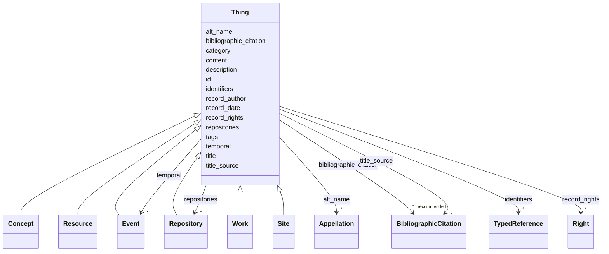

---
search:
  boost: 10.0
---

# Class: Thing 


_Esta classe compreende todas as coisas no universo do CIDOC CRM. É um conceito abstrato que prevê três propriedades gerais:_

_- Identificação por nome ou título, em particular por um identificador_

_  preferencial._

_- Classificação por tipo, permitindo o refinamento da subclasse_

_  específica à qual a instância pertence._

_- Atribuição de texto livre e de outros dados não estruturados, para_

_  expressar informações não capturadas por propriedades formais._

__

_Todas as demais classes do CIDOC CRM são especializações diretas ou indiretas de E1 CRM Entity._

_-------------------------------------------------------------------------_

_This class comprises all things in the universe of discourse of the CIDOC Conceptual Reference Model._

_It is an abstract concept providing for three general properties:_

_- Identification by name or appellation, and in particular by a preferred_

_  identifier._

__

_- Classification by type, allowing further refinement of the specific_

_  subclass to which an instance belongs._

__

_- Attachment of free text and other unstructured data for the expression_

_  of anything not captured by formal properties._

__

_All other classes within the CIDOC CRM are directly or indirectly specialisations of E1 CRM Entity._

__


<div data-search-exclude markdown="1">


* __NOTE__: this is an abstract class and should not be instantiated directly


URI: [crm:E1_CRM_Entity](http://www.cidoc-crm.org/cidoc-crm/E1_CRM_Entity)





## Inheritance
* **Thing**
    * [Concept](Concept.md)
    * [Resource](Resource.md)
    * [Event](Event.md)
    * [Repository](Repository.md)
    * [Work](Work.md)
    * [Site](Site.md)


## Class Properties

| Property | Value |
| --- | --- |
| Class URI | [crm:E1_CRM_Entity](http://www.cidoc-crm.org/cidoc-crm/E1_CRM_Entity) |


## Slots

| Name | Cardinality and Range | Description | Inheritance |
| ---  | --- | --- | --- |
| [description](description.md) | 1 <br/> [String](String.md) | A human-readable description for a thing | direct |
| [bibliographic_citation](bibliographic_citation.md) | * _recommended_ <br/> [BibliographicCitation](BibliographicCitation.md) | 📚  Cadastro de uma referência bibliográfica | direct |
| [content](content.md) | 0..1 _recommended_ <br/> [String](String.md) | Conteúdo textual descritivo ou explicativo | direct |
| [id](id.md) | 1 <br/> [Uriorcurie](Uriorcurie.md) | Identificador globalmente único para este objeto ou recurso | direct |
| [record_author](record_author.md) | 0..1 <br/> [OrcidId](OrcidId.md) | ORCID iD da pessoa que escreveu a versão original da ficha | direct |
| [record_date](record_date.md) | 0..1 <br/> [Date](Date.md) | Data de inclusão da ficha | direct |
| [title](title.md) | 1 <br/> [String](String.md) | Nome pelo qual este item é mais comumente conhecido | direct |
| [title_source](title_source.md) | * <br/> [BibliographicCitation](BibliographicCitation.md) | A fonte do título title_source é opcional ; um título pode ser atestado em ma... | direct |
| [alt_name](alt_name.md) | * <br/> [Appellation](Appellation.md) | O bloco `alt_name` permite cadastrar outros nomes pelos quais o objeto ou con... | direct |
| [category](category.md) | 1 <br/> [Uriorcurie](Uriorcurie.md) | Uma classificação ampla para o objeto descrito na ficha, usando o vocabulário... | direct |
| [identifiers](identifiers.md) | * <br/> [TypedReference](TypedReference.md) | Números de inventário e demais códigos que identificam este objeto em outras ... | direct |
| [tags](tags.md) | * <br/> [String](String.md) | Lista de palavras-chave que caracterizam o objeto, de modo não estruturado | direct |
| [temporal](temporal.md) | * <br/> [Event](Event.md) | Descrição dos eventos associados ao ciclo de vida da edificação ou à existênc... | direct |
| [repositories](repositories.md) | * <br/> [Repository](Repository.md) | Nos Documentários da Arquitetura Tradicional, usamos repositórios para indica... | direct |
| [record_rights](record_rights.md) | * <br/> [Right](Right.md) | Informações estruturadas sobre os direitos que incidem sobre o conteúdo textu... | direct |


## Usages

| used by | used in | type | used |
| ---  | --- | --- | --- |
| [RelatedObject](RelatedObject.md) | [related_object](related_object.md) | range | [Thing](Thing.md) |
| [Work](Work.md) | [collection](collection.md) | range | [Thing](Thing.md) |


## Identifier and Mapping Information
### Administrative Metadata

**Rank:** 0


### Schema Source


* from schema: https://tradicional.arq.br/schema


## Mappings

| Mapping Type | Mapped Value |
| ---  | ---  |
| self | crm:E1_CRM_Entity |
| native | wasth:Thing |
| exact | schema:Thing |


## LinkML Source

<!-- TODO: investigate https://stackoverflow.com/questions/37606292/how-to-create-tabbed-code-blocks-in-mkdocs-or-sphinx -->

### Direct

<details>
```yaml
name: Thing
description: "Esta classe compreende todas as coisas no universo do CIDOC CRM. É um\
  \ conceito abstrato que prevê três propriedades gerais:\n- Identificação por nome\
  \ ou título, em particular por um identificador\n  preferencial.\n- Classificação\
  \ por tipo, permitindo o refinamento da subclasse\n  específica à qual a instância\
  \ pertence.\n- Atribuição de texto livre e de outros dados não estruturados, para\n\
  \  expressar informações não capturadas por propriedades formais.\n\nTodas as demais\
  \ classes do CIDOC CRM são especializações diretas ou indiretas de E1 CRM Entity.\n\
  -------------------------------------------------------------------------\nThis\
  \ class comprises all things in the universe of discourse of the CIDOC Conceptual\
  \ Reference Model.\nIt is an abstract concept providing for three general properties:\n\
  - Identification by name or appellation, and in particular by a preferred\n  identifier.\n\
  \n- Classification by type, allowing further refinement of the specific\n  subclass\
  \ to which an instance belongs.\n\n- Attachment of free text and other unstructured\
  \ data for the expression\n  of anything not captured by formal properties.\n\n\
  All other classes within the CIDOC CRM are directly or indirectly specialisations\
  \ of E1 CRM Entity.\n"
from_schema: https://tradicional.arq.br/schema
exact_mappings:
- schema:Thing
rank: 0
abstract: true
slots:
- description
- bibliographic_citation
- content
slot_usage:
  description:
    name: description
    required: true
attributes:
  id:
    name: id
    description: 'Identificador globalmente único para este objeto ou recurso.

      '
    from_schema: https://tradicional.arq.br/schema/thing
    rank: 1000
    slot_uri: dcterms:identifier
    identifier: true
    domain_of:
    - Thing
    range: uriorcurie
  record_author:
    name: record_author
    description: 'ORCID iD da pessoa que escreveu a versão original da ficha. Alterar
      apenas no caso de a ficha ter sido substancialmente reescrita.

      '
    from_schema: https://tradicional.arq.br/schema/thing
    rank: 1000
    slot_uri: dcterms:contributor
    alias: author
    domain_of:
    - Thing
    range: OrcidId
  record_date:
    name: record_date
    description: Data de inclusão da ficha.
    from_schema: https://tradicional.arq.br/schema/thing
    rank: 1000
    slot_uri: dcterms:created
    alias: date
    domain_of:
    - Thing
    range: date
  title:
    name: title
    description: 'Nome pelo qual este item é mais comumente conhecido. Outros nomes
      podem ser cadastrados em `alt_name`.

      '
    from_schema: https://tradicional.arq.br/schema/thing
    exact_mappings:
    - schema:name
    rank: 1000
    slot_uri: dcterms:title
    domain_of:
    - Thing
    range: string
    required: true
  title_source:
    name: title_source
    description: A fonte do título title_source é opcional ; um título pode ser atestado
      em mais de uma fonte, por isso este campo é uma lista de itens (cada item começa
      com um hífen).
    from_schema: https://tradicional.arq.br/schema/thing
    rank: 1000
    domain_of:
    - Thing
    range: BibliographicCitation
    multivalued: true
    inlined_as_list: true
  alt_name:
    name: alt_name
    description: 'O bloco `alt_name` permite cadastrar outros nomes pelos quais o
      objeto ou conceito será eventualmente conhecido. É uma lista opcional de itens,
      e se existir, os campos de cada item da lista devem ser preenchidos como os
      do título principal.

      O campo `label` ou `description` de cada item contém o texto do título (nome).

      Este bloco pode ser omitido por completo se não houver títulos alternativos.

      '
    from_schema: https://tradicional.arq.br/schema/thing
    rank: 1000
    domain_of:
    - Thing
    range: Appellation
    multivalued: true
    inlined_as_list: true
  category:
    name: category
    description: 'Uma classificação ampla para o objeto descrito na ficha, usando
      o vocabulário controlado do LIDO.

      Nos documentários de edificações, preencher este campo OBRIGATORIAMENTE com
      `term:lido00096` ("Objeto manufaturado").

      No vocabulário controlado, preencher este campo OBRIGATORIAMENTE com `term:lido01193`
      ("Objeto conceitual").

      ---------------------------------------------------------------------

      The LIDO Category Vocabulary is a structured controlled list of terms recommended
      to use as values in the LIDO Category element.

      Examples are human-made object or natural object.'
    from_schema: https://tradicional.arq.br/schema/thing
    rank: 1000
    slot_uri: term:lidoCategory
    designates_type: true
    domain_of:
    - Thing
    range: uriorcurie
    required: true
  identifiers:
    name: identifiers
    description: "Números de inventário e demais códigos que identificam este objeto\
      \ em outras bases de dados.\nCaso esta edificação esteja cadastrada em outras\
      \ bases de dados (por exemplo, [SICG], [SIPA], [HPIP], [iPatrimonio], etc.),\
      \ pode preencher a lista `identifiers` como segue.\n:clipboard: O conteúdo de\
      \ cada bloco é uma lista recuada em dois espaços com respeito à categoria superior.\
      \ Seus itens são :\n* `type` é o tipo de referência : pode ser `uri` (padrão),\
      \ `iri` ou\n  `local` — se estiver em dúvida, omita esta linha ;\n\n* `refid`\
      \ é obrigatório : representa o identificador do conceito no\n  vocabulário controlado\
      \ ou no repositório de origem — normalmente\n  será uma URI (um link para a\
      \ página web do cadastro) ;\n\n* `description` deve ser usado para representar\
      \ textualmente\n  o número de inventário, código identificador ou outra informação\n\
      \  que individualize o objeto na base externa (por exemplo, livro do\n  tombo\
      \ e número do processo de tombamento, no Brasil) ;\n\n* `bibliographic_citation`\
      \ é opcional e permite citar uma lista de\n  referências bibliográficas que\
      \ validem a inclusão deste termo.\n\n* `source` também é opcional e permite\
      \ cadastrar os dados da pessoa\n  jurídica responsável pelo registro.\n\n---------------------------------------------------------------------\n\
      Published or external identifiers for the object.\n"
    from_schema: https://tradicional.arq.br/schema/thing
    rank: 1000
    domain_of:
    - Thing
    range: TypedReference
    multivalued: true
    inlined_as_list: true
  tags:
    name: tags
    description: 'Lista de palavras-chave que caracterizam o objeto, de modo não estruturado.
      Recomenda-se usar uma palavra-chave de cada um dos recortes abaixo:

      - Geográfico ; - Cronológico ; - Histórico-cultural ; - Técnico-construtivo ;
      - Temático ou tipológico ; - Funcional.

      ---------------------------------------------------------------------

      Provisional uncontrolled keywords. Prefer `classifications` or `subject` for
      curated vocabulary terms.'
    from_schema: https://tradicional.arq.br/schema/thing
    rank: 1000
    domain_of:
    - Thing
    range: string
    multivalued: true
  temporal:
    name: temporal
    description: 'Descrição dos eventos associados ao ciclo de vida da edificação
      ou à existência e/ou uso do objeto ou conceito. Ler a respetiva documentação
      para estruturar este campo.

      '
    from_schema: https://tradicional.arq.br/schema/thing
    domain_of:
    - Right
    - Thing
    range: Event
    multivalued: true
    inlined_as_list: true
  repositories:
    name: repositories
    description: 'Nos Documentários da Arquitetura Tradicional, usamos repositórios
      para indicar a inclusão da edificação em perímetros de sítios tombados/classificados
      do patrimônio, áreas de interesse histórico-cultural, etc.

      O repositório é cadastrado como uma pessoa jurídica dotada de extensão geográfica.

      ---------------------------------------------------------------------

      A set of elements for the identification, name and location of the repository
      that is responsible for the object/work in focus.

      Repeated if there are several designations known, or if former repositories
      or geographic places should be listed.

      '
    from_schema: https://tradicional.arq.br/schema/thing
    rank: 1000
    domain_of:
    - Thing
    range: Repository
    multivalued: true
    inlined_as_list: true
  record_rights:
    name: record_rights
    description: 'Informações estruturadas sobre os direitos que incidem sobre o conteúdo
      textual desta ficha.

      ⚠️  Este grupo se refere aos direitos sobre o CONTEÚDO da ficha, não sobre os
      direitos incidentes sobre o objeto descrito.

      ---------------------------------------------------------------------

      A set of structured information about rights regarding the content provided
      in this LIDO record.

      '
    from_schema: https://tradicional.arq.br/schema/thing
    rank: 1000
    domain_of:
    - Thing
    range: Right
    multivalued: true
    inlined_as_list: true
class_uri: crm:E1_CRM_Entity

```
</details>

### Induced

<details>
```yaml
name: Thing
description: "Esta classe compreende todas as coisas no universo do CIDOC CRM. É um\
  \ conceito abstrato que prevê três propriedades gerais:\n- Identificação por nome\
  \ ou título, em particular por um identificador\n  preferencial.\n- Classificação\
  \ por tipo, permitindo o refinamento da subclasse\n  específica à qual a instância\
  \ pertence.\n- Atribuição de texto livre e de outros dados não estruturados, para\n\
  \  expressar informações não capturadas por propriedades formais.\n\nTodas as demais\
  \ classes do CIDOC CRM são especializações diretas ou indiretas de E1 CRM Entity.\n\
  -------------------------------------------------------------------------\nThis\
  \ class comprises all things in the universe of discourse of the CIDOC Conceptual\
  \ Reference Model.\nIt is an abstract concept providing for three general properties:\n\
  - Identification by name or appellation, and in particular by a preferred\n  identifier.\n\
  \n- Classification by type, allowing further refinement of the specific\n  subclass\
  \ to which an instance belongs.\n\n- Attachment of free text and other unstructured\
  \ data for the expression\n  of anything not captured by formal properties.\n\n\
  All other classes within the CIDOC CRM are directly or indirectly specialisations\
  \ of E1 CRM Entity.\n"
from_schema: https://tradicional.arq.br/schema
exact_mappings:
- schema:Thing
rank: 0
abstract: true
slot_usage:
  description:
    name: description
    required: true
attributes:
  id:
    name: id
    description: 'Identificador globalmente único para este objeto ou recurso.

      '
    from_schema: https://tradicional.arq.br/schema/thing
    rank: 1000
    slot_uri: dcterms:identifier
    identifier: true
    owner: Thing
    domain_of:
    - Thing
    range: uriorcurie
    required: true
  record_author:
    name: record_author
    description: 'ORCID iD da pessoa que escreveu a versão original da ficha. Alterar
      apenas no caso de a ficha ter sido substancialmente reescrita.

      '
    from_schema: https://tradicional.arq.br/schema/thing
    rank: 1000
    slot_uri: dcterms:contributor
    alias: author
    owner: Thing
    domain_of:
    - Thing
    range: OrcidId
  record_date:
    name: record_date
    description: Data de inclusão da ficha.
    from_schema: https://tradicional.arq.br/schema/thing
    rank: 1000
    slot_uri: dcterms:created
    alias: date
    owner: Thing
    domain_of:
    - Thing
    range: date
  title:
    name: title
    description: 'Nome pelo qual este item é mais comumente conhecido. Outros nomes
      podem ser cadastrados em `alt_name`.

      '
    from_schema: https://tradicional.arq.br/schema/thing
    exact_mappings:
    - schema:name
    rank: 1000
    slot_uri: dcterms:title
    owner: Thing
    domain_of:
    - Thing
    range: string
    required: true
  title_source:
    name: title_source
    description: A fonte do título title_source é opcional ; um título pode ser atestado
      em mais de uma fonte, por isso este campo é uma lista de itens (cada item começa
      com um hífen).
    from_schema: https://tradicional.arq.br/schema/thing
    rank: 1000
    owner: Thing
    domain_of:
    - Thing
    range: BibliographicCitation
    multivalued: true
    inlined: true
    inlined_as_list: true
  alt_name:
    name: alt_name
    description: 'O bloco `alt_name` permite cadastrar outros nomes pelos quais o
      objeto ou conceito será eventualmente conhecido. É uma lista opcional de itens,
      e se existir, os campos de cada item da lista devem ser preenchidos como os
      do título principal.

      O campo `label` ou `description` de cada item contém o texto do título (nome).

      Este bloco pode ser omitido por completo se não houver títulos alternativos.

      '
    from_schema: https://tradicional.arq.br/schema/thing
    rank: 1000
    owner: Thing
    domain_of:
    - Thing
    range: Appellation
    multivalued: true
    inlined: true
    inlined_as_list: true
  category:
    name: category
    description: 'Uma classificação ampla para o objeto descrito na ficha, usando
      o vocabulário controlado do LIDO.

      Nos documentários de edificações, preencher este campo OBRIGATORIAMENTE com
      `term:lido00096` ("Objeto manufaturado").

      No vocabulário controlado, preencher este campo OBRIGATORIAMENTE com `term:lido01193`
      ("Objeto conceitual").

      ---------------------------------------------------------------------

      The LIDO Category Vocabulary is a structured controlled list of terms recommended
      to use as values in the LIDO Category element.

      Examples are human-made object or natural object.'
    from_schema: https://tradicional.arq.br/schema/thing
    rank: 1000
    slot_uri: term:lidoCategory
    designates_type: true
    owner: Thing
    domain_of:
    - Thing
    range: uriorcurie
    required: true
  identifiers:
    name: identifiers
    description: "Números de inventário e demais códigos que identificam este objeto\
      \ em outras bases de dados.\nCaso esta edificação esteja cadastrada em outras\
      \ bases de dados (por exemplo, [SICG], [SIPA], [HPIP], [iPatrimonio], etc.),\
      \ pode preencher a lista `identifiers` como segue.\n:clipboard: O conteúdo de\
      \ cada bloco é uma lista recuada em dois espaços com respeito à categoria superior.\
      \ Seus itens são :\n* `type` é o tipo de referência : pode ser `uri` (padrão),\
      \ `iri` ou\n  `local` — se estiver em dúvida, omita esta linha ;\n\n* `refid`\
      \ é obrigatório : representa o identificador do conceito no\n  vocabulário controlado\
      \ ou no repositório de origem — normalmente\n  será uma URI (um link para a\
      \ página web do cadastro) ;\n\n* `description` deve ser usado para representar\
      \ textualmente\n  o número de inventário, código identificador ou outra informação\n\
      \  que individualize o objeto na base externa (por exemplo, livro do\n  tombo\
      \ e número do processo de tombamento, no Brasil) ;\n\n* `bibliographic_citation`\
      \ é opcional e permite citar uma lista de\n  referências bibliográficas que\
      \ validem a inclusão deste termo.\n\n* `source` também é opcional e permite\
      \ cadastrar os dados da pessoa\n  jurídica responsável pelo registro.\n\n---------------------------------------------------------------------\n\
      Published or external identifiers for the object.\n"
    from_schema: https://tradicional.arq.br/schema/thing
    rank: 1000
    owner: Thing
    domain_of:
    - Thing
    range: TypedReference
    multivalued: true
    inlined: true
    inlined_as_list: true
  tags:
    name: tags
    description: 'Lista de palavras-chave que caracterizam o objeto, de modo não estruturado.
      Recomenda-se usar uma palavra-chave de cada um dos recortes abaixo:

      - Geográfico ; - Cronológico ; - Histórico-cultural ; - Técnico-construtivo ;
      - Temático ou tipológico ; - Funcional.

      ---------------------------------------------------------------------

      Provisional uncontrolled keywords. Prefer `classifications` or `subject` for
      curated vocabulary terms.'
    from_schema: https://tradicional.arq.br/schema/thing
    rank: 1000
    owner: Thing
    domain_of:
    - Thing
    range: string
    multivalued: true
  temporal:
    name: temporal
    description: 'Descrição dos eventos associados ao ciclo de vida da edificação
      ou à existência e/ou uso do objeto ou conceito. Ler a respetiva documentação
      para estruturar este campo.

      '
    from_schema: https://tradicional.arq.br/schema/thing
    owner: Thing
    domain_of:
    - Right
    - Thing
    range: Event
    multivalued: true
    inlined: true
    inlined_as_list: true
  repositories:
    name: repositories
    description: 'Nos Documentários da Arquitetura Tradicional, usamos repositórios
      para indicar a inclusão da edificação em perímetros de sítios tombados/classificados
      do patrimônio, áreas de interesse histórico-cultural, etc.

      O repositório é cadastrado como uma pessoa jurídica dotada de extensão geográfica.

      ---------------------------------------------------------------------

      A set of elements for the identification, name and location of the repository
      that is responsible for the object/work in focus.

      Repeated if there are several designations known, or if former repositories
      or geographic places should be listed.

      '
    from_schema: https://tradicional.arq.br/schema/thing
    rank: 1000
    owner: Thing
    domain_of:
    - Thing
    range: Repository
    multivalued: true
    inlined: true
    inlined_as_list: true
  record_rights:
    name: record_rights
    description: 'Informações estruturadas sobre os direitos que incidem sobre o conteúdo
      textual desta ficha.

      ⚠️  Este grupo se refere aos direitos sobre o CONTEÚDO da ficha, não sobre os
      direitos incidentes sobre o objeto descrito.

      ---------------------------------------------------------------------

      A set of structured information about rights regarding the content provided
      in this LIDO record.

      '
    from_schema: https://tradicional.arq.br/schema/thing
    rank: 1000
    owner: Thing
    domain_of:
    - Thing
    range: Right
    multivalued: true
    inlined: true
    inlined_as_list: true
  description:
    name: description
    description: A human-readable description for a thing
    from_schema: https://tradicional.arq.br/schema
    exact_mappings:
    - schema:description
    rank: 1000
    slot_uri: dcterms:description
    alias: display
    owner: Thing
    domain_of:
    - ConceptReference
    - BibliographicCitation
    - RelatedObject
    - MediaObject
    - TypedReference
    - Measurement
    - RelatedEvent
    - Thing
    - Inscription
    - Topic
    range: string
    required: true
  bibliographic_citation:
    name: bibliographic_citation
    description: '📚  Cadastro de uma referência bibliográfica.

      O campo `refid` deve conter a chave de citação (citation key) que consta do
      registro bibliográfico na biblioteca do nosso projeto de pesquisa no Zotero,
      começando com arroba @. Em geral, a chave de citação é o DOI ou ISBN da publicação,
      mas pode ser diferente.

      Se necessário, incluir no campo `note` uma especificação adicional, como o número
      da página da referência bibliográfica de onde a informação foi extraída.

      Usar o campo `description` para formatar a referência, caso a formatação automática
      do Zotero não for satisfatória.

      '
    from_schema: https://tradicional.arq.br/schema
    rank: 1000
    slot_uri: dcterms:bibliographicCitation
    owner: Thing
    domain_of:
    - ConceptReference
    - RelatedObject
    - MediaObject
    - TypedReference
    - Measurement
    - Actor
    - Thing
    - Appellation
    - GeographicPoint
    - GeographicExtent
    - Inscription
    range: BibliographicCitation
    recommended: true
    multivalued: true
    inlined: true
    inlined_as_list: true
  content:
    name: content
    description: Conteúdo textual descritivo ou explicativo.
    from_schema: https://tradicional.arq.br/schema
    rank: 1000
    slot_uri: skos:scopeNote
    owner: Thing
    domain_of:
    - Thing
    - Inscription
    range: string
    recommended: true
class_uri: crm:E1_CRM_Entity

```
</details></div>