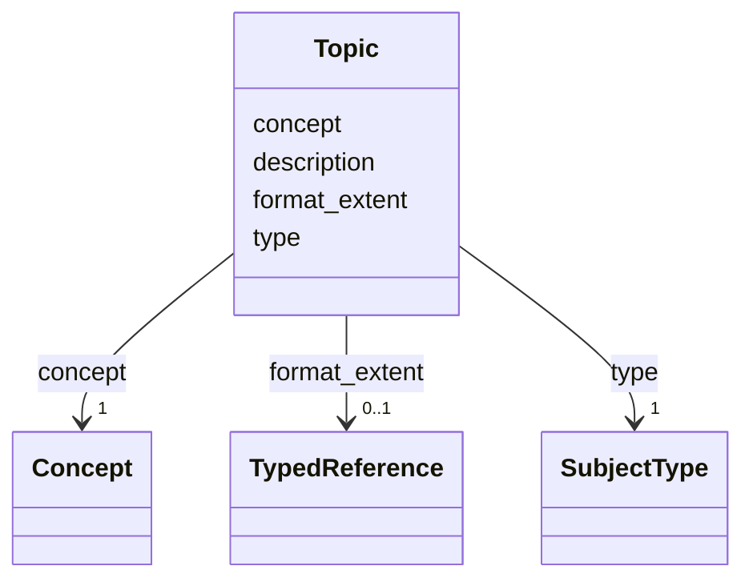

---
search:
  boost: 10.0
---

# Class: Topic


_Subject or iconographic topic._


<div data-search-exclude markdown="1">


URI: [wasth:Topic](https://tradicional.arq.br/schema/Topic)





<!-- no inheritance hierarchy -->

## Slots

| Name | Cardinality and Range | Description | Inheritance |
| ---  | --- | --- | --- |
| [description](description.md) | 0..1 <br/> [String](String.md) | A human-readable description for a thing | direct |
| [format_extent](format_extent.md) | 0..1 <br/> [TypedReference](TypedReference.md) | Indica a parte do objeto que está sendo medida — por | direct |
| [concept](concept.md) | 1 <br/> [Concept](Concept.md) |  | direct |
| [type](type.md) | 1 <br/> [SubjectType](SubjectType.md) |  | direct |


## Usages

| used by | used in | type | used |
| ---  | --- | --- | --- |
| [Work](Work.md) | [subject](subject.md) | range | [Topic](Topic.md) |


## Identifier and Mapping Information


### Schema Source


* from schema: https://tradicional.arq.br/schema


## Mappings

| Mapping Type | Mapped Value |
| ---  | ---  |
| self | wasth:Topic |
| native | wasth:Topic |


## LinkML Source

<!-- TODO: investigate https://stackoverflow.com/questions/37606292/how-to-create-tabbed-code-blocks-in-mkdocs-or-sphinx -->

### Direct

<details>
```yaml
name: Topic
description: Subject or iconographic topic.
from_schema: https://tradicional.arq.br/schema
slots:
- description
- format_extent
- concept
slot_usage:
  concept:
    name: concept
    required: true
attributes:
  type:
    name: type
    from_schema: https://tradicional.arq.br/schema/work
    domain_of:
    - Measurements
    - Event
    - StylePeriod
    - EventPlace
    - Inscription
    - Topic
    - HistoricPlace
    range: SubjectType
    required: true

```
</details>

### Induced

<details>
```yaml
name: Topic
description: Subject or iconographic topic.
from_schema: https://tradicional.arq.br/schema
slot_usage:
  concept:
    name: concept
    required: true
attributes:
  type:
    name: type
    from_schema: https://tradicional.arq.br/schema/work
    owner: Topic
    domain_of:
    - Measurements
    - Event
    - StylePeriod
    - EventPlace
    - Inscription
    - Topic
    - HistoricPlace
    range: SubjectType
    required: true
  description:
    name: description
    description: A human-readable description for a thing
    from_schema: https://tradicional.arq.br/schema
    rank: 1000
    slot_uri: dcterms:description
    alias: display
    owner: Topic
    domain_of:
    - ConceptReference
    - Measurements
    - BibliographicCitation
    - RelatedObject
    - Media
    - EventDate
    - EventPlace
    - RelatedEvent
    - Thing
    - Appellation
    - Inscription
    - Topic
    range: string
  format_extent:
    name: format_extent
    description: 'Indica a parte do objeto que está sendo medida — por

      exemplo, se a altura é até a linha de coroamento ou até a cumeeira, etc.

      — usar a `uri` de um vocabulário controlado.

      '
    from_schema: https://tradicional.arq.br/schema
    rank: 1000
    alias: extent
    owner: Topic
    domain_of:
    - Measurements
    - Inscription
    - Topic
    range: TypedReference
    inlined: true
  concept:
    name: concept
    from_schema: https://tradicional.arq.br/schema
    rank: 1000
    alias: name
    owner: Topic
    domain_of:
    - Topic
    range: Concept
    required: true

```
</details></div>
