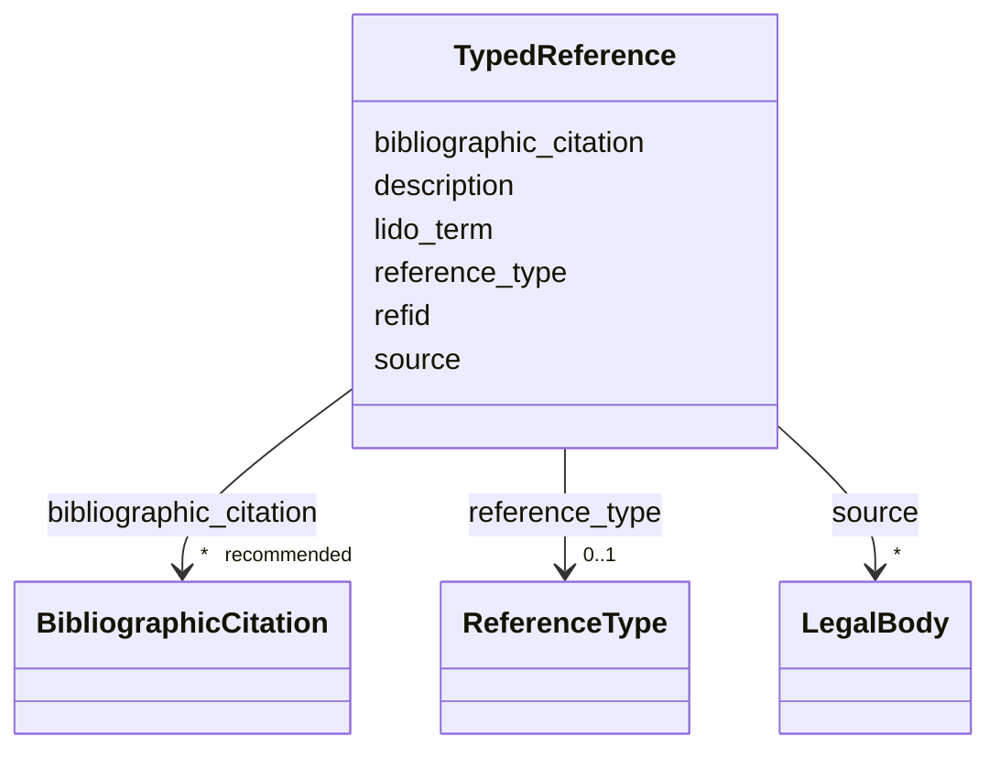

---
search:
  boost: 10.0
---

# Class: TypedReference 


_Permite referenciar um registro local ou externo por meio da sua URI (localizador universal, como um link da internet, por padrão), IRI ou código na base local (não recomendado)._

_-------------------------------------------------------------------------_

_Reference to a local record, IRI, URI, or LIDO terminology term._


<div data-search-exclude markdown="1">


URI: [wasth:TypedReference](https://tradicional.arq.br/schema/TypedReference)





<!-- no inheritance hierarchy -->

## Slots

| Name | Cardinality and Range | Description | Inheritance |
| ---  | --- | --- | --- |
| [reference_type](reference_type.md) | 0..1 <br/> [ReferenceType](ReferenceType.md) |  | direct |
| [lido_term](lido_term.md) | 0..1 <br/> [Uriorcurie](Uriorcurie.md) | LIDO terminology term | direct |
| [refid](refid.md) | 1 <br/> [Uriorcurie](Uriorcurie.md) | Local or external identifier | direct |
| [description](description.md) | 0..1 <br/> [String](String.md) | A human-readable description for a thing | direct |
| [bibliographic_citation](bibliographic_citation.md) | * _recommended_ <br/> [BibliographicCitation](BibliographicCitation.md) | 📚  Cadastro de uma referência bibliográfica | direct |
| [source](source.md) | * <br/> [LegalBody](LegalBody.md) |  | direct |


## Usages

| used by | used in | type | used |
| ---  | --- | --- | --- |
| [Concept](Concept.md) | [identifiers](identifiers.md) | range | [TypedReference](TypedReference.md) |
| [Resource](Resource.md) | [resource_service](resource_service.md) | range | [TypedReference](TypedReference.md) |
| [Resource](Resource.md) | [unit](unit.md) | range | [TypedReference](TypedReference.md) |
| [Resource](Resource.md) | [identifiers](identifiers.md) | range | [TypedReference](TypedReference.md) |
| [MediaObject](MediaObject.md) | [format](format.md) | range | [TypedReference](TypedReference.md) |
| [MediaObject](MediaObject.md) | [resource_service](resource_service.md) | range | [TypedReference](TypedReference.md) |
| [Measurement](Measurement.md) | [unit](unit.md) | range | [TypedReference](TypedReference.md) |
| [Measurement](Measurement.md) | [format_extent](format_extent.md) | range | [TypedReference](TypedReference.md) |
| [Measurement](Measurement.md) | [measurement_shape](measurement_shape.md) | range | [TypedReference](TypedReference.md) |
| [Right](Right.md) | [rights_statement](rights_statement.md) | range | [TypedReference](TypedReference.md) |
| [LegalBody](LegalBody.md) | [legal_body_name](legal_body_name.md) | range | [TypedReference](TypedReference.md) |
| [Event](Event.md) | [culture](culture.md) | range | [TypedReference](TypedReference.md) |
| [Event](Event.md) | [identifiers](identifiers.md) | range | [TypedReference](TypedReference.md) |
| [Actor](Actor.md) | [actor_name](actor_name.md) | range | [TypedReference](TypedReference.md) |
| [Actor](Actor.md) | [actor_qualifier](actor_qualifier.md) | range | [TypedReference](TypedReference.md) |
| [Actor](Actor.md) | [actor_extent](actor_extent.md) | range | [TypedReference](TypedReference.md) |
| [Thing](Thing.md) | [identifiers](identifiers.md) | range | [TypedReference](TypedReference.md) |
| [Repository](Repository.md) | [identifiers](identifiers.md) | range | [TypedReference](TypedReference.md) |
| [Work](Work.md) | [culture](culture.md) | range | [TypedReference](TypedReference.md) |
| [Work](Work.md) | [part_of](part_of.md) | range | [TypedReference](TypedReference.md) |
| [Work](Work.md) | [identifiers](identifiers.md) | range | [TypedReference](TypedReference.md) |
| [Site](Site.md) | [identifiers](identifiers.md) | range | [TypedReference](TypedReference.md) |
| [Inscription](Inscription.md) | [format_extent](format_extent.md) | range | [TypedReference](TypedReference.md) |
| [Topic](Topic.md) | [format_extent](format_extent.md) | range | [TypedReference](TypedReference.md) |
| [LocationHistoric](LocationHistoric.md) | [location_historic_name](location_historic_name.md) | range | [TypedReference](TypedReference.md) |


## Identifier and Mapping Information


### Schema Source


* from schema: https://tradicional.arq.br/schema


## Mappings

| Mapping Type | Mapped Value |
| ---  | ---  |
| self | wasth:TypedReference |
| native | wasth:TypedReference |


## LinkML Source

<!-- TODO: investigate https://stackoverflow.com/questions/37606292/how-to-create-tabbed-code-blocks-in-mkdocs-or-sphinx -->

### Direct

<details>
```yaml
name: TypedReference
description: 'Permite referenciar um registro local ou externo por meio da sua URI
  (localizador universal, como um link da internet, por padrão), IRI ou código na
  base local (não recomendado).

  -------------------------------------------------------------------------

  Reference to a local record, IRI, URI, or LIDO terminology term.'
from_schema: https://tradicional.arq.br/schema
slots:
- reference_type
- lido_term
- refid
- description
- bibliographic_citation
- source
slot_usage:
  refid:
    name: refid
    key: true

```
</details>

### Induced

<details>
```yaml
name: TypedReference
description: 'Permite referenciar um registro local ou externo por meio da sua URI
  (localizador universal, como um link da internet, por padrão), IRI ou código na
  base local (não recomendado).

  -------------------------------------------------------------------------

  Reference to a local record, IRI, URI, or LIDO terminology term.'
from_schema: https://tradicional.arq.br/schema
slot_usage:
  refid:
    name: refid
    key: true
attributes:
  reference_type:
    name: reference_type
    from_schema: https://tradicional.arq.br/schema
    rank: 1000
    ifabsent: ReferenceType(uri)
    alias: type
    owner: TypedReference
    domain_of:
    - TypedReference
    range: ReferenceType
  lido_term:
    name: lido_term
    description: LIDO terminology term.
    from_schema: https://tradicional.arq.br/schema
    rank: 1000
    alias: term
    owner: TypedReference
    domain_of:
    - TypedReference
    range: uriorcurie
    pattern: ^http://terminology\.lido-schema\.org/lido[0-9]{5}$
  refid:
    name: refid
    description: Local or external identifier.
    from_schema: https://tradicional.arq.br/schema
    exact_mappings:
    - schema:identifier
    rank: 1000
    slot_uri: dcterms:identifier
    key: true
    owner: TypedReference
    domain_of:
    - BibliographicCitation
    - TypedReference
    range: uriorcurie
    required: true
  description:
    name: description
    description: A human-readable description for a thing
    from_schema: https://tradicional.arq.br/schema
    exact_mappings:
    - schema:description
    rank: 1000
    slot_uri: dcterms:description
    alias: display
    owner: TypedReference
    domain_of:
    - ConceptReference
    - BibliographicCitation
    - RelatedObject
    - MediaObject
    - TypedReference
    - Measurement
    - RelatedEvent
    - Thing
    - Inscription
    - Topic
    range: string
  bibliographic_citation:
    name: bibliographic_citation
    description: '📚  Cadastro de uma referência bibliográfica.

      O campo `refid` deve conter a chave de citação (citation key) que consta do
      registro bibliográfico na biblioteca do nosso projeto de pesquisa no Zotero,
      começando com arroba @. Em geral, a chave de citação é o DOI ou ISBN da publicação,
      mas pode ser diferente.

      Se necessário, incluir no campo `note` uma especificação adicional, como o número
      da página da referência bibliográfica de onde a informação foi extraída.

      Usar o campo `description` para formatar a referência, caso a formatação automática
      do Zotero não for satisfatória.

      '
    from_schema: https://tradicional.arq.br/schema
    rank: 1000
    slot_uri: dcterms:bibliographicCitation
    owner: TypedReference
    domain_of:
    - ConceptReference
    - RelatedObject
    - MediaObject
    - TypedReference
    - Measurement
    - Actor
    - Thing
    - Appellation
    - GeographicPoint
    - GeographicExtent
    - Inscription
    range: BibliographicCitation
    recommended: true
    multivalued: true
    inlined: true
    inlined_as_list: true
  source:
    name: source
    from_schema: https://tradicional.arq.br/schema
    rank: 1000
    owner: TypedReference
    domain_of:
    - RelatedObject
    - MediaObject
    - TypedReference
    - GeographicPoint
    - GeographicExtent
    range: LegalBody
    multivalued: true
    inlined: true
    inlined_as_list: true

```
</details></div>