---
search:
  boost: 10.0
---

# Class: Work 


_Nos Documentários da Arquitetura Tradicional, esta ficha é usada para cadastrar uma edificação, um conjunto arquitetônico, ou ainda uma parte significativa de uma edificação._

_<h3>Especificação e modelo de preenchimento</h3>_

_As instruções de preeenchimento para cada elemento da ficha se encontram na seção [Slots](#slots)._

_Observe como exemplo de ficha (quase) completamente preenchida a [Casa dos Sete Candeeiros](https://github.com/arqtrad/casa/blob/main/br-ba-salvador-casa_7_candeeiros.md?plain=1)._

_Em caso de dúvidas quanto à formatação da ficha, observe as informações acerca da especificação [YAML](https://www.yaml.info/learn/index.html)._

_Todos os grupos que começam com um hífen `-` são listas que podem conter qualquer número de linhas ou blocos._

_A ordem dos blocos não é importante, mas a hierarquia dentro de cada bloco e a indentação de dois espaços por nível hierárquico, sim._

_O caractere `#` indica o início de um comentário, que prossegue até o final da linha. Os comentários e as linhas que contêm apenas comentários devem ser apagados das fichas preenchidas._

_Campos não preenchidos também devem ser apagadas das fichas._

_-------------------------------------------------------------------------_

_An historical landmark or building._

__


<div data-search-exclude markdown="1">


URI: [schema:LandmarksOrHistoricalBuildings](http://schema.org/LandmarksOrHistoricalBuildings)

```mermaid
 classDiagram
    class Work
    click Work href "../Work/"
      Thing <|-- Work
        click Thing href "../Thing/"
      
      Work : alt_name
        
          
    
        
        
        Work --> "*" Appellation : alt_name
        click Appellation href "../Appellation/"
    

        
      Work : bibliographic_citation
        
          
    
        
        
        Work --> "* _recommended_" BibliographicCitation : bibliographic_citation
        click BibliographicCitation href "../BibliographicCitation/"
    

        
      Work : category
        
      Work : classification_genre
        
          
    
        
        
        Work --> "*" ConceptReference : classification_genre
        click ConceptReference href "../ConceptReference/"
    

        
      Work : classification_local
        
          
    
        
        
        Work --> "*" ConceptReference : classification_local
        click ConceptReference href "../ConceptReference/"
    

        
      Work : classification_special
        
          
    
        
        
        Work --> "*" ConceptReference : classification_special
        click ConceptReference href "../ConceptReference/"
    

        
      Work : classification_subject
        
          
    
        
        
        Work --> "*" ConceptReference : classification_subject
        click ConceptReference href "../ConceptReference/"
    

        
      Work : collection
        
          
    
        
        
        Work --> "*" Thing : collection
        click Thing href "../Thing/"
    

        
      Work : content
        
      Work : culture
        
          
    
        
        
        Work --> "*" TypedReference : culture
        click TypedReference href "../TypedReference/"
    

        
      Work : description
        
      Work : former_site
        
          
    
        
        
        Work --> "*" Site : former_site
        click Site href "../Site/"
    

        
      Work : id
        
      Work : identifiers
        
          
    
        
        
        Work --> "*" TypedReference : identifiers
        click TypedReference href "../TypedReference/"
    

        
      Work : inscriptions
        
          
    
        
        
        Work --> "*" Inscription : inscriptions
        click Inscription href "../Inscription/"
    

        
      Work : intended_site
        
          
    
        
        
        Work --> "*" Site : intended_site
        click Site href "../Site/"
    

        
      Work : location_historic
        
          
    
        
        
        Work --> "*" LocationHistoric : location_historic
        click LocationHistoric href "../LocationHistoric/"
    

        
      Work : material
        
          
    
        
        
        Work --> "*" MaterialTech : material
        click MaterialTech href "../MaterialTech/"
    

        
      Work : measurements
        
          
    
        
        
        Work --> "*" Measurement : measurements
        click Measurement href "../Measurement/"
    

        
      Work : media
        
          
    
        
        
        Work --> "*" MediaObject : media
        click MediaObject href "../MediaObject/"
    

        
      Work : other_site
        
          
    
        
        
        Work --> "*" Site : other_site
        click Site href "../Site/"
    

        
      Work : part_of
        
          
    
        
        
        Work --> "*" TypedReference : part_of
        click TypedReference href "../TypedReference/"
    

        
      Work : record_author
        
      Work : record_date
        
      Work : record_rights
        
          
    
        
        
        Work --> "1..*" Right : record_rights
        click Right href "../Right/"
    

        
      Work : related_works
        
          
    
        
        
        Work --> "*" RelatedWork : related_works
        click RelatedWork href "../RelatedWork/"
    

        
      Work : repositories
        
          
    
        
        
        Work --> "*" Repository : repositories
        click Repository href "../Repository/"
    

        
      Work : resources
        
          
    
        
        
        Work --> "*" Resource : resources
        click Resource href "../Resource/"
    

        
      Work : site
        
          
    
        
        
        Work --> "0..1" Site : site
        click Site href "../Site/"
    

        
      Work : style_period
        
          
    
        
        
        Work --> "*" StylePeriod : style_period
        click StylePeriod href "../StylePeriod/"
    

        
      Work : subject
        
          
    
        
        
        Work --> "*" Topic : subject
        click Topic href "../Topic/"
    

        
      Work : tags
        
      Work : technique
        
          
    
        
        
        Work --> "*" MaterialTech : technique
        click MaterialTech href "../MaterialTech/"
    

        
      Work : temporal
        
          
    
        
        
        Work --> "*" Event : temporal
        click Event href "../Event/"
    

        
      Work : title
        
      Work : title_source
        
          
    
        
        
        Work --> "*" BibliographicCitation : title_source
        click BibliographicCitation href "../BibliographicCitation/"
    

        
      Work : work_rights
        
          
    
        
        
        Work --> "1..*" Right : work_rights
        click Right href "../Right/"
    

        
      Work : work_type_condition
        
          
    
        
        
        Work --> "* _recommended_" ConceptReference : work_type_condition
        click ConceptReference href "../ConceptReference/"
    

        
      Work : work_type_context
        
          
    
        
        
        Work --> "* _recommended_" ConceptReference : work_type_context
        click ConceptReference href "../ConceptReference/"
    

        
      Work : work_type_form
        
          
    
        
        
        Work --> "* _recommended_" ConceptReference : work_type_form
        click ConceptReference href "../ConceptReference/"
    

        
      Work : work_type_function
        
          
    
        
        
        Work --> "* _recommended_" ConceptReference : work_type_function
        click ConceptReference href "../ConceptReference/"
    

        
      Work : work_type_material_tech
        
          
    
        
        
        Work --> "* _recommended_" MaterialTech : work_type_material_tech
        click MaterialTech href "../MaterialTech/"
    

        
      Work : work_type_subject_type
        
          
    
        
        
        Work --> "* _recommended_" ConceptReference : work_type_subject_type
        click ConceptReference href "../ConceptReference/"
    

        
      Work : work_type_use
        
          
    
        
        
        Work --> "* _recommended_" ConceptReference : work_type_use
        click ConceptReference href "../ConceptReference/"
    

        
      
```





## Inheritance
* [Thing](Thing.md)
    * **Work**


## Class Properties

| Property | Value |
| --- | --- |
| Class URI | [schema:LandmarksOrHistoricalBuildings](http://schema.org/LandmarksOrHistoricalBuildings) |


## Slots

| Name | Cardinality and Range | Description | Inheritance |
| ---  | --- | --- | --- |
| [site](site.md) | 0..1 <br/> [Site](Site.md) | A localização real, atual da edificação — é o que será usado em quase todos o... | direct |
| [measurements](measurements.md) | * <br/> [Measurement](Measurement.md) | A wrapper for information about the dimensions, or other measurements, of the... | direct |
| [material](material.md) | * <br/> [MaterialTech](MaterialTech.md) | Descreve a natureza do material empregado na edificação, no elemento ou no ev... | direct |
| [technique](technique.md) | * <br/> [MaterialTech](MaterialTech.md) | Processos, técnicas, métodos e saberes postos em prática no conjunto da edifi... | direct |
| [style_period](style_period.md) | * <br/> [StylePeriod](StylePeriod.md) | Denomina o(s) período(s) em que o evento decorreu, em qualquer escala relevan... | direct |
| [culture](culture.md) | * <br/> [TypedReference](TypedReference.md) | Designa o contexto cultural ou étnico no qual o objeto foi afetado pelo event... | direct |
| [subject](subject.md) | * <br/> [Topic](Topic.md) | Recomenda-se articular o tema em três níveis : descrição, identificação e int... | direct |
| [related_works](related_works.md) | * <br/> [RelatedWork](RelatedWork.md) | A wrapper for identifying information about an object or work, including coll... | direct |
| [resources](resources.md) | * <br/> [Resource](Resource.md) | Os desenhos ou modelos da edificação são apresentados online por meio de imag... | direct |
| [media](media.md) | * <br/> [MediaObject](MediaObject.md) | Representações iconográficas deste objeto | direct |
| [work_type_condition](work_type_condition.md) | * _recommended_ <br/> [ConceptReference](ConceptReference.md) | Descreve o estado físico da edificação quanto à sua aparência de completude, ... | direct |
| [work_type_form](work_type_form.md) | * _recommended_ <br/> [ConceptReference](ConceptReference.md) | Nos Documentários da Arquitetura Tradicional, designa uma tipologia formal | direct |
| [work_type_function](work_type_function.md) | * _recommended_ <br/> [ConceptReference](ConceptReference.md) | Nos Documentários de edificações, designa um dos sete tipos de propósitos con... | direct |
| [work_type_context](work_type_context.md) | * _recommended_ <br/> [ConceptReference](ConceptReference.md) | Nos Documentários de edificações, designa sobretudo o contexto imediato de im... | direct |
| [work_type_material_tech](work_type_material_tech.md) | * _recommended_ <br/> [MaterialTech](MaterialTech.md) | Nos Documentários da Arquitetura Tradicional, refere-se à caracterização cons... | direct |
| [work_type_subject_type](work_type_subject_type.md) | * _recommended_ <br/> [ConceptReference](ConceptReference.md) | Nos Documentários da Arquitetura Tradicional, indica, se houver, uma classifi... | direct |
| [work_type_use](work_type_use.md) | * _recommended_ <br/> [ConceptReference](ConceptReference.md) | Nos Documentários da Arquitetura Tradicional, designa propriamente a(s) class... | direct |
| [classification_genre](classification_genre.md) | * <br/> [ConceptReference](ConceptReference.md) | ❓ Ainda não implementamos o bloco `objectClassification` do LIDO | direct |
| [classification_subject](classification_subject.md) | * <br/> [ConceptReference](ConceptReference.md) | ❓ Ainda não implementamos o bloco `objectClassification` do LIDO | direct |
| [classification_local](classification_local.md) | * <br/> [ConceptReference](ConceptReference.md) | ❓ Ainda não implementamos o bloco `objectClassification` do LIDO | direct |
| [classification_special](classification_special.md) | * <br/> [ConceptReference](ConceptReference.md) | ❓ Ainda não implementamos o bloco `objectClassification` do LIDO | direct |
| [part_of](part_of.md) | * <br/> [TypedReference](TypedReference.md) | Permite identificar o contexto geográfico ou administrativo ao qual a edifica... | direct |
| [former_site](former_site.md) | * <br/> [Site](Site.md) | Indica que a edificação não se encontra mais no local indicado, seja porque f... | direct |
| [intended_site](intended_site.md) | * <br/> [Site](Site.md) | Sinaliza que a edificação devia ocupar um certo local, mas não chegou a ser c... | direct |
| [other_site](other_site.md) | * <br/> [Site](Site.md) | Para casos de implantação não contemplados em nenhuma das categorias acima | direct |
| [location_historic](location_historic.md) | * <br/> [LocationHistoric](LocationHistoric.md) | Antigas jurisdições ou designações para o lugar onde o objeto se encontra | direct |
| [inscriptions](inscriptions.md) | * <br/> [Inscription](Inscription.md) | Marcas, símbolos ou textos gravados na edificação, especialmente aqueles refe... | direct |
| [collection](collection.md) | * <br/> [Thing](Thing.md) | Descreve conjuntos conceituais nos quais a edificação foi incluída, por exemp... | direct |
| [work_rights](work_rights.md) | 1..* <br/> [Right](Right.md) | ⚠️  Este bloco se refere a eventuais direitos autorais ou de propriedade sobr... | direct |
| [description](description.md) | 1 <br/> [String](String.md) | A human-readable description for a thing | [Thing](Thing.md) |
| [bibliographic_citation](bibliographic_citation.md) | * _recommended_ <br/> [BibliographicCitation](BibliographicCitation.md) | 📚  Cadastro de uma referência bibliográfica | [Thing](Thing.md) |
| [content](content.md) | 0..1 _recommended_ <br/> [String](String.md) | Deixe uma linha em branco após o fechamento dos metadados e inclua aqui uma d... | [Thing](Thing.md) |
| [id](id.md) | 1 <br/> [OlcPlusCode11](OlcPlusCode11.md) | Cada edificação terá um identificador gerado a partir do seu georreferenciame... | [Thing](Thing.md) |
| [record_author](record_author.md) | 0..1 <br/> [OrcidId](OrcidId.md) | ORCID iD da pessoa que escreveu a versão original da ficha | [Thing](Thing.md) |
| [record_date](record_date.md) | 0..1 <br/> [Date](Date.md) | Data de inclusão da ficha | [Thing](Thing.md) |
| [title](title.md) | 1 <br/> [String](String.md) | Nome pelo qual este item é mais comumente conhecido | [Thing](Thing.md) |
| [title_source](title_source.md) | * <br/> [BibliographicCitation](BibliographicCitation.md) | A fonte do título title_source é opcional ; um título pode ser atestado em ma... | [Thing](Thing.md) |
| [alt_name](alt_name.md) | * <br/> [Appellation](Appellation.md) | O bloco `alt_name` permite cadastrar outros nomes pelos quais o objeto ou con... | [Thing](Thing.md) |
| [category](category.md) | 1 <br/> [Uriorcurie](Uriorcurie.md) | Uma classificação ampla para o objeto descrito na ficha, usando o vocabulário... | [Thing](Thing.md) |
| [identifiers](identifiers.md) | * <br/> [TypedReference](TypedReference.md) | Números de inventário e demais códigos que identificam este objeto em outras ... | [Thing](Thing.md) |
| [tags](tags.md) | * <br/> [String](String.md) | Lista de palavras-chave que caracterizam o objeto, de modo não estruturado | [Thing](Thing.md) |
| [temporal](temporal.md) | * <br/> [Event](Event.md) | Descrição dos eventos associados ao ciclo de vida da edificação ou à existênc... | [Thing](Thing.md) |
| [repositories](repositories.md) | * <br/> [Repository](Repository.md) | Nos Documentários da Arquitetura Tradicional, usamos repositórios para indica... | [Thing](Thing.md) |
| [record_rights](record_rights.md) | 1..* <br/> [Right](Right.md) | Informações estruturadas sobre os direitos que incidem sobre o conteúdo textu... | [Thing](Thing.md) |


## Usages

| used by | used in | type | used |
| ---  | --- | --- | --- |
| [Container](Container.md) | [works](works.md) | range | [Work](Work.md) |
| [RelatedWork](RelatedWork.md) | [related_object](related_object.md) | range | [Work](Work.md) |


## Identifier and Mapping Information
### Administrative Metadata

**Rank:** 0


### Schema Source


* from schema: https://tradicional.arq.br/schema


## Mappings

| Mapping Type | Mapped Value |
| ---  | ---  |
| self | schema:LandmarksOrHistoricalBuildings |
| native | wasth:Work |
| close | crm:E22_Human-Made_Object |


## LinkML Source

<!-- TODO: investigate https://stackoverflow.com/questions/37606292/how-to-create-tabbed-code-blocks-in-mkdocs-or-sphinx -->

### Direct

<details>
```yaml
name: Work
description: 'Nos Documentários da Arquitetura Tradicional, esta ficha é usada para
  cadastrar uma edificação, um conjunto arquitetônico, ou ainda uma parte significativa
  de uma edificação.

  <h3>Especificação e modelo de preenchimento</h3>

  As instruções de preeenchimento para cada elemento da ficha se encontram na seção
  [Slots](#slots).

  Observe como exemplo de ficha (quase) completamente preenchida a [Casa dos Sete
  Candeeiros](https://github.com/arqtrad/casa/blob/main/br-ba-salvador-casa_7_candeeiros.md?plain=1).

  Em caso de dúvidas quanto à formatação da ficha, observe as informações acerca da
  especificação [YAML](https://www.yaml.info/learn/index.html).

  Todos os grupos que começam com um hífen `-` são listas que podem conter qualquer
  número de linhas ou blocos.

  A ordem dos blocos não é importante, mas a hierarquia dentro de cada bloco e a indentação
  de dois espaços por nível hierárquico, sim.

  O caractere `#` indica o início de um comentário, que prossegue até o final da linha.
  Os comentários e as linhas que contêm apenas comentários devem ser apagados das
  fichas preenchidas.

  Campos não preenchidos também devem ser apagadas das fichas.

  -------------------------------------------------------------------------

  An historical landmark or building.

  '
from_schema: https://tradicional.arq.br/schema
close_mappings:
- crm:E22_Human-Made_Object
rank: 0
is_a: Thing
slots:
- site
- measurements
- material
- technique
- style_period
- culture
- subject
- related_works
- resources
- media
slot_usage:
  title_type:
    name: title_type
    range: TitleType
    required: true
  id:
    name: id
    description: Cada edificação terá um identificador gerado a partir do seu georreferenciamento
      usando Open Location Code ("PlusCode"). Este identificador usa o campo `id`,
      que será gerado automaticamente pelo programa WASTH.
    range: OlcPlusCode11
  author:
    name: author
    required: true
  category:
    name: category
    ifabsent: string(http://terminology.lido-schema.org/lido00096)
  site:
    name: site
    required: false
  record_rights:
    name: record_rights
    required: true
  content:
    name: content
    description: 'Deixe uma linha em branco após o fechamento dos metadados e inclua
      aqui uma descrição morfológica e histórica da edificação com texto livre, usando
      formatação Markdown.

      Poderá incluir um segundo bloco de metadados para indicar as referências bibliográficas
      da descrição textual, no campo `nocite`. O formato é uma lista de chaves de
      citação do Zotero (cada uma começando com `@`) separadas por vírgulas:

      ```yaml Conteúdo textual em formato *Markdown* com citações [@citekey].

      --- nocite: "@*" --- ```

      '
attributes:
  work_type_condition:
    name: work_type_condition
    description: 'Descreve o estado físico da edificação quanto à sua aparência de
      completude, deterioração ou capacidade de desempenhar sua função.

      Atende aos campos do [SICG](https://sicg.iphan.gov.br/sicg/manual/manual.html)
      "estado de preservação" e "estado de conservação".

      ---------------------------------------------------------------------

      Descriptors for objects that are distinguishable by their overall state such
      as appearance, level of damage, completeness, or quality. If an object is identified
      by its prevailing physical state, then it is qualified by condition.

      Based on [AAT "conditions"](http://vocab.getty.edu/page/aat/300389724) and [CIDOC
      CRM "E3 Condition State"](http://cidoc-crm.org/html/cidoc_crm_v7.1.1_with_translations.html#E3)'
    from_schema: https://tradicional.arq.br/schema/work
    rank: 1000
    slot_uri: term:lido00937
    domain_of:
    - Work
    range: ConceptReference
    recommended: true
    multivalued: true
    inlined_as_list: true
  work_type_form:
    name: work_type_form
    description: 'Nos Documentários da Arquitetura Tradicional, designa uma tipologia
      formal.

      O vocabulário controlado para este item está em processo de estruturação.

      ---------------------------------------------------------------------

      Descriptors for objects that are distinguishable by their physical form or by
      the manner in which they are presented. If an object is identified by sight,
      then it is qualified by form.

      Based on [AAT Guidelines "Types of Guide Terms"](https://www.getty.edu/research/tools/vocabularies/guidelines/aat_3_1_hierarchical_rels.html)'
    from_schema: https://tradicional.arq.br/schema/work
    rank: 1000
    slot_uri: term:lido00766
    domain_of:
    - Work
    range: ConceptReference
    recommended: true
    multivalued: true
    inlined_as_list: true
  work_type_function:
    name: work_type_function
    description: 'Nos Documentários de edificações, designa um dos sete tipos de propósitos
      concebidos por C. William Westfall e Samir Younés em *Architectural Type and
      Character*.

      No Documentário de Lugares, designa o papel administrativo da localidade, por
      exemplo freguesia, sede municipal, capital estadual ou nacional.

      ---------------------------------------------------------------------

      Objects that are distinguishable by the particular purpose for which they are
      designed or used. If an object is identifiable by its intended use, then it
      is qualified by function.

      Based on [AAT Guidelines "Types of Guide Terms"](https://www.getty.edu/research/tools/vocabularies/guidelines/aat_3_1_hierarchical_rels.html)'
    from_schema: https://tradicional.arq.br/schema/work
    rank: 1000
    slot_uri: term:lido00767
    domain_of:
    - Work
    range: ConceptReference
    recommended: true
    multivalued: true
    inlined_as_list: true
  work_type_context:
    name: work_type_context
    description: 'Nos Documentários de edificações, designa sobretudo o contexto imediato
      de implantação de uma edificação : urbana, rural, isolada, em correnteza, etc.

      No Documentário de Lugares Tradicionais, designa o tipo de núcleo populacional :
      sítio isolado, povoação rural, vila ou cidade, por exemplo.

      ---------------------------------------------------------------------

      Descriptors for objects that are distinguishable by their use or application
      within a particular physical location. If an object is identifiable by association
      with specific surroundings, it is qualified by location or context.

      Based on [AAT Guidelines "Types of Guide Terms"](https://www.getty.edu/research/tools/vocabularies/guidelines/aat_3_1_hierarchical_rels.html)'
    from_schema: https://tradicional.arq.br/schema/work
    rank: 1000
    slot_uri: term:lido00934
    domain_of:
    - Work
    range: ConceptReference
    recommended: true
    multivalued: true
    inlined_as_list: true
  work_type_material_tech:
    name: work_type_material_tech
    description: 'Nos Documentários da Arquitetura Tradicional, refere-se à caracterização
      construtiva geral da edificação.

      ---------------------------------------------------------------------

      Descriptors for objects that are distinguishable by their materials encorporated,
      or the techniques used to create the object or work. If an object is identified
      by the substances detected and/or the processes employed, then it is qualified
      by material or technique.'
    from_schema: https://tradicional.arq.br/schema/work
    rank: 1000
    slot_uri: term:lido00789
    domain_of:
    - Work
    range: MaterialTech
    recommended: true
    multivalued: true
    inlined_as_list: true
  work_type_subject_type:
    name: work_type_subject_type
    description: 'Nos Documentários da Arquitetura Tradicional, indica, se houver,
      uma classificação iconográfica mais específica do que `form` ou `function`.

      ---------------------------------------------------------------------

      Descriptors for objects that are distinguishable by their topics, themes, or
      other content of the work. If an object is identified by what it is of or about,
      then it is qualified by subject.

      Based on [AAT "subjects"](http://vocab.getty.edu/page/aat/300404126)'
    from_schema: https://tradicional.arq.br/schema/work
    rank: 1000
    slot_uri: term:lido00768
    domain_of:
    - Work
    range: ConceptReference
    recommended: true
    multivalued: true
    inlined_as_list: true
  work_type_use:
    name: work_type_use
    description: 'Nos Documentários da Arquitetura Tradicional, designa propriamente
      a(s) classificação(ões) de usos do solo ou atividades predominante(s) na edificação
      atualmente.

      ---------------------------------------------------------------------

      Descriptors for objects that are distinguishable by the way they are employed,
      occupied, applied, or function. If an object is identifiable by its particular
      mode of use, it is qualified by use.

      Based on [AAT "use"](http://vocab.getty.edu/page/aat/300068844)'
    from_schema: https://tradicional.arq.br/schema/work
    rank: 1000
    slot_uri: term:lido00938
    domain_of:
    - Work
    range: ConceptReference
    recommended: true
    multivalued: true
    inlined_as_list: true
  classification_genre:
    name: classification_genre
    description: '❓ Ainda não implementamos o bloco `objectClassification` do LIDO.
      Talvez ele não seja relevante para o documentário de arquitetura doméstica,
      e não é obrigatório no padrão LIDO nem no perfil de aplicação para arquitetura.

      ---------------------------------------------------------------------

      A broad category for grouping objects on the basis of shared intrinsic characteristics.
      The relationship between an object/work and the object genre is a generic is-a-relation
      rather than a membership based on ascription to a subject group.

      Note that the [AAT Object Genres](http://vocab.getty.edu/page/aat/300185711)
      hierarchy differs in its scope from Object genre here in that the AAT includes
      more specific terms grouped by various aspects. In general, AAT descriptors
      are not intended to be used as indexing terms for classification.

      '
    from_schema: https://tradicional.arq.br/schema/work
    rank: 1000
    slot_uri: term:lido00853
    domain_of:
    - Work
    range: ConceptReference
    multivalued: true
    inlined_as_list: true
  classification_subject:
    name: classification_subject
    description: '❓ Ainda não implementamos o bloco `objectClassification` do LIDO.
      Talvez ele não seja relevante para o documentário de arquitetura doméstica,
      e não é obrigatório no padrão LIDO nem no perfil de aplicação para arquitetura.

      ---------------------------------------------------------------------

      A broad category for grouping objects or works on the basis of a topical association,
      including thematic or systematic classification, or an assignment by discipline.
      The relationship between an object/work and a subject category is a kind of
      membership based on ascription rather than a generic is-a relation.'
    from_schema: https://tradicional.arq.br/schema/work
    rank: 1000
    slot_uri: term:lido00932
    domain_of:
    - Work
    range: ConceptReference
    multivalued: true
    inlined_as_list: true
  classification_local:
    name: classification_local
    description: '❓ Ainda não implementamos o bloco `objectClassification` do LIDO.
      Talvez ele não seja relevante para o documentário de arquitetura doméstica,
      e não é obrigatório no padrão LIDO nem no perfil de aplicação para arquitetura.

      ---------------------------------------------------------------------

      A classification scheme for grouping objects on the basis of locally defined
      criteria, including categories corresponding to the curatorial departments of
      the repository, such as "prints and drawings", "decorative arts", "North America",
      "invertebrates", "Bronze Age" or "textiles". [Based on CCO "Class"](https://vraweb.org/wp-content/uploads/2020/04/CatalogingCulturalObjectsFullv2.pdf)'
    from_schema: https://tradicional.arq.br/schema/work
    rank: 1000
    slot_uri: term:lido01135
    domain_of:
    - Work
    range: ConceptReference
    multivalued: true
    inlined_as_list: true
  classification_special:
    name: classification_special
    description: '❓ Ainda não implementamos o bloco `objectClassification` do LIDO.
      Talvez ele não seja relevante para o documentário de arquitetura doméstica,
      e não é obrigatório no padrão LIDO nem no perfil de aplicação para arquitetura.

      ---------------------------------------------------------------------

      A classification scheme for grouping objects on the basis of criteria defined
      within specific academic disciplines or cultural domains, such as the "Hornbostel-Sachs
      Classification of Musical Instruments", the "Nickel-Strunz classification",
      biological taxonomies etc. Refers to classification schemes that group objects
      on the basis of object characteristics, not on the basis of themes or topics
      which the objects or works are related to.'
    from_schema: https://tradicional.arq.br/schema/work
    rank: 1000
    slot_uri: term:lido01144
    domain_of:
    - Work
    range: ConceptReference
    multivalued: true
    inlined_as_list: true
  part_of:
    name: part_of
    description: 'Permite identificar o contexto geográfico ou administrativo ao qual
      a edificação se subordina, ou ainda um conjunto arquitetônico, urbanístico ou
      conceitual (por exemplo, uma série de casas) do qual ela faz parte.

      ---------------------------------------------------------------------

      A set of structured information about a place that is the broader context for
      the place in focus, such as the district, state, or nation to which a city belongs.'
    from_schema: https://tradicional.arq.br/schema/work
    rank: 1000
    slot_uri: dcterms:isPartOf
    domain_of:
    - Work
    range: TypedReference
    multivalued: true
    inlined_as_list: true
  former_site:
    name: former_site
    description: Indica que a edificação não se encontra mais no local indicado, seja
      porque foi deslocada ou demolida.
    from_schema: https://tradicional.arq.br/schema/work
    rank: 1000
    domain_of:
    - Work
    range: Site
    multivalued: true
    inlined_as_list: true
  intended_site:
    name: intended_site
    description: Sinaliza que a edificação devia ocupar um certo local, mas não chegou
      a ser construída.
    from_schema: https://tradicional.arq.br/schema/work
    rank: 1000
    alias: intended
    domain_of:
    - Work
    range: Site
    multivalued: true
    inlined_as_list: true
  other_site:
    name: other_site
    description: Para casos de implantação não contemplados em nenhuma das categorias
      acima.
    from_schema: https://tradicional.arq.br/schema/work
    rank: 1000
    alias: other
    domain_of:
    - Work
    range: Site
    multivalued: true
    inlined_as_list: true
  location_historic:
    name: location_historic
    description: Antigas jurisdições ou designações para o lugar onde o objeto se
      encontra. Para um sítio de onde o objeto foi fisicamente removido, usar a lista
      `former_site`.
    from_schema: https://tradicional.arq.br/schema/work
    rank: 1000
    domain_of:
    - Work
    range: LocationHistoric
    multivalued: true
    inlined_as_list: true
  inscriptions:
    name: inscriptions
    description: Marcas, símbolos ou textos gravados na edificação, especialmente
      aqueles referentes à estrutura como um todo e não específicos a alguma de suas
      partes. Não usar para iconografia.
    from_schema: https://tradicional.arq.br/schema/work
    rank: 1000
    domain_of:
    - Work
    range: Inscription
    multivalued: true
    inlined_as_list: true
  collection:
    name: collection
    description: 'Descreve conjuntos conceituais nos quais a edificação foi incluída,
      por exemplo catálogos raisonnés, obras de referência, exposições, ou agrupamentos
      *ad-hoc* para formar coleções temáticas de acordo com as necessidades do projeto
      de investigação.

      Para o pertencimento a perímetros de sítios históricos tombados/classificados,
      preencher o grupo `identifiers`. Para a identificação de proprietários ou responsáveis,
      preencher o grupo `work_rights`.

      ---------------------------------------------------------------------

      A set of identifying and indexing information about the collection the object/work
      in focus is gathered into or is a member of.

      Collection applies to any accumulated group of physical or digital items, conceptually
      or physically brought together on the basis of a focal characteristic. Use cases
      for grouping items into a collection are various and may span curated holdings
      in museums, departmental collections, sets of items to be displayed in an exhibition,
      or aggregations bound informally for cataloging and retrieval purposes.

      '
    from_schema: https://tradicional.arq.br/schema/work
    rank: 1000
    slot_uri: lido:collection
    domain_of:
    - Work
    range: Thing
    multivalued: true
    inlined_as_list: false
  work_rights:
    name: work_rights
    description: '⚠️  Este bloco se refere a eventuais direitos autorais ou de propriedade
      sobre A EDIFICAÇÃO E O SEU PROJETO, não sobre o conteúdo da ficha, nem sobre
      a iconografia relacionada.

      '
    from_schema: https://tradicional.arq.br/schema/work
    rank: 1000
    slot_uri: lido:rightsWorkSet
    domain_of:
    - Work
    range: Right
    required: true
    multivalued: true
    inlined_as_list: true
class_uri: schema:LandmarksOrHistoricalBuildings

```
</details>

### Induced

<details>
```yaml
name: Work
description: 'Nos Documentários da Arquitetura Tradicional, esta ficha é usada para
  cadastrar uma edificação, um conjunto arquitetônico, ou ainda uma parte significativa
  de uma edificação.

  <h3>Especificação e modelo de preenchimento</h3>

  As instruções de preeenchimento para cada elemento da ficha se encontram na seção
  [Slots](#slots).

  Observe como exemplo de ficha (quase) completamente preenchida a [Casa dos Sete
  Candeeiros](https://github.com/arqtrad/casa/blob/main/br-ba-salvador-casa_7_candeeiros.md?plain=1).

  Em caso de dúvidas quanto à formatação da ficha, observe as informações acerca da
  especificação [YAML](https://www.yaml.info/learn/index.html).

  Todos os grupos que começam com um hífen `-` são listas que podem conter qualquer
  número de linhas ou blocos.

  A ordem dos blocos não é importante, mas a hierarquia dentro de cada bloco e a indentação
  de dois espaços por nível hierárquico, sim.

  O caractere `#` indica o início de um comentário, que prossegue até o final da linha.
  Os comentários e as linhas que contêm apenas comentários devem ser apagados das
  fichas preenchidas.

  Campos não preenchidos também devem ser apagadas das fichas.

  -------------------------------------------------------------------------

  An historical landmark or building.

  '
from_schema: https://tradicional.arq.br/schema
close_mappings:
- crm:E22_Human-Made_Object
rank: 0
is_a: Thing
slot_usage:
  title_type:
    name: title_type
    range: TitleType
    required: true
  id:
    name: id
    description: Cada edificação terá um identificador gerado a partir do seu georreferenciamento
      usando Open Location Code ("PlusCode"). Este identificador usa o campo `id`,
      que será gerado automaticamente pelo programa WASTH.
    range: OlcPlusCode11
  author:
    name: author
    required: true
  category:
    name: category
    ifabsent: string(http://terminology.lido-schema.org/lido00096)
  site:
    name: site
    required: false
  record_rights:
    name: record_rights
    required: true
  content:
    name: content
    description: 'Deixe uma linha em branco após o fechamento dos metadados e inclua
      aqui uma descrição morfológica e histórica da edificação com texto livre, usando
      formatação Markdown.

      Poderá incluir um segundo bloco de metadados para indicar as referências bibliográficas
      da descrição textual, no campo `nocite`. O formato é uma lista de chaves de
      citação do Zotero (cada uma começando com `@`) separadas por vírgulas:

      ```yaml Conteúdo textual em formato *Markdown* com citações [@citekey].

      --- nocite: "@*" --- ```

      '
attributes:
  work_type_condition:
    name: work_type_condition
    description: 'Descreve o estado físico da edificação quanto à sua aparência de
      completude, deterioração ou capacidade de desempenhar sua função.

      Atende aos campos do [SICG](https://sicg.iphan.gov.br/sicg/manual/manual.html)
      "estado de preservação" e "estado de conservação".

      ---------------------------------------------------------------------

      Descriptors for objects that are distinguishable by their overall state such
      as appearance, level of damage, completeness, or quality. If an object is identified
      by its prevailing physical state, then it is qualified by condition.

      Based on [AAT "conditions"](http://vocab.getty.edu/page/aat/300389724) and [CIDOC
      CRM "E3 Condition State"](http://cidoc-crm.org/html/cidoc_crm_v7.1.1_with_translations.html#E3)'
    from_schema: https://tradicional.arq.br/schema/work
    rank: 1000
    slot_uri: term:lido00937
    owner: Work
    domain_of:
    - Work
    range: ConceptReference
    recommended: true
    multivalued: true
    inlined: true
    inlined_as_list: true
  work_type_form:
    name: work_type_form
    description: 'Nos Documentários da Arquitetura Tradicional, designa uma tipologia
      formal.

      O vocabulário controlado para este item está em processo de estruturação.

      ---------------------------------------------------------------------

      Descriptors for objects that are distinguishable by their physical form or by
      the manner in which they are presented. If an object is identified by sight,
      then it is qualified by form.

      Based on [AAT Guidelines "Types of Guide Terms"](https://www.getty.edu/research/tools/vocabularies/guidelines/aat_3_1_hierarchical_rels.html)'
    from_schema: https://tradicional.arq.br/schema/work
    rank: 1000
    slot_uri: term:lido00766
    owner: Work
    domain_of:
    - Work
    range: ConceptReference
    recommended: true
    multivalued: true
    inlined: true
    inlined_as_list: true
  work_type_function:
    name: work_type_function
    description: 'Nos Documentários de edificações, designa um dos sete tipos de propósitos
      concebidos por C. William Westfall e Samir Younés em *Architectural Type and
      Character*.

      No Documentário de Lugares, designa o papel administrativo da localidade, por
      exemplo freguesia, sede municipal, capital estadual ou nacional.

      ---------------------------------------------------------------------

      Objects that are distinguishable by the particular purpose for which they are
      designed or used. If an object is identifiable by its intended use, then it
      is qualified by function.

      Based on [AAT Guidelines "Types of Guide Terms"](https://www.getty.edu/research/tools/vocabularies/guidelines/aat_3_1_hierarchical_rels.html)'
    from_schema: https://tradicional.arq.br/schema/work
    rank: 1000
    slot_uri: term:lido00767
    owner: Work
    domain_of:
    - Work
    range: ConceptReference
    recommended: true
    multivalued: true
    inlined: true
    inlined_as_list: true
  work_type_context:
    name: work_type_context
    description: 'Nos Documentários de edificações, designa sobretudo o contexto imediato
      de implantação de uma edificação : urbana, rural, isolada, em correnteza, etc.

      No Documentário de Lugares Tradicionais, designa o tipo de núcleo populacional :
      sítio isolado, povoação rural, vila ou cidade, por exemplo.

      ---------------------------------------------------------------------

      Descriptors for objects that are distinguishable by their use or application
      within a particular physical location. If an object is identifiable by association
      with specific surroundings, it is qualified by location or context.

      Based on [AAT Guidelines "Types of Guide Terms"](https://www.getty.edu/research/tools/vocabularies/guidelines/aat_3_1_hierarchical_rels.html)'
    from_schema: https://tradicional.arq.br/schema/work
    rank: 1000
    slot_uri: term:lido00934
    owner: Work
    domain_of:
    - Work
    range: ConceptReference
    recommended: true
    multivalued: true
    inlined: true
    inlined_as_list: true
  work_type_material_tech:
    name: work_type_material_tech
    description: 'Nos Documentários da Arquitetura Tradicional, refere-se à caracterização
      construtiva geral da edificação.

      ---------------------------------------------------------------------

      Descriptors for objects that are distinguishable by their materials encorporated,
      or the techniques used to create the object or work. If an object is identified
      by the substances detected and/or the processes employed, then it is qualified
      by material or technique.'
    from_schema: https://tradicional.arq.br/schema/work
    rank: 1000
    slot_uri: term:lido00789
    owner: Work
    domain_of:
    - Work
    range: MaterialTech
    recommended: true
    multivalued: true
    inlined: true
    inlined_as_list: true
  work_type_subject_type:
    name: work_type_subject_type
    description: 'Nos Documentários da Arquitetura Tradicional, indica, se houver,
      uma classificação iconográfica mais específica do que `form` ou `function`.

      ---------------------------------------------------------------------

      Descriptors for objects that are distinguishable by their topics, themes, or
      other content of the work. If an object is identified by what it is of or about,
      then it is qualified by subject.

      Based on [AAT "subjects"](http://vocab.getty.edu/page/aat/300404126)'
    from_schema: https://tradicional.arq.br/schema/work
    rank: 1000
    slot_uri: term:lido00768
    owner: Work
    domain_of:
    - Work
    range: ConceptReference
    recommended: true
    multivalued: true
    inlined: true
    inlined_as_list: true
  work_type_use:
    name: work_type_use
    description: 'Nos Documentários da Arquitetura Tradicional, designa propriamente
      a(s) classificação(ões) de usos do solo ou atividades predominante(s) na edificação
      atualmente.

      ---------------------------------------------------------------------

      Descriptors for objects that are distinguishable by the way they are employed,
      occupied, applied, or function. If an object is identifiable by its particular
      mode of use, it is qualified by use.

      Based on [AAT "use"](http://vocab.getty.edu/page/aat/300068844)'
    from_schema: https://tradicional.arq.br/schema/work
    rank: 1000
    slot_uri: term:lido00938
    owner: Work
    domain_of:
    - Work
    range: ConceptReference
    recommended: true
    multivalued: true
    inlined: true
    inlined_as_list: true
  classification_genre:
    name: classification_genre
    description: '❓ Ainda não implementamos o bloco `objectClassification` do LIDO.
      Talvez ele não seja relevante para o documentário de arquitetura doméstica,
      e não é obrigatório no padrão LIDO nem no perfil de aplicação para arquitetura.

      ---------------------------------------------------------------------

      A broad category for grouping objects on the basis of shared intrinsic characteristics.
      The relationship between an object/work and the object genre is a generic is-a-relation
      rather than a membership based on ascription to a subject group.

      Note that the [AAT Object Genres](http://vocab.getty.edu/page/aat/300185711)
      hierarchy differs in its scope from Object genre here in that the AAT includes
      more specific terms grouped by various aspects. In general, AAT descriptors
      are not intended to be used as indexing terms for classification.

      '
    from_schema: https://tradicional.arq.br/schema/work
    rank: 1000
    slot_uri: term:lido00853
    owner: Work
    domain_of:
    - Work
    range: ConceptReference
    multivalued: true
    inlined: true
    inlined_as_list: true
  classification_subject:
    name: classification_subject
    description: '❓ Ainda não implementamos o bloco `objectClassification` do LIDO.
      Talvez ele não seja relevante para o documentário de arquitetura doméstica,
      e não é obrigatório no padrão LIDO nem no perfil de aplicação para arquitetura.

      ---------------------------------------------------------------------

      A broad category for grouping objects or works on the basis of a topical association,
      including thematic or systematic classification, or an assignment by discipline.
      The relationship between an object/work and a subject category is a kind of
      membership based on ascription rather than a generic is-a relation.'
    from_schema: https://tradicional.arq.br/schema/work
    rank: 1000
    slot_uri: term:lido00932
    owner: Work
    domain_of:
    - Work
    range: ConceptReference
    multivalued: true
    inlined: true
    inlined_as_list: true
  classification_local:
    name: classification_local
    description: '❓ Ainda não implementamos o bloco `objectClassification` do LIDO.
      Talvez ele não seja relevante para o documentário de arquitetura doméstica,
      e não é obrigatório no padrão LIDO nem no perfil de aplicação para arquitetura.

      ---------------------------------------------------------------------

      A classification scheme for grouping objects on the basis of locally defined
      criteria, including categories corresponding to the curatorial departments of
      the repository, such as "prints and drawings", "decorative arts", "North America",
      "invertebrates", "Bronze Age" or "textiles". [Based on CCO "Class"](https://vraweb.org/wp-content/uploads/2020/04/CatalogingCulturalObjectsFullv2.pdf)'
    from_schema: https://tradicional.arq.br/schema/work
    rank: 1000
    slot_uri: term:lido01135
    owner: Work
    domain_of:
    - Work
    range: ConceptReference
    multivalued: true
    inlined: true
    inlined_as_list: true
  classification_special:
    name: classification_special
    description: '❓ Ainda não implementamos o bloco `objectClassification` do LIDO.
      Talvez ele não seja relevante para o documentário de arquitetura doméstica,
      e não é obrigatório no padrão LIDO nem no perfil de aplicação para arquitetura.

      ---------------------------------------------------------------------

      A classification scheme for grouping objects on the basis of criteria defined
      within specific academic disciplines or cultural domains, such as the "Hornbostel-Sachs
      Classification of Musical Instruments", the "Nickel-Strunz classification",
      biological taxonomies etc. Refers to classification schemes that group objects
      on the basis of object characteristics, not on the basis of themes or topics
      which the objects or works are related to.'
    from_schema: https://tradicional.arq.br/schema/work
    rank: 1000
    slot_uri: term:lido01144
    owner: Work
    domain_of:
    - Work
    range: ConceptReference
    multivalued: true
    inlined: true
    inlined_as_list: true
  part_of:
    name: part_of
    description: 'Permite identificar o contexto geográfico ou administrativo ao qual
      a edificação se subordina, ou ainda um conjunto arquitetônico, urbanístico ou
      conceitual (por exemplo, uma série de casas) do qual ela faz parte.

      ---------------------------------------------------------------------

      A set of structured information about a place that is the broader context for
      the place in focus, such as the district, state, or nation to which a city belongs.'
    from_schema: https://tradicional.arq.br/schema/work
    rank: 1000
    slot_uri: dcterms:isPartOf
    owner: Work
    domain_of:
    - Work
    range: TypedReference
    multivalued: true
    inlined: true
    inlined_as_list: true
  former_site:
    name: former_site
    description: Indica que a edificação não se encontra mais no local indicado, seja
      porque foi deslocada ou demolida.
    from_schema: https://tradicional.arq.br/schema/work
    rank: 1000
    owner: Work
    domain_of:
    - Work
    range: Site
    multivalued: true
    inlined: true
    inlined_as_list: true
  intended_site:
    name: intended_site
    description: Sinaliza que a edificação devia ocupar um certo local, mas não chegou
      a ser construída.
    from_schema: https://tradicional.arq.br/schema/work
    rank: 1000
    alias: intended
    owner: Work
    domain_of:
    - Work
    range: Site
    multivalued: true
    inlined: true
    inlined_as_list: true
  other_site:
    name: other_site
    description: Para casos de implantação não contemplados em nenhuma das categorias
      acima.
    from_schema: https://tradicional.arq.br/schema/work
    rank: 1000
    alias: other
    owner: Work
    domain_of:
    - Work
    range: Site
    multivalued: true
    inlined: true
    inlined_as_list: true
  location_historic:
    name: location_historic
    description: Antigas jurisdições ou designações para o lugar onde o objeto se
      encontra. Para um sítio de onde o objeto foi fisicamente removido, usar a lista
      `former_site`.
    from_schema: https://tradicional.arq.br/schema/work
    rank: 1000
    owner: Work
    domain_of:
    - Work
    range: LocationHistoric
    multivalued: true
    inlined: true
    inlined_as_list: true
  inscriptions:
    name: inscriptions
    description: Marcas, símbolos ou textos gravados na edificação, especialmente
      aqueles referentes à estrutura como um todo e não específicos a alguma de suas
      partes. Não usar para iconografia.
    from_schema: https://tradicional.arq.br/schema/work
    rank: 1000
    owner: Work
    domain_of:
    - Work
    range: Inscription
    multivalued: true
    inlined: true
    inlined_as_list: true
  collection:
    name: collection
    description: 'Descreve conjuntos conceituais nos quais a edificação foi incluída,
      por exemplo catálogos raisonnés, obras de referência, exposições, ou agrupamentos
      *ad-hoc* para formar coleções temáticas de acordo com as necessidades do projeto
      de investigação.

      Para o pertencimento a perímetros de sítios históricos tombados/classificados,
      preencher o grupo `identifiers`. Para a identificação de proprietários ou responsáveis,
      preencher o grupo `work_rights`.

      ---------------------------------------------------------------------

      A set of identifying and indexing information about the collection the object/work
      in focus is gathered into or is a member of.

      Collection applies to any accumulated group of physical or digital items, conceptually
      or physically brought together on the basis of a focal characteristic. Use cases
      for grouping items into a collection are various and may span curated holdings
      in museums, departmental collections, sets of items to be displayed in an exhibition,
      or aggregations bound informally for cataloging and retrieval purposes.

      '
    from_schema: https://tradicional.arq.br/schema/work
    rank: 1000
    slot_uri: lido:collection
    owner: Work
    domain_of:
    - Work
    range: Thing
    multivalued: true
    inlined_as_list: false
  work_rights:
    name: work_rights
    description: '⚠️  Este bloco se refere a eventuais direitos autorais ou de propriedade
      sobre A EDIFICAÇÃO E O SEU PROJETO, não sobre o conteúdo da ficha, nem sobre
      a iconografia relacionada.

      '
    from_schema: https://tradicional.arq.br/schema/work
    rank: 1000
    slot_uri: lido:rightsWorkSet
    owner: Work
    domain_of:
    - Work
    range: Right
    required: true
    multivalued: true
    inlined: true
    inlined_as_list: true
  site:
    name: site
    description: A localização real, atual da edificação — é o que será usado em quase
      todos os casos.
    from_schema: https://tradicional.arq.br/schema
    rank: 1000
    owner: Work
    domain_of:
    - Repository
    - Work
    range: Site
    required: false
    inlined: true
  measurements:
    name: measurements
    description: 'A wrapper for information about the dimensions, or other measurements,
      of the object/work in focus. May also include extents of the parts of a complex
      object or work.

      '
    from_schema: https://tradicional.arq.br/schema
    rank: 1000
    owner: Work
    domain_of:
    - MediaObject
    - Event
    - Work
    range: Measurement
    multivalued: true
    inlined: true
    inlined_as_list: true
  material:
    name: material
    description: 'Descreve a natureza do material empregado na edificação, no elemento
      ou no evento descritos. Conforme necessário e segundo o discernimento de quem
      preenche a ficha, pode se referir a matérias-primas ou a produtos prontos para
      uso.

      Espólios ou partes de outras edificações reutilizadas podem ser descritos segundo
      os materiais de que são constituídos, mas a procedência não deve ser cadastrada
      neste item. Para tanto, devem ser utilizados os eventos no grupo `temporal`.

      -------------------------------------------------------------------------

      This class is a specialization of E55 Type and comprises the concepts of materials.

      Instances of E57 Material may denote properties of matter before its use, during
      its use, and as incorporated in an object, such as ultramarine powder, tempera
      paste, reinforced concrete. Discrete pieces of raw-materials kept in museums,
      such as bricks, sheets of fabric, pieces of metal, should be modelled individually
      in the same way as other objects. Discrete used or processed pieces, such as
      the stones from Nefer Titi''s temple, should be modelled as parts (cf. P46 is
      composed of (forms part of): E18 Physical Thing).

      This type is used categorically in the model without reference to instances
      of it, i.e. the Model does not foresee the description of instances of instances
      of E57 Material, e.g. “instances of gold”.

      It is recommended that internationally or nationally agreed codes and terminology
      should be used.

      '
    from_schema: https://tradicional.arq.br/schema
    exact_mappings:
    - vra:Material
    rank: 1000
    slot_uri: crm:E57_Material
    owner: Work
    domain_of:
    - Event
    - Work
    range: MaterialTech
    multivalued: true
    inlined: true
    inlined_as_list: true
  technique:
    name: technique
    description: 'Processos, técnicas, métodos e saberes postos em prática no conjunto
      da edificação e nas suas partes mais significativas, considerando a sua produção
      e alterações substanciais, bem como a sua eventual destruição.

      -------------------------------------------------------------------------

      The production or manufacturing processes, techniques, and methods incorporated
      in the fabrication or alteration of the work or image.

      '
    from_schema: https://tradicional.arq.br/schema
    close_mappings:
    - crm:E55_Type
    rank: 1000
    slot_uri: vra:Technique
    owner: Work
    domain_of:
    - Event
    - Work
    range: MaterialTech
    multivalued: true
    inlined: true
    inlined_as_list: true
  style_period:
    name: style_period
    description: 'Denomina o(s) período(s) em que o evento decorreu, em qualquer escala
      relevante para o conhecimento : geológica, arqueológica, histórica ou artística.
      A identificação do período ou estilo deve ser relevante para as características
      que o objeto adquiriu devido a esse evento, não somente uma coincidência cronológica.

      ---------------------------------------------------------------------

      An index element for the period in which the event happened, comprising information
      about geologic time scale, archaelogical, historical, or artistic period, style,
      or art movement, whose characteristics are represented by the object or work.

      Note that "Period/Style" corresponds to "Style" in CDWA as shorthand for [Style/Period/Group/Movement/Dynasty](https://www.getty.edu/research/publications/electronic_publications/cdwa/17styles.html).

      Examples may be Neolithic for a period, Impressionist for a style, or Cubism
      for a movement.

      '
    from_schema: https://tradicional.arq.br/schema
    rank: 1000
    owner: Work
    domain_of:
    - Event
    - Work
    range: StylePeriod
    multivalued: true
    inlined: true
    inlined_as_list: true
  culture:
    name: culture
    description: 'Designa o contexto cultural ou étnico no qual o objeto foi afetado
      pelo evento em questão, desde que as características de tal contexto estejam
      refletidas no objeto. O preenchimento do contexto cultural é especialmente relevante
      quando os agentes envolvidos na produção ou alteração do objeto são desconhecidos.

      ---------------------------------------------------------------------

      An index element for the cultural context from which the object/work in focus
      originated. Used if the creator or producer is unknown, or if the cultural context
      is of particular interest. Examples may include the name of a culture, a nation,
      or an ethnic group.'
    from_schema: https://tradicional.arq.br/schema
    rank: 1000
    owner: Work
    domain_of:
    - Event
    - Work
    range: TypedReference
    multivalued: true
    inlined: true
    inlined_as_list: true
  subject:
    name: subject
    description: 'Recomenda-se articular o tema em três níveis : descrição, identificação
      e interpretação.

      DESCRIÇÃO se refere a elementos imediatamente reconhecíveis sem necessidade
      de conhecimento especializado : coluna(ta)s, arcadas, brasões, cunhais, ornamentos
      em geral.

      IDENTIFICAÇÃO se refere ao reconhecimento das particularidades arquitetônicas
      ou iconográficas dos elementos : p. ex. as colunas são da ordem toscana, a abóbada
      é de aresta, o brasão pertence a tal família...

      INTERPRETAÇÃO diz respeito ao significado iconológico, alegórico ou político
      dos elementos, incluindo questões de status e estilo.

      '
    from_schema: https://tradicional.arq.br/schema
    rank: 1000
    slot_uri: lido:subjectSet
    owner: Work
    domain_of:
    - Work
    range: Topic
    multivalued: true
    inlined: true
    inlined_as_list: true
  related_works:
    name: related_works
    description: "A wrapper for identifying information about an object or work, including\
      \ collections, related to the object/work in focus. May include a weblink.\n\
      As formas mais comuns de relação no nosso projeto são :\n\n  - depicted in:\
      \ A edificação é representada numa pintura ou desenho\n    artístico;\n\n  -\
      \ documented by: Informações sobre a edificação estão publicadas numa\n    referência\
      \ bibliográfica, processo administrativo ou outro documento\n    textual impresso,\
      \ manuscrito ou eletrônico;\n\n  - has plan / has floor plan / has section /\
      \ has elevation / has\n    rendering: Essas relações mostram a existência de\
      \ desenhos técnicos\n    da edificação, sejam eles históricos ou recentes, compilados\
      \ de\n    fontes externas a este projeto de pesquisa.\n\n  - has construction\
      \ drawing / has design / has sketch: Essas relações se\n    referem a desenhos\
      \ históricos (fontes primárias) que atestam o\n    processo de projeto da edificação.\n\
      \nATENÇÃO : OS DESENHOS PRODUZIDOS POR ESTE PROJETO DE PESQUISA DEVEM SER CADASTRADOS\
      \ NO GRUPO resource, MAIS ABAIXO.\nO grupo relation é destinado unicamente a\
      \ cadastrar relações desta edificação com objetos autônomos, tais como outras\
      \ edificações, conjuntos urbanos, obras de artes visuais, referências bibliográficas\
      \ ou acervos arquivísticos."
    from_schema: https://tradicional.arq.br/schema
    rank: 1000
    slot_uri: dcterms:related
    owner: Work
    domain_of:
    - Work
    range: RelatedWork
    multivalued: true
    inlined: true
    inlined_as_list: true
  resources:
    name: resources
    description: 'Os desenhos ou modelos da edificação são apresentados online por
      meio de imagens vetoriais ou bitmap.

      Cada desenho ou modelo pode ser apresentado sob várias representações, como
      pré-visualização, imagem original, ou serviço [IIIF]. Essas imagens devem ser
      identificadas como segue :

      As categorias de representação previstas no [LIDO] podem ser consultadas em
      <http://terminology.lido-schema.org/resourceRepresentation_type> e são inseridas
      na ficha como um mapa.

      '
    from_schema: https://tradicional.arq.br/schema
    rank: 1000
    owner: Work
    domain_of:
    - RelatedObject
    - Work
    range: Resource
    multivalued: true
    inlined: true
    inlined_as_list: false
  media:
    name: media
    description: 'Representações iconográficas deste objeto.

      No caso de `preview_image` ou `provided_image`, o link deve referenciar diretamente
      o arquivo (ficheiro) da imagem. Em se tratando de `provided_3d` ou `service`,
      o link deve remeter a uma página web que forneça a respetiva API ou as informações
      acerca do modelo.

      (A FAZER) Ver [Instruções para carregar imagens e desenhos].

      '
    from_schema: https://tradicional.arq.br/schema
    rank: 1000
    owner: Work
    domain_of:
    - RelatedObject
    - Event
    - Work
    range: MediaObject
    multivalued: true
    inlined: true
    inlined_as_list: true
  description:
    name: description
    description: A human-readable description for a thing
    from_schema: https://tradicional.arq.br/schema
    exact_mappings:
    - schema:description
    rank: 1000
    slot_uri: dcterms:description
    alias: display
    owner: Work
    domain_of:
    - ConceptReference
    - BibliographicCitation
    - RelatedObject
    - MediaObject
    - TypedReference
    - Measurement
    - RelatedEvent
    - Thing
    - Inscription
    - Topic
    range: string
    required: true
  bibliographic_citation:
    name: bibliographic_citation
    description: '📚  Cadastro de uma referência bibliográfica.

      O campo `refid` deve conter a chave de citação (citation key) que consta do
      registro bibliográfico na biblioteca do nosso projeto de pesquisa no Zotero,
      começando com arroba @. Em geral, a chave de citação é o DOI ou ISBN da publicação,
      mas pode ser diferente.

      Se necessário, incluir no campo `note` uma especificação adicional, como o número
      da página da referência bibliográfica de onde a informação foi extraída.

      Usar o campo `description` para formatar a referência, caso a formatação automática
      do Zotero não for satisfatória.

      '
    from_schema: https://tradicional.arq.br/schema
    rank: 1000
    slot_uri: dcterms:bibliographicCitation
    owner: Work
    domain_of:
    - ConceptReference
    - RelatedObject
    - MediaObject
    - TypedReference
    - Measurement
    - Actor
    - Thing
    - Appellation
    - GeographicPoint
    - GeographicExtent
    - Inscription
    range: BibliographicCitation
    recommended: true
    multivalued: true
    inlined: true
    inlined_as_list: true
  content:
    name: content
    description: 'Deixe uma linha em branco após o fechamento dos metadados e inclua
      aqui uma descrição morfológica e histórica da edificação com texto livre, usando
      formatação Markdown.

      Poderá incluir um segundo bloco de metadados para indicar as referências bibliográficas
      da descrição textual, no campo `nocite`. O formato é uma lista de chaves de
      citação do Zotero (cada uma começando com `@`) separadas por vírgulas:

      ```yaml Conteúdo textual em formato *Markdown* com citações [@citekey].

      --- nocite: "@*" --- ```

      '
    from_schema: https://tradicional.arq.br/schema
    rank: 1000
    slot_uri: skos:scopeNote
    owner: Work
    domain_of:
    - Thing
    - Inscription
    range: string
    recommended: true
  id:
    name: id
    description: Cada edificação terá um identificador gerado a partir do seu georreferenciamento
      usando Open Location Code ("PlusCode"). Este identificador usa o campo `id`,
      que será gerado automaticamente pelo programa WASTH.
    from_schema: https://tradicional.arq.br/schema
    rank: 1000
    slot_uri: dcterms:identifier
    identifier: true
    owner: Work
    domain_of:
    - Thing
    range: OlcPlusCode11
    required: true
  record_author:
    name: record_author
    description: 'ORCID iD da pessoa que escreveu a versão original da ficha. Alterar
      apenas no caso de a ficha ter sido substancialmente reescrita.

      '
    from_schema: https://tradicional.arq.br/schema/thing
    rank: 1000
    slot_uri: dcterms:contributor
    alias: author
    owner: Work
    domain_of:
    - Thing
    range: OrcidId
  record_date:
    name: record_date
    description: Data de inclusão da ficha.
    from_schema: https://tradicional.arq.br/schema/thing
    rank: 1000
    slot_uri: dcterms:created
    alias: date
    owner: Work
    domain_of:
    - Thing
    range: date
  title:
    name: title
    description: 'Nome pelo qual este item é mais comumente conhecido. Outros nomes
      podem ser cadastrados em `alt_name`.

      '
    from_schema: https://tradicional.arq.br/schema/thing
    exact_mappings:
    - schema:name
    rank: 1000
    slot_uri: dcterms:title
    owner: Work
    domain_of:
    - Thing
    range: string
    required: true
  title_source:
    name: title_source
    description: A fonte do título title_source é opcional ; um título pode ser atestado
      em mais de uma fonte, por isso este campo é uma lista de itens (cada item começa
      com um hífen).
    from_schema: https://tradicional.arq.br/schema/thing
    rank: 1000
    owner: Work
    domain_of:
    - Thing
    range: BibliographicCitation
    multivalued: true
    inlined: true
    inlined_as_list: true
  alt_name:
    name: alt_name
    description: 'O bloco `alt_name` permite cadastrar outros nomes pelos quais o
      objeto ou conceito será eventualmente conhecido. É uma lista opcional de itens,
      e se existir, os campos de cada item da lista devem ser preenchidos como os
      do título principal.

      O campo `label` ou `description` de cada item contém o texto do título (nome).

      Este bloco pode ser omitido por completo se não houver títulos alternativos.

      '
    from_schema: https://tradicional.arq.br/schema/thing
    rank: 1000
    owner: Work
    domain_of:
    - Thing
    range: Appellation
    multivalued: true
    inlined: true
    inlined_as_list: true
  category:
    name: category
    description: 'Uma classificação ampla para o objeto descrito na ficha, usando
      o vocabulário controlado do LIDO.

      Nos documentários de edificações, preencher este campo OBRIGATORIAMENTE com
      `term:lido00096` ("Objeto manufaturado").

      No vocabulário controlado, preencher este campo OBRIGATORIAMENTE com `term:lido01193`
      ("Objeto conceitual").

      ---------------------------------------------------------------------

      The LIDO Category Vocabulary is a structured controlled list of terms recommended
      to use as values in the LIDO Category element.

      Examples are human-made object or natural object.'
    from_schema: https://tradicional.arq.br/schema
    rank: 1000
    slot_uri: term:lidoCategory
    ifabsent: string(http://terminology.lido-schema.org/lido00096)
    designates_type: true
    owner: Work
    domain_of:
    - Thing
    range: uriorcurie
    required: true
  identifiers:
    name: identifiers
    description: "Números de inventário e demais códigos que identificam este objeto\
      \ em outras bases de dados.\nCaso esta edificação esteja cadastrada em outras\
      \ bases de dados (por exemplo, [SICG], [SIPA], [HPIP], [iPatrimonio], etc.),\
      \ pode preencher a lista `identifiers` como segue.\n:clipboard: O conteúdo de\
      \ cada bloco é uma lista recuada em dois espaços com respeito à categoria superior.\
      \ Seus itens são :\n* `type` é o tipo de referência : pode ser `uri` (padrão),\
      \ `iri` ou\n  `local` — se estiver em dúvida, omita esta linha ;\n\n* `refid`\
      \ é obrigatório : representa o identificador do conceito no\n  vocabulário controlado\
      \ ou no repositório de origem — normalmente\n  será uma URI (um link para a\
      \ página web do cadastro) ;\n\n* `description` deve ser usado para representar\
      \ textualmente\n  o número de inventário, código identificador ou outra informação\n\
      \  que individualize o objeto na base externa (por exemplo, livro do\n  tombo\
      \ e número do processo de tombamento, no Brasil) ;\n\n* `bibliographic_citation`\
      \ é opcional e permite citar uma lista de\n  referências bibliográficas que\
      \ validem a inclusão deste termo.\n\n* `source` também é opcional e permite\
      \ cadastrar os dados da pessoa\n  jurídica responsável pelo registro.\n\n---------------------------------------------------------------------\n\
      Published or external identifiers for the object.\n"
    from_schema: https://tradicional.arq.br/schema/thing
    rank: 1000
    owner: Work
    domain_of:
    - Thing
    range: TypedReference
    multivalued: true
    inlined: true
    inlined_as_list: true
  tags:
    name: tags
    description: 'Lista de palavras-chave que caracterizam o objeto, de modo não estruturado.
      Recomenda-se usar uma palavra-chave de cada um dos recortes abaixo:

      - Geográfico ; - Cronológico ; - Histórico-cultural ; - Técnico-construtivo ;
      - Temático ou tipológico ; - Funcional.

      ---------------------------------------------------------------------

      Provisional uncontrolled keywords. Prefer `classifications` or `subject` for
      curated vocabulary terms.'
    from_schema: https://tradicional.arq.br/schema/thing
    rank: 1000
    owner: Work
    domain_of:
    - Thing
    range: string
    multivalued: true
  temporal:
    name: temporal
    description: 'Descrição dos eventos associados ao ciclo de vida da edificação
      ou à existência e/ou uso do objeto ou conceito. Ler a respetiva documentação
      para estruturar este campo.

      '
    from_schema: https://tradicional.arq.br/schema/thing
    owner: Work
    domain_of:
    - Right
    - Thing
    range: Event
    multivalued: true
    inlined: true
    inlined_as_list: true
  repositories:
    name: repositories
    description: 'Nos Documentários da Arquitetura Tradicional, usamos repositórios
      para indicar a inclusão da edificação em perímetros de sítios tombados/classificados
      do patrimônio, áreas de interesse histórico-cultural, etc.

      O repositório é cadastrado como uma pessoa jurídica dotada de extensão geográfica.

      ---------------------------------------------------------------------

      A set of elements for the identification, name and location of the repository
      that is responsible for the object/work in focus.

      Repeated if there are several designations known, or if former repositories
      or geographic places should be listed.

      '
    from_schema: https://tradicional.arq.br/schema/thing
    rank: 1000
    owner: Work
    domain_of:
    - Thing
    range: Repository
    multivalued: true
    inlined: true
    inlined_as_list: true
  record_rights:
    name: record_rights
    description: 'Informações estruturadas sobre os direitos que incidem sobre o conteúdo
      textual desta ficha.

      ⚠️  Este grupo se refere aos direitos sobre o CONTEÚDO da ficha, não sobre os
      direitos incidentes sobre o objeto descrito.

      ---------------------------------------------------------------------

      A set of structured information about rights regarding the content provided
      in this LIDO record.

      '
    from_schema: https://tradicional.arq.br/schema
    rank: 1000
    owner: Work
    domain_of:
    - Thing
    range: Right
    required: true
    multivalued: true
    inlined: true
    inlined_as_list: true
class_uri: schema:LandmarksOrHistoricalBuildings

```
</details></div>