---
search:
  boost: 10.0
---

# Class: Work


_An historical landmark or building._

__

_This class comprises all persistent physical objects of any size that are_

_purposely created by human activity and have physical boundaries that_

_separate them completely in an objective way from other objects._

__

_The class also includes all aggregates of objects made for functional_

_purposes of whatever kind, independent of physical coherence, such as a_

_set of chessmen._

__

_Nos Documentários da Arquitetura Tradicional, esta ficha pode ser usada_

_para cadastrar uma edificação, um conjunto arquitetônico, ou ainda_

_uma parte significativa de uma edificação._

__


<div data-search-exclude markdown="1">


URI: [schema:LandmarksOrHistoricalBuildings](http://schema.org/LandmarksOrHistoricalBuildings)

```mermaid
 classDiagram
    class Work
    click Work href "../Work/"
      Place <|-- Work
        click Place href "../Place/"

      Work : alt_name





        Work --> "*" Appellation : alt_name
        click Appellation href "../Appellation/"



      Work : author

      Work : bibliographic_citation





        Work --> "* _recommended_" BibliographicCitation : bibliographic_citation
        click BibliographicCitation href "../BibliographicCitation/"



      Work : category

      Work : classification_genre





        Work --> "*" ConceptReference : classification_genre
        click ConceptReference href "../ConceptReference/"



      Work : classification_local





        Work --> "*" ConceptReference : classification_local
        click ConceptReference href "../ConceptReference/"



      Work : classification_special





        Work --> "*" ConceptReference : classification_special
        click ConceptReference href "../ConceptReference/"



      Work : classification_subject





        Work --> "*" ConceptReference : classification_subject
        click ConceptReference href "../ConceptReference/"



      Work : collection





        Work --> "*" Thing : collection
        click Thing href "../Thing/"



      Work : content

      Work : description

      Work : former_site





        Work --> "*" Site : former_site
        click Site href "../Site/"



      Work : id

      Work : identifiers





        Work --> "*" TypedReference : identifiers
        click TypedReference href "../TypedReference/"



      Work : inscriptions





        Work --> "*" Inscription : inscriptions
        click Inscription href "../Inscription/"



      Work : intended_site





        Work --> "*" Site : intended_site
        click Site href "../Site/"



      Work : location_historic





        Work --> "*" HistoricPlace : location_historic
        click HistoricPlace href "../HistoricPlace/"



      Work : material





        Work --> "*" MaterialTech : material
        click MaterialTech href "../MaterialTech/"



      Work : measurements





        Work --> "*" Measurements : measurements
        click Measurements href "../Measurements/"



      Work : media





        Work --> "*" Media : media
        click Media href "../Media/"



      Work : other_site





        Work --> "*" Site : other_site
        click Site href "../Site/"



      Work : part_of





        Work --> "0..1" Place : part_of
        click Place href "../Place/"



      Work : record_date

      Work : record_rights





        Work --> "1..*" Right : record_rights
        click Right href "../Right/"



      Work : related_work





        Work --> "*" RelatedWork : related_work
        click RelatedWork href "../RelatedWork/"



      Work : repository





        Work --> "*" Repository : repository
        click Repository href "../Repository/"



      Work : resource





        Work --> "*" Resource : resource
        click Resource href "../Resource/"



      Work : site





        Work --> "0..1" Site : site
        click Site href "../Site/"



      Work : subject





        Work --> "*" Topic : subject
        click Topic href "../Topic/"



      Work : tags

      Work : technique





        Work --> "*" MaterialTech : technique
        click MaterialTech href "../MaterialTech/"



      Work : temporal





        Work --> "*" Event : temporal
        click Event href "../Event/"



      Work : title

      Work : title_source





        Work --> "*" BibliographicCitation : title_source
        click BibliographicCitation href "../BibliographicCitation/"



      Work : title_type





        Work --> "0..1" RepositoryType : title_type
        click RepositoryType href "../RepositoryType/"



      Work : work_rights





        Work --> "*" Right : work_rights
        click Right href "../Right/"



      Work : work_type_condition





        Work --> "* _recommended_" ConceptReference : work_type_condition
        click ConceptReference href "../ConceptReference/"



      Work : work_type_context





        Work --> "* _recommended_" ConceptReference : work_type_context
        click ConceptReference href "../ConceptReference/"



      Work : work_type_form





        Work --> "* _recommended_" ConceptReference : work_type_form
        click ConceptReference href "../ConceptReference/"



      Work : work_type_function





        Work --> "* _recommended_" ConceptReference : work_type_function
        click ConceptReference href "../ConceptReference/"



      Work : work_type_material_tech





        Work --> "* _recommended_" MaterialTech : work_type_material_tech
        click MaterialTech href "../MaterialTech/"



      Work : work_type_subject_type





        Work --> "* _recommended_" ConceptReference : work_type_subject_type
        click ConceptReference href "../ConceptReference/"



      Work : work_type_use





        Work --> "* _recommended_" ConceptReference : work_type_use
        click ConceptReference href "../ConceptReference/"




```





## Inheritance
* [Thing](Thing.md)
    * [Place](Place.md)
        * **Work**


## Class Properties

| Property | Value |
| --- | --- |
| Class URI | [schema:LandmarksOrHistoricalBuildings](http://schema.org/LandmarksOrHistoricalBuildings) |


## Slots

| Name | Cardinality and Range | Description | Inheritance |
| ---  | --- | --- | --- |
| [measurements](measurements.md) | * <br/> [Measurements](Measurements.md) |  | direct |
| [material](material.md) | * <br/> [MaterialTech](MaterialTech.md) |  | direct |
| [technique](technique.md) | * <br/> [MaterialTech](MaterialTech.md) |  | direct |
| [repository](repository.md) | * <br/> [Repository](Repository.md) |  | direct |
| [subject](subject.md) | * <br/> [Topic](Topic.md) | Recomenda-se articular o tema em três níveis : descrição, identificação e | direct |
| [related_work](related_work.md) | * <br/> [RelatedWork](RelatedWork.md) |  | direct |
| [resource](resource.md) | * <br/> [Resource](Resource.md) | Os desenhos ou modelos da edificação são apresentados online por meio de | direct |
| [media](media.md) | * <br/> [Media](Media.md) |  | direct |
| [work_type_condition](work_type_condition.md) | * _recommended_ <br/> [ConceptReference](ConceptReference.md) | Descriptors for objects that are distinguishable by their overall state such ... | direct |
| [work_type_form](work_type_form.md) | * _recommended_ <br/> [ConceptReference](ConceptReference.md) | Descriptors for objects that are distinguishable by their physical form or by... | direct |
| [work_type_material_tech](work_type_material_tech.md) | * _recommended_ <br/> [MaterialTech](MaterialTech.md) | Descriptors for objects that are distinguishable by their materials encorpora... | direct |
| [work_type_subject_type](work_type_subject_type.md) | * _recommended_ <br/> [ConceptReference](ConceptReference.md) | Descriptors for objects that are distinguishable by their topics, themes, or ... | direct |
| [work_type_use](work_type_use.md) | * _recommended_ <br/> [ConceptReference](ConceptReference.md) | Descriptors for objects that are distinguishable by the way they are employed... | direct |
| [classification_genre](classification_genre.md) | * <br/> [ConceptReference](ConceptReference.md) | A broad category for grouping objects on the basis of shared intrinsic | direct |
| [classification_subject](classification_subject.md) | * <br/> [ConceptReference](ConceptReference.md) | A broad category for grouping objects or works on the basis of a topical asso... | direct |
| [classification_local](classification_local.md) | * <br/> [ConceptReference](ConceptReference.md) | A classification scheme for grouping objects on the basis of locally defined ... | direct |
| [classification_special](classification_special.md) | * <br/> [ConceptReference](ConceptReference.md) | A classification scheme for grouping objects on the basis of criteria defined... | direct |
| [inscriptions](inscriptions.md) | * <br/> [Inscription](Inscription.md) | Marcas, símbolos ou textos gravados na edificação, especialmente aqueles refe... | direct |
| [location_historic](location_historic.md) | * <br/> [HistoricPlace](HistoricPlace.md) | Antigas jurisdições ou designações para o lugar onde o objeto se encontra | direct |
| [collection](collection.md) | * <br/> [Thing](Thing.md) |  | direct |
| [work_rights](work_rights.md) | * <br/> [Right](Right.md) |  | direct |
| [site](site.md) | 0..1 <br/> [Site](Site.md) | A localização real, atual da edificação — é o que será usado em quase todos o... | [Place](Place.md) |
| [work_type_function](work_type_function.md) | * _recommended_ <br/> [ConceptReference](ConceptReference.md) | Objects that are distinguishable by the particular purpose for which they are... | [Place](Place.md) |
| [work_type_context](work_type_context.md) | * _recommended_ <br/> [ConceptReference](ConceptReference.md) | Descriptors for objects that are distinguishable by their use or application ... | [Place](Place.md) |
| [part_of](part_of.md) | 0..1 <br/> [Place](Place.md) | A set of structured information about a place that is the broader context for... | [Place](Place.md) |
| [former_site](former_site.md) | * <br/> [Site](Site.md) | Indica que a edificação não se encontra mais no local indicado, seja porque f... | [Place](Place.md) |
| [intended_site](intended_site.md) | * <br/> [Site](Site.md) | Sinaliza que a edificação devia ocupar um certo local, mas não chegou a ser c... | [Place](Place.md) |
| [other_site](other_site.md) | * <br/> [Site](Site.md) | Para casos não contemplados em nenhuma das categorias acima | [Place](Place.md) |
| [description](description.md) | 1 <br/> [String](String.md) | A human-readable description for a thing | [Thing](Thing.md) |
| [record_rights](record_rights.md) | 1..* <br/> [Right](Right.md) |  | [Thing](Thing.md) |
| [title_type](title_type.md) | 0..1 <br/> [RepositoryType](RepositoryType.md) | Indica se o título é um nome próprio, descritivo, etc | [Thing](Thing.md) |
| [alt_name](alt_name.md) | * <br/> [Appellation](Appellation.md) | O bloco `alt_name` permite cadastrar outros nomes pelos quais a edificação | [Thing](Thing.md) |
| [bibliographic_citation](bibliographic_citation.md) | * _recommended_ <br/> [BibliographicCitation](BibliographicCitation.md) |  | [Thing](Thing.md) |
| [identifiers](identifiers.md) | * <br/> [TypedReference](TypedReference.md) | Published or external identifiers for the object | [Thing](Thing.md) |
| [tags](tags.md) | * <br/> [String](String.md) | Provisional uncontrolled keywords | [Thing](Thing.md) |
| [temporal](temporal.md) | * <br/> [Event](Event.md) | Temporalidade do objeto | [Thing](Thing.md) |
| [content](content.md) | 0..1 _recommended_ <br/> [String](String.md) | Deixe uma linha em branco após o fechamento dos metadados e inclua aqui | [Thing](Thing.md) |
| [id](id.md) | 1 <br/> [OlcPlusCode11](OlcPlusCode11.md) | Cada edificação terá um identificador gerado a partir do seu georreferenciame... | [Thing](Thing.md) |
| [author](author.md) | 1 <br/> [OrcidId](OrcidId.md) | ORCID iD of the record author or maintainer | [Thing](Thing.md) |
| [record_date](record_date.md) | 0..1 <br/> [Date](Date.md) | Date the record was created or last substantively revised | [Thing](Thing.md) |
| [title](title.md) | 1 <br/> [String](String.md) | The preferred human-readable label for a Thing | [Thing](Thing.md) |
| [title_source](title_source.md) | * <br/> [BibliographicCitation](BibliographicCitation.md) | 📚 A fonte do título title_source é opcional ; um título pode ser atestado em ... | [Thing](Thing.md) |
| [category](category.md) | 1 <br/> [Uriorcurie](Uriorcurie.md) | The LIDO Category Vocabulary is a structured controlled list of terms recomme... | [Thing](Thing.md) |


## Usages

| used by | used in | type | used |
| ---  | --- | --- | --- |
| [Container](Container.md) | [works](works.md) | range | [Work](Work.md) |
| [RelatedWork](RelatedWork.md) | [related_object](related_object.md) | range | [Work](Work.md) |


## Identifier and Mapping Information


### Schema Source


* from schema: https://tradicional.arq.br/schema


## Mappings

| Mapping Type | Mapped Value |
| ---  | ---  |
| self | schema:LandmarksOrHistoricalBuildings |
| native | wasth:Work |


## LinkML Source

<!-- TODO: investigate https://stackoverflow.com/questions/37606292/how-to-create-tabbed-code-blocks-in-mkdocs-or-sphinx -->

### Direct

<details>
```yaml
name: Work
description: 'An historical landmark or building.


  This class comprises all persistent physical objects of any size that are

  purposely created by human activity and have physical boundaries that

  separate them completely in an objective way from other objects.


  The class also includes all aggregates of objects made for functional

  purposes of whatever kind, independent of physical coherence, such as a

  set of chessmen.


  Nos Documentários da Arquitetura Tradicional, esta ficha pode ser usada

  para cadastrar uma edificação, um conjunto arquitetônico, ou ainda

  uma parte significativa de uma edificação.

  '
from_schema: https://tradicional.arq.br/schema
is_a: Place
slots:
- measurements
- material
- technique
- repository
- subject
- related_work
- resource
- media
slot_usage:
  id:
    name: id
    description: Cada edificação terá um identificador gerado a partir do seu georreferenciamento
      usando Open Location Code ("PlusCode"). Este identificador usa o campo `id`,
      que será gerado automaticamente pelo programa WASTH.
    range: OlcPlusCode11
  author:
    name: author
    required: true
  category:
    name: category
    ifabsent: string(http://terminology.lido-schema.org/lido00096)
  relation:
    name: relation
    slot_uri: lido:relatedWorkSet
    range: RelatedWork
  site:
    name: site
    required: false
attributes:
  work_type_condition:
    name: work_type_condition
    description: 'Descriptors for objects that are distinguishable by their overall
      state such as appearance, level of damage, completeness, or quality. If an object
      is identified by its prevailing physical state, then it is qualified by condition.

      Based on [AAT "conditions"](http://vocab.getty.edu/page/aat/300389724) and [CIDOC
      CRM "E3 Condition State"](http://cidoc-crm.org/html/cidoc_crm_v7.1.1_with_translations.html#E3)

      Atende aos campos do [SICG](https://sicg.iphan.gov.br/sicg/manual/manual.htmlhttps://sicg.iphan.gov.br/sicg/manual/manual.html)
      "estado de preservação" e "estado de conservação".'
    from_schema: https://tradicional.arq.br/schema/work
    rank: 1000
    slot_uri: term:lido00937
    domain_of:
    - Work
    range: ConceptReference
    recommended: true
    multivalued: true
    inlined_as_list: false
  work_type_form:
    name: work_type_form
    description: 'Descriptors for objects that are distinguishable by their physical
      form or by the manner in which they are presented. If an object is identified
      by sight, then it is qualified by form.

      Based on [AAT Guidelines "Types of Guide Terms"](https://www.getty.edu/research/tools/vocabularies/guidelines/aat_3_1_hierarchical_rels.html)

      Nos Documentários da Arquitetura Tradicional, designa uma tipologia formal.

      Based on [AAT Guidelines "Types of Guide Terms"](https://www.getty.edu/research/tools/vocabularies/guidelines/aat_3_1_hierarchical_rels.html)

      Nos Documentários da Arquitetura Tradicional, designa a situação de implantação
      da edificação, por exemplo se está em contexto urbano ou rural, isolada ou em
      correnteza...'
    from_schema: https://tradicional.arq.br/schema/work
    rank: 1000
    slot_uri: term:lido00766
    domain_of:
    - Work
    range: ConceptReference
    recommended: true
    multivalued: true
    inlined_as_list: false
  work_type_material_tech:
    name: work_type_material_tech
    description: 'Descriptors for objects that are distinguishable by their materials
      encorporated, or the techniques used to create the object or work. If an object
      is identified by the substances detected and/or the processes employed, then
      it is qualified by material or technique.

      Nos Documentários da Arquitetura Tradicional, refere-se à caracterização construtiva
      geral da edificação.'
    from_schema: https://tradicional.arq.br/schema/work
    rank: 1000
    slot_uri: term:lido00789
    domain_of:
    - Work
    range: MaterialTech
    recommended: true
    multivalued: true
    inlined_as_list: false
  work_type_subject_type:
    name: work_type_subject_type
    description: 'Descriptors for objects that are distinguishable by their topics,
      themes, or other content of the work. If an object is identified by what it
      is of or about, then it is qualified by subject.

      Based on [AAT "subjects"](http://vocab.getty.edu/page/aat/300404126)

      Nos Documentários da Arquitetura Tradicional, é o único bloco opcional desta
      seção : ele indica, se houver, uma classificação iconográfica mais específica
      do que `form` ou `function`.'
    from_schema: https://tradicional.arq.br/schema/work
    rank: 1000
    slot_uri: term:lido00768
    domain_of:
    - Work
    range: ConceptReference
    recommended: true
    multivalued: true
    inlined_as_list: false
  work_type_use:
    name: work_type_use
    description: 'Descriptors for objects that are distinguishable by the way they
      are employed, occupied, applied, or function. If an object is identifiable by
      its particular mode of use, it is qualified by use.

      Based on [AAT "use"](http://vocab.getty.edu/page/aat/300068844)

      Nos Documentários da Arquitetura Tradicional, designa propriamente a(s) classificação(ões)
      de usos do solo ou atividades predominante(s) na edificação atualmente.'
    from_schema: https://tradicional.arq.br/schema/work
    rank: 1000
    slot_uri: term:lido00938
    domain_of:
    - Work
    range: ConceptReference
    recommended: true
    multivalued: true
    inlined_as_list: false
  classification_genre:
    name: classification_genre
    description: 'A broad category for grouping objects on the basis of shared intrinsic

      characteristics. The relationship between an object/work and the object

      genre is a generic is-a-relation rather than a membership based on

      ascription to a subject group.


      Note that the

      [AAT Object Genres](http://vocab.getty.edu/page/aat/300185711) hierarchy

      differs in its scope from Object genre here in that the AAT includes more

      specific terms grouped by various aspects. In general, AAT descriptors

      are not intended to be used as indexing terms for classification.


      ❓ Ainda não implementamos o bloco `objectClassification` do LIDO.

      Talvez ele não seja relevante para o documentário de arquitetura

      doméstica, e não é obrigatório no padrão LIDO nem no perfil de aplicação

      para arquitetura.

      '
    from_schema: https://tradicional.arq.br/schema/work
    rank: 1000
    slot_uri: term:lido00853
    domain_of:
    - Work
    range: ConceptReference
    multivalued: true
    inlined_as_list: false
  classification_subject:
    name: classification_subject
    description: 'A broad category for grouping objects or works on the basis of a
      topical association, including thematic or systematic classification, or an
      assignment by discipline. The relationship between an object/work and a subject
      category is a kind of membership based on ascription rather than a generic is-a
      relation.

      ❓ Ainda não implementamos o bloco `objectClassification` do LIDO. Talvez ele
      não seja relevante para o documentário de arquitetura doméstica, e não é obrigatório
      no padrão LIDO nem no perfil de aplicação para arquitetura.'
    from_schema: https://tradicional.arq.br/schema/work
    rank: 1000
    slot_uri: term:lido00932
    domain_of:
    - Work
    range: ConceptReference
    multivalued: true
    inlined_as_list: false
  classification_local:
    name: classification_local
    description: 'A classification scheme for grouping objects on the basis of locally
      defined criteria, including categories corresponding to the curatorial departments
      of the repository, such as "prints and drawings", "decorative arts", "North
      America", "invertebrates", "Bronze Age" or "textiles". [Based on CCO "Class"](https://vraweb.org/wp-content/uploads/2020/04/CatalogingCulturalObjectsFullv2.pdf)

      ❓ Ainda não implementamos o bloco `objectClassification` do LIDO. Talvez ele
      não seja relevante para o documentário de arquitetura doméstica, e não é obrigatório
      no padrão LIDO nem no perfil de aplicação para arquitetura.'
    from_schema: https://tradicional.arq.br/schema/work
    rank: 1000
    slot_uri: term:lido01135
    domain_of:
    - Work
    range: ConceptReference
    multivalued: true
    inlined_as_list: false
  classification_special:
    name: classification_special
    description: 'A classification scheme for grouping objects on the basis of criteria
      defined within specific academic disciplines or cultural domains, such as the
      "Hornbostel-Sachs Classification of Musical Instruments", the "Nickel-Strunz
      classification", biological taxonomies etc. Refers to classification schemes
      that group objects on the basis of object characteristics, not on the basis
      of themes or topics which the objects or works are related to.

      ❓ Ainda não implementamos o bloco `objectClassification` do LIDO. Talvez ele
      não seja relevante para o documentário de arquitetura doméstica, e não é obrigatório
      no padrão LIDO nem no perfil de aplicação para arquitetura.'
    from_schema: https://tradicional.arq.br/schema/work
    rank: 1000
    slot_uri: term:lido01144
    domain_of:
    - Work
    range: ConceptReference
    multivalued: true
    inlined_as_list: false
  inscriptions:
    name: inscriptions
    description: Marcas, símbolos ou textos gravados na edificação, especialmente
      aqueles referentes à estrutura como um todo e não específicos a alguma de suas
      partes. Não usar para iconografia.
    from_schema: https://tradicional.arq.br/schema/work
    rank: 1000
    domain_of:
    - Work
    range: Inscription
    multivalued: true
    inlined_as_list: true
  location_historic:
    name: location_historic
    description: Antigas jurisdições ou designações para o lugar onde o objeto se
      encontra. Para um sítio de onde o objeto foi fisicamente removido, usar `former_site:`.
    from_schema: https://tradicional.arq.br/schema/work
    rank: 1000
    domain_of:
    - Work
    range: HistoricPlace
    multivalued: true
    inlined_as_list: true
  collection:
    name: collection
    from_schema: https://tradicional.arq.br/schema/work
    slot_uri: lido:collection
    domain_of:
    - Thing
    - Work
    range: Thing
    multivalued: true
    inlined_as_list: false
  work_rights:
    name: work_rights
    from_schema: https://tradicional.arq.br/schema/work
    rank: 1000
    slot_uri: lido:rightsWorkSet
    domain_of:
    - Work
    range: Right
    multivalued: true
    inlined_as_list: true
class_uri: schema:LandmarksOrHistoricalBuildings

```
</details>

### Induced

<details>
```yaml
name: Work
description: 'An historical landmark or building.


  This class comprises all persistent physical objects of any size that are

  purposely created by human activity and have physical boundaries that

  separate them completely in an objective way from other objects.


  The class also includes all aggregates of objects made for functional

  purposes of whatever kind, independent of physical coherence, such as a

  set of chessmen.


  Nos Documentários da Arquitetura Tradicional, esta ficha pode ser usada

  para cadastrar uma edificação, um conjunto arquitetônico, ou ainda

  uma parte significativa de uma edificação.

  '
from_schema: https://tradicional.arq.br/schema
is_a: Place
slot_usage:
  id:
    name: id
    description: Cada edificação terá um identificador gerado a partir do seu georreferenciamento
      usando Open Location Code ("PlusCode"). Este identificador usa o campo `id`,
      que será gerado automaticamente pelo programa WASTH.
    range: OlcPlusCode11
  author:
    name: author
    required: true
  category:
    name: category
    ifabsent: string(http://terminology.lido-schema.org/lido00096)
  relation:
    name: relation
    slot_uri: lido:relatedWorkSet
    range: RelatedWork
  site:
    name: site
    required: false
attributes:
  work_type_condition:
    name: work_type_condition
    description: 'Descriptors for objects that are distinguishable by their overall
      state such as appearance, level of damage, completeness, or quality. If an object
      is identified by its prevailing physical state, then it is qualified by condition.

      Based on [AAT "conditions"](http://vocab.getty.edu/page/aat/300389724) and [CIDOC
      CRM "E3 Condition State"](http://cidoc-crm.org/html/cidoc_crm_v7.1.1_with_translations.html#E3)

      Atende aos campos do [SICG](https://sicg.iphan.gov.br/sicg/manual/manual.htmlhttps://sicg.iphan.gov.br/sicg/manual/manual.html)
      "estado de preservação" e "estado de conservação".'
    from_schema: https://tradicional.arq.br/schema/work
    rank: 1000
    slot_uri: term:lido00937
    owner: Work
    domain_of:
    - Work
    range: ConceptReference
    recommended: true
    multivalued: true
    inlined_as_list: false
  work_type_form:
    name: work_type_form
    description: 'Descriptors for objects that are distinguishable by their physical
      form or by the manner in which they are presented. If an object is identified
      by sight, then it is qualified by form.

      Based on [AAT Guidelines "Types of Guide Terms"](https://www.getty.edu/research/tools/vocabularies/guidelines/aat_3_1_hierarchical_rels.html)

      Nos Documentários da Arquitetura Tradicional, designa uma tipologia formal.

      Based on [AAT Guidelines "Types of Guide Terms"](https://www.getty.edu/research/tools/vocabularies/guidelines/aat_3_1_hierarchical_rels.html)

      Nos Documentários da Arquitetura Tradicional, designa a situação de implantação
      da edificação, por exemplo se está em contexto urbano ou rural, isolada ou em
      correnteza...'
    from_schema: https://tradicional.arq.br/schema/work
    rank: 1000
    slot_uri: term:lido00766
    owner: Work
    domain_of:
    - Work
    range: ConceptReference
    recommended: true
    multivalued: true
    inlined_as_list: false
  work_type_material_tech:
    name: work_type_material_tech
    description: 'Descriptors for objects that are distinguishable by their materials
      encorporated, or the techniques used to create the object or work. If an object
      is identified by the substances detected and/or the processes employed, then
      it is qualified by material or technique.

      Nos Documentários da Arquitetura Tradicional, refere-se à caracterização construtiva
      geral da edificação.'
    from_schema: https://tradicional.arq.br/schema/work
    rank: 1000
    slot_uri: term:lido00789
    owner: Work
    domain_of:
    - Work
    range: MaterialTech
    recommended: true
    multivalued: true
    inlined_as_list: false
  work_type_subject_type:
    name: work_type_subject_type
    description: 'Descriptors for objects that are distinguishable by their topics,
      themes, or other content of the work. If an object is identified by what it
      is of or about, then it is qualified by subject.

      Based on [AAT "subjects"](http://vocab.getty.edu/page/aat/300404126)

      Nos Documentários da Arquitetura Tradicional, é o único bloco opcional desta
      seção : ele indica, se houver, uma classificação iconográfica mais específica
      do que `form` ou `function`.'
    from_schema: https://tradicional.arq.br/schema/work
    rank: 1000
    slot_uri: term:lido00768
    owner: Work
    domain_of:
    - Work
    range: ConceptReference
    recommended: true
    multivalued: true
    inlined_as_list: false
  work_type_use:
    name: work_type_use
    description: 'Descriptors for objects that are distinguishable by the way they
      are employed, occupied, applied, or function. If an object is identifiable by
      its particular mode of use, it is qualified by use.

      Based on [AAT "use"](http://vocab.getty.edu/page/aat/300068844)

      Nos Documentários da Arquitetura Tradicional, designa propriamente a(s) classificação(ões)
      de usos do solo ou atividades predominante(s) na edificação atualmente.'
    from_schema: https://tradicional.arq.br/schema/work
    rank: 1000
    slot_uri: term:lido00938
    owner: Work
    domain_of:
    - Work
    range: ConceptReference
    recommended: true
    multivalued: true
    inlined_as_list: false
  classification_genre:
    name: classification_genre
    description: 'A broad category for grouping objects on the basis of shared intrinsic

      characteristics. The relationship between an object/work and the object

      genre is a generic is-a-relation rather than a membership based on

      ascription to a subject group.


      Note that the

      [AAT Object Genres](http://vocab.getty.edu/page/aat/300185711) hierarchy

      differs in its scope from Object genre here in that the AAT includes more

      specific terms grouped by various aspects. In general, AAT descriptors

      are not intended to be used as indexing terms for classification.


      ❓ Ainda não implementamos o bloco `objectClassification` do LIDO.

      Talvez ele não seja relevante para o documentário de arquitetura

      doméstica, e não é obrigatório no padrão LIDO nem no perfil de aplicação

      para arquitetura.

      '
    from_schema: https://tradicional.arq.br/schema/work
    rank: 1000
    slot_uri: term:lido00853
    owner: Work
    domain_of:
    - Work
    range: ConceptReference
    multivalued: true
    inlined_as_list: false
  classification_subject:
    name: classification_subject
    description: 'A broad category for grouping objects or works on the basis of a
      topical association, including thematic or systematic classification, or an
      assignment by discipline. The relationship between an object/work and a subject
      category is a kind of membership based on ascription rather than a generic is-a
      relation.

      ❓ Ainda não implementamos o bloco `objectClassification` do LIDO. Talvez ele
      não seja relevante para o documentário de arquitetura doméstica, e não é obrigatório
      no padrão LIDO nem no perfil de aplicação para arquitetura.'
    from_schema: https://tradicional.arq.br/schema/work
    rank: 1000
    slot_uri: term:lido00932
    owner: Work
    domain_of:
    - Work
    range: ConceptReference
    multivalued: true
    inlined_as_list: false
  classification_local:
    name: classification_local
    description: 'A classification scheme for grouping objects on the basis of locally
      defined criteria, including categories corresponding to the curatorial departments
      of the repository, such as "prints and drawings", "decorative arts", "North
      America", "invertebrates", "Bronze Age" or "textiles". [Based on CCO "Class"](https://vraweb.org/wp-content/uploads/2020/04/CatalogingCulturalObjectsFullv2.pdf)

      ❓ Ainda não implementamos o bloco `objectClassification` do LIDO. Talvez ele
      não seja relevante para o documentário de arquitetura doméstica, e não é obrigatório
      no padrão LIDO nem no perfil de aplicação para arquitetura.'
    from_schema: https://tradicional.arq.br/schema/work
    rank: 1000
    slot_uri: term:lido01135
    owner: Work
    domain_of:
    - Work
    range: ConceptReference
    multivalued: true
    inlined_as_list: false
  classification_special:
    name: classification_special
    description: 'A classification scheme for grouping objects on the basis of criteria
      defined within specific academic disciplines or cultural domains, such as the
      "Hornbostel-Sachs Classification of Musical Instruments", the "Nickel-Strunz
      classification", biological taxonomies etc. Refers to classification schemes
      that group objects on the basis of object characteristics, not on the basis
      of themes or topics which the objects or works are related to.

      ❓ Ainda não implementamos o bloco `objectClassification` do LIDO. Talvez ele
      não seja relevante para o documentário de arquitetura doméstica, e não é obrigatório
      no padrão LIDO nem no perfil de aplicação para arquitetura.'
    from_schema: https://tradicional.arq.br/schema/work
    rank: 1000
    slot_uri: term:lido01144
    owner: Work
    domain_of:
    - Work
    range: ConceptReference
    multivalued: true
    inlined_as_list: false
  inscriptions:
    name: inscriptions
    description: Marcas, símbolos ou textos gravados na edificação, especialmente
      aqueles referentes à estrutura como um todo e não específicos a alguma de suas
      partes. Não usar para iconografia.
    from_schema: https://tradicional.arq.br/schema/work
    rank: 1000
    owner: Work
    domain_of:
    - Work
    range: Inscription
    multivalued: true
    inlined: true
    inlined_as_list: true
  location_historic:
    name: location_historic
    description: Antigas jurisdições ou designações para o lugar onde o objeto se
      encontra. Para um sítio de onde o objeto foi fisicamente removido, usar `former_site:`.
    from_schema: https://tradicional.arq.br/schema/work
    rank: 1000
    owner: Work
    domain_of:
    - Work
    range: HistoricPlace
    multivalued: true
    inlined: true
    inlined_as_list: true
  collection:
    name: collection
    from_schema: https://tradicional.arq.br/schema/work
    slot_uri: lido:collection
    owner: Work
    domain_of:
    - Thing
    - Work
    range: Thing
    multivalued: true
    inlined_as_list: false
  work_rights:
    name: work_rights
    from_schema: https://tradicional.arq.br/schema/work
    rank: 1000
    slot_uri: lido:rightsWorkSet
    owner: Work
    domain_of:
    - Work
    range: Right
    multivalued: true
    inlined: true
    inlined_as_list: true
  measurements:
    name: measurements
    from_schema: https://tradicional.arq.br/schema
    rank: 1000
    owner: Work
    domain_of:
    - Media
    - Event
    - Work
    range: Measurements
    multivalued: true
    inlined: true
    inlined_as_list: true
  material:
    name: material
    from_schema: https://tradicional.arq.br/schema
    rank: 1000
    owner: Work
    domain_of:
    - Event
    - Work
    range: MaterialTech
    multivalued: true
    inlined: true
    inlined_as_list: true
  technique:
    name: technique
    from_schema: https://tradicional.arq.br/schema
    rank: 1000
    owner: Work
    domain_of:
    - Event
    - Work
    range: MaterialTech
    multivalued: true
    inlined: true
    inlined_as_list: true
  repository:
    name: repository
    from_schema: https://tradicional.arq.br/schema
    rank: 1000
    owner: Work
    domain_of:
    - Thing
    - Work
    range: Repository
    multivalued: true
    inlined: true
    inlined_as_list: true
  subject:
    name: subject
    description: 'Recomenda-se articular o tema em três níveis : descrição, identificação
      e

      interpretação.


      DESCRIÇÃO se refere a elementos imediatamente reconhecíveis sem

      necessidade de conhecimento especializado : coluna(ta)s, arcadas,

      brasões, cunhais, ornamentos em geral.


      IDENTIFICAÇÃO se refere ao reconhecimento das particularidades

      arquitetônicas ou iconográficas dos elementos : p. ex. as colunas são da

      ordem toscana, a abóbada é de aresta, o brasão pertence a tal família...


      INTERPRETAÇÃO diz respeito ao significado iconológico, alegórico ou

      político dos elementos, incluindo questões de status e estilo.

      '
    from_schema: https://tradicional.arq.br/schema
    rank: 1000
    slot_uri: lido:subjectSet
    owner: Work
    domain_of:
    - Work
    range: Topic
    multivalued: true
    inlined: true
    inlined_as_list: true
  related_work:
    name: related_work
    from_schema: https://tradicional.arq.br/schema
    rank: 1000
    slot_uri: skos:related
    owner: Work
    domain_of:
    - Work
    range: RelatedWork
    multivalued: true
    inlined: true
    inlined_as_list: true
  resource:
    name: resource
    description: 'Os desenhos ou modelos da edificação são apresentados online por
      meio de

      imagens vetoriais ou bitmap.


      Cada desenho ou modelo pode ser apresentado sob várias representações,

      como pré-visualização, imagem original, ou serviço [IIIF].

      Essas imagens devem ser identificadas como segue :


      As categorias de representação previstas no [LIDO] podem ser consultadas

      em <http://terminology.lido-schema.org/resourceRepresentation_type>

      e são inseridas na ficha como um mapa.

      '
    from_schema: https://tradicional.arq.br/schema
    rank: 1000
    owner: Work
    domain_of:
    - RelatedObject
    - Work
    range: Resource
    multivalued: true
    inlined: true
    inlined_as_list: false
  media:
    name: media
    from_schema: https://tradicional.arq.br/schema
    rank: 1000
    owner: Work
    domain_of:
    - RelatedObject
    - Event
    - Work
    range: Media
    multivalued: true
    inlined: true
    inlined_as_list: true
  site:
    name: site
    description: A localização real, atual da edificação — é o que será usado em quase
      todos os casos.
    from_schema: https://tradicional.arq.br/schema
    rank: 1000
    owner: Work
    domain_of:
    - Place
    - Repository
    range: Site
    required: false
    inlined: true
  work_type_function:
    name: work_type_function
    description: 'Objects that are distinguishable by the particular purpose for which
      they are designed or used. If an object is identifiable by its intended use,
      then it is qualified by function.

      Based on [AAT Guidelines "Types of Guide Terms"](https://www.getty.edu/research/tools/vocabularies/guidelines/aat_3_1_hierarchical_rels.html)

      Nos Documentários de edificações, designa um dos sete tipos de propósitos concebidos
      por C. William Westfall e Samir Younés em *Architectural Type and Character*.

      No Documentário de Lugares, designa o papel administrativo da localidade, por
      exemplo freguesia, sede municipal, capital estadual ou nacional.'
    from_schema: https://tradicional.arq.br/schema/place
    rank: 1000
    slot_uri: term:lido00767
    owner: Work
    domain_of:
    - Place
    range: ConceptReference
    recommended: true
    multivalued: true
    inlined_as_list: false
  work_type_context:
    name: work_type_context
    description: 'Descriptors for objects that are distinguishable by their use or
      application within a particular physical location. If an object is identifiable
      by association with specific surroundings, it is qualified by location or context.

      No Documentário de Lugares Tradicionais, designa o tipo de núcleo populacional :
      sítio isolado, povoação rural, vila ou cidade, por exemplo.

      Nos Documentários de edificações, designa sobretudo o contexto imediato de implantação
      de uma edificação : urbana, rural, isolada, em correnteza, etc.'
    from_schema: https://tradicional.arq.br/schema/place
    rank: 1000
    slot_uri: term:lido00934
    owner: Work
    domain_of:
    - Place
    range: ConceptReference
    recommended: true
    multivalued: true
    inlined_as_list: false
  part_of:
    name: part_of
    description: A set of structured information about a place that is the broader
      context for the place in focus, such as the district, state, or nation to which
      a city belongs.
    from_schema: https://tradicional.arq.br/schema/place
    rank: 1000
    slot_uri: lido:partOfPlace
    owner: Work
    domain_of:
    - Place
    range: Place
    inlined: false
  former_site:
    name: former_site
    description: Indica que a edificação não se encontra mais no local indicado, seja
      porque foi deslocada ou demolida.
    from_schema: https://tradicional.arq.br/schema/place
    rank: 1000
    alias: former
    owner: Work
    domain_of:
    - Place
    range: Site
    multivalued: true
    inlined: true
    inlined_as_list: true
  intended_site:
    name: intended_site
    description: Sinaliza que a edificação devia ocupar um certo local, mas não chegou
      a ser construída.
    from_schema: https://tradicional.arq.br/schema/place
    rank: 1000
    alias: intended
    owner: Work
    domain_of:
    - Place
    range: Site
    multivalued: true
    inlined: true
    inlined_as_list: true
  other_site:
    name: other_site
    description: Para casos não contemplados em nenhuma das categorias acima.
    from_schema: https://tradicional.arq.br/schema/place
    rank: 1000
    alias: other
    owner: Work
    domain_of:
    - Place
    range: Site
    multivalued: true
    inlined: true
    inlined_as_list: true
  description:
    name: description
    description: A human-readable description for a thing
    from_schema: https://tradicional.arq.br/schema
    rank: 1000
    slot_uri: dcterms:description
    alias: display
    owner: Work
    domain_of:
    - ConceptReference
    - Measurements
    - BibliographicCitation
    - RelatedObject
    - Media
    - EventDate
    - EventPlace
    - RelatedEvent
    - Thing
    - Appellation
    - Inscription
    - Topic
    range: string
    required: true
  record_rights:
    name: record_rights
    from_schema: https://tradicional.arq.br/schema
    rank: 1000
    owner: Work
    domain_of:
    - Thing
    range: Right
    required: true
    multivalued: true
    inlined: true
    inlined_as_list: true
  title_type:
    name: title_type
    description: Indica se o título é um nome próprio, descritivo, etc.
    from_schema: https://tradicional.arq.br/schema
    rank: 1000
    alias: type
    owner: Work
    domain_of:
    - Thing
    - Appellation
    range: RepositoryType
  alt_name:
    name: alt_name
    description: 'O bloco `alt_name` permite cadastrar outros nomes pelos quais a
      edificação

      será eventualmente conhecida. É uma lista opcional de itens, e se

      existir, os campos de cada item da lista devem ser preenchidos como os do

      título principal.


      O campo `description` de cada item contém o texto do título (nome).


      Este bloco pode ser omitido por completo se não houver títulos

      alternativos.

      '
    from_schema: https://tradicional.arq.br/schema
    rank: 1000
    owner: Work
    domain_of:
    - Thing
    range: Appellation
    multivalued: true
    inlined: true
    inlined_as_list: true
  bibliographic_citation:
    name: bibliographic_citation
    from_schema: https://tradicional.arq.br/schema
    rank: 1000
    slot_uri: dcterms:bibliographicCitation
    owner: Work
    domain_of:
    - ConceptReference
    - GeographicPoint
    - GeographicExtent
    - TypedReference
    - Measurements
    - RelatedObject
    - Media
    - Actor
    - Thing
    - Appellation
    - Inscription
    range: BibliographicCitation
    recommended: true
    multivalued: true
    inlined: true
    inlined_as_list: true
  identifiers:
    name: identifiers
    description: Published or external identifiers for the object.
    from_schema: https://tradicional.arq.br/schema
    rank: 1000
    owner: Work
    domain_of:
    - Thing
    range: TypedReference
    multivalued: true
    inlined: true
    inlined_as_list: true
  tags:
    name: tags
    description: Provisional uncontrolled keywords. Prefer `classifications` or `subject`
      for curated vocabulary terms.
    from_schema: https://tradicional.arq.br/schema
    rank: 1000
    owner: Work
    domain_of:
    - Thing
    range: string
    multivalued: true
  temporal:
    name: temporal
    description: Temporalidade do objeto.
    from_schema: https://tradicional.arq.br/schema
    rank: 1000
    owner: Work
    domain_of:
    - Thing
    range: Event
    multivalued: true
    inlined: true
    inlined_as_list: true
  content:
    name: content
    description: 'Deixe uma linha em branco após o fechamento dos metadados e inclua
      aqui

      uma descrição morfológica e histórica da edificação com texto livre,

      usando formatação Markdown.


      Poderá incluir um segundo bloco de metadados para indicar as referências

      bibliográficas da descrição textual, no campo `nocite`.

      O formato é uma lista de chaves de citação do Zotero

      (cada uma começando com `@`) separadas por vírgulas.

      '
    from_schema: https://tradicional.arq.br/schema
    rank: 1000
    slot_uri: skos:scopeNote
    owner: Work
    domain_of:
    - Thing
    - Inscription
    range: string
    recommended: true
  id:
    name: id
    description: Cada edificação terá um identificador gerado a partir do seu georreferenciamento
      usando Open Location Code ("PlusCode"). Este identificador usa o campo `id`,
      que será gerado automaticamente pelo programa WASTH.
    from_schema: https://tradicional.arq.br/schema
    rank: 1000
    slot_uri: dcterms:identifier
    identifier: true
    owner: Work
    domain_of:
    - Thing
    range: OlcPlusCode11
    required: true
  author:
    name: author
    description: ORCID iD of the record author or maintainer.
    from_schema: https://tradicional.arq.br/schema
    rank: 1000
    slot_uri: dcterms:creator
    owner: Work
    domain_of:
    - Thing
    range: OrcidId
    required: true
  record_date:
    name: record_date
    description: Date the record was created or last substantively revised.
    from_schema: https://tradicional.arq.br/schema/thing
    rank: 1000
    slot_uri: dcterms:created
    owner: Work
    domain_of:
    - Thing
    range: date
  title:
    name: title
    description: The preferred human-readable label for a Thing.
    from_schema: https://tradicional.arq.br/schema/thing
    rank: 1000
    slot_uri: dcterms:title
    owner: Work
    domain_of:
    - Thing
    range: string
    required: true
  title_source:
    name: title_source
    description: '📚 A fonte do título title_source é opcional ; um título pode ser
      atestado em mais de uma fonte, por isso este campo é uma lista de itens (cada
      item começa com um hífen).

      Se a fonte for cadastrada, o campo `refid` deve conter a chave de citação (citation
      key) que consta do registro bibliográfico na biblioteca do nosso projeto de
      pesquisa no Zotero. Em geral, a chave de citação é o DOI ou ISBN da publicação,
      mas pode ser diferente.

      Se necessário, incluir no campo note uma especificação adicional, como o número
      da página da referência bibliográfica de onde a informação foi extraída.

      Todos os campos source no restante da ficha devem ser preenchidos do mesmo modo.
      (Equivalente DublinCore: bibliographiCitation).'
    from_schema: https://tradicional.arq.br/schema/thing
    rank: 1000
    owner: Work
    domain_of:
    - Thing
    range: BibliographicCitation
    multivalued: true
    inlined: true
    inlined_as_list: true
  category:
    name: category
    description: 'The LIDO Category Vocabulary is a structured controlled list of
      terms recommended to use as values in the LIDO Category element.

      Examples are human-made object or natural object.'
    from_schema: https://tradicional.arq.br/schema
    rank: 1000
    slot_uri: term:lidoCategory
    ifabsent: string(http://terminology.lido-schema.org/lido00096)
    designates_type: true
    owner: Work
    domain_of:
    - Thing
    range: uriorcurie
    required: true
class_uri: schema:LandmarksOrHistoricalBuildings

```
</details></div>
